# API – Authentication

Đối chiếu mã nguồn ngày **2026-10-13**. Mô tả implementation trong repository, không phải xác nhận môi trường production.

Base path: `/api/auth`. Toàn bộ nhóm này chịu rate limit 10 request/phút/IP.

| Method | Path | Quyền | Chức năng |
| --- | --- | --- | --- |
| POST | `/api/auth/register` | Public | Đăng ký Student, gửi mã xác thực email |
| POST | `/api/auth/verify-email` | Public | Xác thực email, kích hoạt tài khoản |
| POST | `/api/auth/resend-verification` | Public | Gửi lại mã xác thực |
| POST | `/api/auth/login` | Public | Đăng nhập email/mật khẩu |
| POST | `/api/auth/refresh` | Public | Đổi refresh token lấy cặp token mới |
| POST | `/api/auth/forgot-password` | Public | Yêu cầu mã đặt lại mật khẩu |
| POST | `/api/auth/reset-password` | Public | Đặt lại mật khẩu bằng mã |
| GET | `/api/auth/oauth/Google/authorize` | Public | Bắt đầu đăng nhập Google |
| GET | `/api/auth/oauth/Google/link/authorize` | Đã đăng nhập | Bắt đầu liên kết Google với tài khoản hiện tại |
| GET | `/api/auth/oauth/Google/callback` | Public (cần state + cookie) | Callback từ Google |
| POST | `/api/auth/login-code` | Public | Đổi login code OAuth lấy token |

Token pair dùng chung (response của `login`, `refresh`, `login-code`):

```json
{
  "accessToken": "eyJhbGciOiJIUzI1NiIsInR5cCI6IkpXVCJ9...",
  "expiresAt": "2026-09-04T13:00:00Z",
  "refreshToken": "opaque-refresh-token",
  "refreshTokenExpiresAt": "2026-10-04T12:00:00Z"
}
```

---

## `POST /api/auth/register`

Luồng xử lý và dữ liệu:

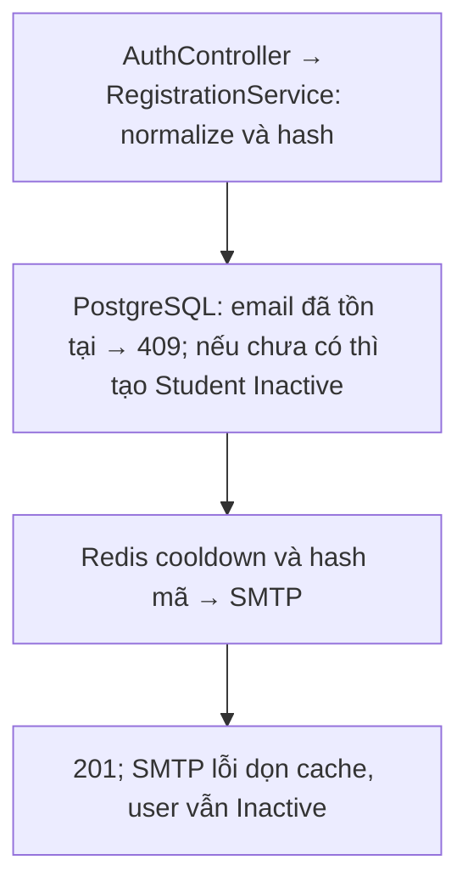

**Chức năng:** Tạo tài khoản local, luôn có role `Student`, status `Inactive`, rồi gửi mã xác thực 6 ký tự qua email.

**Request:**

```json
{
  "email": "student@example.com",
  "fullName": "Nguyen Van An",
  "phone": "0901234567",
  "password": "password123",
  "passwordConfirm": "password123"
}
```

**Response `201 Created`:**

```json
{
  "userId": "00000000-0000-0000-0000-000000000001",
  "email": "student@example.com",
  "status": "Inactive",
  "verificationCodeExpiresAt": "2026-09-04T12:15:00Z"
}
```

**Hành vi:**

1. Validate dữ liệu; chuẩn hóa email, họ tên và số điện thoại; hash mật khẩu. `fullName` là bắt buộc (tối đa 100 ký tự), `phone` là tùy chọn (tối đa 20 ký tự).
2. Nếu email đã thuộc bất kỳ tài khoản nào, kể cả `Inactive`, trả `409 An account with this email already exists.` và không gửi thêm email.
3. Ghi user mới vào PostgreSQL.
4. Chiếm cooldown (`SetIfNotExists`, 1 phút), sinh mã, lưu Redis TTL 15 phút.
5. Gửi mã qua SMTP.

Nếu SMTP lỗi: mã và cooldown bị xóa nhưng user vẫn tồn tại ở trạng thái `Inactive`. Lần đăng ký lại trả `409`; người dùng phải dùng `POST /api/auth/resend-verification` (nút **Kích hoạt tài khoản** ở frontend) để nhận mã mới.

**Dữ liệu đi qua:** PostgreSQL (`users`), Redis (`auth:email-verification*`), SMTP.

---

## `POST /api/auth/verify-email`

Luồng xử lý và dữ liệu:

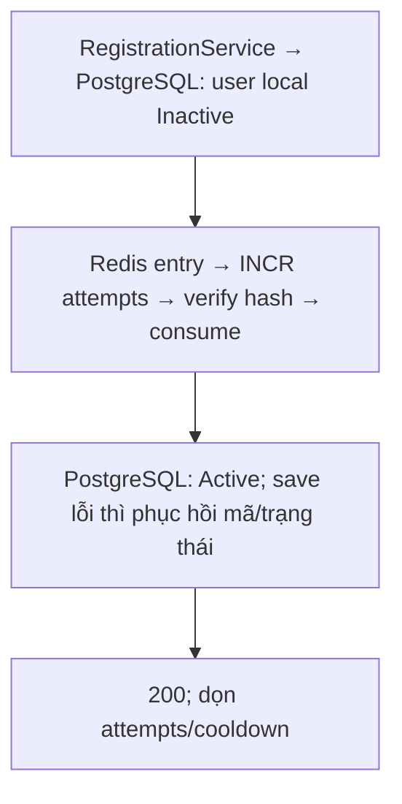

**Chức năng:** Xác thực email bằng mã, chuyển account `Inactive` → `Active`.

**Request:**

```json
{
  "email": "student@example.com",
  "verificationCode": "AB23CD"
}
```

**Response `200 OK`:**

```json
{
  "userId": "00000000-0000-0000-0000-000000000001",
  "email": "student@example.com",
  "status": "Active",
  "verifiedAt": "2026-09-04T12:01:00Z"
}
```

**Hành vi:**

- Email không tồn tại → `404`. Chỉ account `Inactive` có mật khẩu được redeem; `Active`/`Disabled`/`Banned` → `409`; account OAuth (không mật khẩu) → `409`.
- Mã lưu trong Redis dưới dạng **hash**, so khớp bằng `PasswordHasher.Verify`; mã được chuẩn hóa (trim, chữ hoa) trước khi so.
- Mỗi lần nhập tăng bộ đếm `attempts` (Redis, INCR atomic). Quá 5 lần: xóa mã và trả `409`.
- Mã sai/hết hạn/không có mã trả `400`; mã đúng được consume atomic (GET+DEL) nên chỉ dùng một lần (request thứ hai → `409 Verification code has already been used`).
- Nếu cập nhật PostgreSQL lỗi sau khi consume, mã và trạng thái được khôi phục để thử lại.

**Dữ liệu đi qua:** Redis (`auth:email-verification*`), PostgreSQL (`users`).

---

## `POST /api/auth/resend-verification`

Luồng xử lý và dữ liệu:

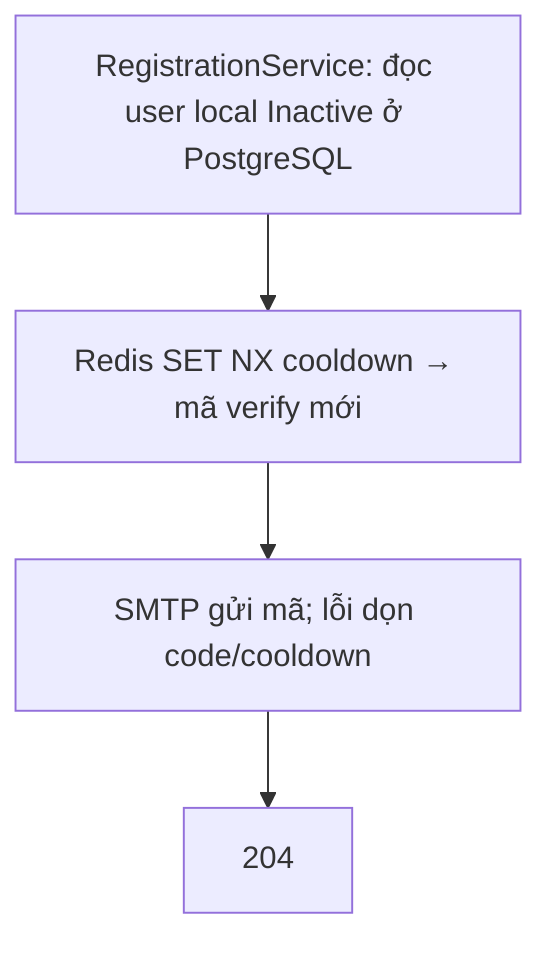

**Chức năng:** Gửi lại mã xác thực cho account local đang `Inactive`.

**Request:**

```json
{
  "email": "student@example.com"
}
```

**Response `204 No Content`** (không có body).

**Hành vi:** Email không tồn tại → `404`; account không `Inactive` hoặc là OAuth → `409`; đang trong cooldown 1 phút (`auth:email-verification-cooldown`) → `409`. Lỗi SMTP giải phóng mã/cooldown để retry ngay.

**Dữ liệu đi qua:** PostgreSQL (đọc user), Redis, SMTP.

---

## `POST /api/auth/login`

Luồng xử lý và dữ liệu:

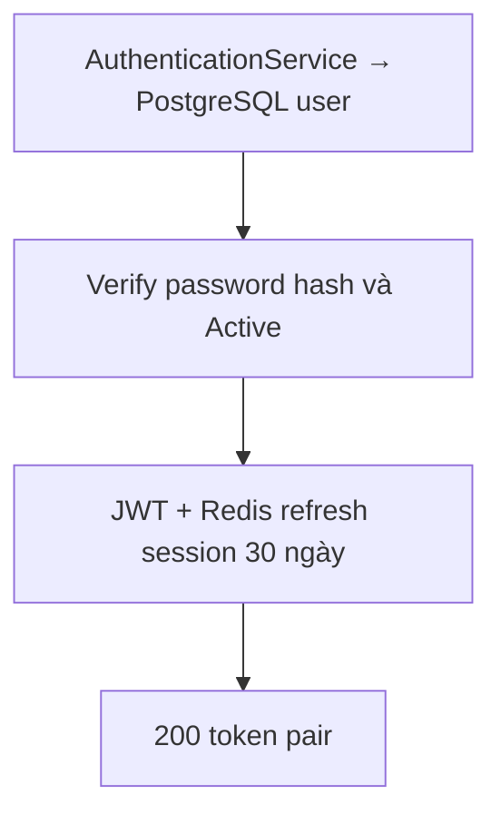

**Chức năng:** Đăng nhập local; chỉ tài khoản `Active`.

**Request:**

```json
{
  "email": "student@example.com",
  "password": "password123"
}
```

**Response `200 OK`:** Token pair (xem đầu tài liệu).

**Hành vi:** Tìm user theo email → verify hash mật khẩu → kiểm tra `Active` → tạo JWT (`NameIdentifier`, `Email`, `Role`, `auth_version`, `jti`) → sinh refresh token opaque, lưu session (kèm `authVersion`) vào Redis dưới key hash SHA-256, TTL 30 ngày.

**Dữ liệu đi qua:** PostgreSQL (`users`), Redis (`auth:refresh:*`).

---

## `POST /api/auth/refresh`

Luồng xử lý và dữ liệu:

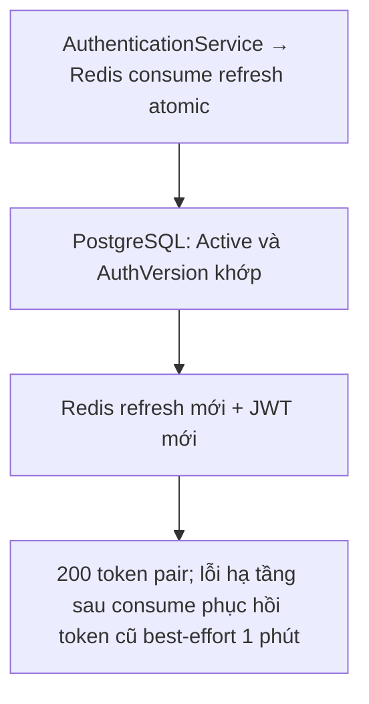

**Chức năng:** Xoay vòng token.

**Request:**

```json
{
  "refreshToken": "opaque-refresh-token"
}
```

**Response `200 OK`:**

```json
{
  "accessToken": "eyJhbGciOiJIUzI1NiIs...",
  "expiresAt": "2026-09-04T13:00:00Z",
  "refreshToken": "new-opaque-refresh-token",
  "refreshTokenExpiresAt": "2026-10-04T12:00:00Z"
}
```

**Hành vi:**

- Refresh token cũ bị consume (xóa) ngay khi dùng; token sai/hết hạn trả `401`.
- Session phải có `authVersion` bằng `users.auth_version` và user còn `Active`; không khớp trả `401`.
- Nếu lỗi hạ tầng tạm thời sau khi consume, token cũ được phục hồi trong 1 phút để retry; lỗi xác thực/trạng thái account không phục hồi.

**Dữ liệu đi qua:** Redis (`auth:refresh:*`), PostgreSQL (`users`).

---

## `POST /api/auth/forgot-password`

Luồng xử lý và dữ liệu:

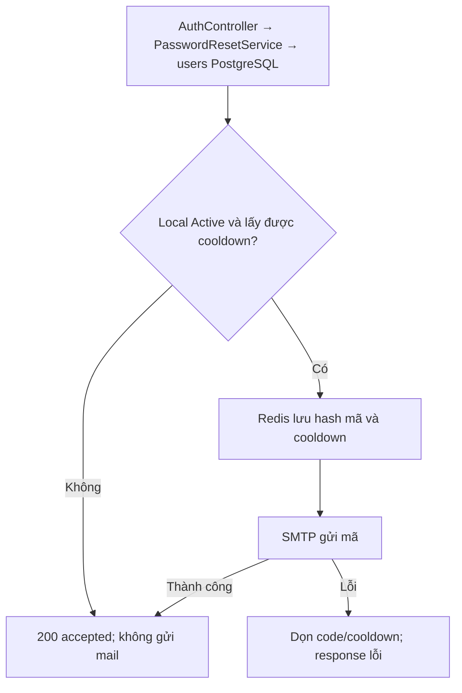

**Chức năng:** Gửi mã đặt lại mật khẩu cho tài khoản local. Không tiết lộ email có tồn tại hay không.

**Request:**

```json
{
  "email": "student@example.com"
}
```

**Response `200 OK`:**

```json
{
  "accepted": true,
  "codeExpiresAt": "2026-09-04T12:15:00Z"
}
```

**Hành vi:** Email không tồn tại, tài khoản không có mật khẩu (OAuth), không `Active`, hoặc đang trong cooldown → vẫn `200 {accepted:true}` nhưng không gửi mail. Ngược lại: cooldown 1 phút, mã (lưu dạng hash) ở Redis `auth:password-reset:{userId}` TTL 15 phút, gửi SMTP. SMTP lỗi thì xóa mã/cooldown và trả lỗi `500` để client retry.

**Dữ liệu đi qua:** PostgreSQL (đọc user), Redis (`auth:password-reset*`), SMTP.

---

## `POST /api/auth/reset-password`

Luồng xử lý và dữ liệu:

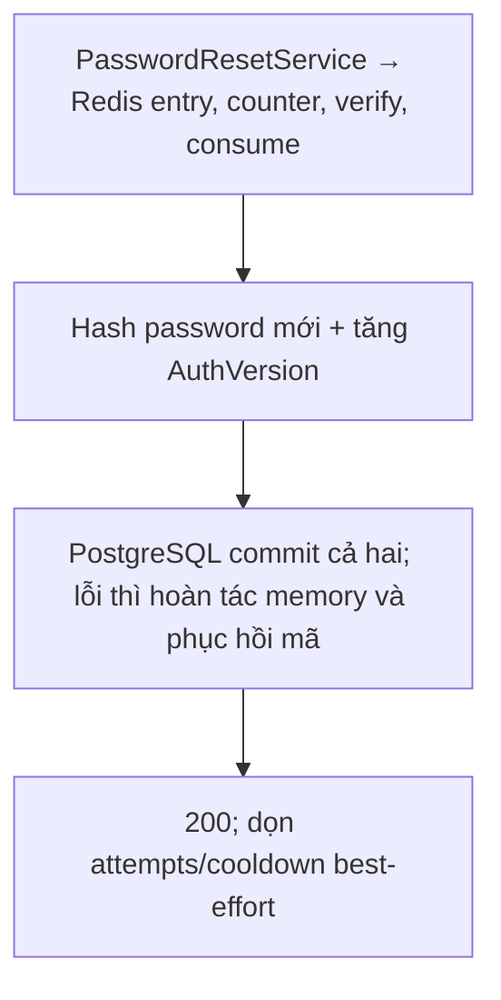

**Chức năng:** Đặt mật khẩu mới bằng mã. Chỉ tài khoản local.

**Request:**

```json
{
  "email": "student@example.com",
  "resetCode": "AB23CD",
  "newPassword": "newPassword123",
  "passwordConfirm": "newPassword123"
}
```

**Response `200 OK`:**

```json
{
  "userId": "00000000-0000-0000-0000-000000000001",
  "email": "student@example.com",
  "status": "Active",
  "resetAt": "2026-09-04T12:05:00Z"
}
```

**Hành vi:**

- Email không tồn tại hoặc không có mã → `400 Reset code is invalid or expired.`; tài khoản OAuth → `409`.
- Bộ đếm tăng mỗi lần kiểm tra sau khi tìm thấy entry, kể cả lần nhập đúng; lần thứ 6 xóa mã và trả `409`. TTL bộ đếm tính từ lần tăng đầu tiên; gửi mã reset mới không xóa bộ đếm cũ. Mã consume atomic.
- Hash mật khẩu mới và tăng `AuthVersion` được commit atomic trong PostgreSQL → mọi access/refresh token cũ bị từ chối.
- Nếu cập nhật PostgreSQL lỗi, password hash/version cũ và mã reset được khôi phục. Lỗi dọn attempts/cooldown sau commit không làm response thất bại.

**Dữ liệu đi qua:** Redis (`auth:password-reset*`), PostgreSQL (`users`).

---

## Google OAuth

Luồng đăng nhập:

```text
Frontend → GET authorize → backend tạo state + PKCE, lưu Redis, đặt cookie __Host-LMS.OAuth.{state}
Frontend → redirect tới authorizationUrl (Google)
Google   → GET callback?code&state → backend consume state, đổi code lấy user info
Backend  → redirect {ClientCallbackUri}?loginCode=... (hoặc JSON nếu chưa cấu hình)
Frontend → POST /api/auth/login-code → token pair
```

### `GET /api/auth/oauth/Google/authorize`

Luồng xử lý và dữ liệu:

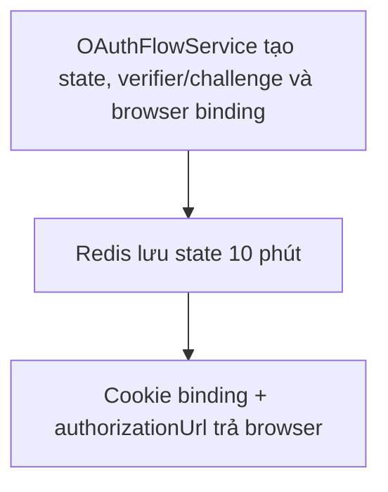

**Quyền:** Public. **Không có body.**

**Response `200 OK`:**

```json
{
  "authorizationUrl": "https://accounts.google.com/o/oauth2/v2/auth?..."
}
```

Gọi bằng trình duyệt có cookie (`credentials`) rồi điều hướng tới `authorizationUrl`. State TTL 10 phút, dùng một lần, gắn với cookie của trình duyệt khởi tạo.

### `GET /api/auth/oauth/Google/link/authorize`

Luồng xử lý và dữ liệu:

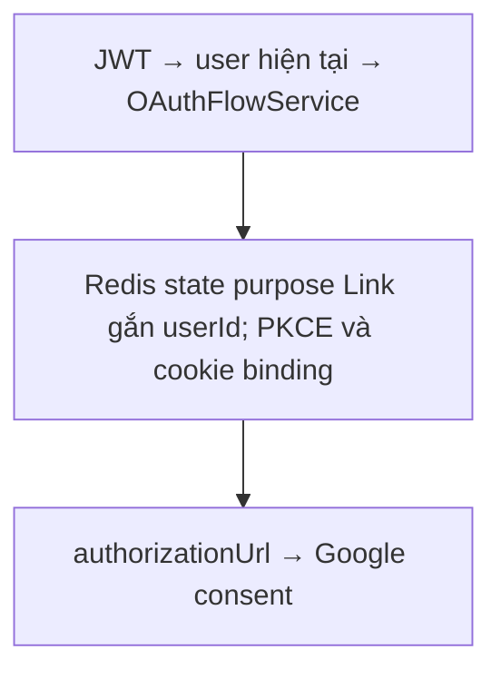

**Quyền:** Đã đăng nhập. Liên kết Google với **chính tài khoản trong JWT** (client không truyền userId). State có mục đích `Link` và không dùng lẫn với state `Login`.

**Response `200 OK`:** cùng dạng `{ "authorizationUrl": "..." }`.

### `GET /api/auth/oauth/Google/callback?code={code}&state={state}`

Luồng xử lý và dữ liệu:

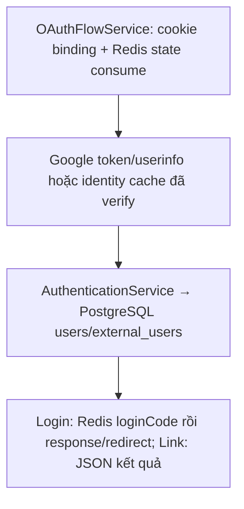

**Quyền:** Public nhưng yêu cầu state hợp lệ, PKCE verifier và cookie binding.

- State `Login` + đã cấu hình `OAuth:Google:ClientCallbackUri`: **redirect** tới frontend kèm `loginCode` trong query.
- State `Login` + chưa cấu hình: `200 OK`

```json
{
  "loginCode": "opaque-one-time-code",
  "expiresAt": "2026-09-04T12:02:00Z"
}
```

- State `Link`: `200 OK`

```json
{
  "userId": "00000000-0000-0000-0000-000000000001",
  "provider": "Google",
  "externalEmail": "student@gmail.com"
}
```

**Hành vi:** Callback không trả access/refresh token. Với state `Login`:

- Đã có liên kết Google → dùng user đó.
- Email Google trùng tài khoản local `Active` chưa có Google → **tự động liên kết** vào tài khoản đó. Nếu tài khoản đã liên kết một Google khác → `409`; không `Active` → `401`.
- Email chưa tồn tại → tạo user `Student`, `Active`, không có mật khẩu.
- Google phải trả `emailVerified = true`, nếu không → `401`.

Với state `Link`: Google đã thuộc user khác → `409`; user đã có Google → `409`. Một identity chỉ thuộc một tài khoản; mỗi tài khoản một identity cho mỗi provider.

**Dữ liệu đi qua:** Redis (`auth:oauth-state`, `auth:oauth-identity`, `auth:oauth-login-code`), HTTP tới Google, PostgreSQL (`users`, `external_users`).

### `POST /api/auth/login-code`

Luồng xử lý và dữ liệu:

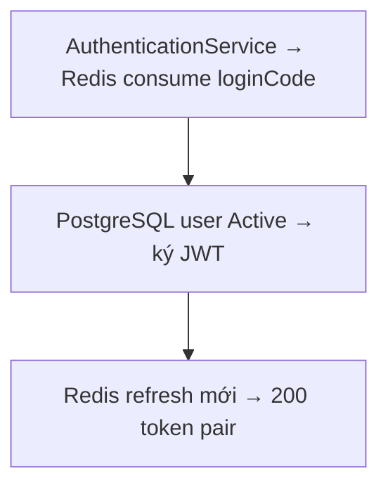

**Chức năng:** Đổi login code lấy token pair.

**Request:**

```json
{
  "loginCode": "opaque-one-time-code"
}
```

**Response `200 OK`:** Token pair.

**Hành vi:** Code lưu theo hash SHA-256, TTL 2 phút, consume atomic (chỉ một request đồng thời thành công). Code sai/hết hạn/đã dùng → `401`. Lỗi hạ tầng tạm thời sau consume được phục hồi 1 phút.

**Dữ liệu đi qua:** Redis (`auth:oauth-login-code:*`, `auth:refresh:*`), PostgreSQL (`users`).

---

## Contract nội bộ `IOAuthProvider`

Luồng xử lý và dữ liệu:

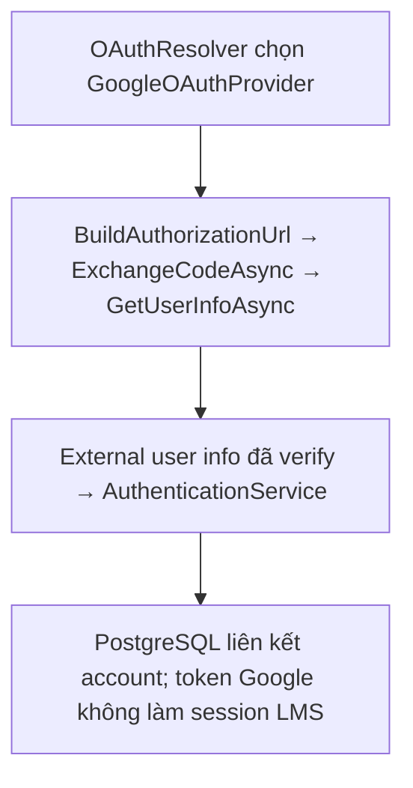

Frontend không gọi trực tiếp. Interface chuẩn hóa provider: `BuildAuthorizationUrl(OAuthAuthorizationRequest)` (redirectUri, state, codeChallenge), `ExchangeCodeAsync(code, redirectUri, codeVerifier, cancellationToken)` trả token provider, `GetUserInfoAsync(token, cancellationToken)` trả:

```json
{
  "providerUserId": "provider-user-id",
  "email": "user@example.com",
  "fullName": "User",
  "avatarUrl": "https://example.com/avatar.jpg",
  "emailVerified": true
}
```

Hiện chỉ có `GoogleOAuthProvider`.

## Phân biệt backend và BFF

Luồng xử lý và dữ liệu:

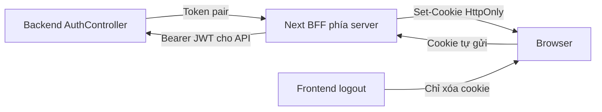

Backend trả cặp token, còn các route cùng tên trên Next.js chỉ đặt cookie HttpOnly và trả thời hạn. Backend không có endpoint logout/revoke một refresh token; `POST /api/auth/logout` của frontend chỉ xóa cookie trình duyệt. Với giao diện BFF hiện tại, callback Google phải về cùng host frontend: `http://localhost:3000/api/backend/auth/oauth/Google/callback` ở local, HTTPS tương ứng ở production. Không dùng callback khác host với nơi nhận cookie binding. Xem [../setup.md](../setup.md) và [../tools-and-integrations.md](../tools-and-integrations.md).
