# API – Chat (REST + SignalR)

Đối chiếu mã nguồn ngày **2026-10-13**. Mô tả implementation trong repository, không phải xác nhận môi trường production.

Base path: `/api/chat`, hub `/hubs/chat`. Cần JWT. Dữ liệu đi qua PostgreSQL (`chat_rooms`, `chat_participants`, `chat_messages`, `chat_attachments`), Storage (file đính kèm), SignalR (broadcast realtime). Chat không dùng Redis.

Quyền truy cập được kiểm tra lại ở service **mỗi lần** gọi REST/SignalR (không dựa vào `ChatParticipant` cũ):

- Course room: teacher hiện tại của course, Admin/System, hoặc student có enrollment `Accepted`.
- Direct room: hai participant của room.
- Room không còn quyền sẽ biến mất khỏi `GET /api/chat/rooms`.

Vòng đời course room: archive khi course `Closed` hoặc bị xóa mềm; mở lại khi course về `Open` hoặc khôi phục ở `Open`. Room archived vẫn đọc được nhưng không nhận/sửa message và không join được; course đã xóa không truy cập được.

| Method | Path | Chức năng |
| --- | --- | --- |
| POST | `/api/chat/realtime-token` | Cấp JWT ngắn hạn cho SignalR |
| GET | `/api/chat/rooms` | Danh sách room có quyền truy cập |
| POST | `/api/chat/courses/{courseId}` | Lấy/tạo course room |
| POST | `/api/chat/direct/{userId}` | Lấy/tạo direct room |
| POST | `/api/chat/rooms/{roomId}/join` | Kiểm tra quyền và lấy thông tin room |
| DELETE | `/api/chat/rooms/{roomId}` | Xóa direct conversation khỏi tài khoản hiện tại |
| GET | `/api/chat/rooms/{roomId}/messages` | Lịch sử tin nhắn |
| POST | `/api/chat/rooms/{roomId}/messages` | Gửi tin nhắn text |
| POST | `/api/chat/rooms/{roomId}/messages/attachment` | Gửi tin nhắn kèm file |
| GET | `/api/chat/messages/{messageId}/attachments/{attachmentId}/content` | Tải file đính kèm |
| PATCH | `/api/chat/messages/{messageId}` | Sửa tin nhắn |
| DELETE | `/api/chat/messages/{messageId}` | Xóa tin nhắn |
| POST | `/api/chat/rooms/{roomId}/read/{messageId}` | Đánh dấu đã đọc |

## Object

Luồng xử lý và dữ liệu:

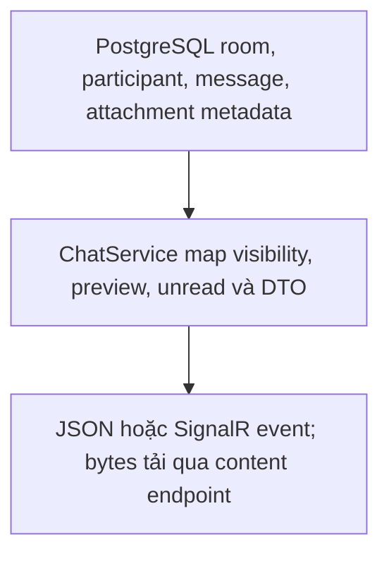

Chat room:

```json
{
  "id": "00000000-0000-0000-0000-000000000030",
  "type": "Course",
  "courseId": "00000000-0000-0000-0000-000000000003",
  "participantIds": [
    "00000000-0000-0000-0000-000000000001"
  ],
  "createdAt": "2026-09-04T10:00:00Z",
  "archivedAt": null,
  "title": "C# Basics",
  "directParticipantName": null,
  "directParticipantEmail": null,
  "hasUnread": false,
  "latestMessage": {
    "id": "00000000-0000-0000-0000-000000000031",
    "senderId": "00000000-0000-0000-0000-000000000001",
    "content": "Hello",
    "createdAt": "2026-09-04T10:00:00Z",
    "hasAttachments": false
  }
}
```

`type` là `"Course"` hoặc `"DirectMessage"`. `title` là tên course (course room); `directParticipantName`/`directParticipantEmail` chỉ dùng cho direct room; `latestMessage` có thể `null`. Các trường này có thể `null` ở response chỉ trả thông tin cơ bản (ví dụ khi tạo room).

Chat message:

```json
{
  "id": "00000000-0000-0000-0000-000000000031",
  "chatRoomId": "00000000-0000-0000-0000-000000000030",
  "senderId": "00000000-0000-0000-0000-000000000001",
  "senderFullName": "Student Name",
  "senderRole": "Student",
  "content": "Hello",
  "replyToMessageId": null,
  "createdAt": "2026-09-04T10:00:00Z",
  "editedAt": null,
  "deletedAt": null,
  "attachments": [
    {
      "id": "00000000-0000-0000-0000-000000000032",
      "fileName": "notes.pdf",
      "contentType": "application/pdf",
      "fileSize": 12345
    }
  ]
}
```

Attachment không lộ `objectKey`; dùng endpoint `content`.

## `POST /api/chat/realtime-token`

Luồng xử lý và dữ liệu:

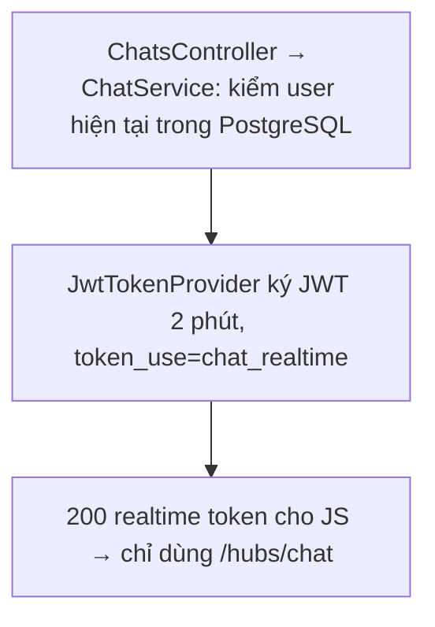

**Không có body.** Cấp JWT sống 2 phút, claim `token_use=chat_realtime`, vẫn mang `auth_version` (bị từ chối ở lần xác thực HTTP tiếp theo khi tài khoản khóa/đổi role/thu hồi session). Chỉ hợp lệ trên `/hubs/chat`; dùng cho REST trả `401`. Connection đã mở không tra lại AuthVersion mỗi event; xem giới hạn realtime cuối trang.

**Response `200 OK`:**

```json
{
  "accessToken": "short-lived-chat-jwt",
  "expiresAt": "2026-10-09T10:02:00Z"
}
```

## `GET /api/chat/rooms`

Luồng xử lý và dữ liệu:

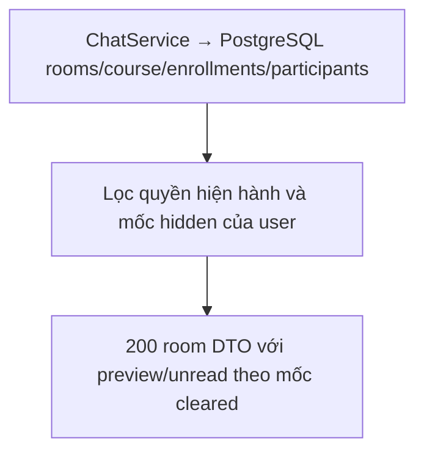

**Response `200 OK`:** Mảng Chat room object mà user còn quyền.

## `POST /api/chat/courses/{courseId}`

Luồng xử lý và dữ liệu:

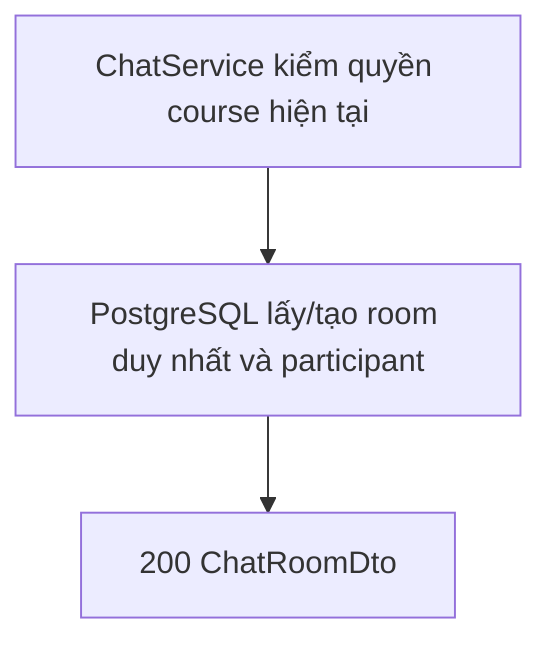

**Không có body.** Lấy hoặc tạo course room (một room dùng chung mỗi course), thêm student/teacher hiện tại làm participant. **Response `200 OK`:** Chat room object.

## `POST /api/chat/direct/{userId}`

Luồng xử lý và dữ liệu:

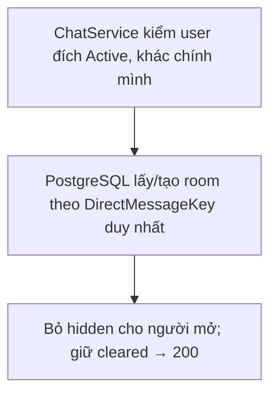

**Không có body.** Lấy hoặc tạo direct room với user đang `Active`; không chat với chính mình. **Response `200 OK`:** Chat room object.

## `POST /api/chat/rooms/{roomId}/join`

Luồng xử lý và dữ liệu:

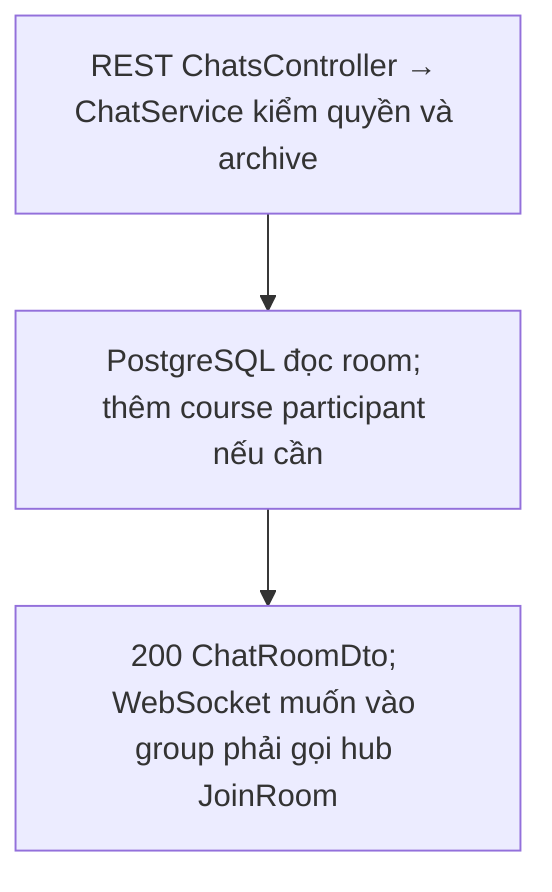

**Không có body.** Kiểm tra quyền, `409` nếu room archived. **Response `200 OK`:** Chat room object (course room kèm `title`).

## `DELETE /api/chat/rooms/{roomId}`

Luồng xử lý và dữ liệu:

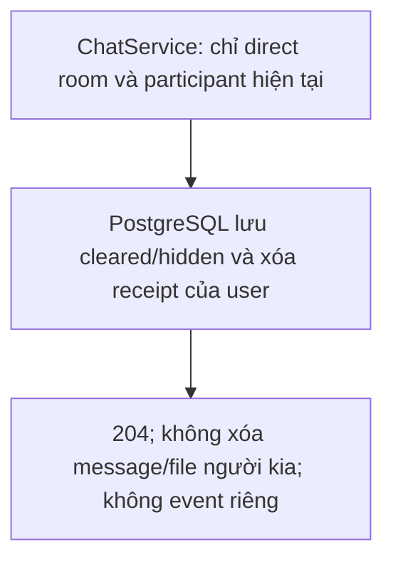

Chỉ áp dụng cho direct conversation và chỉ xóa đối với tài khoản hiện tại. Room biến khỏi danh sách, lịch sử trước thời điểm xóa không còn đọc hoặc tải attachment được; participant còn lại không bị ảnh hưởng. Khi có tin nhắn mới hoặc user chủ động mở lại direct conversation, room xuất hiện lại nhưng lịch sử cũ vẫn ẩn. Course room trả `400`. **Response `204 No Content`.**

## `GET /api/chat/rooms/{roomId}/messages?page=1&pageSize=20`

Luồng xử lý và dữ liệu:

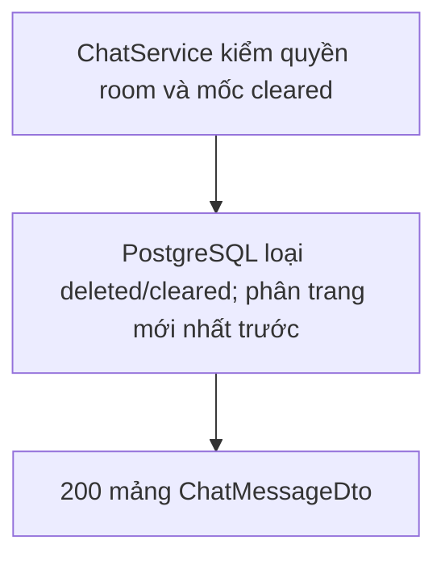

**Response `200 OK`:** Mảng Chat message, mới nhất trước (không phải PagedResult). Tăng `page` để tải lịch sử cũ hơn. Message đã xóa (và attachment của nó), hoặc lịch sử direct conversation mà participant đã xóa, bị loại.

## `POST /api/chat/rooms/{roomId}/messages`

Luồng xử lý và dữ liệu:

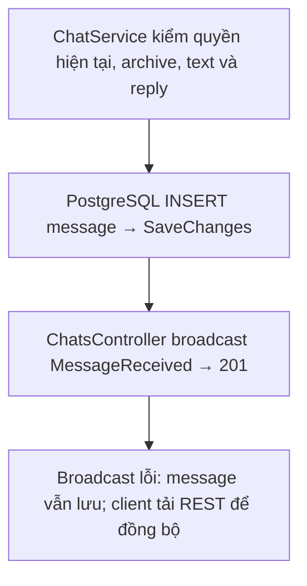

**Request:**

```json
{
  "content": "Hello",
  "replyToMessageId": null
}
```

`content` bắt buộc có nội dung, tối đa 4000 ký tự (cũng áp dụng khi sửa). `replyToMessageId` nếu có phải thuộc cùng room và chưa xóa. Room archived trả `409`.

**Hành vi:** Lưu PostgreSQL → broadcast `MessageReceived` tới group `chat-room:{roomId:N}` (GUID không dấu gạch). **Response `201 Created`:** Chat message.

## `POST /api/chat/rooms/{roomId}/messages/attachment`

Luồng xử lý và dữ liệu:

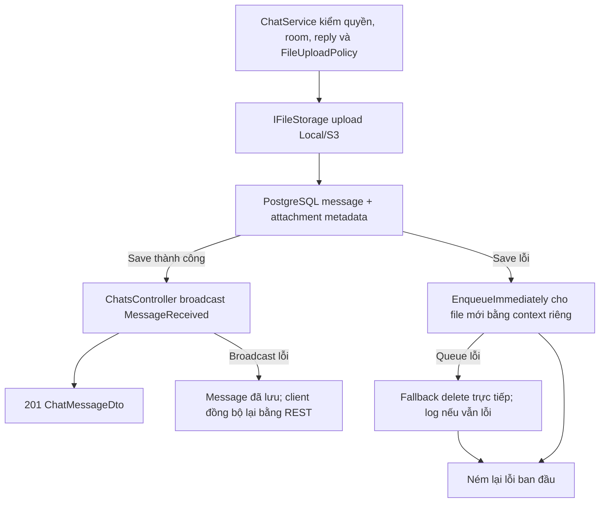

**Request:** `multipart/form-data`:

| Field | Bắt buộc | Ghi chú |
| --- | --- | --- |
| `file` | Có | < 20 MB |
| `content` | Không | Text kèm theo |
| `replyToMessageId` | Không | UUID |

**Hành vi:** Lưu file vào Storage, metadata vào PostgreSQL, broadcast `MessageReceived`. **Response `201 Created`:** Chat message có `attachments`.

## `GET /api/chat/messages/{messageId}/attachments/{attachmentId}/content?download=false`

Luồng xử lý và dữ liệu:

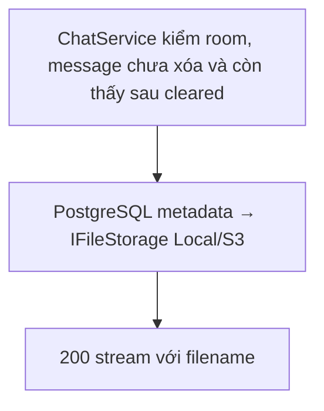

Chỉ user còn quyền vào room và còn thấy message sau mốc cleared của mình. Message đã xóa trả `404`. **Response `200 OK`:** Binary stream, filename trong Content-Disposition kể cả `download=false`.

## `PATCH /api/chat/messages/{messageId}`

Luồng xử lý và dữ liệu:

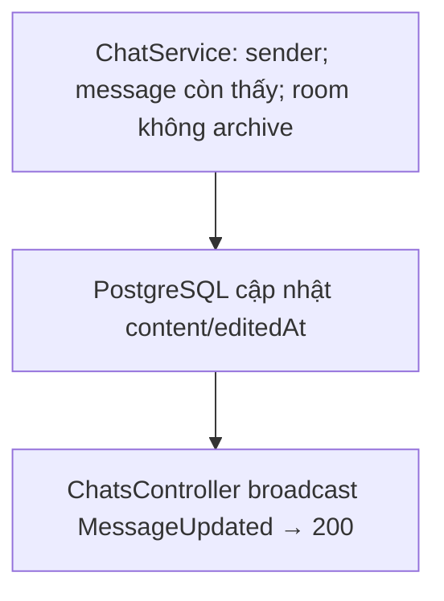

**Request:**

```json
{
  "content": "Updated message"
}
```

Chỉ sender sửa được; message đã xóa hoặc room archived thì không. Broadcast `MessageUpdated`. **Response `200 OK`:** Chat message.

## `DELETE /api/chat/messages/{messageId}`

Luồng xử lý và dữ liệu:

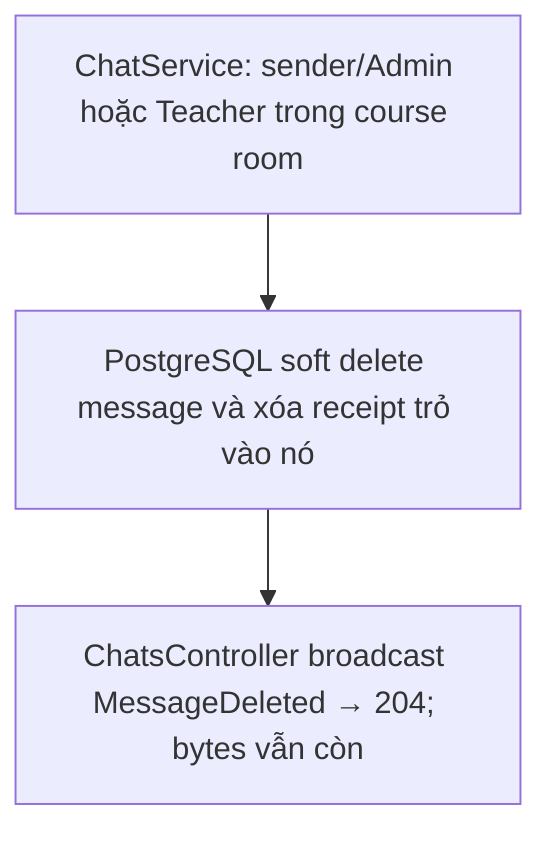

Sender, Admin, hoặc Teacher trong **course** room được xóa. Xóa mềm (`deletedAt`), file đính kèm trong storage không bị xóa. Message biến khỏi danh sách; read receipt đang trỏ tới message đó bị xóa. Broadcast `MessageDeleted`. **Response `204 No Content`.**

## `POST /api/chat/rooms/{roomId}/read/{messageId}`

Luồng xử lý và dữ liệu:

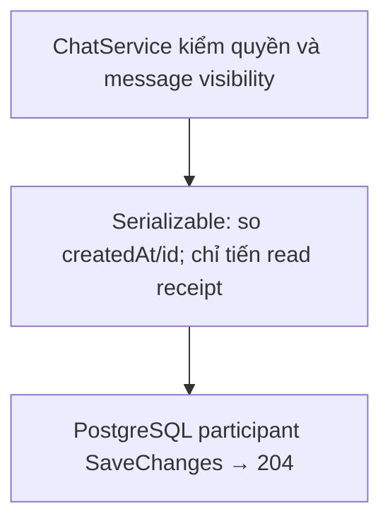

**Không có body.** Đánh dấu participant đã đọc tới message (chưa xóa). Receipt chỉ tiến theo `(createdAt, id)`; request cũ đến muộn bị bỏ qua. **Response `204 No Content`.**

## SignalR `/hubs/chat`

Luồng xử lý và dữ liệu:

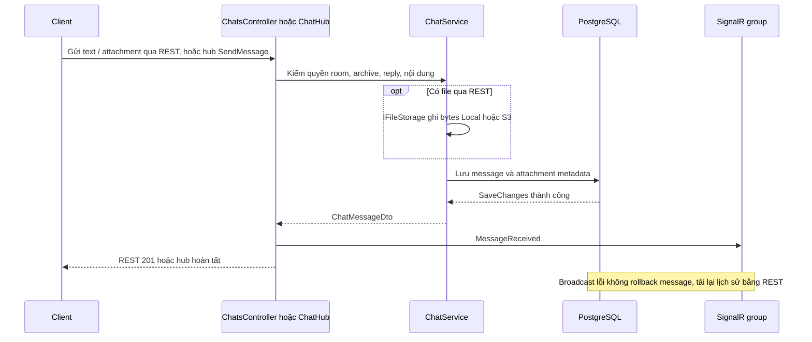

**Xác thực:** lấy JWT từ `POST /api/chat/realtime-token`. Native client gửi `Authorization: Bearer`; trình duyệt dùng `accessTokenFactory` (token đi qua query `access_token`, chỉ được nhận ở `/hubs/chat`). Hub `CloseOnAuthenticationExpiration`: connection bị đóng khi token hết hạn → client lấy token mới và reconnect.

**Phương thức client gọi:**

| Method | Tham số | Hành vi |
| --- | --- | --- |
| `JoinRoom` | `roomId: Guid` | Kiểm tra quyền (room archived thì từ chối), thêm connection vào group `chat-room:{roomId:N}` |
| `LeaveRoom` | `roomId: Guid` | Rời group |
| `SendMessage` | `roomId: Guid`, `request: { content, replyToMessageId }` | Lưu message rồi broadcast `MessageReceived` |

**Sự kiện server phát:**

| Event | Payload |
| --- | --- |
| `MessageReceived` | Chat message (text hoặc attachment mới) |
| `MessageUpdated` | Chat message sau khi sửa |
| `MessageDeleted` | ID message đã xóa |

Quyền room được kiểm tra lại khi `JoinRoom` và `SendMessage`; sau reconnect frontend gọi JoinRoom lại. Tuy nhiên broadcast tới group không kiểm tra lại từng người nhận và chưa tự đẩy connection cũ khỏi group khi revoke enrollment. `OnTokenValidated` kiểm tra AuthVersion khi xác thực kết nối HTTP, không phải mỗi event gửi ra trên connection đang mở. Không suy diễn việc thu hồi token là ngắt ngay mọi WebSocket; xem [../review-findings.md](../review-findings.md).

```javascript
const connection = new signalR.HubConnectionBuilder()
  .withUrl("/hubs/chat", { accessTokenFactory: () => accessToken })
  .withAutomaticReconnect()
  .build();
```

**Khuyến nghị client:** tải lịch sử bằng REST → `JoinRoom` → lắng nghe 3 event. Khi reconnect: lấy token mới, `JoinRoom` lại và đồng bộ lại trang lịch sử gần nhất để bù event bị lỡ. Origin frontend phải nằm chính xác trong `Cors:AllowedOrigins` (không dùng wildcard với SignalR có credentials).
