# Tham chiếu DTO, request và enum

Đối chiếu ngày 2026-10-13, trích khai báo hiện có (không phải OpenAPI sinh từ runtime). Các record phía dưới giữ tên C#; JSON của controller là camelCase, enum dạng chuỗi. `?` biểu thị nullable, `= ...` là default khai báo; validation nghiệp vụ vẫn nằm trong service. Tham số scalar không có `[FromBody]` thường nằm ở route/query; xem tài liệu endpoint để gọi đúng. Các OAuth/cache contract nội bộ không tự trở thành HTTP endpoint.

## IFileStorage.cs — contract nội bộ của storage

Vai trò của nhóm contract trong luồng dữ liệu (tên và trường đầy đủ giữ ở khai báo bên dưới):

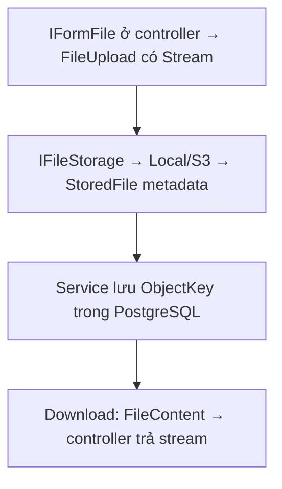

Nguồn: [IFileStorage.cs](../../LMS.Api/application/abstractions/storage/IFileStorage.cs). `Stream` là đối tượng trong tiến trình, không phải trường JSON trên wire; controller nhận `IFormFile` và trả file content qua HTTP.

```csharp
public sealed record FileUpload(
    string FileName,
    string ContentType,
    long Length,
    Stream Content);

public sealed record StoredFile(
    string FileName,
    string ObjectKey,
    string ContentType,
    long FileSize);

public sealed record FileContent(
    Stream Content,
    string FileName,
    string ContentType);
```

## PagedResult.cs

Vai trò của nhóm contract trong luồng dữ liệu (tên và trường đầy đủ giữ ở khai báo bên dưới):

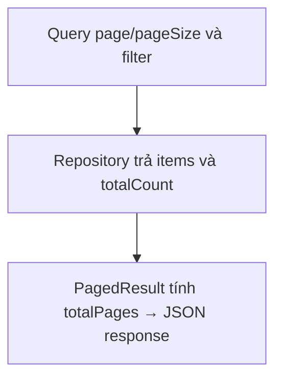

Nguồn: [PagedResult.cs](<../../LMS.Api/application/common/PagedResult.cs>).

```csharp
public sealed record PagedResult<T>(
    IReadOnlyList<T> Items,
    int Page,
    int PageSize,
    int TotalCount)
{
    public int TotalPages => TotalCount == 0
        ? 0
        : (int)Math.Ceiling(TotalCount / (double)PageSize);
}
```

## AuthenticationContracts.cs

Vai trò của nhóm contract trong luồng dữ liệu (tên và trường đầy đủ giữ ở khai báo bên dưới):

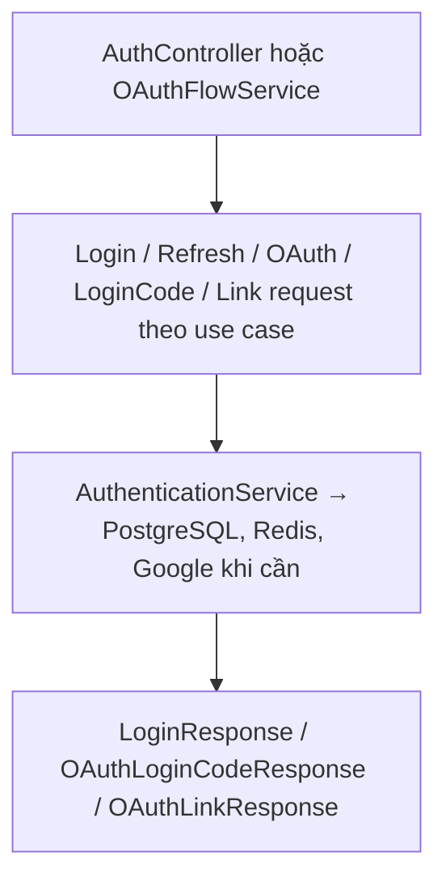

Nguồn: [AuthenticationContracts.cs](<../../LMS.Api/application/features/auth/AuthenticationContracts.cs>).

```csharp
public sealed record LoginRequest(string Email, string Password);

public sealed record LoginResponse(string AccessToken, DateTime ExpiresAt, string RefreshToken, DateTime RefreshTokenExpiresAt);

public sealed record RefreshTokenRequest(string RefreshToken);

public sealed record OAuthLoginRequest(string Provider, string Code, string RedirectUri, string CodeVerifier);

public sealed record OAuthLoginCodeRequest(string LoginCode);

public sealed record OAuthLoginCodeResponse(string LoginCode, DateTime ExpiresAt);

public sealed record OAuthLinkRequest(Guid UserId, string Provider, string Code, string RedirectUri, string CodeVerifier);

public sealed record OAuthLinkResponse(Guid UserId, string Provider, string ExternalEmail);
```

## OAuthFlowContracts.cs

Vai trò của nhóm contract trong luồng dữ liệu (tên và trường đầy đủ giữ ở khai báo bên dưới):

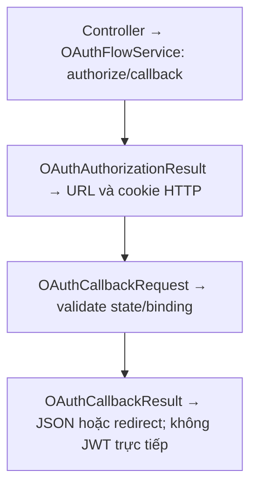

Nguồn: [OAuthFlowContracts.cs](<../../LMS.Api/application/features/auth/OAuthFlowContracts.cs>).

```csharp
public sealed record OAuthAuthorizationResult(
    string AuthorizationUrl,
    string State,
    string BrowserBinding,
    TimeSpan Lifetime);

public sealed record OAuthCallbackRequest(
    string Provider,
    string Code,
    string State,
    string? BrowserBinding);

public sealed record OAuthCallbackResult(object Payload);
```

## ChatContracts.cs

Vai trò của nhóm contract trong luồng dữ liệu (tên và trường đầy đủ giữ ở khai báo bên dưới):

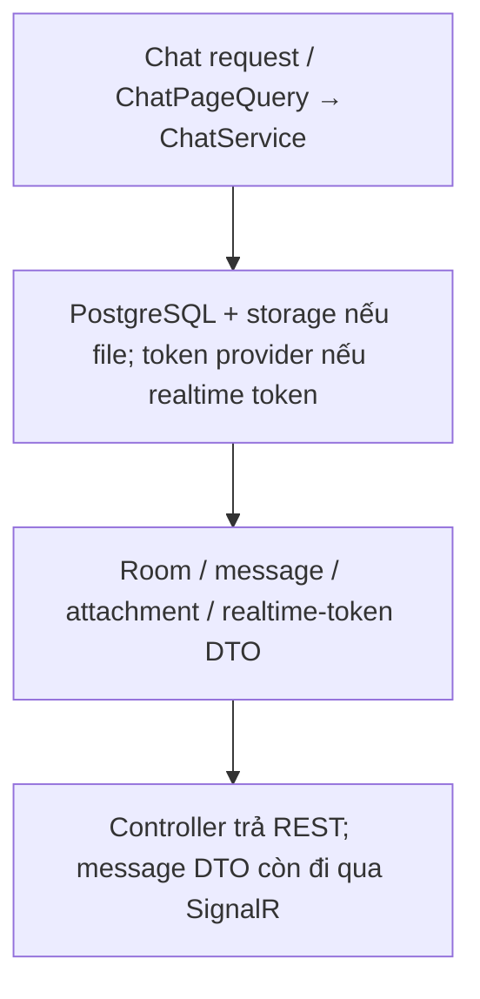

Nguồn: [ChatContracts.cs](<../../LMS.Api/application/features/chats/ChatContracts.cs>).

```csharp
public sealed record ChatRoomDto(
    Guid Id,
    string Type,
    Guid? CourseId,
    Guid[] ParticipantIds,
    DateTime CreatedAt,
    DateTime? ArchivedAt,
    string? Title = null,
    string? DirectParticipantName = null,
    string? DirectParticipantEmail = null,
    bool HasUnread = false,
    ChatRoomLatestMessageDto? LatestMessage = null);

public sealed record ChatRoomLatestMessageDto(Guid Id, Guid SenderId, string? Content, DateTime CreatedAt, bool HasAttachments);

public sealed record ChatAttachmentDto(Guid Id, string FileName, string ContentType, long FileSize);

public sealed record ChatMessageDto(Guid Id, Guid ChatRoomId, Guid SenderId, string? SenderFullName, string? SenderRole, string? Content, Guid? ReplyToMessageId, DateTime CreatedAt, DateTime? EditedAt, DateTime? DeletedAt, IReadOnlyList<ChatAttachmentDto> Attachments);

public sealed record SendChatMessageRequest(string? Content, Guid? ReplyToMessageId);

public sealed record EditChatMessageRequest(string? Content);

public sealed record ChatPageQuery(int Page = 1, int PageSize = 20);

public sealed record ChatRealtimeTokenDto(string AccessToken, DateTime ExpiresAt);
```

## ExerciseContracts.cs

Vai trò của nhóm contract trong luồng dữ liệu (tên và trường đầy đủ giữ ở khai báo bên dưới):

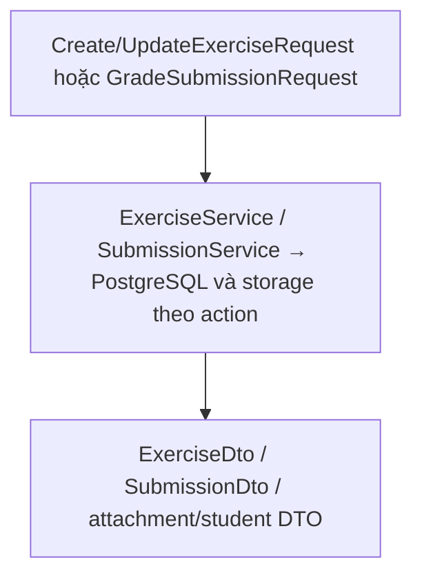

Nguồn: [ExerciseContracts.cs](<../../LMS.Api/application/features/coursecontents/ExerciseContracts.cs>).

```csharp
public sealed record CreateExerciseRequest(string Title, string? Description, DateTime? DueAt);

public sealed record UpdateExerciseRequest(string Title, string? Description, DateTime? DueAt);

public sealed record FileAttachmentDto(
    Guid Id,
    string FileName,
    string ObjectKey,
    string ContentType,
    long FileSize);

public sealed record SubmissionStudentDto(
    Guid Id,
    string FullName,
    string Email);

public sealed record ExerciseDto(
    Guid Id,
    Guid CourseId,
    string Title,
    string? Description,
    DateTime? DueAt,
    ExerciseStatus Status,
    FileAttachmentDto? Attachment,
    DateTime CreatedAt,
    DateTime ModifiedAt);

public sealed record SubmissionDto(
    Guid Id,
    Guid ExerciseId,
    Guid StudentId,
    SubmissionStudentDto? Student,
    SubmissionStatus Status,
    DateTime? SubmittedAt,
    decimal? Grade,
    string? Feedback,
    DateTime? GradedAt,
    Guid? GradedById,
    FileAttachmentDto? Attachment,
    DateTime CreatedAt,
    DateTime ModifiedAt);

public sealed record SubmissionQuery(int Page = 1, int PageSize = 20);

public sealed record GradeSubmissionRequest(decimal Grade, string? Feedback);
```

## LessonContracts.cs

Vai trò của nhóm contract trong luồng dữ liệu (tên và trường đầy đủ giữ ở khai báo bên dưới):

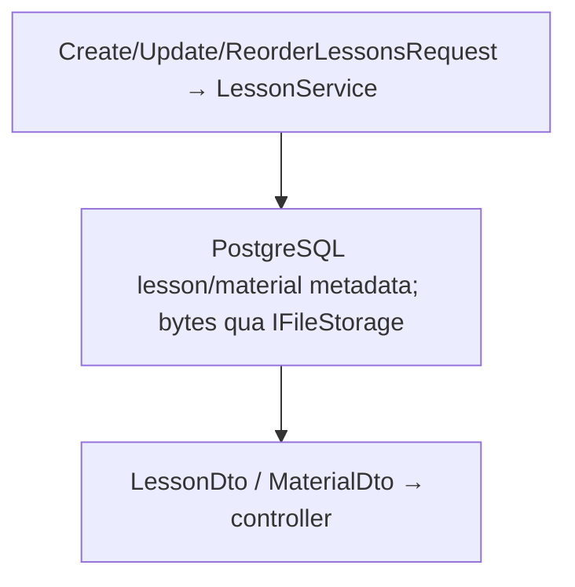

Nguồn: [LessonContracts.cs](<../../LMS.Api/application/features/coursecontents/LessonContracts.cs>).

```csharp
public sealed record CreateLessonRequest(
    string Name,
    string? Content,
    int Order,
    LessonStatus Status = LessonStatus.Draft);

public sealed record UpdateLessonRequest(
    string Name,
    string? Content,
    int Order,
    LessonStatus Status);

public sealed record ReorderLessonsRequest(
    IReadOnlyList<Guid> LessonIds);

public sealed record LessonDto(
    Guid Id,
    Guid CourseId,
    string Name,
    string? Content,
    int Order,
    LessonStatus Status,
    DateTime CreatedAt,
    DateTime ModifiedAt);

public sealed record MaterialDto(
    Guid Id,
    Guid LessonId,
    string FileName,
    string ObjectKey,
    string ContentType,
    long FileSize,
    DateTime CreatedAt,
    DateTime ModifiedAt);
```

## CourseContracts.cs

Vai trò của nhóm contract trong luồng dữ liệu (tên và trường đầy đủ giữ ở khai báo bên dưới):

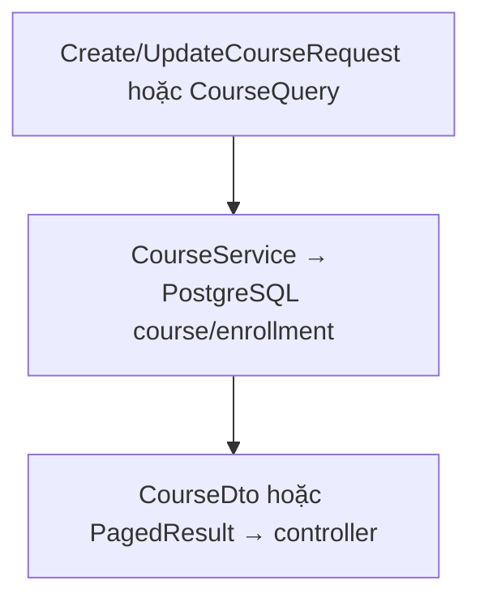

Nguồn: [CourseContracts.cs](<../../LMS.Api/application/features/courses/CourseContracts.cs>).

```csharp
public sealed record CreateCourseRequest(
    string Name,
    string? Description,
    Guid TeacherId,
    int MaxStudents,
    CourseStatus Status = CourseStatus.Open);

public sealed record UpdateCourseRequest(
    string Name,
    string? Description,
    int MaxStudents,
    CourseStatus Status);

public sealed record CourseQuery(
    string? Search = null,
    CourseStatus? Status = null,
    Guid? TeacherId = null,
    bool IncludeDeleted = false,
    int Page = 1,
    int PageSize = 20);

public sealed record CourseDto(
    Guid Id,
    string Name,
    string? Description,
    Guid TeacherId,
    int MaxStudents,
    int AcceptedStudentCount,
    CourseStatus Status,
    DateTime CreatedAt,
    DateTime ModifiedAt,
    DateTime? DeletedAt);
```

## EnrollmentContracts.cs

Vai trò của nhóm contract trong luồng dữ liệu (tên và trường đầy đủ giữ ở khai báo bên dưới):

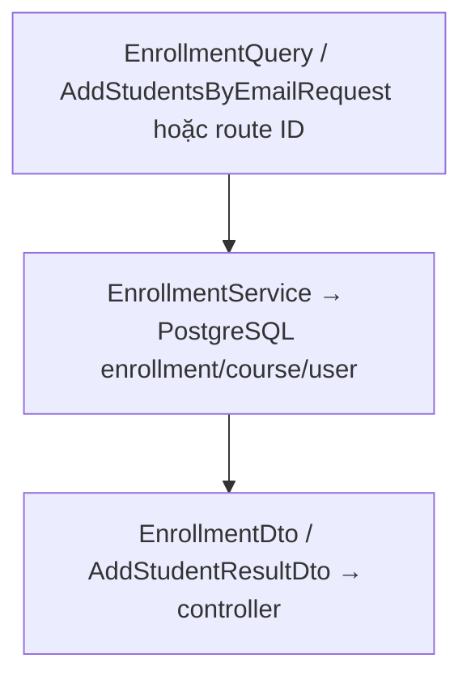

Nguồn: [EnrollmentContracts.cs](<../../LMS.Api/application/features/enrollments/EnrollmentContracts.cs>).

```csharp
public sealed record EnrollmentQuery(int Page = 1, int PageSize = 20);

public sealed record EnrollmentStudentDto(Guid Id, string FullName, string Email);

public sealed record EnrollmentCourseDto(Guid Id, string Name, CourseStatus Status);

public sealed record EnrollmentDto(
    Guid Id,
    Guid StudentId,
    Guid CourseId,
    EnrollmentStatus Status,
    EnrollmentStudentDto? Student,
    DateTime CreatedAt,
    DateTime ModifiedAt,
    EnrollmentCourseDto? Course = null);

public sealed record AddStudentsByEmailRequest(IReadOnlyList<string>? Emails);

public sealed record AddStudentResultDto(string Email, AddStudentResultStatus Status, EnrollmentDto? Enrollment);
```

## ExaminationAttemptContracts.cs

Vai trò của nhóm contract trong luồng dữ liệu (tên và trường đầy đủ giữ ở khai báo bên dưới):

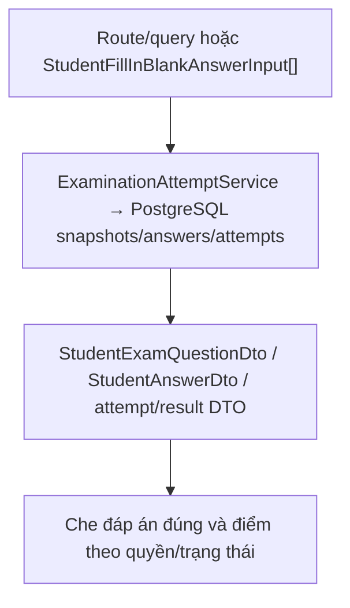

Nguồn: [ExaminationAttemptContracts.cs](<../../LMS.Api/application/features/examinationattempts/ExaminationAttemptContracts.cs>).

```csharp
public sealed record StudentFillInBlankAnswerInput(int BlankOrder, string AnswerText);

public sealed record StudentAnswerDto(
    Guid Id,
    Guid ExaminationQuestionId,
    QuestionType QuestionType,
    Guid? SelectedOptionId,
    IReadOnlyList<StudentFillInBlankAnswerInput> FillInBlankAnswers,
    DateTime ModifiedAt);

public sealed record ExaminationAttemptDto(
    Guid Id,
    Guid ExaminationId,
    Guid StudentId,
    ExaminationAttemptStatus Status,
    ExaminationSubmitReason? SubmitReason,
    DateTime StartedAt,
    DateTime? SubmittedAt,
    DateTime? DisconnectedAt,
    int? RemainingSeconds,
    DateTime LastActivityAt,
    int ViolationCount,
    int? CorrectAnswers,
    int? TotalQuestions,
    decimal? Score);

public sealed record ExaminationAttemptQuery(int Page = 1, int PageSize = 20);

public sealed record ExaminationAttemptResultDto(
    Guid Id,
    Guid ExaminationId,
    Guid StudentId,
    string StudentFullName,
    string StudentEmail,
    ExaminationAttemptStatus Status,
    ExaminationSubmitReason? SubmitReason,
    DateTime StartedAt,
    DateTime? SubmittedAt,
    int ViolationCount,
    int? CorrectAnswers,
    int TotalQuestions,
    decimal? Score);

public sealed record StudentExamOptionDto(Guid Id, string Content, int Order);

public sealed record StudentExamQuestionDto(Guid Id, string Content, QuestionType Type, int Order, IReadOnlyList<StudentExamOptionDto> Options);
```

## ExaminationContracts.cs

Vai trò của nhóm contract trong luồng dữ liệu (tên và trường đầy đủ giữ ở khai báo bên dưới):

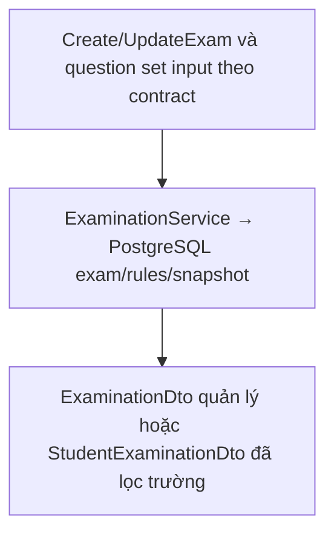

Nguồn: [ExaminationContracts.cs](<../../LMS.Api/application/features/examinations/ExaminationContracts.cs>).

```csharp
public sealed record ExaminationSecuritySettings(
    bool RequireFullscreen,
    int FullscreenGraceSeconds,
    int MaxViolations,
    bool BlockCopyPaste,
    bool BlockRightClick,
    bool DetectTabChange,
    bool DetectDevTools,
    int MaxDisconnectMinutes);

public sealed record QuestionSelectionRuleInput(
    Guid QuestionBankId,
    QuestionDifficulty Difficulty,
    int QuestionCount);

public sealed record CreateExaminationRequest(
    string Title,
    string? Description,
    DateTime StartAt,
    DateTime DueAt,
    int DurationMinutes,
    bool ShuffleQuestions,
    bool ShowScoreImmediately,
    ExaminationSecuritySettings Security,
    IReadOnlyList<QuestionSelectionRuleInput> QuestionSelectionRules,
    ExaminationQuestionSelectionMode SelectionMode = ExaminationQuestionSelectionMode.Random,
    IReadOnlyList<Guid>? QuestionIds = null);

public sealed record UpdateExaminationRequest(
    string Title,
    string? Description,
    DateTime StartAt,
    DateTime DueAt,
    int DurationMinutes,
    bool ShuffleQuestions,
    bool ShowScoreImmediately,
    ExaminationSecuritySettings Security);

public sealed record UpdateExaminationQuestionSetRequest(
    ExaminationQuestionSelectionMode SelectionMode,
    IReadOnlyList<QuestionSelectionRuleInput>? QuestionSelectionRules,
    IReadOnlyList<Guid>? QuestionIds);

public sealed record QuestionSelectionRuleDto(
    Guid Id,
    Guid QuestionBankId,
    QuestionDifficulty Difficulty,
    int QuestionCount);

public sealed record ExaminationDto(
    Guid Id,
    Guid CourseId,
    string Title,
    string? Description,
    ExaminationStatus Status,
    DateTime StartAt,
    DateTime DueAt,
    int DurationMinutes,
    bool ShuffleQuestions,
    bool ShowScoreImmediately,
    ExaminationSecuritySettings Security,
    IReadOnlyList<QuestionSelectionRuleDto> QuestionSelectionRules,
    ExaminationQuestionSelectionMode SelectionMode,
    IReadOnlyList<Guid> SelectedQuestionIds,
    int QuestionCount,
    DateTime CreatedAt,
    DateTime ModifiedAt);

public sealed record StudentExaminationDto(
    Guid Id,
    Guid CourseId,
    string Title,
    string? Description,
    ExaminationStatus Status,
    DateTime StartAt,
    DateTime DueAt,
    int DurationMinutes,
    bool ShuffleQuestions,
    bool ShowScoreImmediately,
    ExaminationSecuritySettings Security,
    int QuestionCount,
    DateTime CreatedAt,
    DateTime ModifiedAt);
```

## PasswordResetContracts.cs

Vai trò của nhóm contract trong luồng dữ liệu (tên và trường đầy đủ giữ ở khai báo bên dưới):

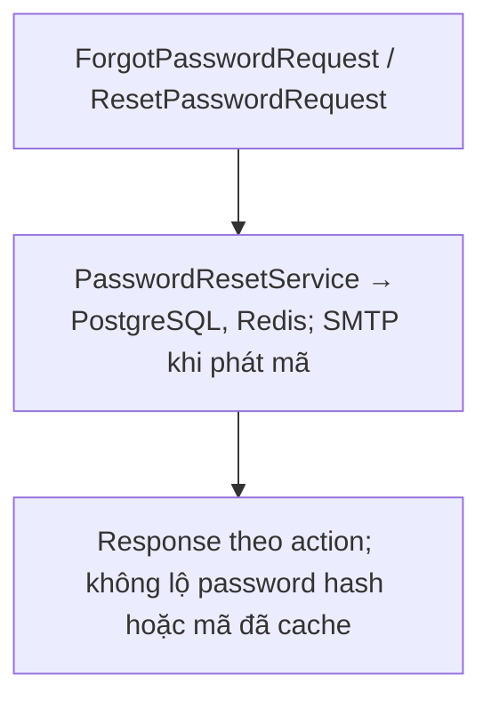

Nguồn: [PasswordResetContracts.cs](<../../LMS.Api/application/features/passwordreset/PasswordResetContracts.cs>).

```csharp
public sealed record ForgotPasswordRequest(string Email);

public sealed record ResetPasswordRequest(string Email, string ResetCode, string NewPassword, string PasswordConfirm);

public sealed record PasswordResetRequestedDto(bool Accepted, DateTime CodeExpiresAt);

public sealed record PasswordResetResultDto(Guid UserId, string Email, AccountStatus Status, DateTime ResetAt);
```

## QuestionContracts.cs

Vai trò của nhóm contract trong luồng dữ liệu (tên và trường đầy đủ giữ ở khai báo bên dưới):

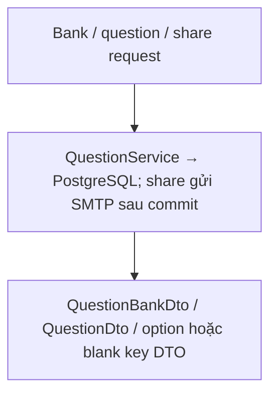

Nguồn: [QuestionContracts.cs](<../../LMS.Api/application/features/questions/QuestionContracts.cs>).

```csharp
public sealed record CreateQuestionBankRequest(Guid TeacherId, string Name, string? Description);

public sealed record UpdateQuestionBankRequest(string Name, string? Description);

public sealed record ShareQuestionBankRequest(string RecipientEmail);

public sealed record QuestionBankDto(
    Guid Id,
    Guid TeacherId,
    string Name,
    string? Description,
    DateTime CreatedAt,
    DateTime ModifiedAt,
    string OwnerFullName,
    string OwnerEmail);

public sealed record MultipleChoiceOptionInput(string Content, bool IsCorrect);

public sealed record FillInBlankAnswerInput(int BlankOrder, string ExpectedAnswer);

public sealed record CreateMultipleChoiceQuestionRequest(
    string Content,
    QuestionDifficulty Difficulty,
    bool ShuffleOptions,
    IReadOnlyList<MultipleChoiceOptionInput> Options);

public sealed record CreateFillInBlankQuestionRequest(
    string Content,
    QuestionDifficulty Difficulty,
    IReadOnlyList<FillInBlankAnswerInput> Answers);

public sealed record UpdateQuestionRequest(
    string Content,
    QuestionDifficulty Difficulty,
    bool? ShuffleOptions = null,
    IReadOnlyList<MultipleChoiceOptionInput>? Options = null,
    IReadOnlyList<FillInBlankAnswerInput>? Answers = null);

public sealed record MultipleChoiceOptionDto(Guid Id, string Content, int Order, bool IsCorrect);

public sealed record FillInBlankAnswerDto(Guid Id, int BlankOrder, string ExpectedAnswer);

public sealed record QuestionDto(
    Guid Id,
    Guid QuestionBankId,
    string Content,
    QuestionType Type,
    QuestionDifficulty Difficulty,
    bool ShuffleOptions,
    IReadOnlyList<MultipleChoiceOptionDto> Options,
    IReadOnlyList<FillInBlankAnswerDto> Answers,
    DateTime CreatedAt,
    DateTime ModifiedAt);
```

## RegistrationContracts.cs

Vai trò của nhóm contract trong luồng dữ liệu (tên và trường đầy đủ giữ ở khai báo bên dưới):

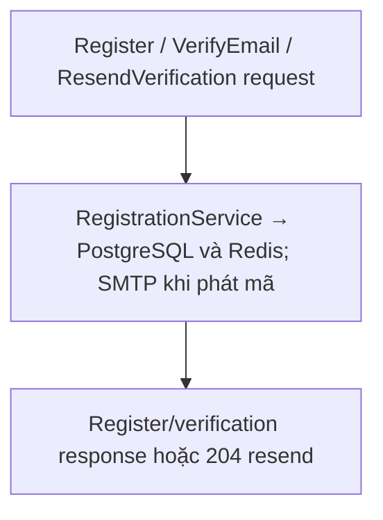

Nguồn: [RegistrationContracts.cs](<../../LMS.Api/application/features/registration/RegistrationContracts.cs>).

```csharp
public sealed record RegisterAccountRequest(
    string Email,
    string Password,
    string PasswordConfirm,
    string FullName,
    string? Phone);

public sealed record VerifyEmailRequest(string Email, string VerificationCode);

public sealed record ResendVerificationRequest(string Email);

public sealed record RegistrationDto(
    Guid UserId,
    string Email,
    AccountStatus Status,
    DateTime VerificationCodeExpiresAt);

public sealed record EmailVerificationResultDto(Guid UserId, string Email, AccountStatus Status, DateTime VerifiedAt);
```

## UserContracts.cs

Vai trò của nhóm contract trong luồng dữ liệu (tên và trường đầy đủ giữ ở khai báo bên dưới):

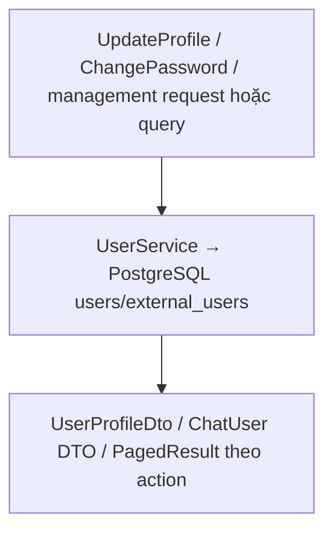

Nguồn: [UserContracts.cs](<../../LMS.Api/application/features/users/UserContracts.cs>).

```csharp
public sealed record UserProfileDto(Guid Id, string Email, string FullName, string? Phone, Role Role, AccountStatus Status, string? AvatarUrl, DateTime CreatedAt, bool HasPassword, bool? IsGoogleLinked = null);

public sealed record UserQuery(
    string? Search = null,
    Role? Role = null,
    AccountStatus? Status = null,
    int Page = 1,
    int PageSize = 20);

public sealed record AdminCreateUserRequest(string Email, string FullName, string? Phone, string Password, Role Role);

public sealed record UpdateUserStatusRequest(AccountStatus Status);

public sealed record AdminUpdateUserRequest(string FullName, string? Phone, Role Role);

public sealed record UpdateMyProfileRequest(string FullName, string? Phone);

public sealed record ChangeMyPasswordRequest(string? CurrentPassword, string NewPassword, string PasswordConfirm);

public sealed record ChatUserSearchDto(Guid Id, string Email, string FullName, string? AvatarUrl, Role Role);
```

## Enum

Vai trò của nhóm contract trong luồng dữ liệu (tên và trường đầy đủ giữ ở khai báo bên dưới):

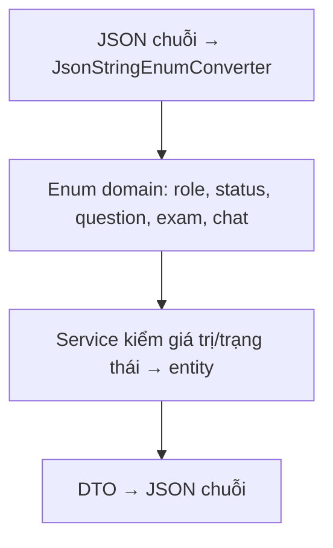

Nguồn: [ChatRoomType.cs](<../../LMS.Api/domain/enums/chats/ChatRoomType.cs>).

```csharp
public enum ChatRoomType
{
    Course = 0,
    DirectMessage = 1
}
```

Nguồn: [CourseStatus.cs](<../../LMS.Api/domain/enums/courses/CourseStatus.cs>).

```csharp
public enum CourseStatus
{
    Open = 0,
    Closed = 1
}
```

Nguồn: [EnrollmentStatus.cs](<../../LMS.Api/domain/enums/courses/EnrollmentStatus.cs>).

```csharp
public enum EnrollmentStatus
{
    Waiting = 0,
    Accepted = 1,
    Rejected = 2,
    Cancelled = 3,
}
```

Nguồn: [ExerciseStatus.cs](<../../LMS.Api/domain/enums/courses/ExerciseStatus.cs>).

```csharp
public enum ExerciseStatus
{
    Draft = 0,
    Published = 1,
    Closed = 2
}
```

Nguồn: [LessonStatus.cs](<../../LMS.Api/domain/enums/courses/LessonStatus.cs>).

```csharp
public enum LessonStatus
{
    Draft = 0,
    Published = 1
}
```

Nguồn: [SubmissionStatus.cs](<../../LMS.Api/domain/enums/courses/SubmissionStatus.cs>).

```csharp
public enum SubmissionStatus
{
    Draft = 0,
    Submitted = 1,
    Graded = 2
}
```

Nguồn: [ExaminationAttemptStatus.cs](<../../LMS.Api/domain/enums/examinations/ExaminationAttemptStatus.cs>).

```csharp
public enum ExaminationAttemptStatus
{
    InProgress = 0,
    Disconnected = 1,
    Submitted = 2,
    AutoSubmitted = 3
}
```

Nguồn: [ExaminationQuestionSelectionMode.cs](<../../LMS.Api/domain/enums/examinations/ExaminationQuestionSelectionMode.cs>).

```csharp
public enum ExaminationQuestionSelectionMode
{
    Random,
    Manual
}
```

Nguồn: [ExaminationStatus.cs](<../../LMS.Api/domain/enums/examinations/ExaminationStatus.cs>).

```csharp
public enum ExaminationStatus
{
    Draft = 0,
    Published = 1,
    Closed = 2
}
```

Nguồn: [ExaminationSubmitReason.cs](<../../LMS.Api/domain/enums/examinations/ExaminationSubmitReason.cs>).

```csharp
public enum ExaminationSubmitReason
{
    StudentSubmitted = 0,
    DurationExpired = 1,
    DisconnectTimeout = 2,
    MaxViolationsExceeded = 3,
    ExaminationClosed = 4
}
```

Nguồn: [ExaminationViolationType.cs](<../../LMS.Api/domain/enums/examinations/ExaminationViolationType.cs>).

```csharp
public enum ExaminationViolationType
{
    ExitFullscreen = 0,
    TabChanged = 1,
    WindowBlurred = 2,
    CopyAttempt = 3,
    PasteAttempt = 4,
    RightClickAttempt = 5,
    DevToolsSuspected = 6
}
```

Nguồn: [QuestionDifficulty.cs](<../../LMS.Api/domain/enums/questions/QuestionDifficulty.cs>).

```csharp
public enum QuestionDifficulty
{
    Easy = 0,
    Medium = 1,
    Hard = 2
}
```

Nguồn: [QuestionType.cs](<../../LMS.Api/domain/enums/questions/QuestionType.cs>).

```csharp
public enum QuestionType
{
    MultipleChoice = 0,
    FillInBlank = 1
}
```

Nguồn: [AccountStatus.cs](<../../LMS.Api/domain/enums/users/AccountStatus.cs>).

```csharp
public enum AccountStatus
{
    Active = 0,
    Inactive = 1,
    Disabled = 2,
    Banned = 3
}
```

Nguồn: [ExternalProvider.cs](<../../LMS.Api/domain/enums/users/ExternalProvider.cs>).

```csharp
public enum ExternalProvider
{
    Google = 0
}
```

Nguồn: [Role.cs](<../../LMS.Api/domain/enums/users/Role.cs>).

```csharp
public enum Role
{
    Student = 0,
    Teacher = 1,
    Admin = 2,
    System = 3
}
```
