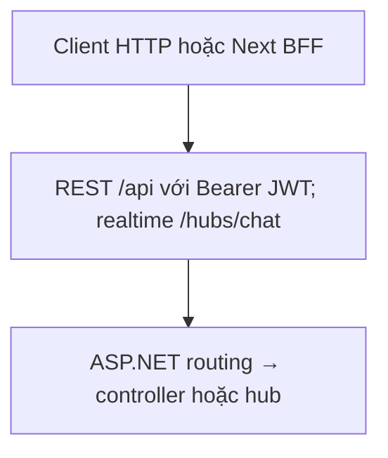
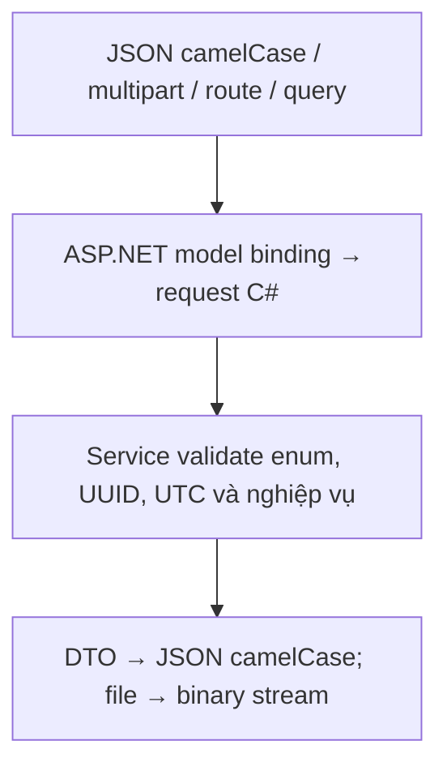
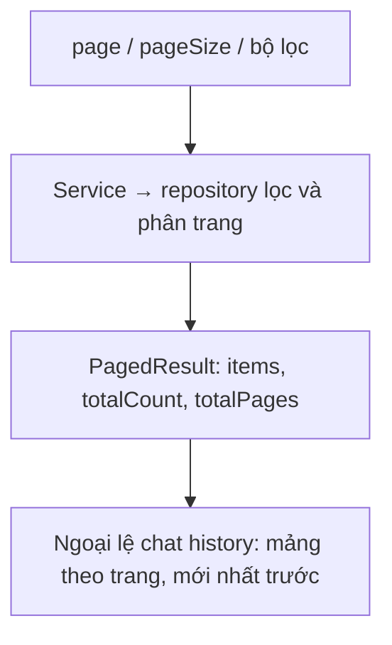
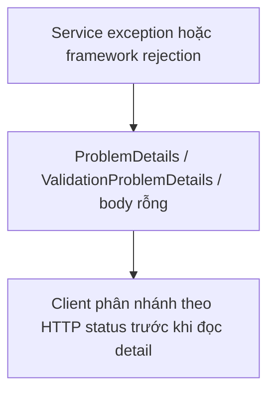
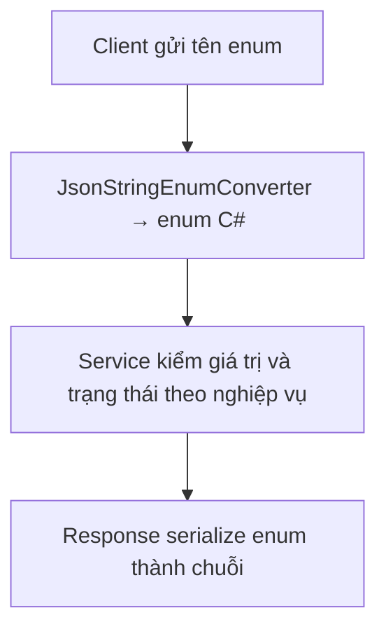
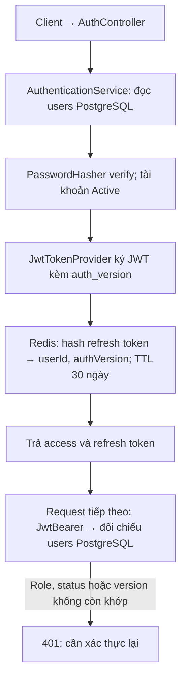
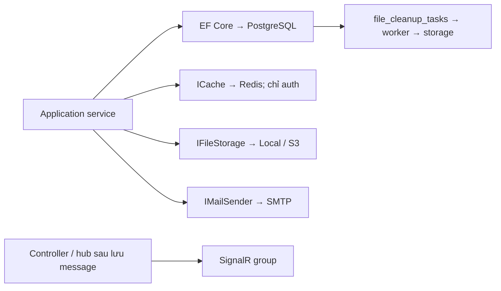

# API – Quy ước chung

Đối chiếu mã nguồn ngày **2026-10-13**. Mô tả implementation trong repository, không phải xác nhận môi trường production.

## Kết nối

Luồng xử lý và dữ liệu:



- Base URL REST: `{API_ORIGIN}/api`. SignalR hub: `{API_ORIGIN}/hubs/chat`.
- Local: `http://localhost:5258` hoặc `https://localhost:7086`. Swagger tại `/swagger` (chỉ `Development`).
- Trừ các endpoint ghi `Public`, mọi endpoint cần header `Authorization: Bearer <accessToken>`.

## Định dạng dữ liệu

Luồng xử lý và dữ liệu:



- JSON `camelCase`.
- UUID là chuỗi, ví dụ `"00000000-0000-0000-0000-000000000001"`.
- Thời gian là UTC ISO-8601, ví dụ `"2026-09-04T10:00:00Z"`. Trường nhập thời gian (`dueAt`, `startAt`) bắt buộc có hậu tố `Z`.
- Response enum dùng **tên chuỗi** (`"Student"`, `"Open"`). Client nên gửi đúng tên; `JsonStringEnumConverter` mặc định còn chấp nhận tên không phân biệt hoa thường và giá trị số, sau đó service có thể kiểm tra `Enum.IsDefined`.
- Request không có body được ghi là `Không có body`.
- Upload dùng `multipart/form-data`, giới hạn mỗi file nhỏ hơn 20 MB (xem [../overview.md](../overview.md#7-lưu-trữ-file)).
- Binary (`.../content`, `.../attachment`): trả stream với `Content-Type` gốc và tên file trong `Content-Disposition`. Controller hiện bỏ qua giá trị `download`: cả `true` và `false` đều truyền tên file vào `File(...)` (attachment). Frontend xem trước bằng Blob URL. Backend bật range processing; BFF hiện chưa chuyển tiếp `Range`/`Content-Range`.

## Phân trang

Luồng xử lý và dữ liệu:



Query `page` (mặc định `1`) và `pageSize` (mặc định `20`, tối đa `100`). Response:

```json
{
  "items": [],
  "page": 1,
  "pageSize": 20,
  "totalCount": 0,
  "totalPages": 0
}
```

Ngoại lệ: `GET /api/chat/rooms/{roomId}/messages` trả **mảng** (mới nhất trước), không phải `PagedResult`.

## Lỗi

Luồng xử lý và dữ liệu:



Chi tiết cơ chế xử lý, danh mục thông báo theo module và các lỗi do framework sinh ra: [../architecture/error-handling.md](../architecture/error-handling.md).

Lỗi nghiệp vụ có cấu trúc `ProblemDetails` như dưới. Handler hiện dùng `WriteAsJsonAsync` không chỉ định media type `application/problem+json`; client cần đọc cả `application/json`, `application/problem+json` và body rỗng của lỗi framework:

```json
{
  "type": "about:blank",
  "title": "Conflict",
  "status": 409,
  "detail": "Only waiting enrollments can change status."
}
```

| Status | Khi nào |
| --- | --- |
| `400` | Dữ liệu không hợp lệ, vi phạm quy tắc nhập liệu |
| `401` | Thiếu/sai/hết hạn token, token bị thu hồi (`auth_version`, tài khoản không còn `Active`) |
| `403` | Đã đăng nhập nhưng không có quyền |
| `404` | Không tìm thấy hoặc không được phép biết tài nguyên tồn tại |
| `409` | Xung đột trạng thái/dữ liệu (trùng, concurrency, sai trạng thái) |
| `429` | Vượt rate limit: `/api/auth/*` 10 request/phút, còn lại 240 request/phút mỗi IP |
| `500` | Lỗi không mong đợi, `detail` luôn là `"An unexpected error occurred."` |
| `503` | Không kết nối được dịch vụ bên ngoài (hiện chỉ Google OAuth: mất kết nối hoặc quá 10 giây), `detail` là message; có thể thử lại |

## Enum

Luồng xử lý và dữ liệu:



| Enum | Giá trị |
| --- | --- |
| `Role` | `Student`, `Teacher`, `Admin`, `System` |
| `AccountStatus` | `Active`, `Inactive`, `Disabled`, `Banned` |
| `CourseStatus` | `Open`, `Closed` |
| `EnrollmentStatus` | `Waiting`, `Accepted`, `Rejected`, `Cancelled` |
| `LessonStatus` | `Draft`, `Published` |
| `ExerciseStatus` | `Draft`, `Published`, `Closed` |
| `SubmissionStatus` | `Draft`, `Submitted`, `Graded` |
| `QuestionType` | `MultipleChoice`, `FillInBlank` |
| `QuestionDifficulty` | `Easy`, `Medium`, `Hard` |
| `ChatRoomType` | `Course`, `DirectMessage` |
| `ExternalProvider` | `Google` |
| `ExaminationQuestionSelectionMode` | `Random`, `Manual` |
| `ExaminationStatus` | `Draft`, `Published`, `Closed` |
| `ExaminationAttemptStatus` | `InProgress`, `Disconnected`, `Submitted`, `AutoSubmitted` |
| `ExaminationSubmitReason` | `StudentSubmitted`, `DurationExpired`, `DisconnectTimeout`, `MaxViolationsExceeded`, `ExaminationClosed` |
| `ExaminationViolationType` | `ExitFullscreen`, `TabChanged`, `WindowBlurred`, `CopyAttempt`, `PasteAttempt`, `RightClickAttempt`, `DevToolsSuspected` |

## Luồng khởi tạo phía client

Luồng xử lý và dữ liệu:



1. `POST /api/auth/login`, lưu cặp token.
2. Gửi `Authorization: Bearer <accessToken>`. Khi nhận `401`, gọi `POST /api/auth/refresh` một lần rồi gửi lại request.
3. Chưa có `/me`: đọc claim `NameIdentifier` trong JWT rồi gọi `GET /api/users/{userId}/profile`.
4. Dùng `role` để chọn giao diện; backend luôn kiểm tra quyền lần cuối.

## Chú thích “Lưu trữ” trong tài liệu endpoint

Luồng xử lý và dữ liệu:



Các tài liệu module có mục **Dữ liệu đi qua**; [endpoint-index.md](endpoint-index.md) liệt kê toàn bộ action, [contracts.md](contracts.md) tra trường DTO, và [../tools-and-integrations.md](../tools-and-integrations.md) ánh xạ công cụ với tình huống/API:

- **PostgreSQL**: đọc/ghi qua EF Core (repository + `IUnitOfWork`).
- **Redis**: key `auth:*` (xem [../overview.md](../overview.md#6-redis)).
- **Storage**: `IFileStorage` (local/S3); **Cleanup queue** là bảng `FileCleanupTask`.
- **SMTP**: gửi email.
- **SignalR**: broadcast tới group `chat-room:{roomId}`.
