# API – Course Content: Lessons và Materials

Đối chiếu mã nguồn ngày **2026-10-13**. Mô tả implementation trong repository, không phải xác nhận môi trường production.

Cần JWT. Teacher sở hữu course hoặc Admin/System được tạo/sửa; student có enrollment `Accepted` được đọc (chỉ nội dung `Published`). Trong bảng dưới, quyền Admin bao gồm System.

| Method | Path | Quyền | Chức năng |
| --- | --- | --- | --- |
| POST | `/api/courses/{courseId}/lessons` | Teacher sở hữu, Admin | Tạo bài giảng |
| GET | `/api/courses/{courseId}/lessons` | Teacher sở hữu, Admin, Student `Accepted` | Danh sách bài giảng |
| PUT | `/api/courses/{courseId}/lessons/reorder` | Teacher sở hữu, Admin | Sắp xếp lại |
| GET | `/api/lessons/{lessonId}` | như trên | Chi tiết |
| PUT | `/api/lessons/{lessonId}` | Teacher sở hữu, Admin | Sửa |
| DELETE | `/api/lessons/{lessonId}` | Teacher sở hữu, Admin | Xóa |
| GET | `/api/lessons/{lessonId}/materials` | Teacher sở hữu, Admin, Student `Accepted` | Danh sách tài liệu |
| POST | `/api/lessons/{lessonId}/materials` | Teacher sở hữu, Admin | Upload tài liệu |
| GET | `/api/materials/{materialId}/content` | như danh sách | Tải/xem tài liệu |
| DELETE | `/api/materials/{materialId}` | Teacher sở hữu, Admin | Xóa tài liệu |

**Dữ liệu đi qua:** PostgreSQL (`lessons`, `materials`); các endpoint file còn qua Storage và Cleanup queue.

## Lesson object

Luồng xử lý và dữ liệu:

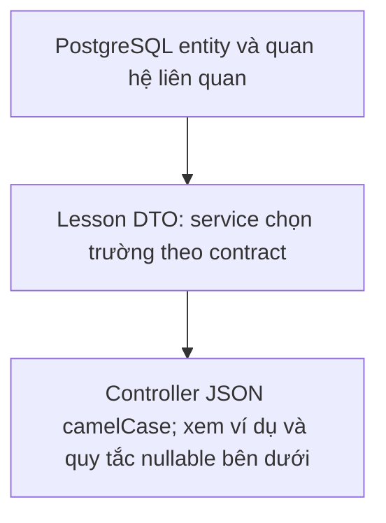

```json
{
  "id": "00000000-0000-0000-0000-000000000011",
  "courseId": "00000000-0000-0000-0000-000000000003",
  "name": "Variables",
  "content": "...",
  "order": 1,
  "status": "Draft",
  "createdAt": "2026-09-04T10:00:00Z",
  "modifiedAt": "2026-09-04T10:00:00Z"
}
```

## `POST /api/courses/{courseId}/lessons`

Luồng xử lý và dữ liệu:

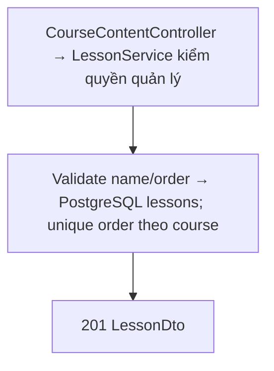

**Request:**

```json
{
  "name": "Variables",
  "content": "...",
  "order": 1,
  "status": "Draft"
}
```

**Response `201 Created`:** Lesson object. `order` không được trùng trong cùng course.

## `GET /api/courses/{courseId}/lessons`

Luồng xử lý và dữ liệu:

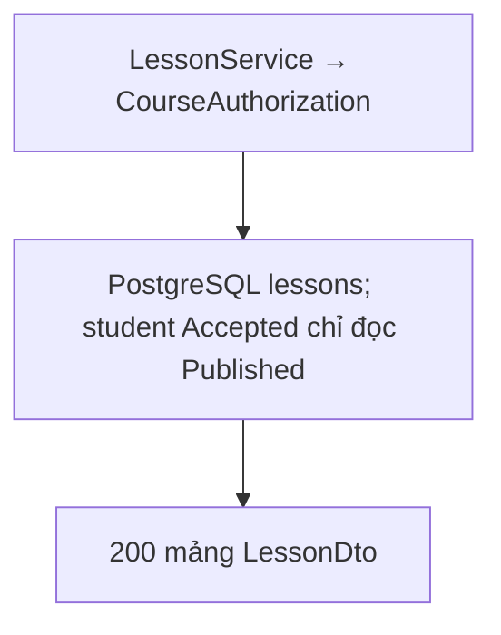

**Response `200 OK`:** Mảng Lesson sắp theo `order`. Teacher/Admin thấy `Draft` và `Published`; student chỉ thấy `Published`.

## `GET /api/lessons/{lessonId}`

Luồng xử lý và dữ liệu:

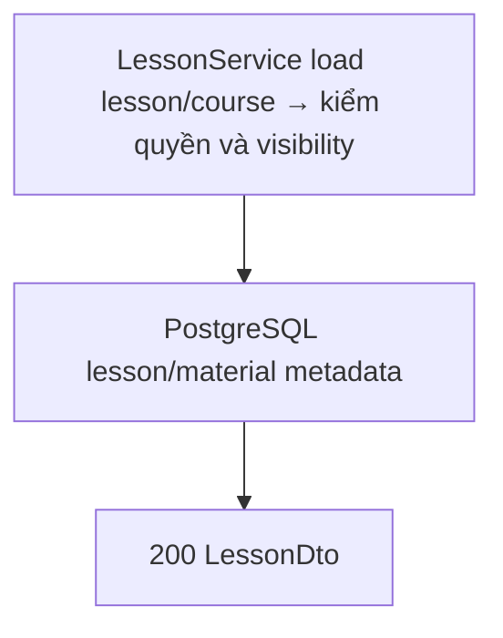

**Response `200 OK`:** Lesson object. Student truy cập lesson `Draft` nhận `404`.

## `PUT /api/lessons/{lessonId}`

Luồng xử lý và dữ liệu:

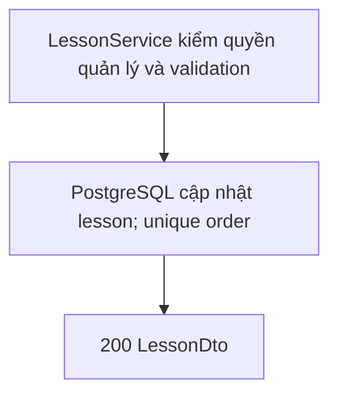

**Request:**

```json
{
  "name": "Variables",
  "content": "Updated content",
  "order": 1,
  "status": "Published"
}
```

**Response `200 OK`:** Lesson object. `order` không trùng trong course.

## `PUT /api/courses/{courseId}/lessons/reorder`

Luồng xử lý và dữ liệu:

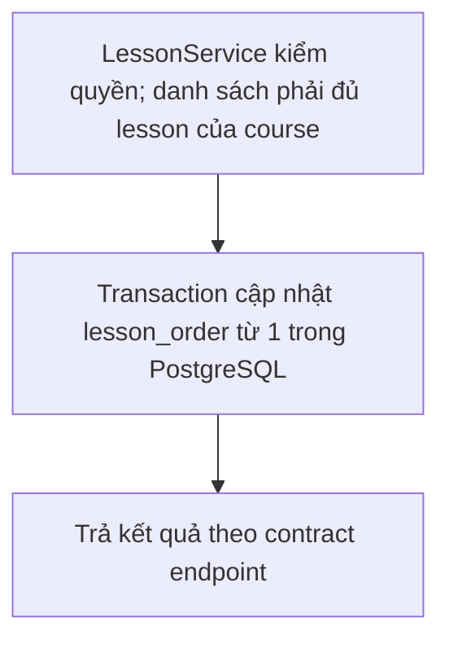

Body phải chứa **đầy đủ** ID lesson hiện có của course theo thứ tự mới.

**Request:**

```json
{
  "lessonIds": [
    "00000000-0000-0000-0000-000000000012",
    "00000000-0000-0000-0000-000000000011"
  ]
}
```

**Hành vi:** Trong một transaction, đánh lại `order` liên tục từ `1`. **Response `200 OK`:** Mảng Lesson theo thứ tự mới.

## `DELETE /api/lessons/{lessonId}`

Luồng xử lý và dữ liệu:

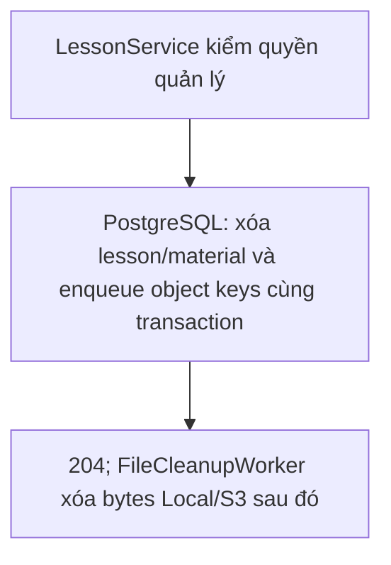

Xóa lesson và metadata material; file vật lý được đưa vào Cleanup queue. **Response `204 No Content`.**

## Material object

Luồng xử lý và dữ liệu:

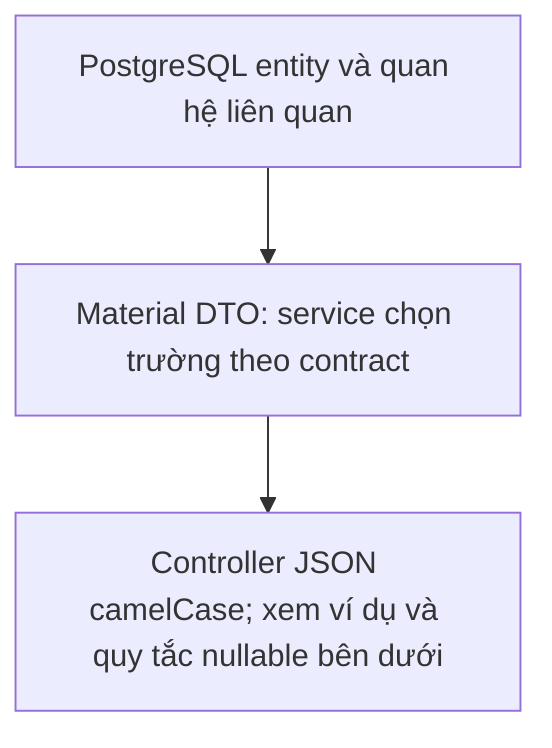

```json
{
  "id": "00000000-0000-0000-0000-000000000012",
  "lessonId": "00000000-0000-0000-0000-000000000011",
  "fileName": "lesson.pdf",
  "objectKey": "courses/00000000-0000-0000-0000-000000000003/lesson.pdf",
  "contentType": "application/pdf",
  "fileSize": 12345,
  "createdAt": "2026-09-04T10:00:00Z",
  "modifiedAt": "2026-09-04T10:00:00Z"
}
```

`objectKey` là khóa nội bộ; client không dựng URL từ nó mà dùng endpoint `content`.

## `GET /api/lessons/{lessonId}/materials`

Luồng xử lý và dữ liệu:

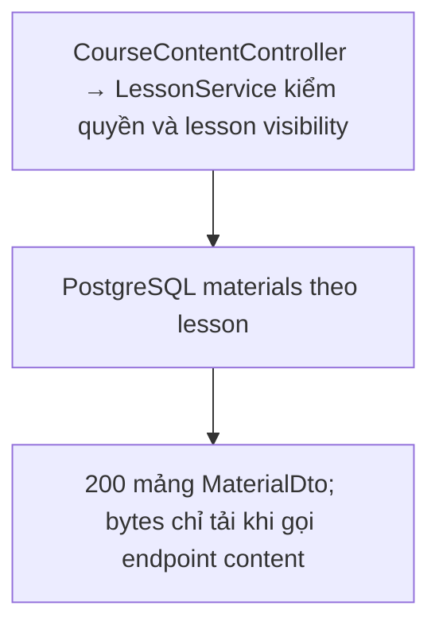

Student chỉ đọc material của lesson `Published`. **Response `200 OK`:** Mảng Material object.

## `POST /api/lessons/{lessonId}/materials`

Luồng xử lý và dữ liệu:

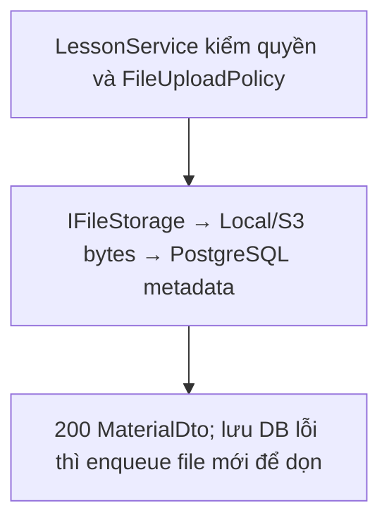

**Request:** `multipart/form-data`, field `file` (bắt buộc, không rỗng, < 20 MB).

```text
file=@lesson.pdf
```

**Hành vi:** Stream file vào Storage, lưu metadata PostgreSQL. **Response `200 OK`:** Material object.

## `GET /api/materials/{materialId}/content?download=false`

Luồng xử lý và dữ liệu:

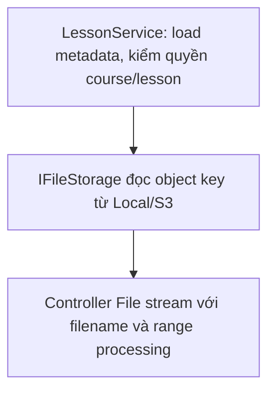

**Response `200 OK`:** Binary stream với `Content-Type` của file và tên gốc trong `Content-Disposition`. Hiện `download` không thay đổi hành vi; cả hai giá trị đều trả attachment. Xem [conventions.md](conventions.md).

## `DELETE /api/materials/{materialId}`

Luồng xử lý và dữ liệu:

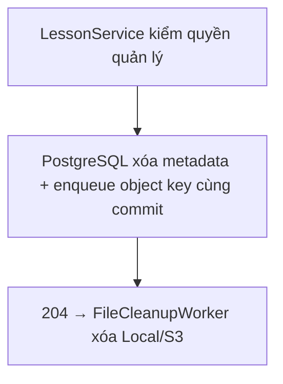

Xóa metadata, file vào Cleanup queue. **Response `204 No Content`.**
