# API – Courses và Enrollments

Đối chiếu mã nguồn ngày **2026-10-13**. Mô tả implementation trong repository, không phải xác nhận môi trường production.

Cần JWT. Dữ liệu qua PostgreSQL (`courses`, `enrollments`, `users`, `chat_rooms`, `chat_participants` khi đồng bộ chat); không dùng Redis/Storage/SMTP. Quyền Admin trong bảng bao gồm System. Thêm học viên bằng email là tra tài khoản đã tồn tại, không gửi thư mời và không tạo tài khoản.

| Method | Path | Quyền | Chức năng |
| --- | --- | --- | --- |
| POST | `/api/courses` | Teacher, Admin | Tạo khóa học |
| GET | `/api/courses` | Đã đăng nhập | Danh sách, lọc, phân trang |
| GET | `/api/courses/mine` | Student | Khóa học đã được nhận |
| GET | `/api/courses/{courseId}` | Đã đăng nhập | Chi tiết |
| PUT | `/api/courses/{courseId}` | Teacher sở hữu, Admin | Sửa |
| DELETE | `/api/courses/{courseId}` | Teacher sở hữu, Admin | Xóa mềm |
| POST | `/api/courses/{courseId}/restore` | Teacher sở hữu, Admin | Khôi phục |
| POST | `/api/courses/{courseId}/enrollments` | Student `Active` | Đăng ký học |
| POST | `/api/courses/{courseId}/enrollments/by-email` | Teacher sở hữu, Admin | Thêm học viên bằng email (vào thẳng `Accepted`) |
| GET | `/api/courses/{courseId}/enrollments` | Teacher sở hữu, Admin | Danh sách đăng ký |
| GET | `/api/enrollments/mine` | Student | Đăng ký của tôi |
| POST | `/api/enrollments/{enrollmentId}/accept` | Teacher sở hữu, Admin | Duyệt |
| POST | `/api/enrollments/{enrollmentId}/reject` | Teacher sở hữu, Admin | Từ chối |
| POST | `/api/enrollments/{enrollmentId}/cancel` | Student chủ đăng ký | Hủy/rời khóa |
| POST | `/api/enrollments/{enrollmentId}/revoke` | Teacher sở hữu, Admin | Loại học viên |

Đóng/xóa/khôi phục course còn kéo theo chat room của course (archive/mở lại), xem [chat.md](chat.md).

## Course object

Luồng xử lý và dữ liệu:

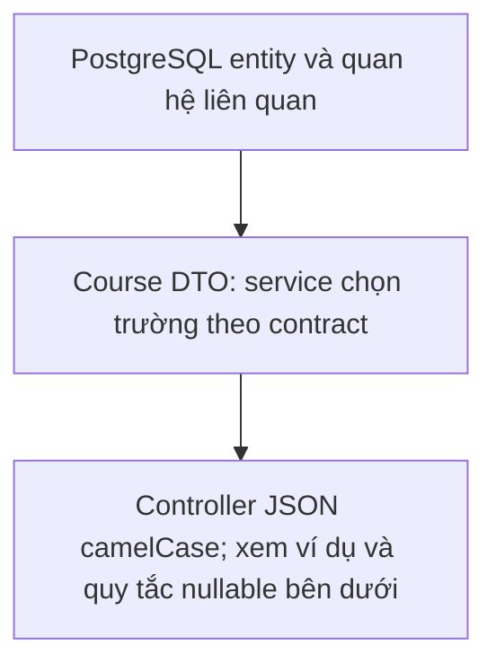

```json
{
  "id": "00000000-0000-0000-0000-000000000003",
  "name": "C# Basics",
  "description": "Introduction",
  "teacherId": "00000000-0000-0000-0000-000000000002",
  "teacherFullName": "Nguyen Van A",
  "maxStudents": 30,
  "acceptedStudentCount": 0,
  "status": "Open",
  "createdAt": "2026-09-04T10:00:00Z",
  "modifiedAt": "2026-09-04T10:00:00Z",
  "deletedAt": null
}
```

## `POST /api/courses`

Luồng xử lý và dữ liệu:

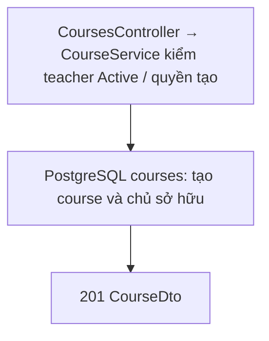

Teacher tự tạo; Admin tạo cho một teacher đang `Active`.

**Request:**

```json
{
  "name": "C# Basics",
  "description": "Introduction",
  "teacherId": "00000000-0000-0000-0000-000000000002",
  "maxStudents": 30,
  "status": "Open"
}
```

**Response `201 Created`:** Course object. Course room tương ứng được tạo trong cùng lần lưu, gồm người tạo và teacher được chỉ định; endpoint chat lấy/tạo room vẫn giữ tính idempotent cho dữ liệu cũ.

## `GET /api/courses?search=&status=&teacherId=&includeDeleted=false&page=1&pageSize=20`

Luồng xử lý và dữ liệu:

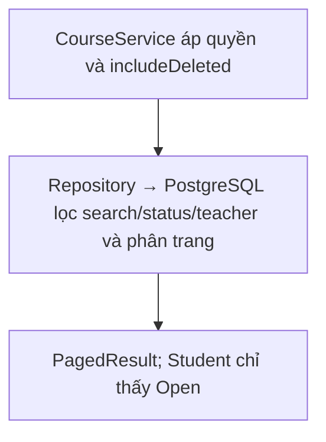

- Student luôn chỉ nhận course `Open`, kể cả khi gửi `status=Closed`.
- Teacher/Admin dùng được `status`, `teacherId`.
- Course xóa mềm chỉ trả khi Admin truyền `includeDeleted=true`.

**Response `200 OK`:**

```json
{
  "items": [
    {
      "id": "00000000-0000-0000-0000-000000000003",
      "name": "C# Basics",
      "description": "Introduction",
      "teacherId": "00000000-0000-0000-0000-000000000002",
      "teacherFullName": "Nguyen Van A",
      "maxStudents": 30,
      "acceptedStudentCount": 12,
      "status": "Open",
      "createdAt": "2026-09-04T10:00:00Z",
      "modifiedAt": "2026-09-04T10:00:00Z",
      "deletedAt": null
    }
  ],
  "page": 1,
  "pageSize": 20,
  "totalCount": 1,
  "totalPages": 1
}
```

`teacherFullName` là tên hiển thị của giảng viên phụ trách. `acceptedStudentCount` là số enrollment đang ở trạng thái `Accepted`; các enrollment `Waiting`, `Rejected` hoặc `Cancelled` không được tính.

## `GET /api/courses/mine`

Luồng xử lý và dữ liệu:

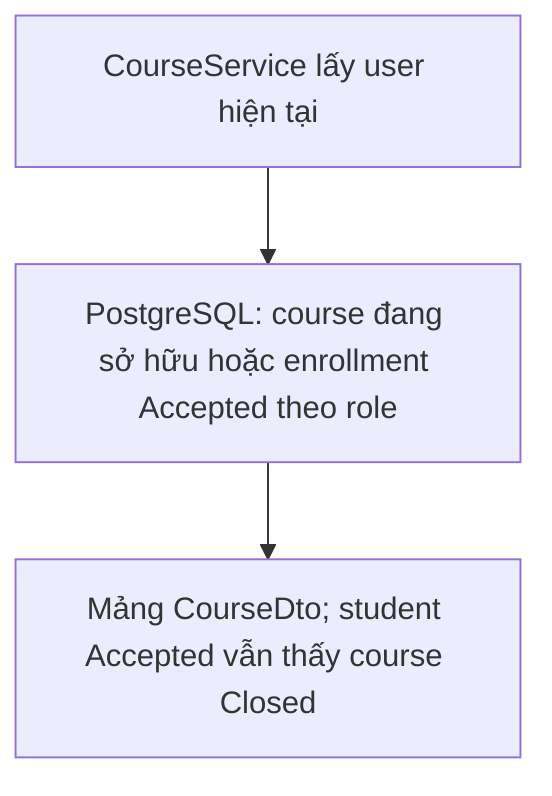

Student. Trả mảng Course object có enrollment `Accepted` của chính student, gồm cả course `Closed`; bỏ course đã xóa mềm.

## `GET /api/courses/{courseId}?includeDeleted=false`

Luồng xử lý và dữ liệu:

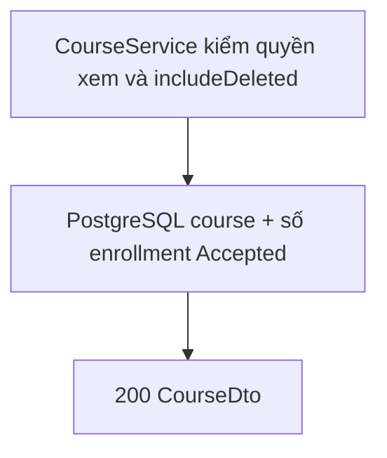

Student xem được course `Open`; course `Closed` chỉ khi enrollment `Accepted`. `includeDeleted=true` chỉ dành Admin. **Response `200 OK`:** Course object.

## `PUT /api/courses/{courseId}`

Luồng xử lý và dữ liệu:

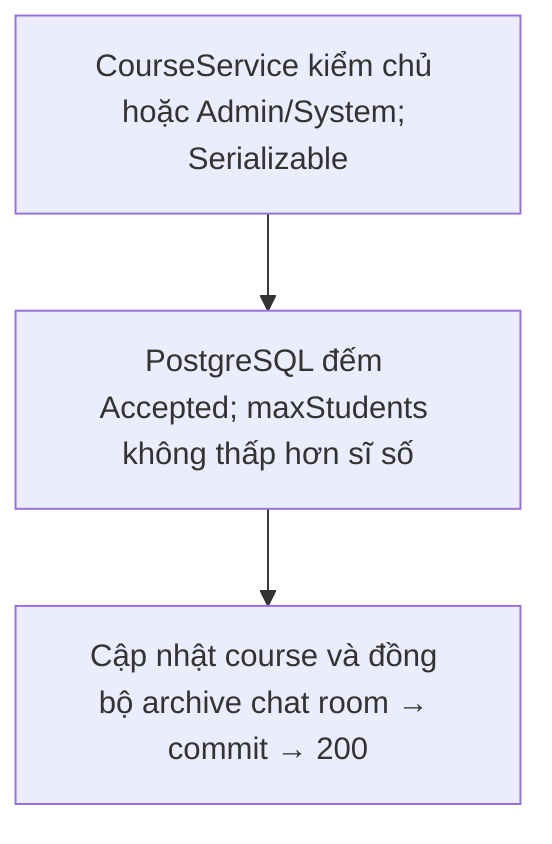

`maxStudents` không được nhỏ hơn số enrollment `Accepted`.

**Request:**

```json
{
  "name": "Advanced C#",
  "description": "Updated",
  "maxStudents": 40,
  "status": "Open"
}
```

**Response `200 OK`:** Course object. Chuyển `Closed` sẽ archive chat room của course; chuyển lại `Open` mở lại.

## `DELETE /api/courses/{courseId}`

Luồng xử lý và dữ liệu:

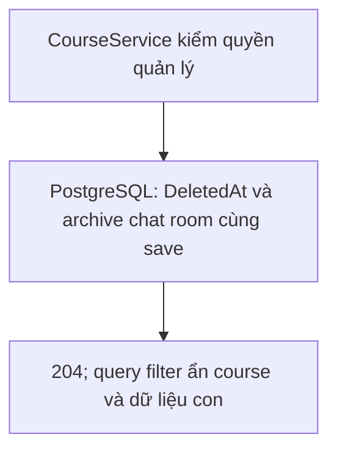

Xóa mềm (`deletedAt`). **Response `204 No Content`.** Chat room của course bị archive.

## `POST /api/courses/{courseId}/restore`

Luồng xử lý và dữ liệu:

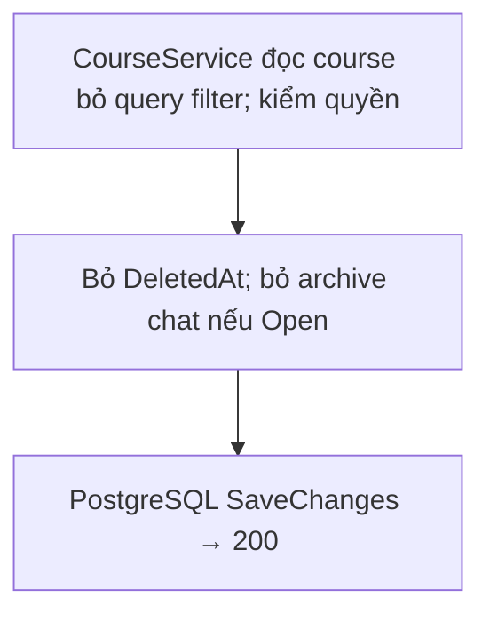

**Không có body.** **Response `200 OK`:** Course object. Room chỉ mở lại nếu course khôi phục ở trạng thái `Open`.

## Enrollment object

Luồng xử lý và dữ liệu:

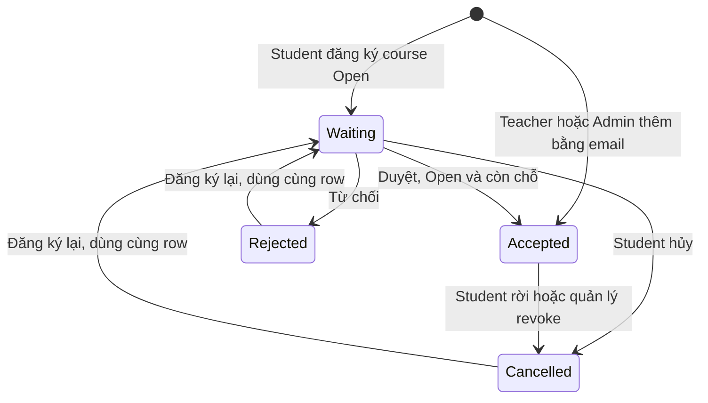

```json
{
  "id": "00000000-0000-0000-0000-000000000004",
  "studentId": "00000000-0000-0000-0000-000000000001",
  "courseId": "00000000-0000-0000-0000-000000000003",
  "status": "Waiting",
  "student": null,
  "createdAt": "2026-09-04T10:00:00Z",
  "modifiedAt": "2026-09-04T10:00:00Z",
  "course": {
    "id": "00000000-0000-0000-0000-000000000003",
    "name": "C# Basics",
    "status": "Open"
  }
}
```

- `course` là bản tóm tắt (`id`, `name`, `status`) để client hiển thị tên khóa học mà không phải gọi thêm API. Có trong response của `POST .../enrollments`, `GET /api/enrollments/mine`, `GET .../enrollments` (danh sách theo course), `accept`, `reject`, `revoke`. **Không có** (`null`) ở response của `cancel`.
- `student` chỉ được điền ở danh sách theo course; các response khác là `null`.

Máy trạng thái: `Waiting → Accepted | Rejected | Cancelled`; `Accepted → Cancelled` (student rời hoặc teacher revoke); `Rejected`/`Cancelled → Waiting` khi đăng ký lại (tái dùng record).

## `POST /api/courses/{courseId}/enrollments`

Luồng xử lý và dữ liệu:

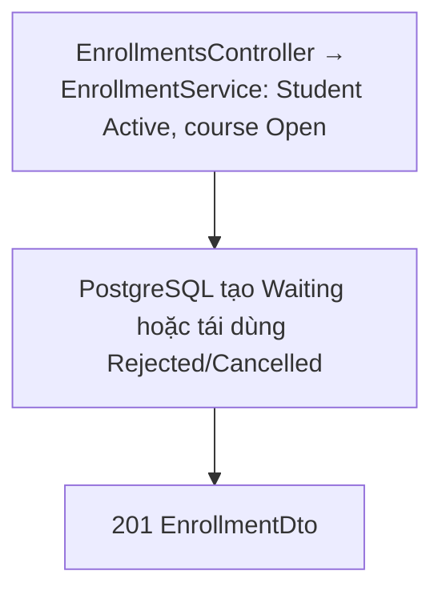

**Không có body.** Student `Active` đăng ký. Nếu record cũ `Rejected`/`Cancelled` thì chuyển lại `Waiting`, không tạo bản sao. **Response `201 Created`:** Enrollment object `status: "Waiting"`.

## `GET /api/enrollments/mine`

Luồng xử lý và dữ liệu:

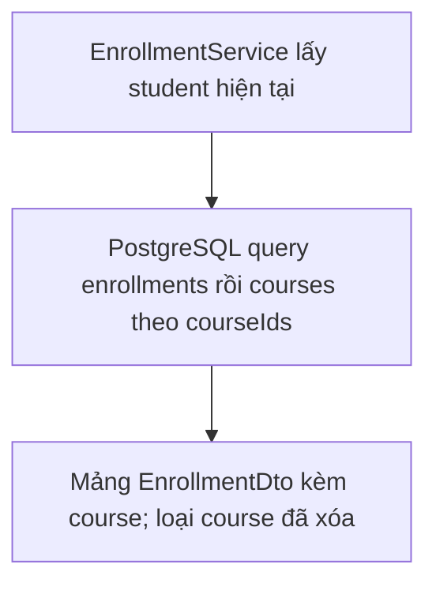

Trả mảng Enrollment object (mọi trạng thái, kèm `course` tóm tắt) của student để khôi phục trạng thái sau reload. Course đã xóa mềm không nằm trong kết quả (global query filter). Dữ liệu lấy bằng hai truy vấn: enrollments của student, rồi courses theo danh sách `courseId`.

## `GET /api/courses/{courseId}/enrollments?page=1&pageSize=20`

Luồng xử lý và dữ liệu:

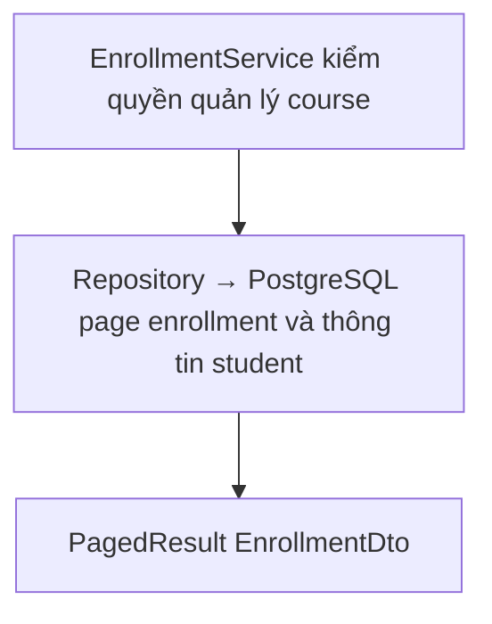

**Response `200 OK`:** PagedResult, trường `student` được điền để teacher nhận diện người đăng ký, `course` là tóm tắt của course đang xem:

```json
{
  "items": [
    {
      "id": "00000000-0000-0000-0000-000000000004",
      "studentId": "00000000-0000-0000-0000-000000000001",
      "courseId": "00000000-0000-0000-0000-000000000003",
      "status": "Waiting",
      "student": {
        "id": "00000000-0000-0000-0000-000000000001",
        "fullName": "Student",
        "email": "student@example.com"
      },
      "createdAt": "2026-09-04T10:00:00Z",
      "modifiedAt": "2026-09-04T10:00:00Z",
      "course": {
        "id": "00000000-0000-0000-0000-000000000003",
        "name": "C# Basics",
        "status": "Open"
      }
    }
  ],
  "page": 1,
  "pageSize": 20,
  "totalCount": 1,
  "totalPages": 1
}
```

## `POST /api/enrollments/{enrollmentId}/accept`

Luồng xử lý và dữ liệu:

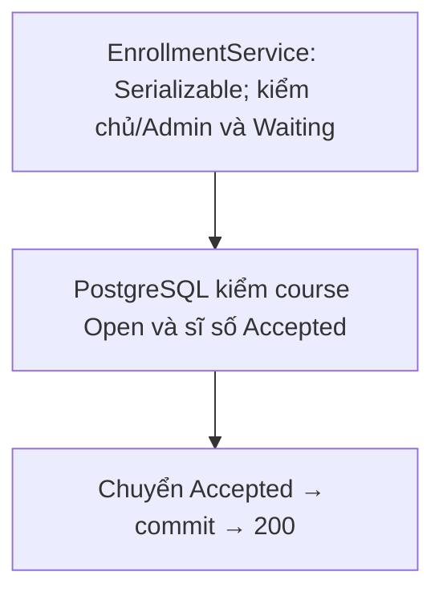

**Không có body.** Chỉ chấp nhận khi enrollment `Waiting`, course `Open` và chưa đủ `maxStudents`. **Response `200 OK`:** Enrollment `Accepted` (có `course`).

## `POST /api/enrollments/{enrollmentId}/reject`

Luồng xử lý và dữ liệu:

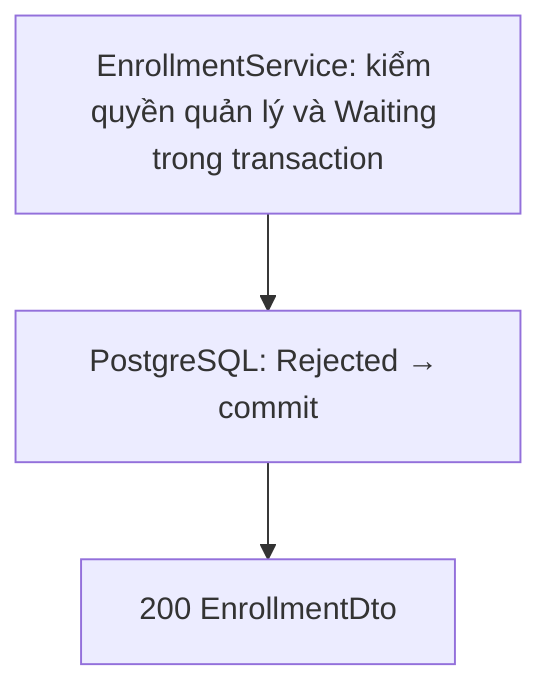

**Không có body.** **Response `200 OK`:** Enrollment `Rejected` (có `course`).

## `POST /api/enrollments/{enrollmentId}/cancel`

Luồng xử lý và dữ liệu:

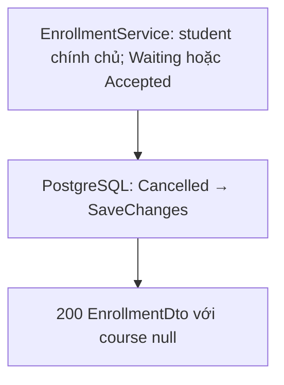

**Không có body.** Student hủy khi `Waiting` hoặc rời khóa khi `Accepted`. **Response `200 OK`:** Enrollment `Cancelled`, `course: null`.

## `POST /api/enrollments/{enrollmentId}/revoke`

Luồng xử lý và dữ liệu:

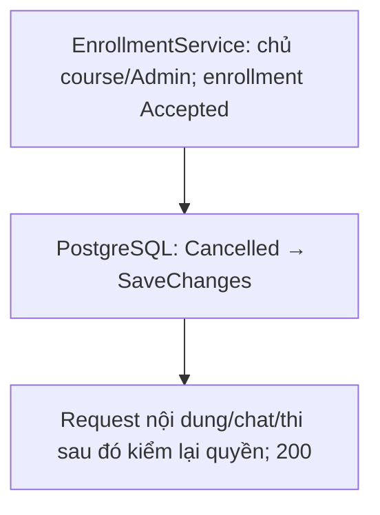

**Không có body.** Chỉ cho enrollment `Accepted`. **Response `200 OK`:** Enrollment `Cancelled` (có `course`). Student mất quyền đọc nội dung, chat khóa học và làm bài thi.

## `POST /api/courses/{courseId}/enrollments/by-email`

Luồng xử lý và dữ liệu:

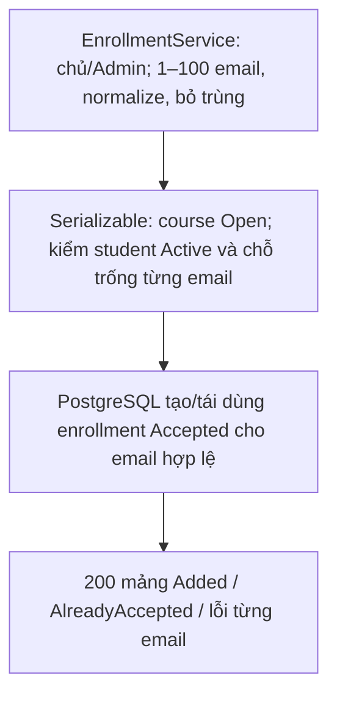

Teacher sở hữu hoặc Admin thêm trực tiếp học viên vào khóa học. Chỉ dùng cho course `Open`, chưa xóa mềm (nếu không: `409`).

**Request:** `{ "emails": ["a@example.com", "b@example.com"] }` – 1 đến 100 email (ngoài khoảng này: `400`). Email được trim, chuyển chữ thường, bỏ trùng.

**Response `200 OK`:** mảng kết quả theo từng email (lỗi từng email không làm hỏng cả request; các email hợp lệ vẫn được lưu):

```json
[{ "email": "a@example.com", "status": "Added", "enrollment": { "status": "Accepted" } }]
```

`status`: `Added`, `AlreadyAccepted`, `InvalidEmail`, `NotFound`, `NotStudent`, `Inactive` (user không `Active`), `CourseFull` (đạt `maxStudents`). `enrollment` chỉ có với `Added`/`AlreadyAccepted`.

Quy tắc: chưa có enrollment thì tạo mới `Accepted`; `Waiting` thì chuyển `Accepted`; `Rejected`/`Cancelled` thì tái dùng record rồi `Accepted`. Chạy trong transaction serializable cùng cách đếm `maxStudents` với `accept`.
