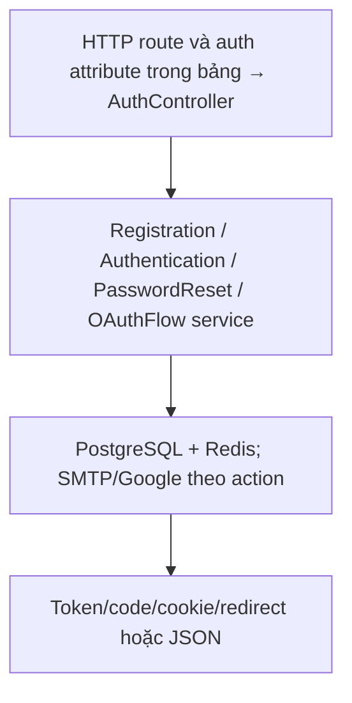
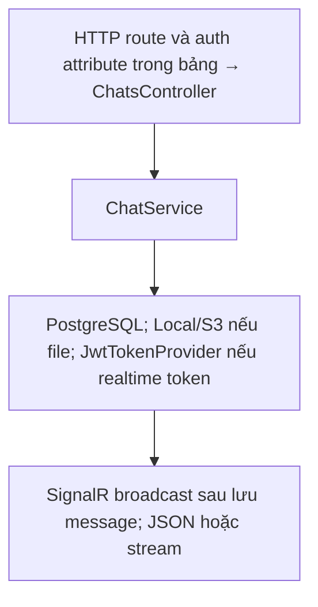
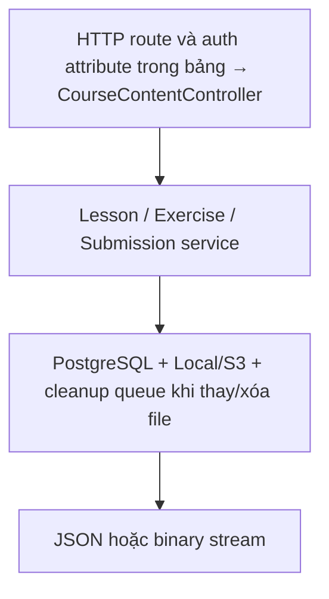
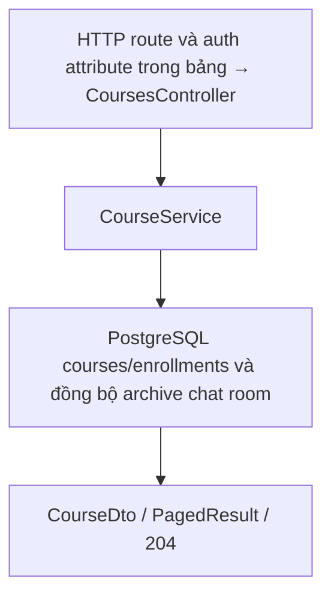
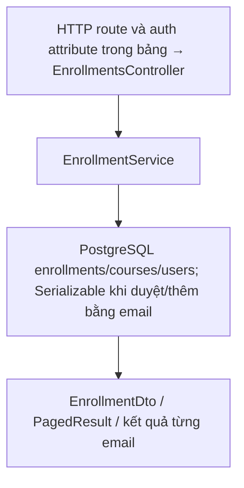
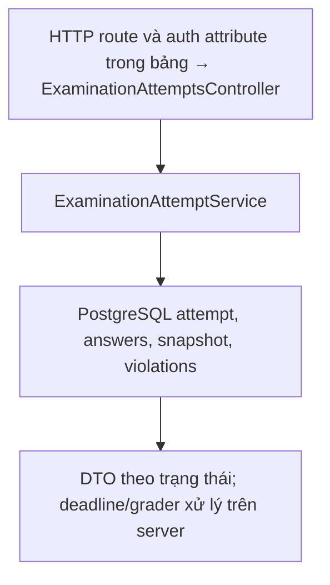
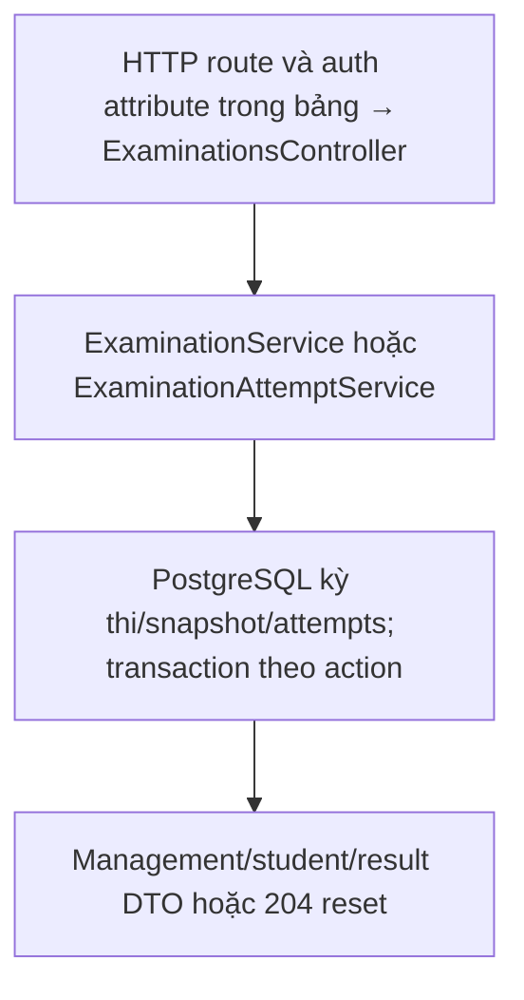
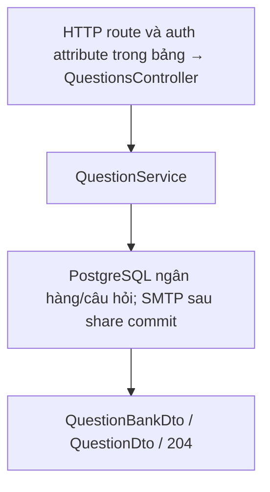
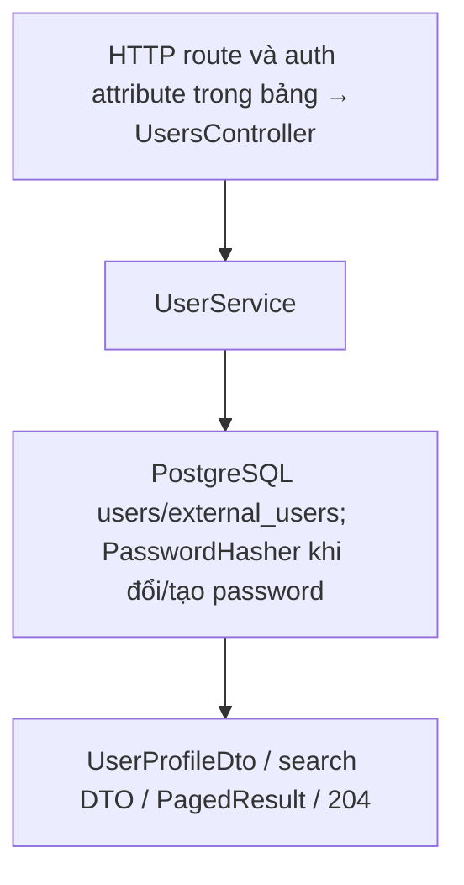

# Danh mục toàn bộ REST action

Đối chiếu ngày 2026-10-13 từ controller. Đường dẫn giữ constraint `:guid` đúng mã nguồn (URL thật chỉ gửi GUID). Cột auth là attribute ở controller/action, không thay thế quyền sở hữu và trạng thái ở service. DTO: [contracts.md](contracts.md); tình huống/công cụ: [tools-and-integrations](../tools-and-integrations.md).

## AuthController

Bản đồ điều phối của controller; middleware JWT/rate limit nằm trước action:

Nguồn: [AuthController.cs](<../../LMS.Api/presentation/controllers/AuthController.cs>).

| Method | Route | Action | Auth attribute |
| --- | --- | --- | --- |
| POST | `/api/auth/register` | `Register` | Public |
| POST | `/api/auth/verify-email` | `VerifyEmail` | Public |
| POST | `/api/auth/resend-verification` | `ResendVerification` | Public |
| POST | `/api/auth/forgot-password` | `ForgotPassword` | Public |
| POST | `/api/auth/reset-password` | `ResetPassword` | Public |
| POST | `/api/auth/login` | `Login` | Public |
| POST | `/api/auth/refresh` | `Refresh` | Public |
| POST | `/api/auth/login-code` | `RedeemOAuthLoginCode` | Public |
| GET | `/api/auth/oauth/{provider}/authorize` | `OAuthAuthorize` | Public |
| GET | `/api/auth/oauth/{provider}/link/authorize` | `OAuthLinkAuthorize` | JWT |
| GET | `/api/auth/oauth/{provider}/callback` | `OAuthCallback` | Public |

## ChatsController

Bản đồ điều phối của controller; middleware JWT/rate limit nằm trước action:

Nguồn: [ChatsController.cs](<../../LMS.Api/presentation/controllers/ChatsController.cs>).

| Method | Route | Action | Auth attribute |
| --- | --- | --- | --- |
| POST | `/api/chat/realtime-token` | `CreateRealtimeToken` | JWT |
| GET | `/api/chat/rooms` | `ListRooms` | JWT |
| POST | `/api/chat/courses/{courseId:guid}` | `GetOrCreateCourseRoom` | JWT |
| POST | `/api/chat/direct/{userId:guid}` | `GetOrCreateDirectRoom` | JWT |
| POST | `/api/chat/rooms/{roomId:guid}/join` | `JoinRoom` | JWT |
| DELETE | `/api/chat/rooms/{roomId:guid}` | `DeleteDirectConversation` | JWT |
| GET | `/api/chat/rooms/{roomId:guid}/messages` | `ListMessages` | JWT |
| POST | `/api/chat/rooms/{roomId:guid}/messages` | `SendMessage` | JWT |
| POST | `/api/chat/rooms/{roomId:guid}/messages/attachment` | `SendMessageWithAttachment` | JWT |
| GET | `/api/chat/messages/{messageId:guid}/attachments/{attachmentId:guid}/content` | `GetAttachmentContent` | JWT |
| PATCH | `/api/chat/messages/{messageId:guid}` | `EditMessage` | JWT |
| DELETE | `/api/chat/messages/{messageId:guid}` | `DeleteMessage` | JWT |
| POST | `/api/chat/rooms/{roomId:guid}/read/{messageId:guid}` | `MarkAsRead` | JWT |

## CourseContentController

Bản đồ điều phối của controller; middleware JWT/rate limit nằm trước action:

Nguồn: [CourseContentController.cs](<../../LMS.Api/presentation/controllers/CourseContentController.cs>).

| Method | Route | Action | Auth attribute |
| --- | --- | --- | --- |
| POST | `/api/courses/{courseId:guid}/lessons` | `CreateLesson` | JWT |
| GET | `/api/courses/{courseId:guid}/lessons` | `ListLessons` | JWT |
| GET | `/api/lessons/{lessonId:guid}` | `GetLesson` | JWT |
| PUT | `/api/lessons/{lessonId:guid}` | `UpdateLesson` | JWT |
| PUT | `/api/courses/{courseId:guid}/lessons/reorder` | `ReorderLessons` | JWT |
| DELETE | `/api/lessons/{lessonId:guid}` | `DeleteLesson` | JWT |
| GET | `/api/lessons/{lessonId:guid}/materials` | `ListMaterials` | JWT |
| GET | `/api/materials/{materialId:guid}/content` | `GetMaterialContent` | JWT |
| POST | `/api/lessons/{lessonId:guid}/materials` | `UploadMaterial` | JWT |
| DELETE | `/api/materials/{materialId:guid}` | `DeleteMaterial` | JWT |
| POST | `/api/courses/{courseId:guid}/exercises` | `CreateExercise` | JWT |
| GET | `/api/courses/{courseId:guid}/exercises` | `ListExercises` | JWT |
| GET | `/api/exercises/{exerciseId:guid}` | `GetExercise` | JWT |
| GET | `/api/exercises/{exerciseId:guid}/attachment` | `GetExerciseAttachment` | JWT |
| PUT | `/api/exercises/{exerciseId:guid}` | `UpdateExercise` | JWT |
| DELETE | `/api/exercises/{exerciseId:guid}` | `DeleteExercise` | JWT |
| POST | `/api/exercises/{exerciseId:guid}/attachment` | `UploadAttachment` | JWT |
| POST | `/api/exercises/{exerciseId:guid}/publish` | `PublishExercise` | JWT |
| POST | `/api/exercises/{exerciseId:guid}/close` | `CloseExercise` | JWT |
| POST | `/api/exercises/{exerciseId:guid}/submissions` | `UploadSubmission` | JWT |
| GET | `/api/exercises/{exerciseId:guid}/my-submission` | `GetMySubmission` | JWT |
| GET | `/api/exercises/{exerciseId:guid}/submissions` | `ListSubmissions` | JWT |
| GET | `/api/submissions/{submissionId:guid}/content` | `GetSubmissionContent` | JWT |
| POST | `/api/submissions/{submissionId:guid}/submit` | `Submit` | JWT |
| POST | `/api/submissions/{submissionId:guid}/unsubmit` | `Unsubmit` | JWT |
| PUT | `/api/submissions/{submissionId:guid}/grade` | `Grade` | JWT |

## CoursesController

Bản đồ điều phối của controller; middleware JWT/rate limit nằm trước action:

Nguồn: [CoursesController.cs](<../../LMS.Api/presentation/controllers/CoursesController.cs>).

| Method | Route | Action | Auth attribute |
| --- | --- | --- | --- |
| POST | `/api/courses` | `Create` | JWT |
| GET | `/api/courses` | `List` | JWT |
| GET | `/api/courses/mine` | `ListMine` | JWT |
| GET | `/api/courses/{courseId:guid}` | `GetById` | JWT |
| PUT | `/api/courses/{courseId:guid}` | `Update` | JWT |
| DELETE | `/api/courses/{courseId:guid}` | `Delete` | JWT |
| POST | `/api/courses/{courseId:guid}/restore` | `Restore` | JWT |

## EnrollmentsController

Bản đồ điều phối của controller; middleware JWT/rate limit nằm trước action:

Nguồn: [EnrollmentsController.cs](<../../LMS.Api/presentation/controllers/EnrollmentsController.cs>).

| Method | Route | Action | Auth attribute |
| --- | --- | --- | --- |
| POST | `/api/courses/{courseId:guid}/enrollments` | `RequestEnrollment` | JWT |
| POST | `/api/courses/{courseId:guid}/enrollments/by-email` | `AddByEmail` | JWT |
| GET | `/api/courses/{courseId:guid}/enrollments` | `ListByCourse` | JWT |
| GET | `/api/enrollments/mine` | `ListMine` | JWT |
| POST | `/api/enrollments/{enrollmentId:guid}/accept` | `Accept` | JWT |
| POST | `/api/enrollments/{enrollmentId:guid}/reject` | `Reject` | JWT |
| POST | `/api/enrollments/{enrollmentId:guid}/cancel` | `Cancel` | JWT |
| POST | `/api/enrollments/{enrollmentId:guid}/revoke` | `Revoke` | JWT |

## ExaminationAttemptsController

Bản đồ điều phối của controller; middleware JWT/rate limit nằm trước action:

Nguồn: [ExaminationAttemptsController.cs](<../../LMS.Api/presentation/controllers/ExaminationAttemptsController.cs>).

| Method | Route | Action | Auth attribute |
| --- | --- | --- | --- |
| POST | `/api/examination-attempts/{examinationId:guid}/start` | `Start` | JWT |
| GET | `/api/examination-attempts/{attemptId:guid}/questions` | `GetQuestions` | JWT |
| PUT | `/api/examination-attempts/{attemptId:guid}/questions/{questionId:guid}/multiple-choice` | `SaveMultipleChoice` | JWT |
| PUT | `/api/examination-attempts/{attemptId:guid}/questions/{questionId:guid}/fill-in-blank` | `SaveFillInBlank` | JWT |
| POST | `/api/examination-attempts/{attemptId:guid}/disconnect` | `Disconnect` | JWT |
| POST | `/api/examination-attempts/{attemptId:guid}/reconnect` | `Reconnect` | JWT |
| POST | `/api/examination-attempts/{attemptId:guid}/violations` | `Violation` | JWT |
| POST | `/api/examination-attempts/{attemptId:guid}/submit` | `Submit` | JWT |
| POST | `/api/examination-attempts/{attemptId:guid}/auto-submit` | `AutoSubmit` | JWT + Admin/System |

## ExaminationsController

Bản đồ điều phối của controller; middleware JWT/rate limit nằm trước action:

Nguồn: [ExaminationsController.cs](<../../LMS.Api/presentation/controllers/ExaminationsController.cs>).

| Method | Route | Action | Auth attribute |
| --- | --- | --- | --- |
| POST | `/api/courses/{courseId:guid}/examinations` | `Create` | JWT |
| GET | `/api/courses/{courseId:guid}/examinations` | `List` | JWT |
| GET | `/api/courses/{courseId:guid}/examinations/available` | `ListAvailable` | JWT |
| GET | `/api/examinations/{id:guid}` | `Get` | JWT |
| GET | `/api/examinations/{id:guid}/student` | `GetForStudent` | JWT |
| GET | `/api/examinations/{id:guid}/my-attempt` | `GetMyAttempt` | JWT |
| GET | `/api/examinations/{id:guid}/attempts` | `ListAttempts` | JWT |
| DELETE | `/api/examinations/{id:guid}/attempts/{attemptId:guid}` | `ResetAttempt` | JWT |
| PUT | `/api/examinations/{id:guid}` | `Update` | JWT |
| PUT | `/api/examinations/{id:guid}/question-set` | `UpdateQuestionSet` | JWT |
| POST | `/api/examinations/{id:guid}/publish` | `Publish` | JWT |
| POST | `/api/examinations/{id:guid}/close` | `Close` | JWT |

## QuestionsController

Bản đồ điều phối của controller; middleware JWT/rate limit nằm trước action:

Nguồn: [QuestionsController.cs](<../../LMS.Api/presentation/controllers/QuestionsController.cs>).

| Method | Route | Action | Auth attribute |
| --- | --- | --- | --- |
| POST | `/api/question-banks` | `CreateBank` | JWT |
| PUT | `/api/question-banks/{id:guid}` | `UpdateBank` | JWT |
| DELETE | `/api/question-banks/{id:guid}` | `DeleteBank` | JWT |
| POST | `/api/question-banks/{id:guid}/share` | `ShareBank` | JWT |
| GET | `/api/question-banks` | `ListBanks` | JWT |
| POST | `/api/question-banks/{id:guid}/multiple-choice` | `CreateMultipleChoice` | JWT |
| POST | `/api/question-banks/{id:guid}/fill-in-blank` | `CreateFillInBlank` | JWT |
| GET | `/api/question-banks/{id:guid}/questions` | `ListQuestions` | JWT |
| PUT | `/api/questions/{id:guid}` | `UpdateQuestion` | JWT |
| DELETE | `/api/questions/{id:guid}` | `DeleteQuestion` | JWT |

## UsersController

Bản đồ điều phối của controller; middleware JWT/rate limit nằm trước action:

Nguồn: [UsersController.cs](<../../LMS.Api/presentation/controllers/UsersController.cs>).

| Method | Route | Action | Auth attribute |
| --- | --- | --- | --- |
| GET | `/api/users/{userId:guid}/profile` | `Profile` | JWT |
| GET | `/api/users` | `List` | JWT |
| GET | `/api/users/search-for-chat` | `FindForChat` | JWT |
| GET | `/api/users/search-for-chat/by-name` | `SearchForChatByName` | JWT |
| PUT | `/api/users/me` | `UpdateMe` | JWT |
| PUT | `/api/users/me/password` | `ChangeMyPassword` | JWT |
| POST | `/api/users` | `Create` | JWT |
| PATCH | `/api/users/{userId:guid}/status` | `UpdateStatus` | JWT |
| PUT | `/api/users/{userId:guid}` | `Update` | JWT |

Tổng: **105 REST actions**, **9 controllers**. Hub riêng: [ChatHub](../../LMS.Api/presentation/hubs/ChatHub.cs) tại `/hubs/chat`, methods JoinRoom/LeaveRoom/SendMessage. Next.js BFF có route riêng: [frontend integration](../../../frontend/docs/api-integration.md).
