# API – Examination Attempts (làm bài thi)

Đối chiếu mã nguồn ngày **2026-10-13**. Mô tả implementation trong repository, không phải xác nhận môi trường production.

Base path: `/api/examination-attempts`. Cần JWT, student phải có enrollment `Accepted`. Dữ liệu chỉ qua PostgreSQL (`examination_attempts`, `student_answers`, `examination_violations`); auto-submit do `ExaminationAutoSubmitWorker` (30 giây/lần) hoặc admin thực hiện.

| Method | Path | Quyền | Chức năng |
| --- | --- | --- | --- |
| POST | `/api/examination-attempts/{examinationId}/start` | Student | Bắt đầu làm bài |
| GET | `/api/examination-attempts/{attemptId}/questions` | Student chủ attempt | Lấy đề (không có đáp án) |
| PUT | `/api/examination-attempts/{attemptId}/questions/{questionId}/multiple-choice` | Student chủ attempt | Lưu đáp án trắc nghiệm |
| PUT | `/api/examination-attempts/{attemptId}/questions/{questionId}/fill-in-blank` | Student chủ attempt | Lưu đáp án điền khuyết |
| POST | `/api/examination-attempts/{attemptId}/disconnect` | Student chủ attempt | Báo mất kết nối |
| POST | `/api/examination-attempts/{attemptId}/reconnect` | Student chủ attempt | Kết nối lại |
| POST | `/api/examination-attempts/{attemptId}/violations` | Student chủ attempt | Ghi nhận vi phạm |
| POST | `/api/examination-attempts/{attemptId}/submit` | Student chủ attempt | Nộp bài |
| POST | `/api/examination-attempts/{attemptId}/auto-submit` | Admin/System | Ép nộp theo lý do |
| DELETE | `/api/examinations/{examinationId}/attempts/{attemptId}` | Giảng viên của khóa học, Admin/System | Xóa lượt thi để học viên có thể bắt đầu lại |

`DELETE` chỉ xóa lượt thi thuộc đúng kỳ thi trong đường dẫn. Dữ liệu đáp án và vi phạm liên quan được xóa theo quan hệ cascade. Lượt thi mới vẫn tuân thủ điều kiện bắt đầu hiện hành (kỳ thi Published, đang trong khoảng thời gian cho phép, học viên còn enrollment Accepted); thao tác reset không gia hạn kỳ thi hoặc thời lượng.

Máy trạng thái:

```text
start → InProgress ⇄ Disconnected (disconnect / reconnect)
InProgress|Disconnected → Submitted      (submit khi còn giờ, reason StudentSubmitted)
InProgress|Disconnected → AutoSubmitted  (submit khi đã hết giờ, hoặc worker/server:
                                          DurationExpired, DisconnectTimeout,
                                          MaxViolationsExceeded, ExaminationClosed)
```

## Examination attempt object

Luồng xử lý và dữ liệu:

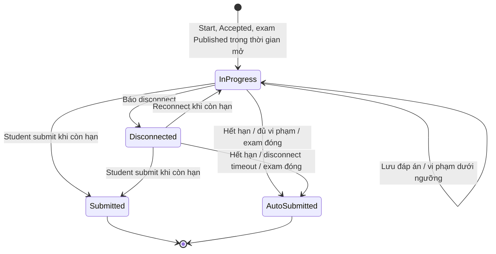

```json
{
  "id": "00000000-0000-0000-0000-000000000019",
  "examinationId": "00000000-0000-0000-0000-000000000017",
  "studentId": "00000000-0000-0000-0000-000000000001",
  "status": "InProgress",
  "submitReason": null,
  "startedAt": "2026-09-10T08:00:00Z",
  "submittedAt": null,
  "disconnectedAt": null,
  "remainingSeconds": 5400,
  "lastActivityAt": "2026-09-10T08:15:00Z",
  "violationCount": 0,
  "correctAnswers": null,
  "totalQuestions": null,
  "score": null
}
```

`correctAnswers`, `totalQuestions`, `score` luôn `null` khi attempt còn `InProgress`/`Disconnected`. Sau khi hoàn thành chúng tuân theo `showScoreImmediately`: nếu `false`, điểm chỉ hiện khi examination `Closed` hoặc thời điểm hiện tại đạt `dueAt`; student gọi lại `GET /api/examinations/{examinationId}/my-attempt` để lấy kết quả.

## `POST /api/examination-attempts/{examinationId}/start`

Luồng xử lý và dữ liệu:

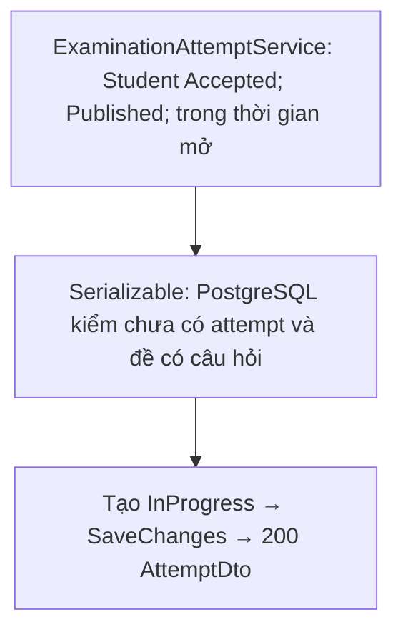

**Không có body.** Điều kiện: examination `Published`, `startAt <= now < dueAt`, enrollment còn `Accepted`, kỳ thi có ít nhất một câu hỏi. Mỗi student chỉ được làm **một lần**: đã có attempt (bất kể trạng thái) thì `409 A student can attempt an examination only once.` (còn ràng buộc unique `(examination_id, student_id)` ở DB). **Response `200 OK`:** Attempt object. Frontend lưu `attempt.id` cho các lời gọi sau.

## `GET /api/examination-attempts/{attemptId}/questions`

Luồng xử lý và dữ liệu:

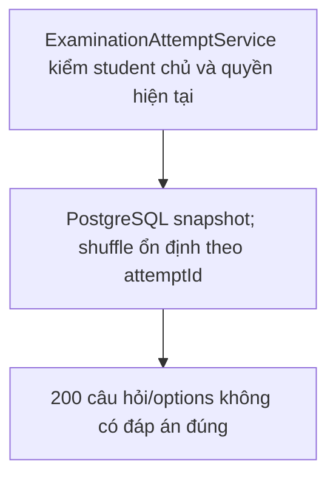

**Response `200 OK`:** Mảng câu hỏi snapshot, **không** có đáp án đúng:

```json
[
  {
    "id": "00000000-0000-0000-0000-000000000021",
    "content": "2 + 2 = ?",
    "type": "MultipleChoice",
    "order": 0,
    "options": [
      {
        "id": "00000000-0000-0000-0000-000000000008",
        "content": "4",
        "order": 0
      }
    ]
  }
]
```

Thứ tự shuffle ổn định theo `attemptId` (gọi lại vẫn cùng thứ tự). `order` bắt đầu từ `0`.

## `PUT /api/examination-attempts/{attemptId}/questions/{questionId}/multiple-choice?selectedOptionId={optionId}`

Luồng xử lý và dữ liệu:

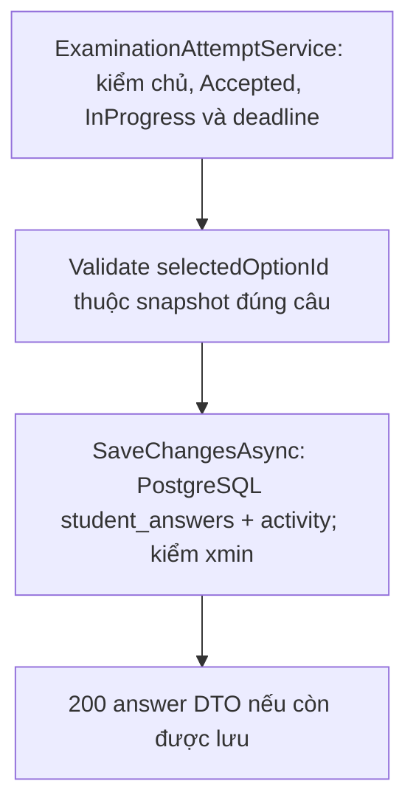

**Không có body**; chọn option qua query. **Response `200 OK`:**

```json
{
  "id": "00000000-0000-0000-0000-000000000020",
  "examinationQuestionId": "00000000-0000-0000-0000-000000000021",
  "questionType": "MultipleChoice",
  "selectedOptionId": "00000000-0000-0000-0000-000000000008",
  "fillInBlankAnswers": [],
  "modifiedAt": "2026-09-10T08:15:00Z"
}
```

## `PUT /api/examination-attempts/{attemptId}/questions/{questionId}/fill-in-blank`

Luồng xử lý và dữ liệu:

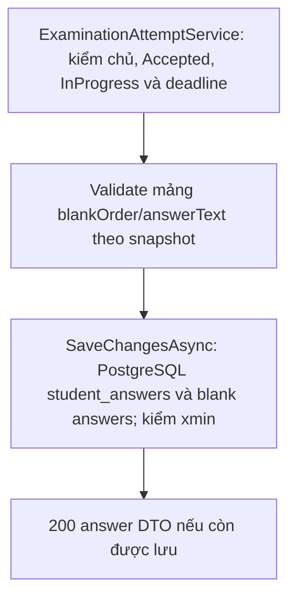

**Request** (mảng thuần, không bọc object):

```json
[
  {
    "blankOrder": 1,
    "answerText": "Paris"
  }
]
```

**Response `200 OK`:**

```json
{
  "id": "00000000-0000-0000-0000-000000000022",
  "examinationQuestionId": "00000000-0000-0000-0000-000000000023",
  "questionType": "FillInBlank",
  "selectedOptionId": null,
  "fillInBlankAnswers": [
    {
      "blankOrder": 1,
      "answerText": "Paris"
    }
  ],
  "modifiedAt": "2026-09-10T08:15:00Z"
}
```

## `POST /api/examination-attempts/{attemptId}/disconnect`

Luồng xử lý và dữ liệu:

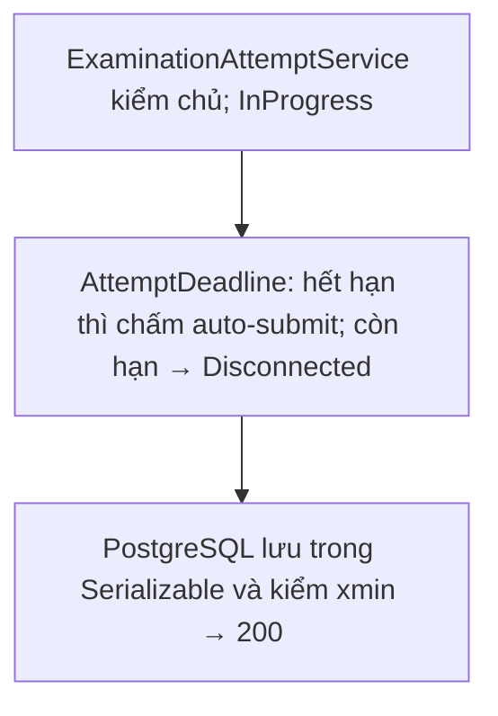

**Không có body.** Chỉ khi `InProgress`. Hết thời gian thì auto-submit; chưa hết thì chuyển `Disconnected` và giữ `remainingSeconds`. **Response `200 OK`:** Attempt object.

## `POST /api/examination-attempts/{attemptId}/reconnect`

Luồng xử lý và dữ liệu:

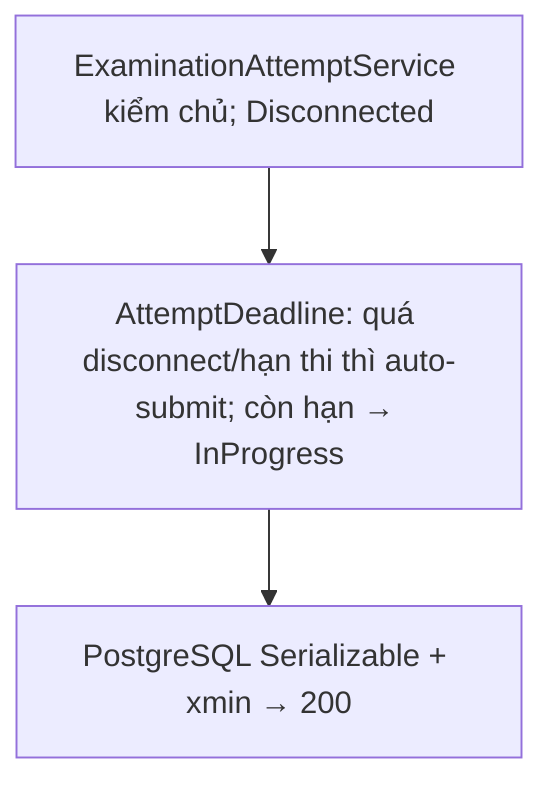

**Không có body.** Chỉ khi `Disconnected`. Quá `maxDisconnectMinutes` hoặc hết giờ thì auto-submit; hợp lệ thì về `InProgress`. **Response `200 OK`:** Attempt object.

## `POST /api/examination-attempts/{attemptId}/violations?violationType=TabChanged&durationSeconds=`

Luồng xử lý và dữ liệu:

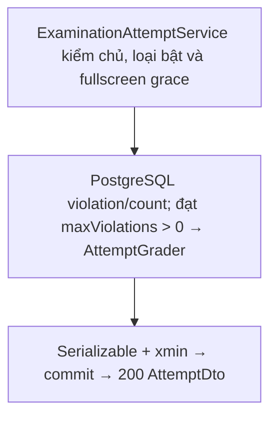

**Không có body.** `violationType` là giá trị của `ExaminationViolationType`. Chỉ ghi nhận loại vi phạm đã bật trong `security` của kỳ thi. Với `ExitFullscreen`, `durationSeconds` bắt buộc; thời gian ≤ `fullscreenGraceSeconds` không tính vi phạm. Khi `violationCount` đạt `maxViolations` (> 0) thì auto-submit (`MaxViolationsExceeded`). **Response `200 OK`:** Attempt object.

## `POST /api/examination-attempts/{attemptId}/submit`

Luồng xử lý và dữ liệu:

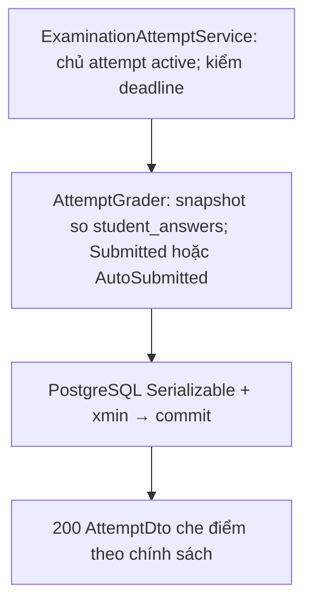

**Không có body.** Attempt phải active. Đã hết giờ → `submitReason=DurationExpired`, ngược lại `StudentSubmitted`. Server chấm điểm. **Response `200 OK`:** Attempt object; nếu `showScoreImmediately=false` thì `correctAnswers`, `totalQuestions`, `score` là `null`.

> Lưu ý giao diện: với kỳ thi có `requireFullscreen=true`, `window.confirm()`/native confirmation thường bị chặn trong chế độ toàn màn hình và không phù hợp cho luồng nộp bài. Frontend nên dùng modal tùy chỉnh trong app trước khi gọi API submit. Sau khi nhận `200 OK`, frontend nên quay về màn hình chi tiết kỳ thi và refetch dữ liệu mới nhất để hiển thị kết quả ngay mà không cần F5/manual reload.

## `POST /api/examination-attempts/{attemptId}/auto-submit?reason=DurationExpired`

Luồng xử lý và dữ liệu:

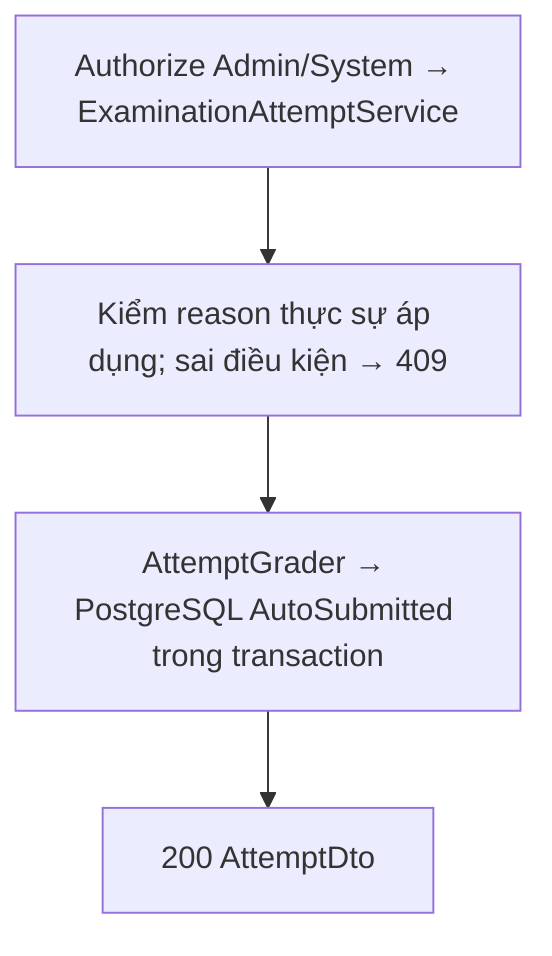

**Quyền:** Admin/System (`[Authorize(Roles = "Admin,System")]`); frontend student không gọi. **Không có body.** `reason` không được là `StudentSubmitted`; backend kiểm tra điều kiện thực tế (deadline, disconnect timeout, ngưỡng vi phạm, kỳ thi đã đóng), không đúng điều kiện trả `409`. **Response `200 OK`:** Attempt object.

## `DELETE /api/examinations/{examinationId}/attempts/{attemptId}`

Bổ sung sơ đồ cho action reset đã liệt kê ở đầu trang. [ExaminationsController](../../LMS.Api/presentation/controllers/ExaminationsController.cs) gọi `ExaminationAttemptService.ResetAsync`; teacher chủ course hoặc Admin/System được thực hiện.

Luồng xử lý và dữ liệu:

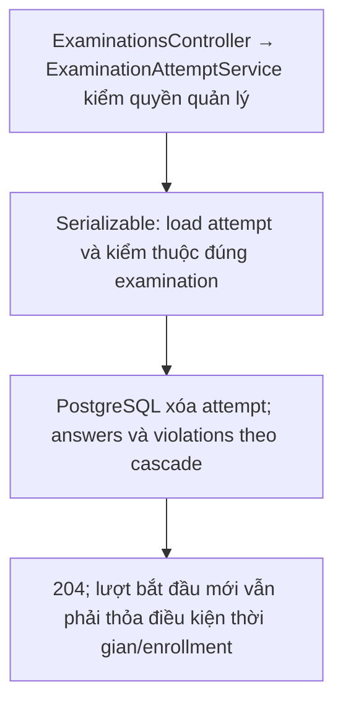
