# API – Exercises, Submissions và chấm điểm

Đối chiếu mã nguồn ngày **2026-10-13**. Mô tả implementation trong repository, không phải xác nhận môi trường production.

Cần JWT. Dữ liệu đi qua PostgreSQL (`exercises`, `exercise_attachments`, `submissions`, `submission_attachments`); endpoint file còn qua Storage và Cleanup queue. Quyền Admin trong bảng bao gồm System. Không gửi mail khi giao bài, nộp bài hoặc chấm điểm; không dùng Redis/SignalR cho các thao tác này. Tham số `download` hiện không đổi Content-Disposition (xem [conventions.md](conventions.md)).

| Method | Path | Quyền | Chức năng |
| --- | --- | --- | --- |
| POST | `/api/courses/{courseId}/exercises` | Teacher sở hữu, Admin | Tạo bài tập (`Draft`) |
| GET | `/api/courses/{courseId}/exercises` | Teacher sở hữu, Admin, Student `Accepted` | Danh sách |
| GET | `/api/exercises/{exerciseId}` | như trên | Chi tiết |
| PUT | `/api/exercises/{exerciseId}` | Teacher sở hữu, Admin | Sửa |
| DELETE | `/api/exercises/{exerciseId}` | Teacher sở hữu, Admin | Xóa (chỉ `Draft`) |
| POST | `/api/exercises/{exerciseId}/attachment` | Teacher sở hữu, Admin | Thêm/thay file đề (chỉ `Draft`) |
| GET | `/api/exercises/{exerciseId}/attachment` | như xem bài tập | Tải file đề |
| POST | `/api/exercises/{exerciseId}/publish` | Teacher sở hữu, Admin | `Draft` → `Published` |
| POST | `/api/exercises/{exerciseId}/close` | Teacher sở hữu, Admin | `Published` → `Closed` |
| POST | `/api/exercises/{exerciseId}/submissions` | Student `Accepted` | Upload bài nộp (tạo/thay draft) |
| GET | `/api/exercises/{exerciseId}/my-submission` | Student `Accepted` | Bài nộp của tôi |
| GET | `/api/exercises/{exerciseId}/submissions` | Teacher sở hữu, Admin | Danh sách bài nộp |
| GET | `/api/submissions/{submissionId}/content` | Student chủ bài, Teacher sở hữu, Admin | Tải bài nộp |
| POST | `/api/submissions/{submissionId}/submit` | Student chủ bài | Nộp bài |
| POST | `/api/submissions/{submissionId}/unsubmit` | Student chủ bài | Rút lại bài |
| PUT | `/api/submissions/{submissionId}/grade` | Teacher sở hữu, Admin | Chấm điểm |

Vòng đời bài tập: `Draft → Published → Closed`. Vòng đời bài nộp: `Draft → Submitted → Graded` (có thể `Submitted → Draft` khi unsubmit).

## Exercise object

Luồng xử lý và dữ liệu:

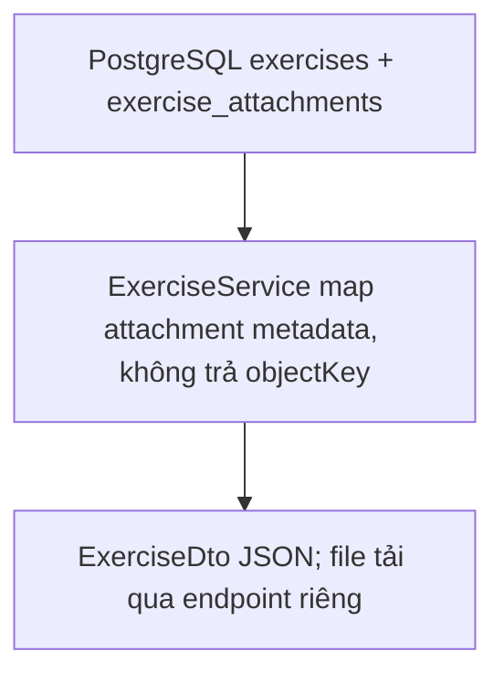

```json
{
  "id": "00000000-0000-0000-0000-000000000013",
  "courseId": "00000000-0000-0000-0000-000000000003",
  "title": "Assignment 1",
  "description": "...",
  "dueAt": "2026-09-20T23:59:00Z",
  "status": "Draft",
  "attachment": null,
  "createdAt": "2026-09-04T10:00:00Z",
  "modifiedAt": "2026-09-04T10:00:00Z"
}
```

`attachment` khi có file:

```json
{
  "id": "00000000-0000-0000-0000-000000000014",
  "fileName": "assignment.pdf",
  "objectKey": "exercises/00000000-0000-0000-0000-000000000013/assignment.pdf",
  "contentType": "application/pdf",
  "fileSize": 12345
}
```

## `POST /api/courses/{courseId}/exercises`

Luồng xử lý và dữ liệu:

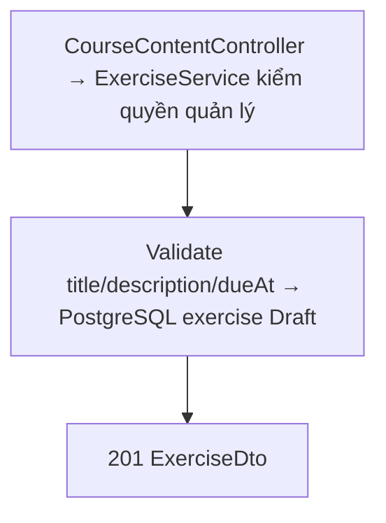

**Request:**

```json
{
  "title": "Assignment 1",
  "description": "...",
  "dueAt": "2026-09-20T23:59:00Z"
}
```

`title` tối đa 200 ký tự, `description` tối đa 4000; `dueAt` nếu có phải UTC. Vượt giới hạn trả `400`. **Response `201 Created`:** Exercise object trạng thái `Draft`.

## `GET /api/courses/{courseId}/exercises`

Luồng xử lý và dữ liệu:

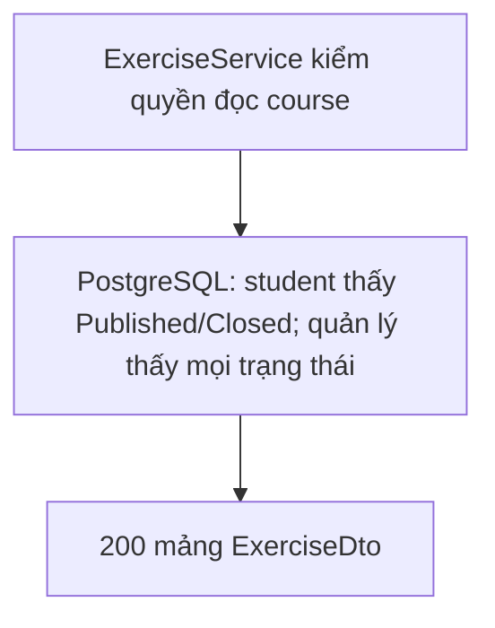

**Response `200 OK`:** Mảng Exercise. Teacher/Admin thấy mọi trạng thái; student thấy `Published` và `Closed` (để xem lịch sử nộp/điểm), không thấy `Draft`.

## `GET /api/exercises/{exerciseId}`

Luồng xử lý và dữ liệu:

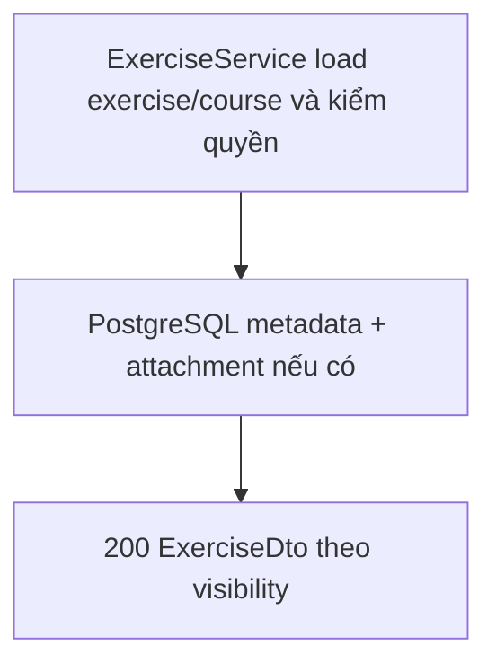

**Response `200 OK`:** Exercise object (cùng quyền như danh sách).

## `PUT /api/exercises/{exerciseId}`

Luồng xử lý và dữ liệu:

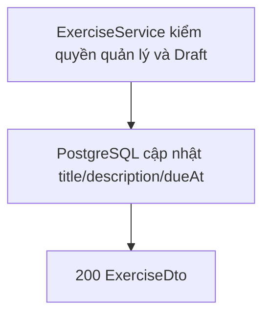

**Request:** cùng shape request tạo. **Response `200 OK`:** Exercise object.

## `DELETE /api/exercises/{exerciseId}`

Luồng xử lý và dữ liệu:

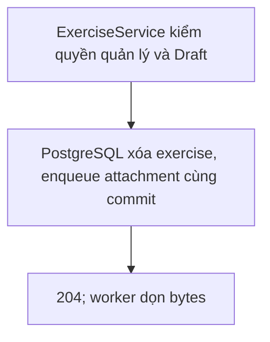

Chỉ `Draft` (để không mất bài nộp đã phát hành); attachment vào Cleanup queue. **Response `204 No Content`.**

## `POST /api/exercises/{exerciseId}/attachment`

Luồng xử lý và dữ liệu:

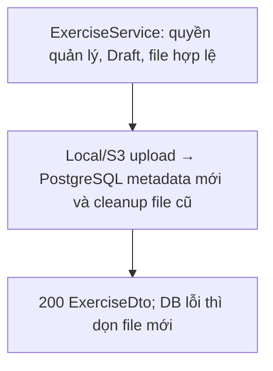

**Request:** `multipart/form-data`, field `file` (< 20 MB). Chỉ `Draft`; upload mới thay file cũ (file cũ vào Cleanup queue). **Response `200 OK`:** Exercise object.

## `GET /api/exercises/{exerciseId}/attachment?download=false`

Luồng xử lý và dữ liệu:

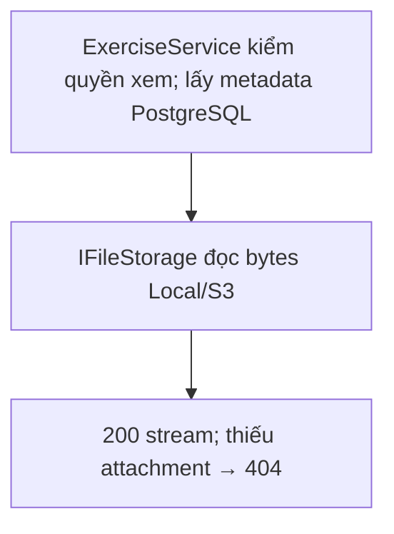

**Response `200 OK`:** Binary stream; `404` nếu chưa có attachment.

## `POST /api/exercises/{exerciseId}/publish`

Luồng xử lý và dữ liệu:

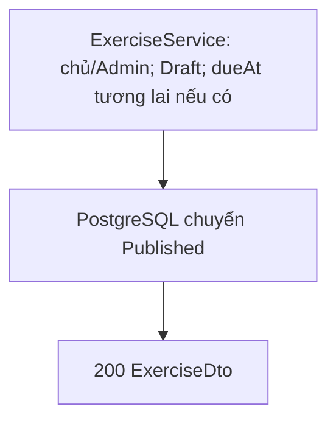

**Không có body.** Chỉ `Draft`; nếu có `dueAt` thì phải ở tương lai. **Response `200 OK`:** Exercise `Published`.

## `POST /api/exercises/{exerciseId}/close`

Luồng xử lý và dữ liệu:

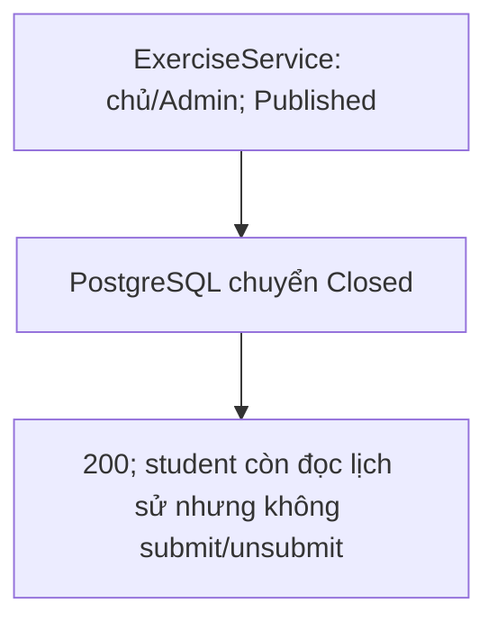

**Không có body.** Chỉ `Published`. Student vẫn xem bài nộp/điểm cũ nhưng không upload/submit/unsubmit được. **Response `200 OK`:** Exercise `Closed`.

## Submission object

Luồng xử lý và dữ liệu:

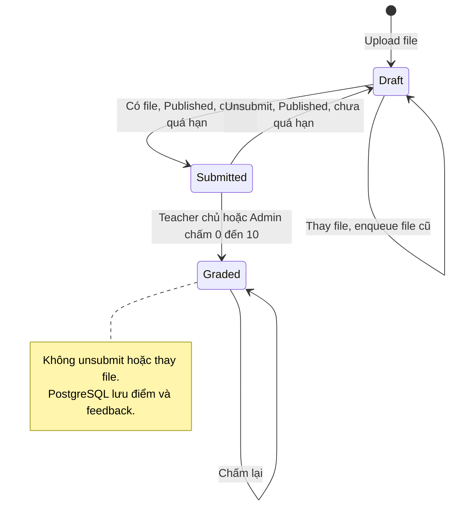

```json
{
  "id": "00000000-0000-0000-0000-000000000015",
  "exerciseId": "00000000-0000-0000-0000-000000000013",
  "studentId": "00000000-0000-0000-0000-000000000001",
  "student": {
    "id": "00000000-0000-0000-0000-000000000001",
    "fullName": "Student",
    "email": "student@example.com"
  },
  "status": "Draft",
  "submittedAt": null,
  "grade": null,
  "feedback": null,
  "gradedAt": null,
  "gradedById": null,
  "attachment": {
    "id": "00000000-0000-0000-0000-000000000016",
    "fileName": "answer.pdf",
    "objectKey": "submissions/00000000-0000-0000-0000-000000000015/answer.pdf",
    "contentType": "application/pdf",
    "fileSize": 10000
  },
  "createdAt": "2026-09-04T10:00:00Z",
  "modifiedAt": "2026-09-04T10:00:00Z"
}
```

`student` có thể `null` ở response không nạp thông tin người dùng.

## `POST /api/exercises/{exerciseId}/submissions`

Luồng xử lý và dữ liệu:

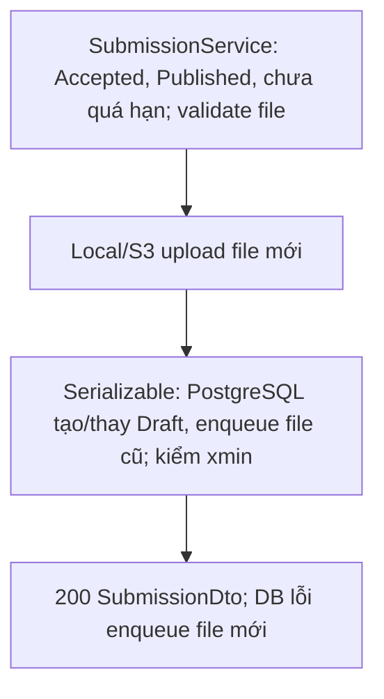

**Request:** `multipart/form-data`, field `file` (< 20 MB).

**Hành vi:** Tạo submission `Draft` nếu chưa có, hoặc thay file của draft hiện tại. Không upload được sau `dueAt` hoặc khi không còn `Draft`. Chạy trong transaction serializable + optimistic concurrency; thua xung đột trả `409` và file mới vào Cleanup queue. **Response `200 OK`:** Submission object.

## `GET /api/exercises/{exerciseId}/my-submission`

Luồng xử lý và dữ liệu:

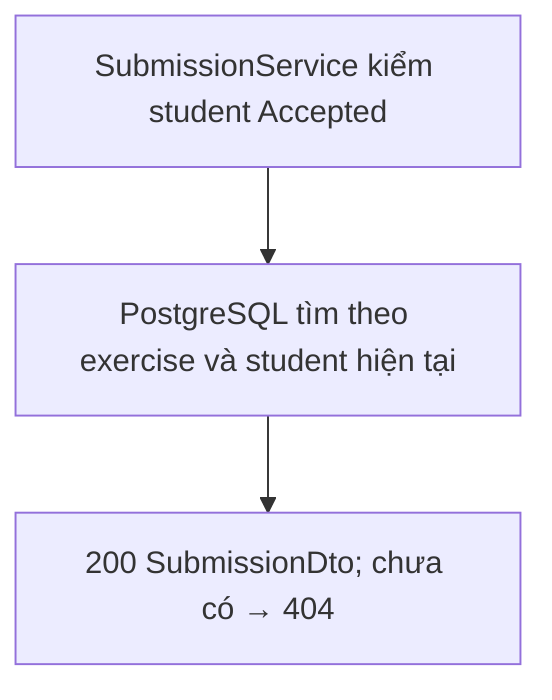

**Response `200 OK`:** Submission của chính student (kèm điểm/nhận xét khi `Graded`); `404` nếu chưa upload.

## `GET /api/exercises/{exerciseId}/submissions?page=1&pageSize=20`

Luồng xử lý và dữ liệu:

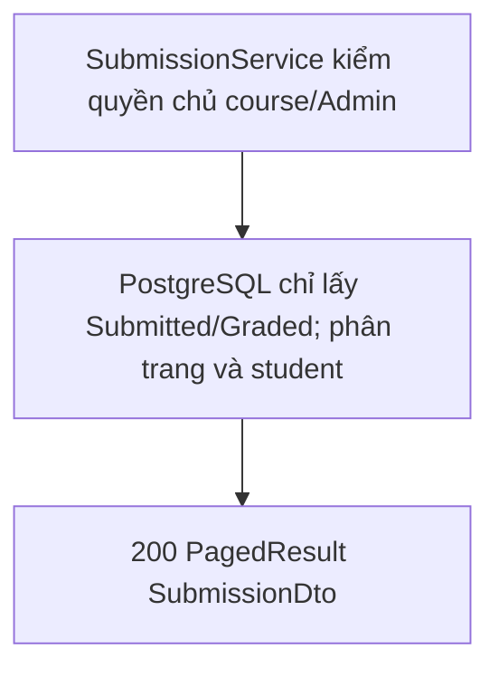

Chỉ trả bài `Submitted`/`Graded` (không lộ draft). **Response `200 OK`:** PagedResult chứa Submission object (có `student`).

## `GET /api/submissions/{submissionId}/content?download=false`

Luồng xử lý và dữ liệu:

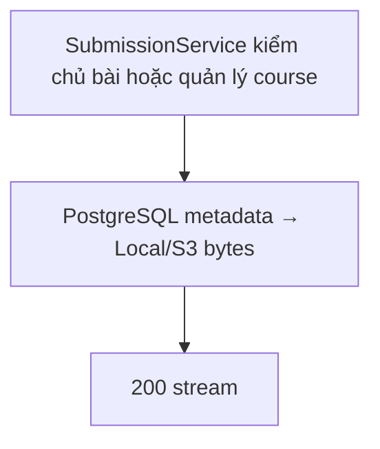

**Response `200 OK`:** Binary stream của file bài nộp.

## `POST /api/submissions/{submissionId}/submit`

Luồng xử lý và dữ liệu:

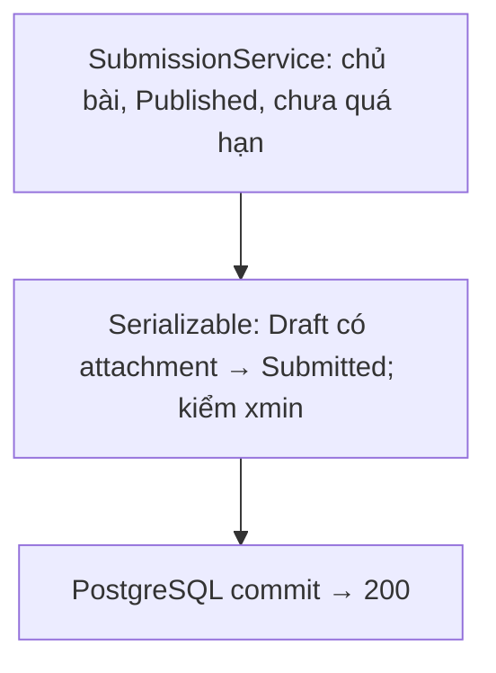

**Không có body.** Chỉ `Draft` đã có attachment và chưa quá `dueAt`. **Response `200 OK`:** Submission `Submitted`, `submittedAt` khác `null`.

## `POST /api/submissions/{submissionId}/unsubmit`

Luồng xử lý và dữ liệu:

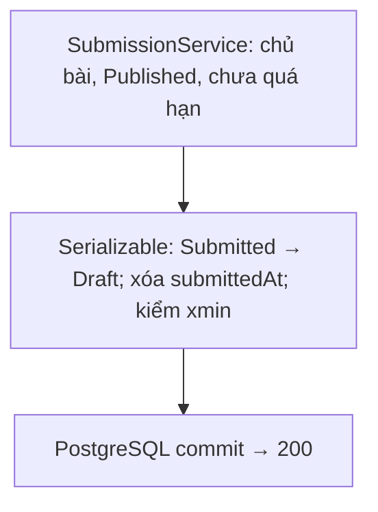

**Không có body.** Chỉ `Submitted` và chưa quá `dueAt`. **Response `200 OK`:** Submission `Draft`, `submittedAt: null`. Bài đã `Graded` không unsubmit/thay file được.

## `PUT /api/submissions/{submissionId}/grade`

Luồng xử lý và dữ liệu:

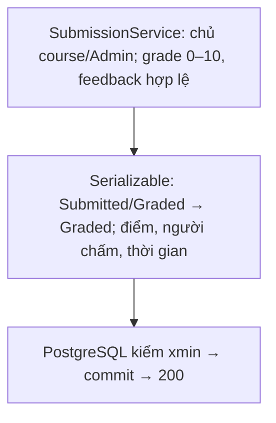

**Request:**

```json
{
  "grade": 8.5,
  "feedback": "Good work"
}
```

`grade` trong khoảng `0..10`, `feedback` tối đa 4000 ký tự. Chấm được bài `Submitted`; chấm lại được bài `Graded`. **Response `200 OK`:** Submission `Graded` (lưu `gradedAt`, `gradedById`).

Upload, submit, unsubmit, grade dùng transaction serializable và optimistic concurrency (row-version); request thua xung đột trả `409`, không ghi đè kết quả đã hoàn tất.
