# API – Question Banks và Questions

Đối chiếu mã nguồn ngày **2026-10-13**. Mô tả implementation trong repository, không phải xác nhận môi trường production.

Cần JWT. Dữ liệu qua PostgreSQL (`question_banks`, `questions`, `multiple_choice_options`, `fill_in_blank_answer_keys`, `users` để lấy chủ bank); chia sẻ còn gửi SMTP sau commit. Không dùng Redis.

| Method | Path | Quyền | Chức năng |
| --- | --- | --- | --- |
| POST | `/api/question-banks` | Teacher cho chính mình | Tạo ngân hàng câu hỏi |
| GET | `/api/question-banks?teacherId=&ownerSearch=` | Teacher (của mình), Admin/System (mọi bank) | Danh sách ngân hàng |
| PUT | `/api/question-banks/{questionBankId}` | Teacher chủ bank | Sửa tên/mô tả |
| DELETE | `/api/question-banks/{questionBankId}` | Teacher chủ bank | Xóa bank và câu hỏi |
| POST | `/api/question-banks/{questionBankId}/share` | Chủ bank (Teacher) | Sao chép bank cho teacher khác theo email |
| POST | `/api/question-banks/{questionBankId}/multiple-choice` | Teacher chủ bank | Thêm câu trắc nghiệm |
| POST | `/api/question-banks/{questionBankId}/fill-in-blank` | Teacher chủ bank | Thêm câu điền khuyết |
| GET | `/api/question-banks/{questionBankId}/questions` | Chủ bank, Admin/System | Danh sách câu hỏi |
| PUT | `/api/questions/{questionId}` | Teacher chủ bank | Sửa nội dung, độ khó và đáp án |
| DELETE | `/api/questions/{questionId}` | Teacher chủ bank | Xóa câu hỏi nguồn |

Câu hỏi trong bank là **nguồn**; kỳ thi tạo snapshot nên sửa/xóa câu hỏi nguồn không ảnh hưởng kỳ thi đã tạo.

## Question bank object

Luồng xử lý và dữ liệu:

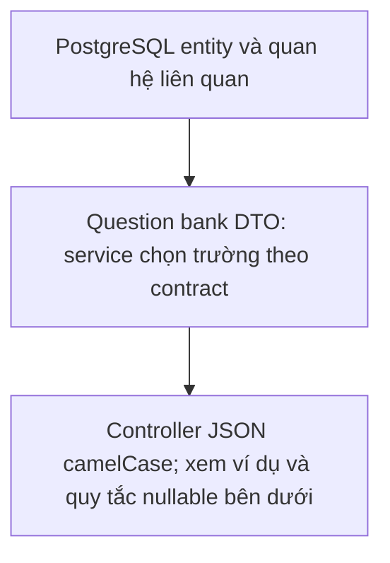

```json
{
  "id": "00000000-0000-0000-0000-000000000005",
  "teacherId": "00000000-0000-0000-0000-000000000002",
  "ownerFullName": "Example Teacher",
  "ownerEmail": "teacher@example.com",
  "name": "C# Questions",
  "description": "Basics",
  "createdAt": "2026-09-04T10:00:00Z",
  "modifiedAt": "2026-09-04T10:00:00Z"
}
```

## `POST /api/question-banks`

Luồng xử lý và dữ liệu:

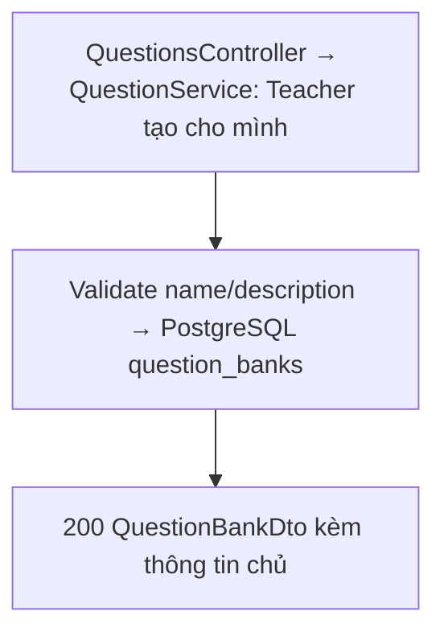

**Request:**

```json
{
  "teacherId": "00000000-0000-0000-0000-000000000002",
  "name": "C# Questions",
  "description": "Basics"
}
```

**Response `200 OK`:** Question bank object. Teacher tạo cho chính mình; Admin/System gọi thao tác ghi nhận `403 Administrator accounts can only view question banks.` Mọi QuestionBankDto còn có `ownerFullName` và `ownerEmail` (hai chuỗi bắt buộc), bao gồm response tạo, sửa, danh sách và chia sẻ.

## `GET /api/question-banks?teacherId={teacherId}`

Luồng xử lý và dữ liệu:

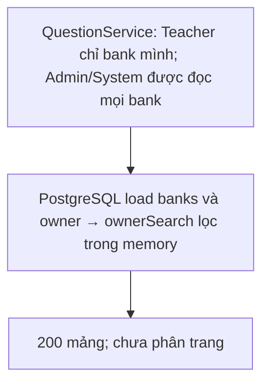

Teacher bỏ `teacherId` để lấy bank của mình, không xem được của teacher khác. Admin/System bỏ `teacherId` để lấy mọi bank, truyền ID để giới hạn theo chủ. `ownerSearch` lọc một phần tên/email chủ bank, trim và không phân biệt hoa thường; lọc trong bộ nhớ sau khi tải bank và chủ bank. Response là mảng, chưa phân trang.

**Response `200 OK`:**

```json
[
  {
    "id": "00000000-0000-0000-0000-000000000005",
    "teacherId": "00000000-0000-0000-0000-000000000002",
    "ownerFullName": "Example Teacher",
    "ownerEmail": "teacher@example.com",
    "name": "C# Questions",
    "description": "Basics",
    "createdAt": "2026-09-04T10:00:00Z",
    "modifiedAt": "2026-09-04T10:00:00Z"
  }
]
```

## `POST /api/question-banks/{questionBankId}/share`

Luồng xử lý và dữ liệu:

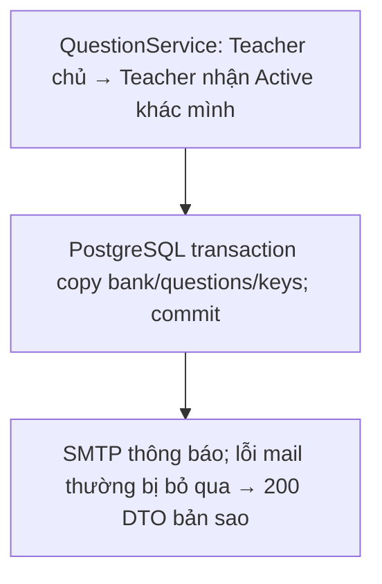

**Request:** `{ "recipientEmail": "teacher2@example.com" }`

Tạo bản sao bank (kèm toàn bộ câu hỏi, đáp án) vào tài khoản Teacher đang Active có email tương ứng, rồi gửi email thông báo (lỗi gửi mail không làm hỏng việc chia sẻ). Tên giữ nguyên, mô tả ghi nguồn. Lỗi: `400` email sai/tự chia sẻ, `403` không phải chủ bank, `404` bank hoặc người nhận không tồn tại.

**Response `200 OK`:** Question bank object của bản sao (`teacherId` = người nhận).

## `PUT /api/question-banks/{questionBankId}`

Luồng xử lý và dữ liệu:

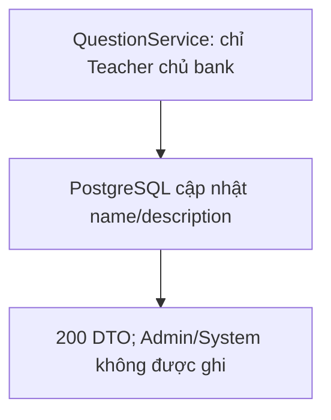

**Request:**

```json
{
  "name": "Updated",
  "description": "Updated"
}
```

**Response `200 OK`:** Question bank object.

## `DELETE /api/question-banks/{questionBankId}`

Luồng xử lý và dữ liệu:

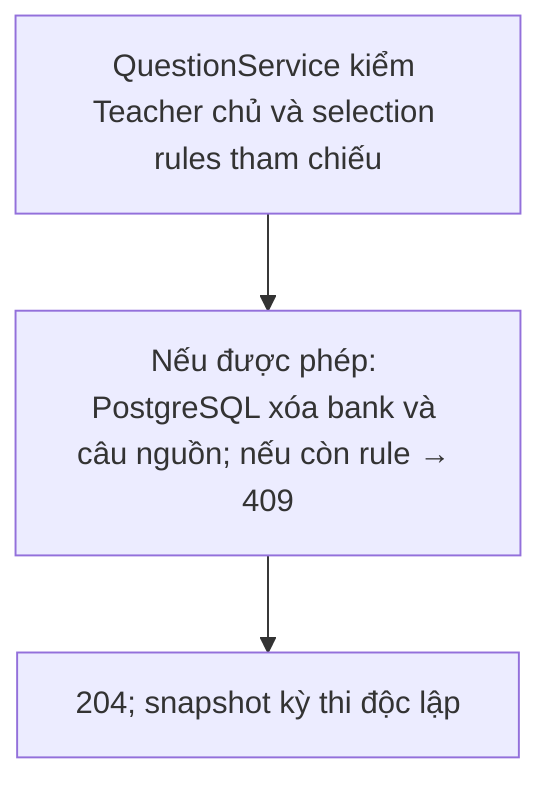

Xóa bank cùng toàn bộ câu hỏi nguồn. `409` nếu bank đang được selection rule của examination tham chiếu. **Response `204 No Content`.**

## Question object – multiple choice

Luồng xử lý và dữ liệu:

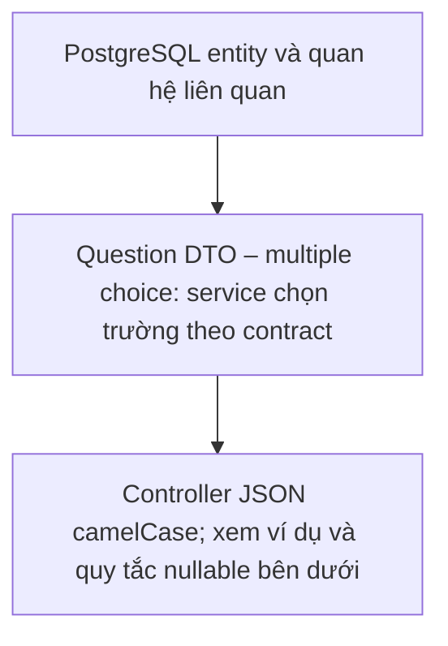

```json
{
  "id": "00000000-0000-0000-0000-000000000006",
  "questionBankId": "00000000-0000-0000-0000-000000000005",
  "content": "2 + 2 = ?",
  "type": "MultipleChoice",
  "difficulty": "Easy",
  "shuffleOptions": true,
  "options": [
    {
      "id": "00000000-0000-0000-0000-000000000007",
      "content": "3",
      "order": 0,
      "isCorrect": false
    },
    {
      "id": "00000000-0000-0000-0000-000000000008",
      "content": "4",
      "order": 1,
      "isCorrect": true
    }
  ],
  "answers": [],
  "createdAt": "2026-09-04T10:00:00Z",
  "modifiedAt": "2026-09-04T10:00:00Z"
}
```

## `POST /api/question-banks/{questionBankId}/multiple-choice`

Luồng xử lý và dữ liệu:

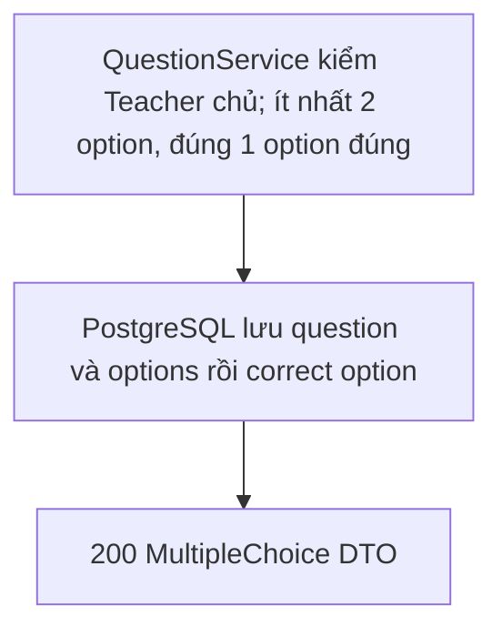

Phải có **chính xác một** option `isCorrect: true`.

**Request:**

```json
{
  "content": "2 + 2 = ?",
  "difficulty": "Easy",
  "shuffleOptions": true,
  "options": [
    { "content": "3", "isCorrect": false },
    { "content": "4", "isCorrect": true }
  ]
}
```

**Response `200 OK`:** Question object dạng multiple choice.

## Question object – fill in blank

Luồng xử lý và dữ liệu:

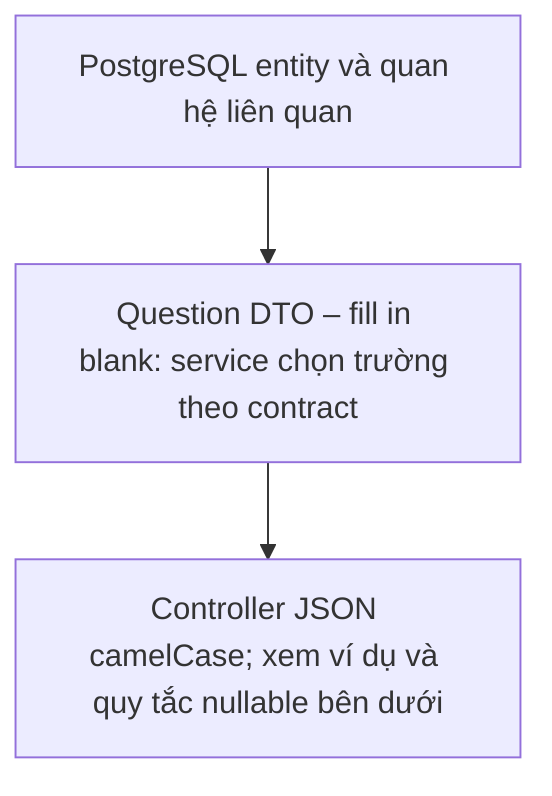

```json
{
  "id": "00000000-0000-0000-0000-000000000009",
  "questionBankId": "00000000-0000-0000-0000-000000000005",
  "content": "Capital of France: ___",
  "type": "FillInBlank",
  "difficulty": "Easy",
  "shuffleOptions": false,
  "options": [],
  "answers": [
    {
      "id": "00000000-0000-0000-0000-000000000010",
      "blankOrder": 1,
      "expectedAnswer": "Paris"
    }
  ],
  "createdAt": "2026-09-04T10:00:00Z",
  "modifiedAt": "2026-09-04T10:00:00Z"
}
```

## `POST /api/question-banks/{questionBankId}/fill-in-blank`

Luồng xử lý và dữ liệu:

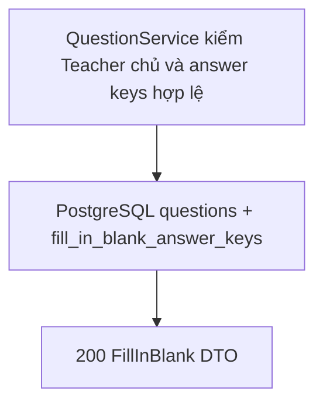

**Request:**

```json
{
  "content": "Capital of France: ___",
  "difficulty": "Easy",
  "answers": [
    { "blankOrder": 1, "expectedAnswer": "Paris" }
  ]
}
```

**Response `200 OK`:** Question object dạng fill in blank.

## `GET /api/question-banks/{questionBankId}/questions`

Luồng xử lý và dữ liệu:

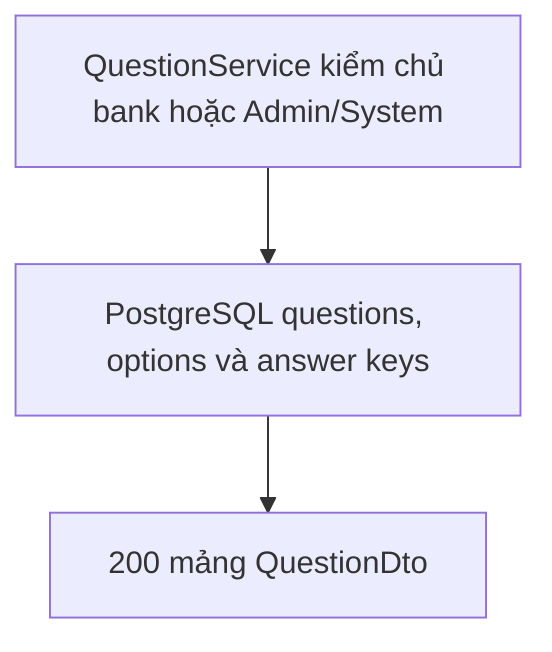

**Response `200 OK`:** Mảng question object (một trong hai dạng trên).

## `PUT /api/questions/{questionId}`

Luồng xử lý và dữ liệu:

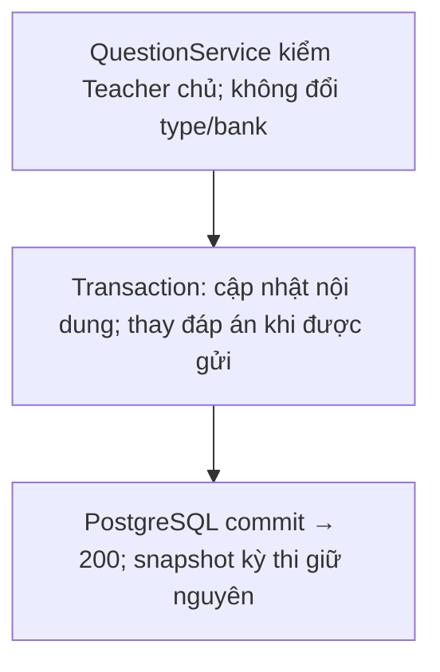

`content` và `difficulty` bắt buộc. Các trường tùy chọn: `shuffleOptions` cho trắc nghiệm, `options` thay toàn bộ phương án trắc nghiệm, `answers` thay toàn bộ đáp án điền khuyết. Bỏ qua hoặc gửi `null` thì giữ tập đáp án cũ; mảng rỗng không hợp lệ. Không đổi loại câu hỏi hoặc bank. Gửi `options` cho câu điền khuyết hoặc `answers` cho câu trắc nghiệm → `400`.

**Request:**

```json
{
  "content": "Updated question",
  "difficulty": "Medium",
  "shuffleOptions": true,
  "options": [
    { "content": "Đáp án A", "isCorrect": true },
    { "content": "Đáp án B", "isCorrect": false }
  ]
}
```

**Response `200 OK`:** Question object. Khi thay options/answers, backend xóa tập cũ rồi lưu tập mới trong transaction để tránh trùng order; ID đáp án có thể đổi. Snapshot kỳ thi đã tạo không đổi.

## `DELETE /api/questions/{questionId}`

Luồng xử lý và dữ liệu:

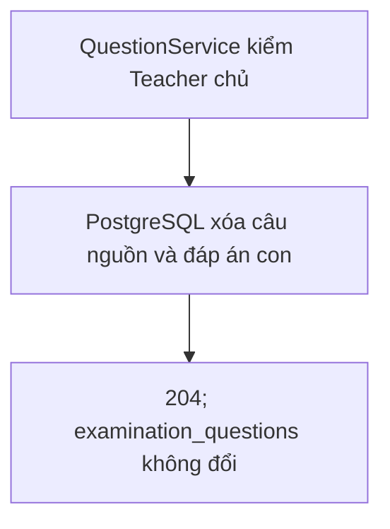

Xóa câu hỏi nguồn; snapshot trong examination giữ nguyên. **Response `204 No Content`.**
