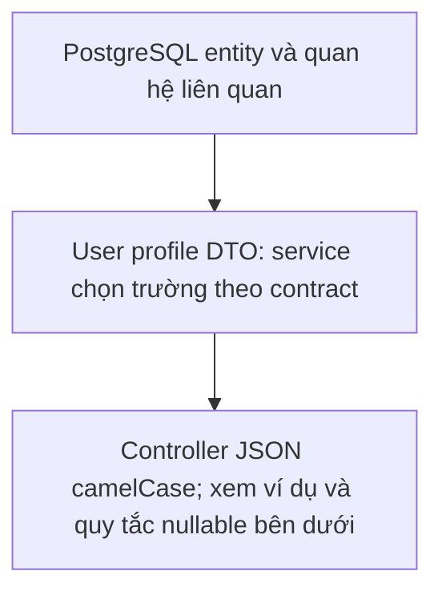
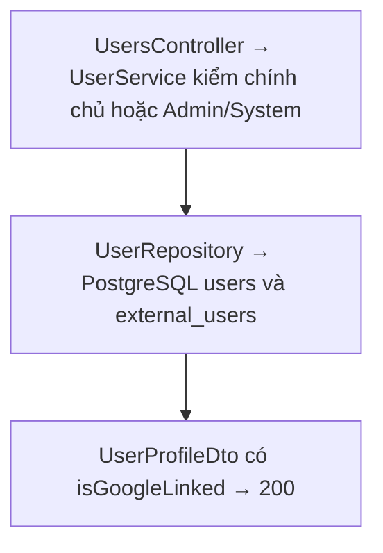
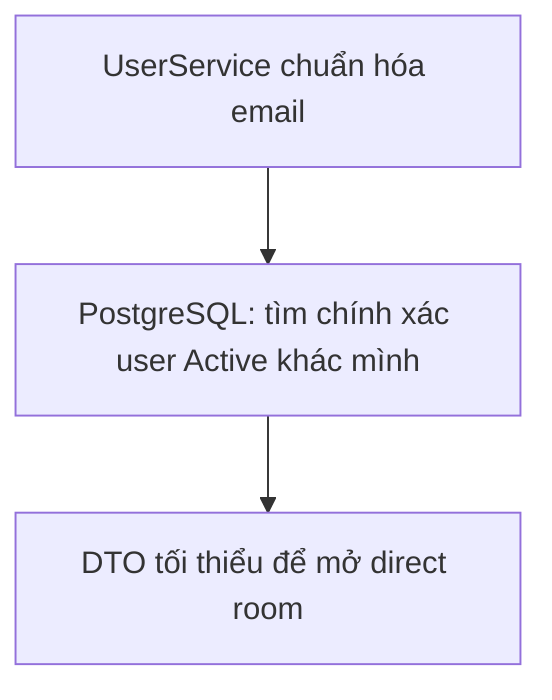
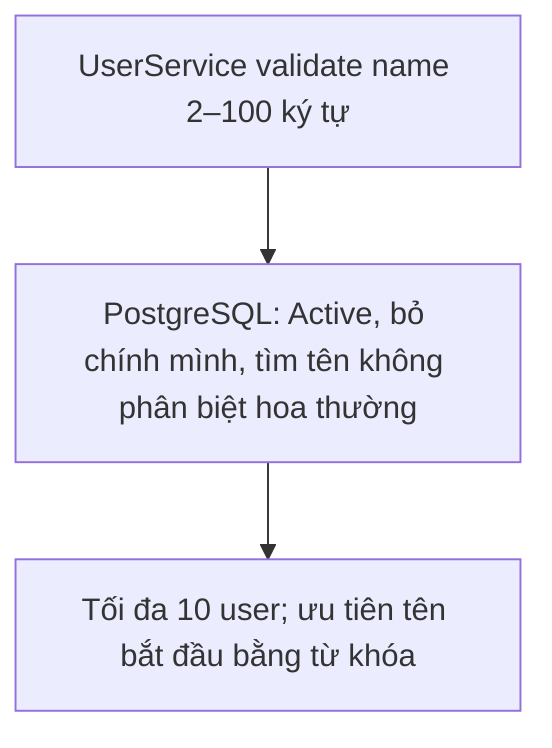
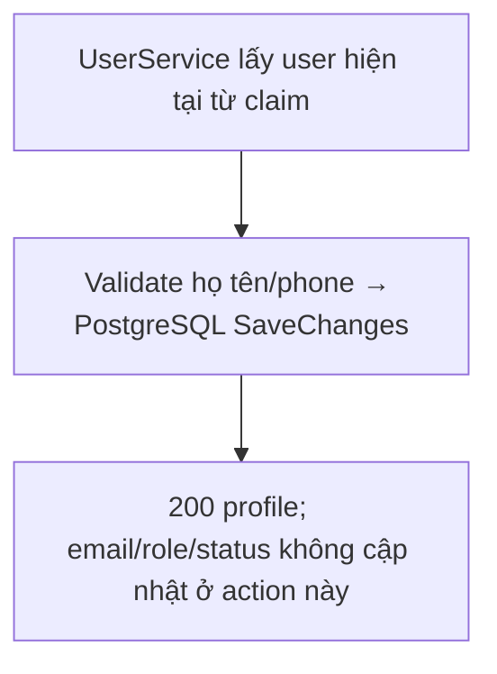
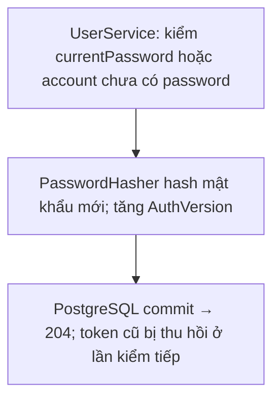
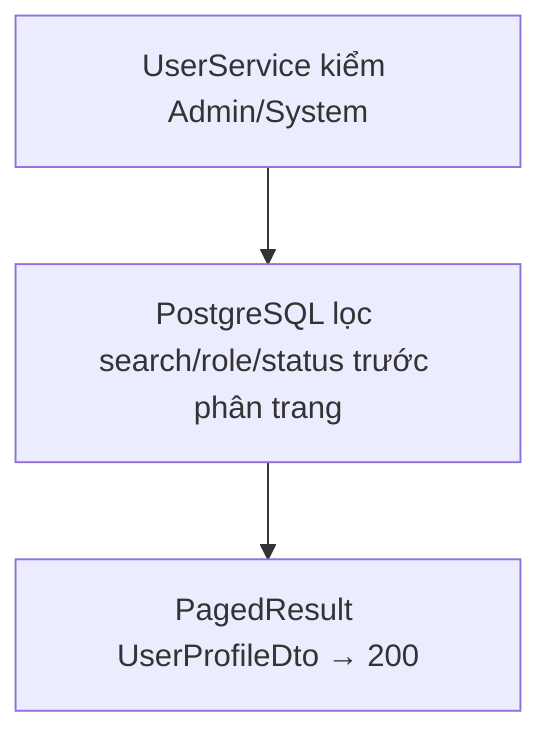
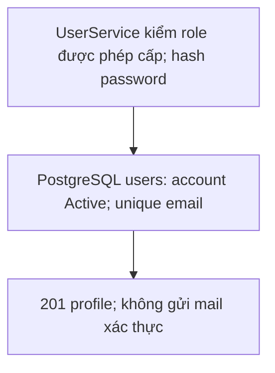
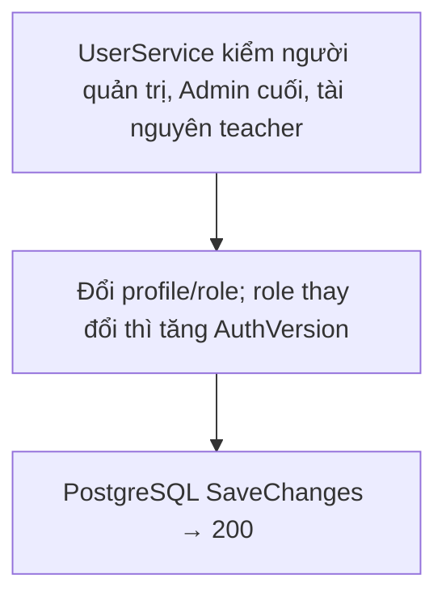
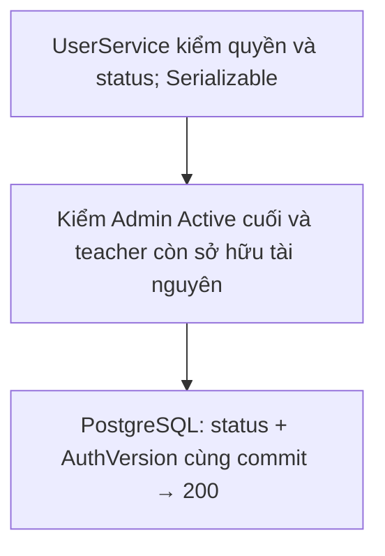

# API – Users

Đối chiếu mã nguồn ngày **2026-10-13**. Mô tả implementation trong repository, không phải xác nhận môi trường production.

Base path: `/api/users`. Cần JWT.

| Method | Path | Quyền | Chức năng |
| --- | --- | --- | --- |
| GET | `/api/users/{userId}/profile` | Chính chủ, Admin hoặc System | Xem hồ sơ |
| GET | `/api/users/search-for-chat?email=` | Đã đăng nhập | Tìm user theo email để tạo chat trực tiếp |
| GET | `/api/users/search-for-chat/by-name?name=` | Đã đăng nhập | Tìm tối đa 10 user theo tên để tạo chat trực tiếp |
| PUT | `/api/users/me` | Đã đăng nhập | Sửa họ tên, số điện thoại |
| PUT | `/api/users/me/password` | Đã đăng nhập | Đổi/tạo mật khẩu |
| GET | `/api/users` | Admin hoặc System | Danh sách, tìm kiếm, lọc theo role/status, phân trang |
| POST | `/api/users` | Admin hoặc System (chỉ System được tạo Admin) | Tạo user |
| PUT | `/api/users/{userId}` | Admin hoặc System | Sửa họ tên, phone, role theo quyền |
| PATCH | `/api/users/{userId}/status` | Admin hoặc System | Đổi trạng thái tài khoản theo quyền |

`System` có quyền quản trị như `Admin` và là vai trò duy nhất được tạo/cấp thêm `Admin`. Cơ sở dữ liệu có unique filtered index để chỉ cho phép tối đa một tài khoản `System`. Không endpoint nào cho phép tạo hoặc gán vai trò `System`; tài khoản System được seed khi API khởi động từ biến môi trường `SYSTEMACCOUNT__EMAIL`/`SYSTEMACCOUNT__PASSWORD` (xem `setup.md`). Nếu email đã tồn tại thì tài khoản đó được nâng lên `System`; do unique index, seed sẽ lỗi nếu đã có một tài khoản `System` khác.

Tất cả chỉ dùng PostgreSQL (`users`, `external_users`); không dùng Redis.

## User profile object

Luồng xử lý và dữ liệu:



```json
{
  "id": "00000000-0000-0000-0000-000000000002",
  "email": "teacher@example.com",
  "fullName": "Teacher",
  "phone": "0900000000",
  "role": "Teacher",
  "status": "Active",
  "avatarUrl": null,
  "createdAt": "2026-09-04T10:00:00Z",
  "hasPassword": true,
  "isGoogleLinked": null
}
```

`isGoogleLinked` là `true`/`false` chỉ ở `GET /api/users/{userId}/profile`; các response khác trả `null`.

## `GET /api/users/{userId}/profile`

Luồng xử lý và dữ liệu:



User xem chính mình; Admin và System xem mọi user. **Response `200 OK`:** User profile object.

## `GET /api/users/search-for-chat?email=student@example.com`

Luồng xử lý và dữ liệu:



Tìm **chính xác** theo email chuẩn hóa, chỉ trả tài khoản `Active`, không trả chính mình. Chỉ trả dữ liệu tối thiểu.

**Response `200 OK`:**

```json
{
  "id": "00000000-0000-0000-0000-000000000001",
  "email": "student@example.com",
  "fullName": "Student",
  "avatarUrl": null,
  "role": "Student"
}
```

## `GET /api/users/search-for-chat/by-name?name=nguyen`

Luồng xử lý và dữ liệu:



Tìm không phân biệt hoa thường theo một phần họ tên. Từ khóa phải có 2–100 ký tự. Chỉ trả tối đa 10 tài khoản `Active`, ưu tiên tên bắt đầu bằng từ khóa và không trả chính người đang tìm.

**Response `200 OK`:** Mảng dữ liệu user tối thiểu; có thể rỗng.

```json
[
  {
    "id": "00000000-0000-0000-0000-000000000001",
    "email": "student@example.com",
    "fullName": "Nguyen Van A",
    "avatarUrl": null,
    "role": "Student"
  }
]
```

## `PUT /api/users/me`

Luồng xử lý và dữ liệu:



Email, role, status, avatar không đổi được ở đây.

**Request:**

```json
{
  "fullName": "Updated Name",
  "phone": "0900000000"
}
```

**Response `200 OK`:** User profile object.

## `PUT /api/users/me/password`

Luồng xử lý và dữ liệu:



Tài khoản local phải gửi đúng `currentPassword`. Tài khoản OAuth chưa có mật khẩu gửi `currentPassword: null` để tạo mật khẩu lần đầu.

**Request:**

```json
{
  "currentPassword": "current-password",
  "newPassword": "new-password",
  "passwordConfirm": "new-password"
}
```

Mật khẩu mới dài 8–128 ký tự, khớp xác nhận và khác mật khẩu hiện tại. Đổi mật khẩu và tăng `auth_version` cùng một commit → mọi access/refresh token đã phát bị thu hồi.

**Response `204 No Content`.** Client phải xóa token/cookie và yêu cầu đăng nhập lại.

## `GET /api/users?search=&role=&status=&page=1&pageSize=20`

Luồng xử lý và dữ liệu:



Tham số truy vấn đều tùy chọn:

| Tham số | Kiểu | Giá trị | Chức năng |
| --- | --- | --- | --- |
| `search` | string | Tên hoặc email | Tìm kiếm không phân biệt hoa thường |
| `role` | enum | `Student`, `Teacher`, `Admin`, `System` | Lọc theo vai trò tài khoản |
| `status` | enum | `Active`, `Inactive`, `Disabled`, `Banned` | Lọc theo trạng thái tài khoản |
| `page` | int | Mặc định `1` | Trang kết quả |
| `pageSize` | int | Mặc định `20`, tối đa `100` | Số tài khoản mỗi trang |

Có thể kết hợp `search`, `role` và `status`; bộ lọc được áp dụng trước khi phân trang. `totalCount` là tổng số tài khoản khớp tất cả điều kiện lọc, không chỉ số phần tử trong trang hiện tại. Ví dụ, lấy giảng viên đang hoạt động:

`GET /api/users?role=Teacher&status=Active&page=1&pageSize=20`

**Response `200 OK`:**

```json
{
  "items": [
    {
      "id": "00000000-0000-0000-0000-000000000002",
      "email": "teacher@example.com",
      "fullName": "Teacher",
      "phone": null,
      "role": "Teacher",
      "status": "Active",
      "avatarUrl": null,
      "createdAt": "2026-09-04T10:00:00Z",
      "hasPassword": true
    }
  ],
  "page": 1,
  "pageSize": 20,
  "totalCount": 1,
  "totalPages": 1
}
```

## `POST /api/users`

Luồng xử lý và dữ liệu:



Admin tạo user role `Student`/`Teacher`; System có thể tạo thêm user role `Admin`. Không thể tạo role `System` qua API. Tài khoản mới có status `Active`.

**Request:**

```json
{
  "email": "teacher@example.com",
  "fullName": "Teacher",
  "phone": "0900000000",
  "password": "password123",
  "role": "Teacher"
}
```

**Response `201 Created`:** User profile object.

## `PUT /api/users/{userId}`

Luồng xử lý và dữ liệu:



**Request:**

```json
{
  "fullName": "Updated Name",
  "phone": "0900000000",
  "role": "Teacher"
}
```

**Response `200 OK`:** User profile object.

Quy tắc:

- Admin chỉ sửa được tài khoản `Student`/`Teacher`, không sửa được tài khoản Admin hoặc System.
- System có thể sửa tài khoản Admin nhưng không thể sửa hoặc thay đổi vai trò tài khoản System.
- Không endpoint user-management nào cho phép Admin tự thay đổi tài khoản Admin của chính mình.
- Không thể hạ quyền/vô hiệu hóa Admin `Active` cuối cùng.
- Teacher đang sở hữu course hoặc question bank không thể đổi sang role khác cho tới khi chuyển quyền sở hữu.
- Đổi role tăng `AuthVersion` → thu hồi token cũ.

## `PATCH /api/users/{userId}/status`

Luồng xử lý và dữ liệu:



**Request:**

```json
{
  "status": "Disabled"
}
```

**Response `200 OK`:** User profile object.

Quy tắc:

- `status` chỉ nhận `Active`, `Disabled`, `Banned`; gửi `Inactive` → `400` (`Inactive` chỉ tồn tại sau khi đăng ký, chờ xác thực email).
- Admin chỉ đổi trạng thái tài khoản `Student`/`Teacher`; System có thể đổi trạng thái Admin.
- Không thể vô hiệu hóa Admin `Active` cuối cùng; kiểm tra trong transaction serializable.
- Teacher đang sở hữu course/question bank không thể rời `Active`.
- Đổi status tăng `AuthVersion` trong cùng transaction → thu hồi token cũ.
