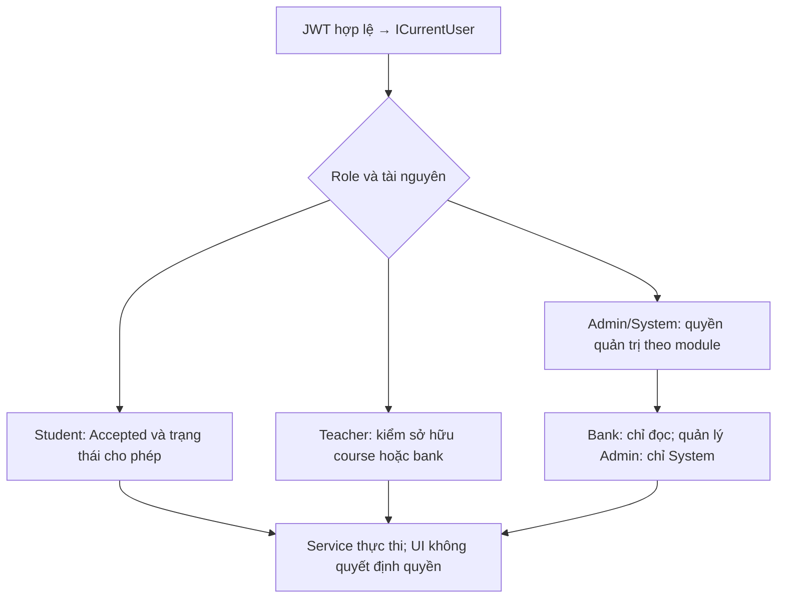
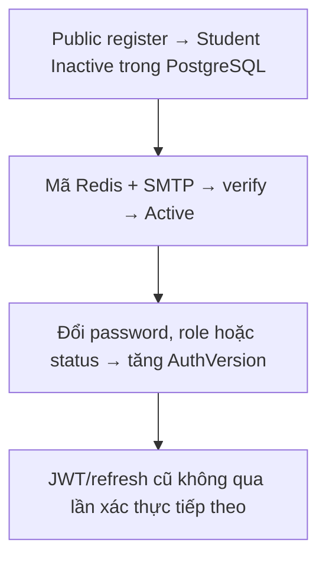
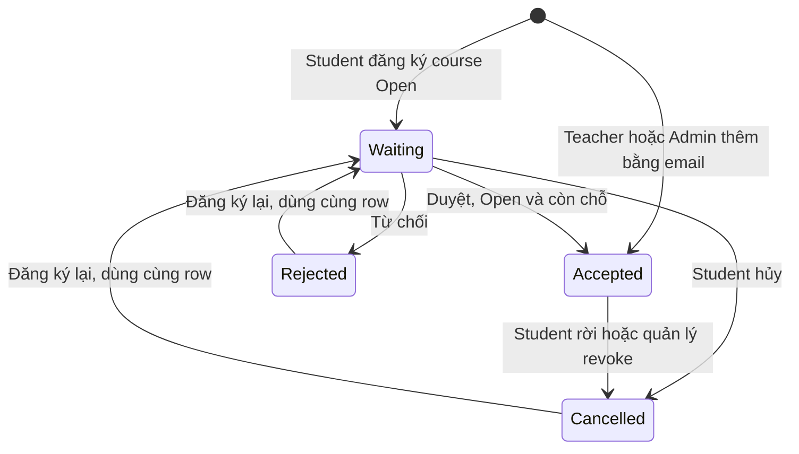
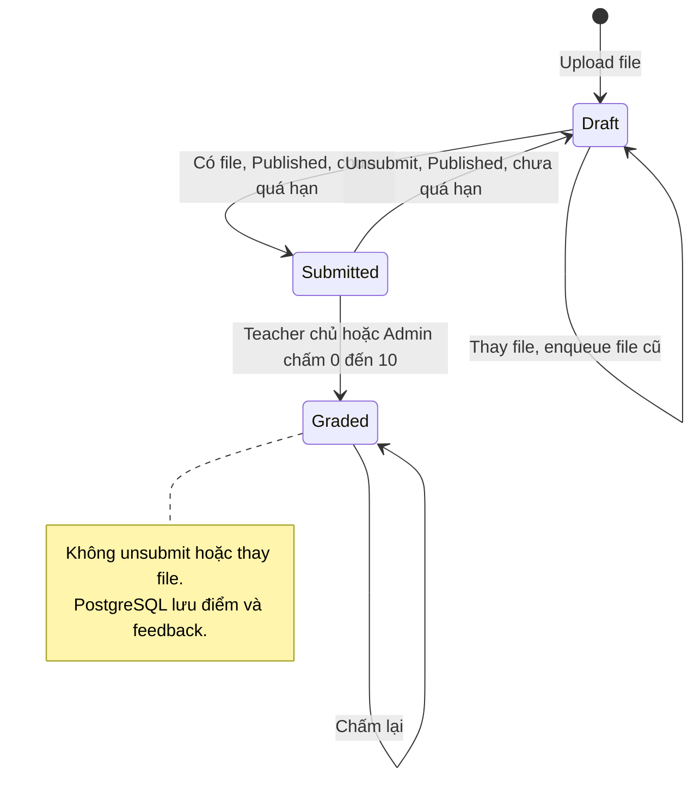
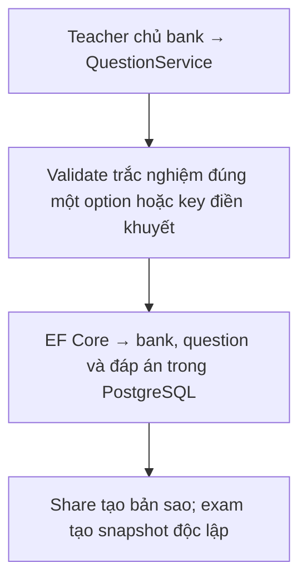
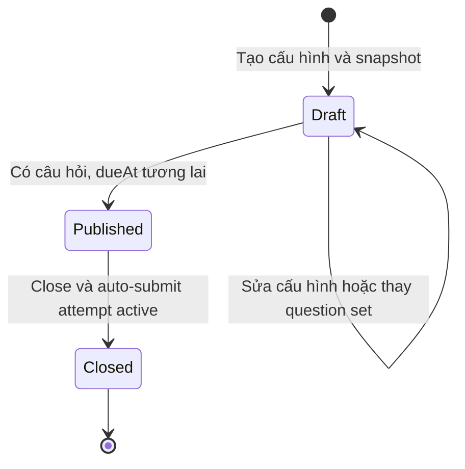
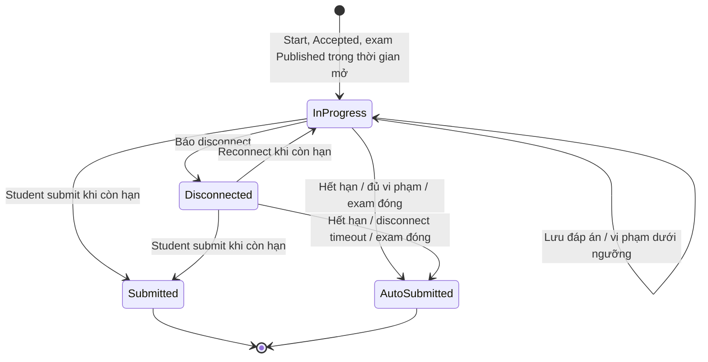
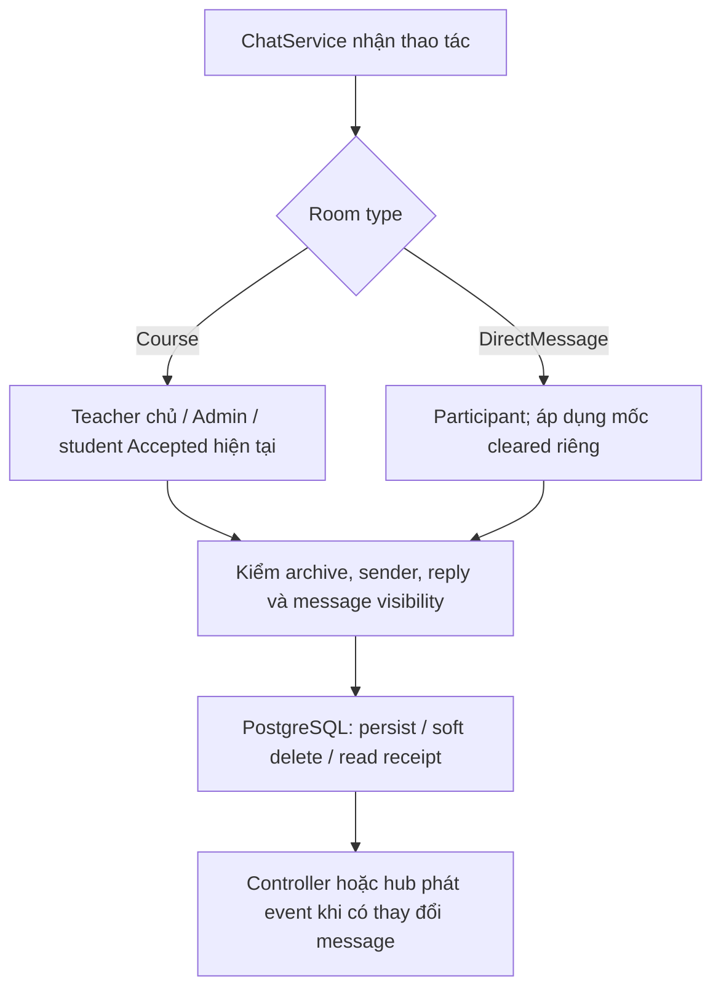

# Backend – Quy tắc nghiệp vụ

Đối chiếu mã nguồn ngày **2026-10-13**. Mô tả implementation trong repository, không phải xác nhận môi trường production.

Tổng hợp quy tắc đang được code thực thi. Chi tiết endpoint xem [../api/conventions.md](../api/conventions.md); luồng xử lý xem [data-flow.md](data-flow.md).

## 1. Ma trận quyền

Luồng xử lý và dữ liệu:

`S` = Student, `T` = Teacher, `A` = Admin hoặc System đối với chức năng học tập. Riêng quản lý tài khoản: chỉ System tạo/cấp Admin; Admin chỉ quản lý Student/Teacher; System không sửa tài khoản System qua API quản trị. "Chủ" = Teacher sở hữu course/question bank. "Accepted" = student có enrollment `Accepted` của course.

| Chức năng | S | T | A |
| --- | --- | --- | --- |
| Đăng ký, đăng nhập, quên mật khẩu, OAuth | Public | Public | Public |
| Xem/sửa hồ sơ của mình, đổi mật khẩu | ✔ | ✔ | ✔ |
| Xem hồ sơ người khác, quản lý user | ✘ | ✘ | ✔ |
| Tạo course | ✘ | ✔ (cho chính mình) | ✔ (cho teacher `Active`) |
| Xem danh sách course | chỉ `Open` | ✔ | ✔ (+ đã xóa) |
| Sửa/xóa/khôi phục course | ✘ | Chủ | ✔ |
| Đăng ký học | ✔ (`Active`) | ✘ | ✘ |
| Duyệt/từ chối/loại học viên | ✘ | Chủ | ✔ |
| Soạn bài giảng, tài liệu, bài tập | ✘ | Chủ | ✔ |
| Đọc bài giảng/tài liệu | Accepted, chỉ `Published` | Chủ (cả `Draft`) | ✔ |
| Đọc bài tập | Accepted, `Published` và `Closed` | Chủ | ✔ |
| Nộp bài, rút bài | Accepted | ✘ | ✘ |
| Chấm điểm | ✘ | Chủ | ✔ |
| Đọc question bank/câu hỏi | ✘ | Chủ | ✔ (mọi bank) |
| Tạo/sửa/xóa/chia sẻ question bank/câu hỏi | ✘ | Chủ | ✘ |
| Soạn kỳ thi, publish, close | ✘ | Chủ | ✔ |
| Xem kỳ thi (dạng học viên) | Accepted, không `Draft` | Chủ | ✔ |
| Làm bài thi | Accepted | ✘ | ✘ |
| Xem kết quả cả lớp | ✘ | Chủ | ✔ |
| Auto-submit thủ công | ✘ | ✘ | ✔ |
| Chat khóa học | Accepted | Chủ | ✔ |
| Chat trực tiếp | ✔ (user `Active`) | ✔ | ✔ |
| Xóa tin nhắn người khác | ✘ | Trong course room | ✔ |

## 2. Tài khoản

Luồng xử lý và dữ liệu:

| Quy tắc | Giá trị |
| --- | --- |
| Email | Chuẩn hóa chữ thường, ≤ 255 ký tự, hợp lệ theo `MailAddress` |
| Mật khẩu | 8–128 ký tự |
| Hồ sơ khi đăng ký | Họ tên bắt buộc (tối đa 100 ký tự); số điện thoại tùy chọn (tối đa 20 ký tự) |
| Đăng ký tự do | Luôn `Student`, `Inactive`; kích hoạt bằng mã email |
| Tạo bởi Admin/System | Admin tạo Student/Teacher; System thêm được Admin; luôn `Active`, không gửi mail xác thực |
| Đăng nhập | Chỉ `Active` |
| Đổi role/status | Tăng `AuthVersion` → thu hồi mọi token |
| Admin | Không sửa được admin khác; admin `Active` cuối cùng không bị hạ role hay khóa |
| Teacher đang sở hữu course/question bank | Không đổi role, không rời `Active` cho tới khi chuyển quyền sở hữu |
| Google | Chỉ một identity mỗi provider cho mỗi user và một identity chỉ thuộc một user; tài khoản Google-only đặt mật khẩu lần đầu qua `PUT /users/me/password` với `currentPassword: null` |
| Phone | ≤ 20 ký tự |

## 3. Khóa học và đăng ký

Luồng xử lý và dữ liệu:

- `name` 1–200 ký tự, `description` ≤ 2000, `maxStudents > 0`.
- `maxStudents` không được thấp hơn số `Accepted` hiện tại.
- `Closed` = ngừng tuyển; student đã `Accepted` vẫn xem nội dung (`/courses/mine`, `/enrollments/mine`).
- Student chỉ đăng ký course `Open`; accept chỉ khi course `Open` và chưa đủ sĩ số.
- Enrollment: `Waiting → Accepted | Rejected | Cancelled`; `Accepted → Cancelled` (rời/revoke); `Rejected | Cancelled → Waiting` (đăng ký lại, cùng record). Teacher sở hữu/Admin có thể thêm student `Active` bằng email, vào thẳng `Accepted` (vẫn tuân thủ `maxStudents`).
- Xóa course là xóa mềm; chat room bị archive. Khôi phục: archive được gỡ nếu course quay lại `Open`.

## 4. Nội dung học

Luồng xử lý và dữ liệu:

**Lesson**: `name` 1–200, `order ≥ 0` và duy nhất trong course; `Draft`/`Published`. Reorder phải gửi đủ mọi lesson của course; hệ thống đánh lại `order` từ `1` trong một transaction.

**Exercise**: `Draft → Published → Closed`.
- Chỉ `Draft` được sửa, đổi attachment, xóa.
- Publish: nếu có `dueAt` thì phải ở tương lai.
- `title` 1–200, `description` ≤ 4000, `dueAt` UTC.

**Submission**: `Draft → Submitted → Graded`.
- Chỉ nộp khi exercise `Published`, chưa quá `dueAt`, student `Accepted`.
- `Submitted → Draft` qua `unsubmit` (chưa quá hạn).
- `Graded` không thể unsubmit hay thay file; teacher chấm lại được.
- `grade` ∈ [0, 10], `feedback` ≤ 4000.
- Mỗi student một submission cho mỗi exercise, tối đa một file.

**Material / attachment**: một file mỗi attachment; mọi file < 20 MB; không giới hạn loại file.

## 5. Ngân hàng câu hỏi

Luồng xử lý và dữ liệu:

- Bank: `name` 1–200, `description` ≤ 2000; chủ phải là teacher `Active`.
- Trắc nghiệm: ≥ 2 option, **đúng một** option đúng, nội dung option không rỗng.
- Điền khuyết: ≥ 1 đáp án; mỗi đáp án `blankOrder ≥ 0`, ≤ 1000 ký tự; không trùng `(blankOrder, expectedAnswer)`.
- Sửa câu hỏi đổi `content`, `difficulty`, tùy chọn `shuffleOptions`, thay toàn bộ `options` hoặc `answers` theo đúng loại; snapshot kỳ thi không đổi.
- Chia sẻ tạo bản sao độc lập cho Teacher Active khác, rồi gửi SMTP thông báo; không phải cấp quyền cùng chỉnh bank gốc.
- Không xóa được bank đang được selection rule của examination tham chiếu.

## 6. Kỳ thi

Luồng xử lý và dữ liệu:

| Quy tắc | Giá trị |
| --- | --- |
| Vòng đời | `Draft → Published → Closed` |
| Sửa cấu hình / question set | Chỉ `Draft` |
| Giới hạn câu | ≤ 500 câu/kỳ thi |
| Thời gian | `startAt`, `dueAt` UTC; `dueAt > startAt`; `durationMinutes` nằm gọn trong khoảng đó |
| Publish | Có ≥ 1 câu và `dueAt` ở tương lai |
| Close | Chỉ `Published`; auto-submit hết attempt active với `ExaminationClosed` |
| Chọn câu | `Random` (rule theo bank + độ khó + số lượng, lấy ngẫu nhiên và lưu cố định) hoặc `Manual` (danh sách theo thứ tự) – loại trừ nhau |
| Nguồn câu hỏi | Bank phải thuộc teacher phụ trách course |
| Cấu hình giám sát | `requireFullscreen`, `fullscreenGraceSeconds`, `maxViolations` (0 = không giới hạn), `blockCopyPaste`, `blockRightClick`, `detectTabChange`, `detectDevTools`, `maxDisconnectMinutes` (không âm) |
| Hiển thị điểm | `showScoreImmediately` hoặc khi `Closed`/quá `dueAt` |

## 7. Làm bài thi

Luồng xử lý và dữ liệu:

| Quy tắc | Giá trị |
| --- | --- |
| Số lượt | **Một** lượt hiện hữu cho mỗi student/kỳ thi (409 nếu bắt đầu lại); Teacher chủ course/Admin/System được reset bằng cách xóa lượt và dữ liệu con |
| Bắt đầu | Kỳ thi `Published`, `startAt ≤ now < dueAt`, student `Accepted` |
| Hạn chót của attempt | `min(startedAt + durationMinutes, dueAt)` |
| Chấm điểm | Mỗi câu 0/1, `score = correct / total × 10` |
| Điền khuyết | Đúng khi mọi ô đều khớp (trim, không phân biệt hoa thường) |
| Thứ tự câu/option | Xáo trộn ổn định theo `attemptId` nếu `shuffleQuestions`/`shuffleOptions` |
| Ngắt kết nối | Quá `maxDisconnectMinutes` → `DisconnectTimeout` |
| Vi phạm | Chỉ loại đã bật; đạt `maxViolations` → `MaxViolationsExceeded`; thoát fullscreen ≤ grace không tính |
| Hoàn thành | `Submitted` (student, còn giờ) hoặc `AutoSubmitted` (hệ thống) |

## 8. Chat

Luồng xử lý và dữ liệu:

- Course room: một room/course; truy cập tính lại theo course/enrollment mỗi lần.
- Direct room: một room/cặp user, hai bên phải `Active`, không chat với chính mình.
- Tin nhắn: text ≤ 4000 ký tự; phải có text hoặc ít nhất một file; reply phải cùng room và chưa xóa.
- Room archived (course `Closed`/xóa): đọc được lịch sử nhưng không gửi, sửa, join.
- Sửa: chỉ sender. Xóa (mềm): sender, Admin, Teacher trong course room.
- Đã đọc: chỉ tiến, không lùi.
- Xóa direct conversation: lưu `ConversationClearedAt`/`ConversationHiddenAt` theo participant; không xóa message/file của người kia. Mở lại/tin nhắn mới bỏ mốc hidden nhưng giữ mốc cleared.
