# Từ điển dữ liệu PostgreSQL

Đối chiếu ngày 2026-10-13 từ [EF snapshot](../../LMS.Api/infrastructure/persistence/migrations/AppDbContextModelSnapshot.cs). Đây là model lưu trong repository, không phải schema introspect từ DB production. Đọc cùng [data-model](data-model.md) để hiểu nghiệp vụ và [configurations](../../LMS.Api/infrastructure/persistence/configurations) để kiểm tra mapping hiện hành. Giá trị mặc định của constructor khác SQL DEFAULT; không suy ra hai thứ giống nhau.

Cột Nullable dựa trên CLR nullable/IsRequired trong snapshot; kiểu enum đã qua converter có thể xuất hiện là string. `xmin` là cột hệ thống PostgreSQL cho row-version, không phải cột Version tự tăng do ứng dụng tạo. FK/index/check bên dưới giữ biểu thức EF nguyên gốc để tránh mất chi tiết.

## chat_attachments

Quan hệ cục bộ: mũi tên đi từ bảng giữ FK sang bảng được tham chiếu; nhãn cuối là delete behavior khi xóa bản ghi cha, không mô tả xóa mềm:

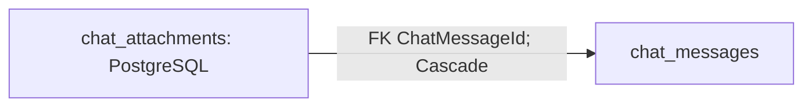

Entity: `ChatAttachment`.

| Property | Cột SQL | Kiểu PostgreSQL | Nullable | Ràng buộc thuộc tính |
| --- | --- | --- | --- | --- |
| `Id` | `id` | uuid | Không | ValueGeneratedOnAdd() |
| `ChatMessageId` | `chat_message_id` | uuid | Không | — |
| `ContentType` | `content_type` | character varying(255) | Không | IsRequired(); HasMaxLength(255) |
| `CreatedAt` | `created_at` | timestamp with time zone | Không | — |
| `FileName` | `file_name` | character varying(255) | Không | IsRequired(); HasMaxLength(255) |
| `FileSize` | `file_size` | bigint | Không | — |
| `ObjectKey` | `object_key` | character varying(1024) | Không | IsRequired(); HasMaxLength(1024) |

Khóa, chỉ mục, quan hệ và CHECK:

```csharp
b.HasKey("Id");
b.HasIndex("ChatMessageId");
b.HasIndex("ObjectKey") .IsUnique();
t.HasCheckConstraint("ck_chat_attachments_file_size", "file_size > 0 AND file_size < 20000000");
b.HasOne("LMS.Api.domain.Entities.Chats.ChatMessage", "ChatMessage") .WithMany("Attachments") .HasForeignKey("ChatMessageId") .OnDelete(DeleteBehavior.Cascade) .IsRequired();
```

## chat_messages

Quan hệ cục bộ: mũi tên đi từ bảng giữ FK sang bảng được tham chiếu; nhãn cuối là delete behavior khi xóa bản ghi cha, không mô tả xóa mềm:

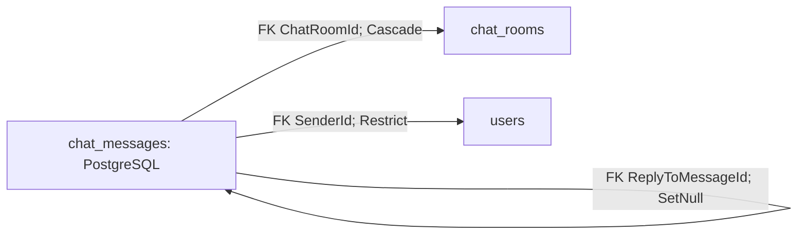

Entity: `ChatMessage`.

| Property | Cột SQL | Kiểu PostgreSQL | Nullable | Ràng buộc thuộc tính |
| --- | --- | --- | --- | --- |
| `Id` | `id` | uuid | Không | ValueGeneratedOnAdd() |
| `ChatRoomId` | `chat_room_id` | uuid | Không | — |
| `Content` | `content` | character varying(4000) | Có | HasMaxLength(4000) |
| `CreatedAt` | `created_at` | timestamp with time zone | Không | — |
| `DeletedAt` | `deleted_at` | timestamp with time zone | Có | — |
| `EditedAt` | `edited_at` | timestamp with time zone | Có | — |
| `ReplyToMessageId` | `reply_to_message_id` | uuid | Có | — |
| `SenderId` | `sender_id` | uuid | Không | — |

Khóa, chỉ mục, quan hệ và CHECK:

```csharp
b.HasKey("Id");
b.HasIndex("ReplyToMessageId");
b.HasIndex("SenderId");
b.HasIndex("ChatRoomId", "CreatedAt", "Id");
b.HasOne("LMS.Api.domain.Entities.Chats.ChatRoom", "ChatRoom") .WithMany() .HasForeignKey("ChatRoomId") .OnDelete(DeleteBehavior.Cascade) .IsRequired();
b.HasOne("LMS.Api.domain.Entities.Chats.ChatMessage", null) .WithMany() .HasForeignKey("ReplyToMessageId") .OnDelete(DeleteBehavior.SetNull);
b.HasOne("LMS.Api.domain.Entities.Users.User", null) .WithMany() .HasForeignKey("SenderId") .OnDelete(DeleteBehavior.Restrict) .IsRequired();
```

## chat_participants

Quan hệ cục bộ: mũi tên đi từ bảng giữ FK sang bảng được tham chiếu; nhãn cuối là delete behavior khi xóa bản ghi cha, không mô tả xóa mềm:

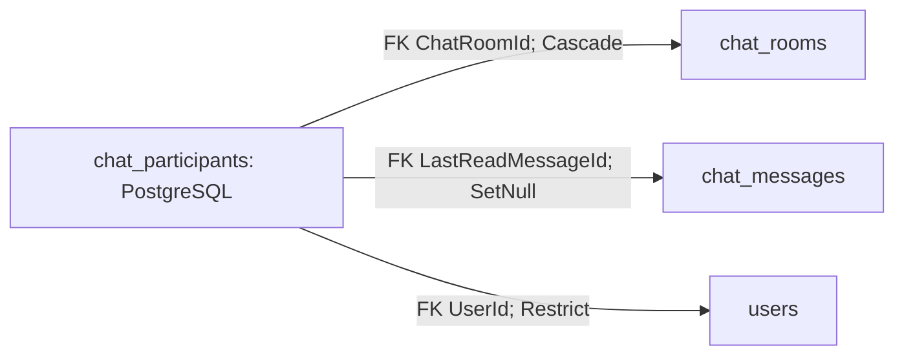

Entity: `ChatParticipant`.

| Property | Cột SQL | Kiểu PostgreSQL | Nullable | Ràng buộc thuộc tính |
| --- | --- | --- | --- | --- |
| `Id` | `id` | uuid | Không | ValueGeneratedOnAdd() |
| `ChatRoomId` | `chat_room_id` | uuid | Không | — |
| `ConversationClearedAt` | `conversation_cleared_at` | timestamp with time zone | Có | — |
| `ConversationHiddenAt` | `conversation_hidden_at` | timestamp with time zone | Có | — |
| `JoinedAt` | `joined_at` | timestamp with time zone | Không | — |
| `LastReadMessageId` | `last_read_message_id` | uuid | Có | — |
| `UserId` | `user_id` | uuid | Không | — |

Khóa, chỉ mục, quan hệ và CHECK:

```csharp
b.HasKey("Id");
b.HasIndex("LastReadMessageId");
b.HasIndex("UserId");
b.HasIndex("ChatRoomId", "UserId") .IsUnique();
b.HasOne("LMS.Api.domain.Entities.Chats.ChatRoom", "ChatRoom") .WithMany("Participants") .HasForeignKey("ChatRoomId") .OnDelete(DeleteBehavior.Cascade) .IsRequired();
b.HasOne("LMS.Api.domain.Entities.Chats.ChatMessage", null) .WithMany() .HasForeignKey("LastReadMessageId") .OnDelete(DeleteBehavior.SetNull);
b.HasOne("LMS.Api.domain.Entities.Users.User", null) .WithMany() .HasForeignKey("UserId") .OnDelete(DeleteBehavior.Restrict) .IsRequired();
```

## chat_rooms

Quan hệ cục bộ: mũi tên đi từ bảng giữ FK sang bảng được tham chiếu; nhãn cuối là delete behavior khi xóa bản ghi cha, không mô tả xóa mềm:

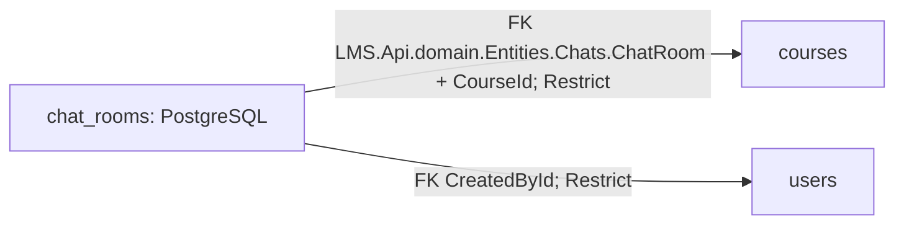

Entity: `ChatRoom`.

| Property | Cột SQL | Kiểu PostgreSQL | Nullable | Ràng buộc thuộc tính |
| --- | --- | --- | --- | --- |
| `Id` | `id` | uuid | Không | ValueGeneratedOnAdd() |
| `ArchivedAt` | `archived_at` | timestamp with time zone | Có | — |
| `CourseId` | `course_id` | uuid | Có | — |
| `CreatedAt` | `created_at` | timestamp with time zone | Không | — |
| `CreatedById` | `created_by_id` | uuid | Không | — |
| `DirectMessageKey` | `direct_message_key` | character varying(65) | Có | HasMaxLength(65) |
| `Type` | `type` | character varying(50) | Không | IsRequired(); HasMaxLength(50) |

Khóa, chỉ mục, quan hệ và CHECK:

```csharp
b.HasKey("Id");
b.HasIndex("ArchivedAt");
b.HasIndex("CourseId") .IsUnique();
b.HasIndex("CreatedById");
b.HasIndex("DirectMessageKey") .IsUnique();
t.HasCheckConstraint("ck_chat_rooms_type_reference", "(type = 'Course' AND course_id IS NOT NULL AND direct_message_key IS NULL) OR (type = 'DirectMessage' AND course_id IS NULL AND direct_message_key IS NOT NULL)");
b.HasOne("LMS.Api.domain.Entities.Courses.Course", null) .WithOne() .HasForeignKey("LMS.Api.domain.Entities.Chats.ChatRoom", "CourseId") .OnDelete(DeleteBehavior.Restrict);
b.HasOne("LMS.Api.domain.Entities.Users.User", null) .WithMany() .HasForeignKey("CreatedById") .OnDelete(DeleteBehavior.Restrict) .IsRequired();
```

## courses

Quan hệ cục bộ: mũi tên đi từ bảng giữ FK sang bảng được tham chiếu; nhãn cuối là delete behavior khi xóa bản ghi cha, không mô tả xóa mềm:

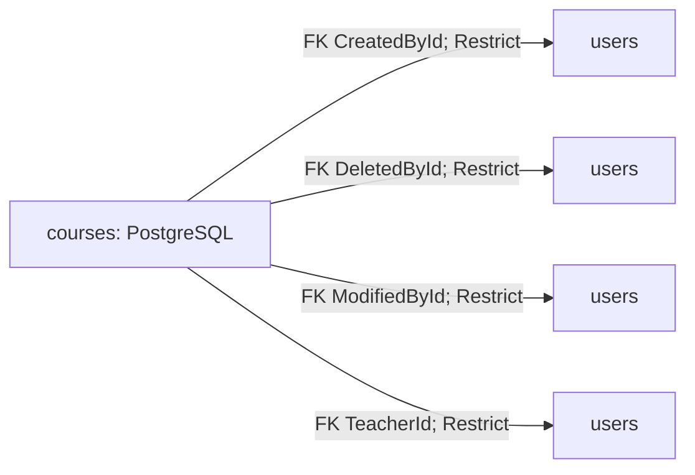

Entity: `Course`.

| Property | Cột SQL | Kiểu PostgreSQL | Nullable | Ràng buộc thuộc tính |
| --- | --- | --- | --- | --- |
| `Id` | `id` | uuid | Không | ValueGeneratedOnAdd() |
| `CreatedAt` | `created_at` | timestamp with time zone | Không | — |
| `CreatedById` | `created_by_id` | uuid | Không | — |
| `DeletedAt` | `deleted_at` | timestamp with time zone | Có | — |
| `DeletedById` | `deleted_by_id` | uuid | Có | — |
| `Description` | `description` | character varying(2000) | Có | HasMaxLength(2000) |
| `MaxStudents` | `max_students` | integer | Không | — |
| `ModifiedAt` | `modified_at` | timestamp with time zone | Không | — |
| `ModifiedById` | `modified_by_id` | uuid | Không | — |
| `Name` | `name` | character varying(200) | Không | IsRequired(); HasMaxLength(200) |
| `Status` | `status` | character varying(50) | Không | IsRequired(); HasMaxLength(50) |
| `TeacherId` | `teacher_id` | uuid | Không | — |

Khóa, chỉ mục, quan hệ và CHECK:

```csharp
b.HasKey("Id");
b.HasIndex("CreatedById");
b.HasIndex("DeletedAt");
b.HasIndex("DeletedById");
b.HasIndex("ModifiedById");
b.HasIndex("Status");
b.HasIndex("TeacherId");
t.HasCheckConstraint("ck_courses_max_students", "max_students > 0");
b.HasOne("LMS.Api.domain.Entities.Users.User", "CreatedBy") .WithMany() .HasForeignKey("CreatedById") .OnDelete(DeleteBehavior.Restrict) .IsRequired();
b.HasOne("LMS.Api.domain.Entities.Users.User", "DeletedBy") .WithMany() .HasForeignKey("DeletedById") .OnDelete(DeleteBehavior.Restrict);
b.HasOne("LMS.Api.domain.Entities.Users.User", "ModifiedBy") .WithMany() .HasForeignKey("ModifiedById") .OnDelete(DeleteBehavior.Restrict) .IsRequired();
b.HasOne("LMS.Api.domain.Entities.Users.User", "Teacher") .WithMany() .HasForeignKey("TeacherId") .OnDelete(DeleteBehavior.Restrict) .IsRequired();
```

## enrollments

Quan hệ cục bộ: mũi tên đi từ bảng giữ FK sang bảng được tham chiếu; nhãn cuối là delete behavior khi xóa bản ghi cha, không mô tả xóa mềm:

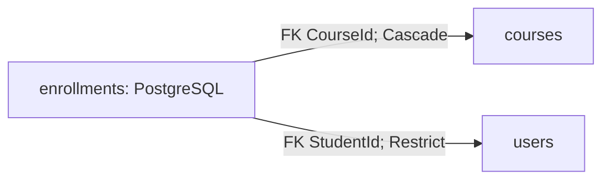

Entity: `Enrollment`.

| Property | Cột SQL | Kiểu PostgreSQL | Nullable | Ràng buộc thuộc tính |
| --- | --- | --- | --- | --- |
| `Id` | `id` | uuid | Không | ValueGeneratedOnAdd() |
| `CourseId` | `course_id` | uuid | Không | — |
| `CreatedAt` | `created_at` | timestamp with time zone | Không | — |
| `ModifiedAt` | `modified_at` | timestamp with time zone | Không | — |
| `Status` | `status` | character varying(50) | Không | IsRequired(); HasMaxLength(50) |
| `StudentId` | `student_id` | uuid | Không | — |

Khóa, chỉ mục, quan hệ và CHECK:

```csharp
b.HasKey("Id");
b.HasIndex("CourseId", "Status");
b.HasIndex("StudentId", "CourseId") .IsUnique();
b.HasOne("LMS.Api.domain.Entities.Courses.Course", "Course") .WithMany() .HasForeignKey("CourseId") .OnDelete(DeleteBehavior.Cascade) .IsRequired();
b.HasOne("LMS.Api.domain.Entities.Users.User", "Student") .WithMany() .HasForeignKey("StudentId") .OnDelete(DeleteBehavior.Restrict) .IsRequired();
```

## exercises

Quan hệ cục bộ: mũi tên đi từ bảng giữ FK sang bảng được tham chiếu; nhãn cuối là delete behavior khi xóa bản ghi cha, không mô tả xóa mềm:

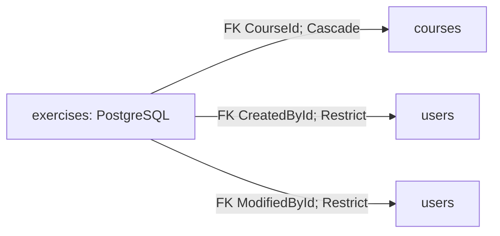

Entity: `Exercise`.

| Property | Cột SQL | Kiểu PostgreSQL | Nullable | Ràng buộc thuộc tính |
| --- | --- | --- | --- | --- |
| `Id` | `id` | uuid | Không | ValueGeneratedOnAdd() |
| `CourseId` | `course_id` | uuid | Không | — |
| `CreatedAt` | `created_at` | timestamp with time zone | Không | — |
| `CreatedById` | `created_by_id` | uuid | Không | — |
| `Description` | `description` | character varying(4000) | Có | HasMaxLength(4000) |
| `DueAt` | `due_at` | timestamp with time zone | Có | — |
| `ModifiedAt` | `modified_at` | timestamp with time zone | Không | — |
| `ModifiedById` | `modified_by_id` | uuid | Không | — |
| `Status` | `status` | character varying(50) | Không | IsRequired(); HasMaxLength(50) |
| `Title` | `title` | character varying(200) | Không | IsRequired(); HasMaxLength(200) |

Khóa, chỉ mục, quan hệ và CHECK:

```csharp
b.HasKey("Id");
b.HasIndex("CourseId");
b.HasIndex("CreatedById");
b.HasIndex("ModifiedById");
b.HasIndex("CourseId", "Status");
b.HasOne("LMS.Api.domain.Entities.Courses.Course", "Course") .WithMany("Exercises") .HasForeignKey("CourseId") .OnDelete(DeleteBehavior.Cascade) .IsRequired();
b.HasOne("LMS.Api.domain.Entities.Users.User", "CreatedBy") .WithMany() .HasForeignKey("CreatedById") .OnDelete(DeleteBehavior.Restrict) .IsRequired();
b.HasOne("LMS.Api.domain.Entities.Users.User", "ModifiedBy") .WithMany() .HasForeignKey("ModifiedById") .OnDelete(DeleteBehavior.Restrict) .IsRequired();
```

## exercise_attachments

Quan hệ cục bộ: mũi tên đi từ bảng giữ FK sang bảng được tham chiếu; nhãn cuối là delete behavior khi xóa bản ghi cha, không mô tả xóa mềm:

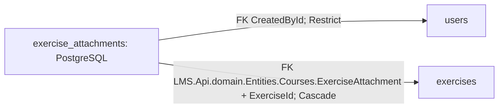

Entity: `ExerciseAttachment`.

| Property | Cột SQL | Kiểu PostgreSQL | Nullable | Ràng buộc thuộc tính |
| --- | --- | --- | --- | --- |
| `Id` | `id` | uuid | Không | ValueGeneratedOnAdd() |
| `ContentType` | `content_type` | character varying(255) | Không | IsRequired(); HasMaxLength(255) |
| `CreatedAt` | `created_at` | timestamp with time zone | Không | — |
| `CreatedById` | `created_by_id` | uuid | Không | — |
| `ExerciseId` | `exercise_id` | uuid | Không | — |
| `FileName` | `file_name` | character varying(255) | Không | IsRequired(); HasMaxLength(255) |
| `FileSize` | `file_size` | bigint | Không | — |
| `ModifiedAt` | `modified_at` | timestamp with time zone | Không | — |
| `ObjectKey` | `object_key` | character varying(1024) | Không | IsRequired(); HasMaxLength(1024) |

Khóa, chỉ mục, quan hệ và CHECK:

```csharp
b.HasKey("Id");
b.HasIndex("CreatedById");
b.HasIndex("ExerciseId") .IsUnique();
b.HasIndex("ObjectKey") .IsUnique();
t.HasCheckConstraint("ck_exercise_attachments_file_size", "file_size > 0");
b.HasOne("LMS.Api.domain.Entities.Users.User", "CreatedBy") .WithMany() .HasForeignKey("CreatedById") .OnDelete(DeleteBehavior.Restrict) .IsRequired();
b.HasOne("LMS.Api.domain.Entities.Courses.Exercise", "Exercise") .WithOne("Attachment") .HasForeignKey("LMS.Api.domain.Entities.Courses.ExerciseAttachment", "ExerciseId") .OnDelete(DeleteBehavior.Cascade);
```

## lessons

Quan hệ cục bộ: mũi tên đi từ bảng giữ FK sang bảng được tham chiếu; nhãn cuối là delete behavior khi xóa bản ghi cha, không mô tả xóa mềm:

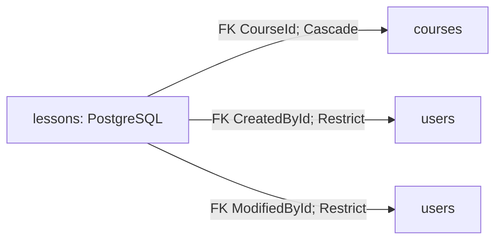

Entity: `Lesson`.

| Property | Cột SQL | Kiểu PostgreSQL | Nullable | Ràng buộc thuộc tính |
| --- | --- | --- | --- | --- |
| `Id` | `id` | uuid | Không | ValueGeneratedOnAdd() |
| `Content` | `content` | text | Có | — |
| `CourseId` | `course_id` | uuid | Không | — |
| `CreatedAt` | `created_at` | timestamp with time zone | Không | — |
| `CreatedById` | `created_by_id` | uuid | Không | — |
| `ModifiedAt` | `modified_at` | timestamp with time zone | Không | — |
| `ModifiedById` | `modified_by_id` | uuid | Không | — |
| `Name` | `name` | character varying(200) | Không | IsRequired(); HasMaxLength(200) |
| `Order` | `lesson_order` | integer | Không | — |
| `Status` | `status` | character varying(50) | Không | IsRequired(); HasMaxLength(50) |

Khóa, chỉ mục, quan hệ và CHECK:

```csharp
b.HasKey("Id");
b.HasIndex("CreatedById");
b.HasIndex("ModifiedById");
b.HasIndex("CourseId", "Order") .IsUnique();
t.HasCheckConstraint("ck_lessons_order", "lesson_order >= 0");
b.HasOne("LMS.Api.domain.Entities.Courses.Course", "Course") .WithMany("Lessons") .HasForeignKey("CourseId") .OnDelete(DeleteBehavior.Cascade) .IsRequired();
b.HasOne("LMS.Api.domain.Entities.Users.User", "CreatedBy") .WithMany() .HasForeignKey("CreatedById") .OnDelete(DeleteBehavior.Restrict) .IsRequired();
b.HasOne("LMS.Api.domain.Entities.Users.User", "ModifiedBy") .WithMany() .HasForeignKey("ModifiedById") .OnDelete(DeleteBehavior.Restrict) .IsRequired();
```

## materials

Quan hệ cục bộ: mũi tên đi từ bảng giữ FK sang bảng được tham chiếu; nhãn cuối là delete behavior khi xóa bản ghi cha, không mô tả xóa mềm:

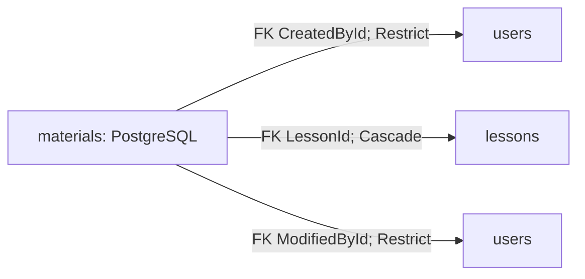

Entity: `Material`.

| Property | Cột SQL | Kiểu PostgreSQL | Nullable | Ràng buộc thuộc tính |
| --- | --- | --- | --- | --- |
| `Id` | `id` | uuid | Không | ValueGeneratedOnAdd() |
| `ContentType` | `content_type` | character varying(255) | Không | IsRequired(); HasMaxLength(255) |
| `CreatedAt` | `created_at` | timestamp with time zone | Không | — |
| `CreatedById` | `created_by_id` | uuid | Không | — |
| `FileName` | `file_name` | character varying(255) | Không | IsRequired(); HasMaxLength(255) |
| `FileSize` | `file_size` | bigint | Không | — |
| `LessonId` | `lesson_id` | uuid | Không | — |
| `ModifiedAt` | `modified_at` | timestamp with time zone | Không | — |
| `ModifiedById` | `modified_by_id` | uuid | Không | — |
| `ObjectKey` | `object_key` | character varying(1024) | Không | IsRequired(); HasMaxLength(1024) |

Khóa, chỉ mục, quan hệ và CHECK:

```csharp
b.HasKey("Id");
b.HasIndex("CreatedById");
b.HasIndex("LessonId");
b.HasIndex("ModifiedById");
b.HasIndex("ObjectKey") .IsUnique();
t.HasCheckConstraint("ck_materials_file_size", "file_size > 0");
b.HasOne("LMS.Api.domain.Entities.Users.User", "CreatedBy") .WithMany() .HasForeignKey("CreatedById") .OnDelete(DeleteBehavior.Restrict) .IsRequired();
b.HasOne("LMS.Api.domain.Entities.Courses.Lesson", "Lesson") .WithMany("Materials") .HasForeignKey("LessonId") .OnDelete(DeleteBehavior.Cascade);
b.HasOne("LMS.Api.domain.Entities.Users.User", "ModifiedBy") .WithMany() .HasForeignKey("ModifiedById") .OnDelete(DeleteBehavior.Restrict) .IsRequired();
```

## submissions

Quan hệ cục bộ: mũi tên đi từ bảng giữ FK sang bảng được tham chiếu; nhãn cuối là delete behavior khi xóa bản ghi cha, không mô tả xóa mềm:

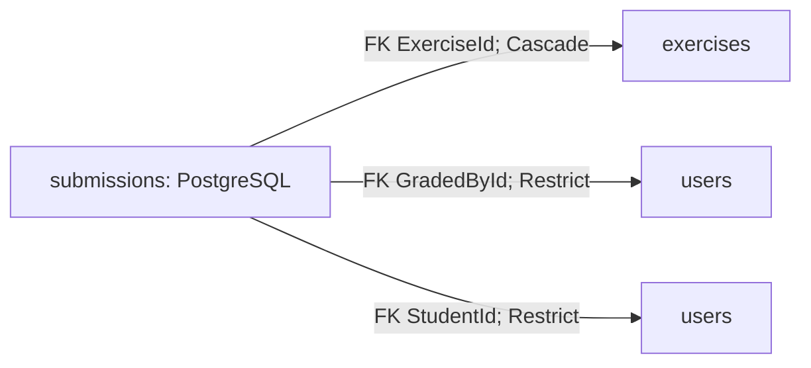

Entity: `Submission`.

| Property | Cột SQL | Kiểu PostgreSQL | Nullable | Ràng buộc thuộc tính |
| --- | --- | --- | --- | --- |
| `Id` | `id` | uuid | Không | ValueGeneratedOnAdd() |
| `CreatedAt` | `created_at` | timestamp with time zone | Không | — |
| `ExerciseId` | `exercise_id` | uuid | Không | — |
| `Feedback` | `feedback` | character varying(4000) | Có | HasMaxLength(4000) |
| `Grade` | `grade` | numeric(5,2) | Có | HasPrecision(5, 2) |
| `GradedAt` | `graded_at` | timestamp with time zone | Có | — |
| `GradedById` | `graded_by_id` | uuid | Có | — |
| `ModifiedAt` | `modified_at` | timestamp with time zone | Không | — |
| `Status` | `status` | character varying(50) | Không | IsRequired(); HasMaxLength(50) |
| `StudentId` | `student_id` | uuid | Không | — |
| `SubmittedAt` | `submitted_at` | timestamp with time zone | Có | — |
| `Version` | `xmin` | xid | Không | IsConcurrencyToken(); ValueGeneratedOnAddOrUpdate() |

Khóa, chỉ mục, quan hệ và CHECK:

```csharp
b.HasKey("Id");
b.HasIndex("GradedById");
b.HasIndex("StudentId");
b.HasIndex("ExerciseId", "StudentId") .IsUnique();
b.HasOne("LMS.Api.domain.Entities.Courses.Exercise", "Exercise") .WithMany() .HasForeignKey("ExerciseId") .OnDelete(DeleteBehavior.Cascade);
b.HasOne("LMS.Api.domain.Entities.Users.User", "GradedBy") .WithMany() .HasForeignKey("GradedById") .OnDelete(DeleteBehavior.Restrict);
b.HasOne("LMS.Api.domain.Entities.Users.User", "Student") .WithMany() .HasForeignKey("StudentId") .OnDelete(DeleteBehavior.Restrict) .IsRequired();
```

## submission_attachments

Quan hệ cục bộ: mũi tên đi từ bảng giữ FK sang bảng được tham chiếu; nhãn cuối là delete behavior khi xóa bản ghi cha, không mô tả xóa mềm:

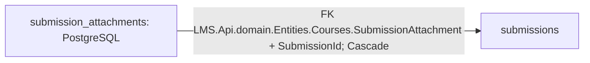

Entity: `SubmissionAttachment`.

| Property | Cột SQL | Kiểu PostgreSQL | Nullable | Ràng buộc thuộc tính |
| --- | --- | --- | --- | --- |
| `Id` | `id` | uuid | Không | ValueGeneratedOnAdd() |
| `ContentType` | `content_type` | character varying(255) | Không | IsRequired(); HasMaxLength(255) |
| `CreatedAt` | `created_at` | timestamp with time zone | Không | — |
| `FileName` | `file_name` | character varying(255) | Không | IsRequired(); HasMaxLength(255) |
| `FileSize` | `file_size` | bigint | Không | — |
| `ModifiedAt` | `modified_at` | timestamp with time zone | Không | — |
| `ObjectKey` | `object_key` | character varying(1024) | Không | IsRequired(); HasMaxLength(1024) |
| `SubmissionId` | `submission_id` | uuid | Không | — |

Khóa, chỉ mục, quan hệ và CHECK:

```csharp
b.HasKey("Id");
b.HasIndex("ObjectKey") .IsUnique();
b.HasIndex("SubmissionId") .IsUnique();
t.HasCheckConstraint("ck_submission_attachments_file_size", "file_size > 0");
b.HasOne("LMS.Api.domain.Entities.Courses.Submission", "Submission") .WithOne("Attachment") .HasForeignKey("LMS.Api.domain.Entities.Courses.SubmissionAttachment", "SubmissionId") .OnDelete(DeleteBehavior.Cascade) .IsRequired();
```

## examinations

Quan hệ cục bộ: mũi tên đi từ bảng giữ FK sang bảng được tham chiếu; nhãn cuối là delete behavior khi xóa bản ghi cha, không mô tả xóa mềm:

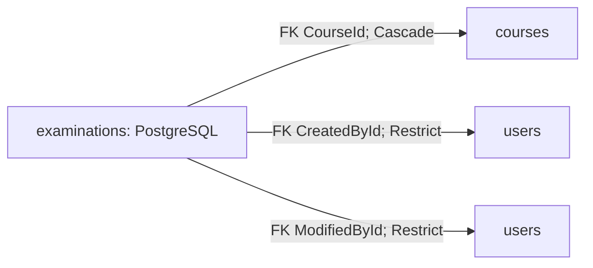

Entity: `Examination`.

| Property | Cột SQL | Kiểu PostgreSQL | Nullable | Ràng buộc thuộc tính |
| --- | --- | --- | --- | --- |
| `Id` | `id` | uuid | Không | ValueGeneratedOnAdd() |
| `BlockCopyPaste` | `block_copy_paste` | boolean | Không | — |
| `BlockRightClick` | `block_right_click` | boolean | Không | — |
| `CourseId` | `course_id` | uuid | Không | — |
| `CreatedAt` | `created_at` | timestamp with time zone | Không | — |
| `CreatedById` | `created_by_id` | uuid | Không | — |
| `Description` | `description` | character varying(4000) | Có | HasMaxLength(4000) |
| `DetectDevTools` | `detect_dev_tools` | boolean | Không | — |
| `DetectTabChange` | `detect_tab_change` | boolean | Không | — |
| `DueAt` | `due_at` | timestamp with time zone | Không | — |
| `DurationMinutes` | `duration_minutes` | integer | Không | — |
| `FullscreenGraceSeconds` | `fullscreen_grace_seconds` | integer | Không | — |
| `MaxDisconnectMinutes` | `max_disconnect_minutes` | integer | Không | — |
| `MaxViolations` | `max_violations` | integer | Không | — |
| `ModifiedAt` | `modified_at` | timestamp with time zone | Không | — |
| `ModifiedById` | `modified_by_id` | uuid | Không | — |
| `RequireFullscreen` | `require_fullscreen` | boolean | Không | — |
| `ShowScoreImmediately` | `show_score_immediately` | boolean | Không | — |
| `ShuffleQuestions` | `shuffle_questions` | boolean | Không | — |
| `StartAt` | `start_at` | timestamp with time zone | Không | — |
| `Status` | `status` | character varying(50) | Không | IsRequired(); HasMaxLength(50) |
| `Title` | `title` | character varying(200) | Không | IsRequired(); HasMaxLength(200) |

Khóa, chỉ mục, quan hệ và CHECK:

```csharp
b.HasKey("Id");
b.HasIndex("CreatedById");
b.HasIndex("ModifiedById");
b.HasIndex("CourseId", "Status");
b.HasIndex("StartAt", "DueAt");
t.HasCheckConstraint("ck_examinations_anti_cheat", "fullscreen_grace_seconds >= 0 AND max_violations >= 0 AND max_disconnect_minutes >= 0");
t.HasCheckConstraint("ck_examinations_duration", "duration_minutes > 0");
t.HasCheckConstraint("ck_examinations_schedule", "due_at > start_at");
b.HasOne("LMS.Api.domain.Entities.Courses.Course", "Course") .WithMany("Examinations") .HasForeignKey("CourseId") .OnDelete(DeleteBehavior.Cascade) .IsRequired();
b.HasOne("LMS.Api.domain.Entities.Users.User", "CreatedBy") .WithMany() .HasForeignKey("CreatedById") .OnDelete(DeleteBehavior.Restrict) .IsRequired();
b.HasOne("LMS.Api.domain.Entities.Users.User", "ModifiedBy") .WithMany() .HasForeignKey("ModifiedById") .OnDelete(DeleteBehavior.Restrict) .IsRequired();
```

## examination_attempts

Quan hệ cục bộ: mũi tên đi từ bảng giữ FK sang bảng được tham chiếu; nhãn cuối là delete behavior khi xóa bản ghi cha, không mô tả xóa mềm:

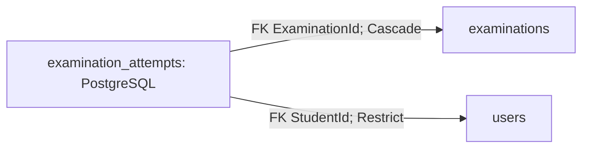

Entity: `ExaminationAttempt`.

| Property | Cột SQL | Kiểu PostgreSQL | Nullable | Ràng buộc thuộc tính |
| --- | --- | --- | --- | --- |
| `Id` | `id` | uuid | Không | ValueGeneratedOnAdd() |
| `CorrectAnswers` | `correct_answers` | integer | Không | — |
| `DisconnectedAt` | `disconnected_at` | timestamp with time zone | Có | — |
| `ExaminationId` | `examination_id` | uuid | Không | — |
| `LastActivityAt` | `last_activity_at` | timestamp with time zone | Không | — |
| `RemainingSeconds` | `remaining_seconds` | integer | Có | — |
| `Score` | `score` | numeric(5,2) | Không | HasPrecision(5, 2) |
| `StartedAt` | `started_at` | timestamp with time zone | Không | — |
| `Status` | `status` | character varying(50) | Không | IsRequired(); HasMaxLength(50) |
| `StudentId` | `student_id` | uuid | Không | — |
| `SubmitReason` | `submit_reason` | character varying(50) | Có | HasMaxLength(50) |
| `SubmittedAt` | `submitted_at` | timestamp with time zone | Có | — |
| `TotalQuestions` | `total_questions` | integer | Không | — |
| `Version` | `xmin` | xid | Không | IsConcurrencyToken(); ValueGeneratedOnAddOrUpdate() |
| `ViolationCount` | `violation_count` | integer | Không | — |

Khóa, chỉ mục, quan hệ và CHECK:

```csharp
b.HasKey("Id");
b.HasIndex("StudentId");
b.HasIndex("ExaminationId", "StudentId") .IsUnique();
b.HasIndex("Status", "LastActivityAt");
t.HasCheckConstraint("ck_examination_attempts_remaining_seconds", "remaining_seconds IS NULL OR remaining_seconds >= 0");
t.HasCheckConstraint("ck_examination_attempts_result", "correct_answers >= 0 AND total_questions >= 0 AND score >= 0");
b.HasOne("LMS.Api.domain.Entities.Examinations.Examination", "Examination") .WithMany("Attempts") .HasForeignKey("ExaminationId") .OnDelete(DeleteBehavior.Cascade);
b.HasOne("LMS.Api.domain.Entities.Users.User", "Student") .WithMany() .HasForeignKey("StudentId") .OnDelete(DeleteBehavior.Restrict) .IsRequired();
```

## examination_fill_in_blank_answer_keys

Quan hệ cục bộ: mũi tên đi từ bảng giữ FK sang bảng được tham chiếu; nhãn cuối là delete behavior khi xóa bản ghi cha, không mô tả xóa mềm:

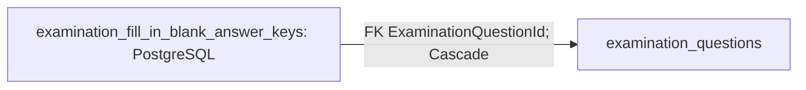

Entity: `ExaminationFillInBlankAnswerKey`.

| Property | Cột SQL | Kiểu PostgreSQL | Nullable | Ràng buộc thuộc tính |
| --- | --- | --- | --- | --- |
| `Id` | `id` | uuid | Không | ValueGeneratedOnAdd() |
| `BlankOrder` | `blank_order` | integer | Không | — |
| `ExaminationQuestionId` | `examination_question_id` | uuid | Không | — |
| `ExpectedAnswer` | `expected_answer` | character varying(1000) | Không | IsRequired(); HasMaxLength(1000) |

Khóa, chỉ mục, quan hệ và CHECK:

```csharp
b.HasKey("Id");
b.HasIndex("ExaminationQuestionId", "BlankOrder", "ExpectedAnswer") .IsUnique();
t.HasCheckConstraint("ck_examination_fill_in_blank_answer_keys_order", "blank_order >= 0");
b.HasOne("LMS.Api.domain.Entities.Examinations.ExaminationQuestion", "ExaminationQuestion") .WithMany("FillInBlankAnswerKeys") .HasForeignKey("ExaminationQuestionId") .OnDelete(DeleteBehavior.Cascade) .IsRequired();
```

## examination_multiple_choice_options

Quan hệ cục bộ: mũi tên đi từ bảng giữ FK sang bảng được tham chiếu; nhãn cuối là delete behavior khi xóa bản ghi cha, không mô tả xóa mềm:

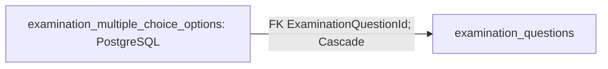

Entity: `ExaminationMultipleChoiceOption`.

| Property | Cột SQL | Kiểu PostgreSQL | Nullable | Ràng buộc thuộc tính |
| --- | --- | --- | --- | --- |
| `Id` | `id` | uuid | Không | ValueGeneratedOnAdd() |
| `Content` | `content` | text | Không | IsRequired() |
| `ExaminationQuestionId` | `examination_question_id` | uuid | Không | — |
| `Order` | `option_order` | integer | Không | — |

Khóa, chỉ mục, quan hệ và CHECK:

```csharp
b.HasKey("Id");
b.HasIndex("ExaminationQuestionId", "Order") .IsUnique();
t.HasCheckConstraint("ck_examination_multiple_choice_options_order", "option_order >= 0");
b.HasOne("LMS.Api.domain.Entities.Examinations.ExaminationQuestion", "ExaminationQuestion") .WithMany("MultipleChoiceOptions") .HasForeignKey("ExaminationQuestionId") .OnDelete(DeleteBehavior.Cascade) .IsRequired();
```

## examination_questions

Quan hệ cục bộ: mũi tên đi từ bảng giữ FK sang bảng được tham chiếu; nhãn cuối là delete behavior khi xóa bản ghi cha, không mô tả xóa mềm:

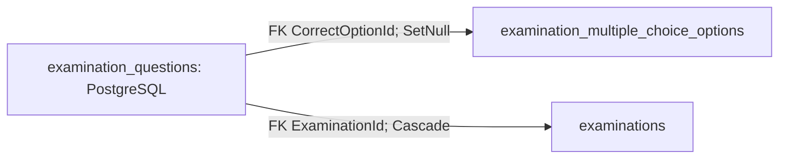

Entity: `ExaminationQuestion`.

| Property | Cột SQL | Kiểu PostgreSQL | Nullable | Ràng buộc thuộc tính |
| --- | --- | --- | --- | --- |
| `Id` | `id` | uuid | Không | ValueGeneratedOnAdd() |
| `Content` | `content` | text | Không | IsRequired() |
| `CorrectOptionId` | `correct_option_id` | uuid | Có | — |
| `Difficulty` | `difficulty` | character varying(50) | Không | IsRequired(); HasMaxLength(50) |
| `ExaminationId` | `examination_id` | uuid | Không | — |
| `Order` | `question_order` | integer | Không | — |
| `ShuffleOptions` | `shuffle_options` | boolean | Không | — |
| `SourceQuestionId` | `source_question_id` | uuid | Có | — |
| `Type` | `type` | character varying(50) | Không | IsRequired(); HasMaxLength(50) |

Khóa, chỉ mục, quan hệ và CHECK:

```csharp
b.HasKey("Id");
b.HasIndex("CorrectOptionId");
b.HasIndex("SourceQuestionId");
b.HasIndex("ExaminationId", "Order") .IsUnique();
t.HasCheckConstraint("ck_examination_questions_order", "question_order >= 0");
b.HasOne("LMS.Api.domain.Entities.Examinations.ExaminationMultipleChoiceOption", "CorrectOption") .WithMany() .HasForeignKey("CorrectOptionId") .OnDelete(DeleteBehavior.SetNull);
b.HasOne("LMS.Api.domain.Entities.Examinations.Examination", "Examination") .WithMany("Questions") .HasForeignKey("ExaminationId") .OnDelete(DeleteBehavior.Cascade);
```

## examination_question_selection_rules

Quan hệ cục bộ: mũi tên đi từ bảng giữ FK sang bảng được tham chiếu; nhãn cuối là delete behavior khi xóa bản ghi cha, không mô tả xóa mềm:

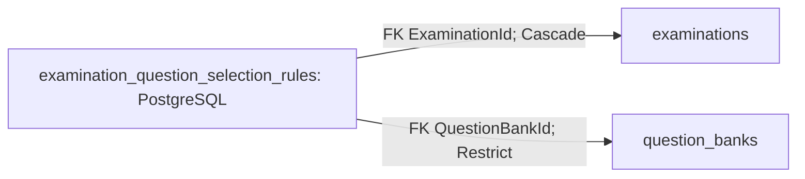

Entity: `ExaminationQuestionSelectionRule`.

| Property | Cột SQL | Kiểu PostgreSQL | Nullable | Ràng buộc thuộc tính |
| --- | --- | --- | --- | --- |
| `Id` | `id` | uuid | Không | ValueGeneratedOnAdd() |
| `Difficulty` | `difficulty` | character varying(50) | Không | IsRequired(); HasMaxLength(50) |
| `ExaminationId` | `examination_id` | uuid | Không | — |
| `QuestionBankId` | `question_bank_id` | uuid | Không | — |
| `QuestionCount` | `question_count` | integer | Không | — |

Khóa, chỉ mục, quan hệ và CHECK:

```csharp
b.HasKey("Id");
b.HasIndex("QuestionBankId");
b.HasIndex("ExaminationId", "QuestionBankId", "Difficulty") .IsUnique();
t.HasCheckConstraint("ck_examination_question_selection_rules_count", "question_count > 0");
b.HasOne("LMS.Api.domain.Entities.Examinations.Examination", "Examination") .WithMany("QuestionSelectionRules") .HasForeignKey("ExaminationId") .OnDelete(DeleteBehavior.Cascade);
b.HasOne("LMS.Api.domain.Entities.Questions.QuestionBank", "QuestionBank") .WithMany() .HasForeignKey("QuestionBankId") .OnDelete(DeleteBehavior.Restrict) .IsRequired();
```

## examination_violations

Quan hệ cục bộ: mũi tên đi từ bảng giữ FK sang bảng được tham chiếu; nhãn cuối là delete behavior khi xóa bản ghi cha, không mô tả xóa mềm:

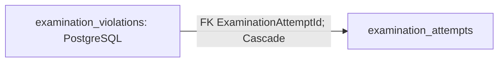

Entity: `ExaminationViolation`.

| Property | Cột SQL | Kiểu PostgreSQL | Nullable | Ràng buộc thuộc tính |
| --- | --- | --- | --- | --- |
| `Id` | `id` | uuid | Không | ValueGeneratedOnAdd() |
| `ExaminationAttemptId` | `examination_attempt_id` | uuid | Không | — |
| `OccurredAt` | `occurred_at` | timestamp with time zone | Không | — |
| `Type` | `type` | character varying(50) | Không | IsRequired(); HasMaxLength(50) |

Khóa, chỉ mục, quan hệ và CHECK:

```csharp
b.HasKey("Id");
b.HasIndex("ExaminationAttemptId", "OccurredAt");
b.HasOne("LMS.Api.domain.Entities.Examinations.ExaminationAttempt", "ExaminationAttempt") .WithMany("Violations") .HasForeignKey("ExaminationAttemptId") .OnDelete(DeleteBehavior.Cascade) .IsRequired();
```

## student_answers

Quan hệ cục bộ: mũi tên đi từ bảng giữ FK sang bảng được tham chiếu; nhãn cuối là delete behavior khi xóa bản ghi cha, không mô tả xóa mềm:

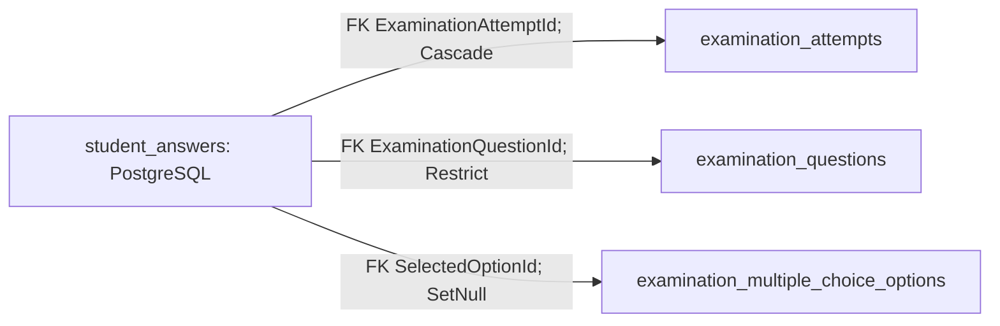

Entity: `StudentAnswer`.

| Property | Cột SQL | Kiểu PostgreSQL | Nullable | Ràng buộc thuộc tính |
| --- | --- | --- | --- | --- |
| `Id` | `id` | uuid | Không | ValueGeneratedOnAdd() |
| `CreatedAt` | `created_at` | timestamp with time zone | Không | — |
| `ExaminationAttemptId` | `examination_attempt_id` | uuid | Không | — |
| `ExaminationQuestionId` | `examination_question_id` | uuid | Không | — |
| `ModifiedAt` | `modified_at` | timestamp with time zone | Không | — |
| `SelectedOptionId` | `selected_option_id` | uuid | Có | — |

Khóa, chỉ mục, quan hệ và CHECK:

```csharp
b.HasKey("Id");
b.HasIndex("ExaminationQuestionId");
b.HasIndex("SelectedOptionId");
b.HasIndex("ExaminationAttemptId", "ExaminationQuestionId") .IsUnique();
b.HasOne("LMS.Api.domain.Entities.Examinations.ExaminationAttempt", "ExaminationAttempt") .WithMany("Answers") .HasForeignKey("ExaminationAttemptId") .OnDelete(DeleteBehavior.Cascade) .IsRequired();
b.HasOne("LMS.Api.domain.Entities.Examinations.ExaminationQuestion", "ExaminationQuestion") .WithMany() .HasForeignKey("ExaminationQuestionId") .OnDelete(DeleteBehavior.Restrict) .IsRequired();
b.HasOne("LMS.Api.domain.Entities.Examinations.ExaminationMultipleChoiceOption", "SelectedOption") .WithMany() .HasForeignKey("SelectedOptionId") .OnDelete(DeleteBehavior.SetNull);
```

## student_fill_in_blank_answers

Quan hệ cục bộ: mũi tên đi từ bảng giữ FK sang bảng được tham chiếu; nhãn cuối là delete behavior khi xóa bản ghi cha, không mô tả xóa mềm:

```mermaid
flowchart LR
    T["student_fill_in_blank_answers: PostgreSQL"]
    P0["student_answers"]
    T -->|"FK StudentAnswerId; Cascade"| P0
```

Entity: `StudentFillInBlankAnswer`.

| Property | Cột SQL | Kiểu PostgreSQL | Nullable | Ràng buộc thuộc tính |
| --- | --- | --- | --- | --- |
| `Id` | `id` | uuid | Không | ValueGeneratedOnAdd() |
| `AnswerText` | `answer_text` | character varying(1000) | Không | IsRequired(); HasMaxLength(1000) |
| `BlankOrder` | `blank_order` | integer | Không | — |
| `StudentAnswerId` | `student_answer_id` | uuid | Không | — |

Khóa, chỉ mục, quan hệ và CHECK:

```csharp
b.HasKey("Id");
b.HasIndex("StudentAnswerId", "BlankOrder") .IsUnique();
t.HasCheckConstraint("ck_student_fill_in_blank_answers_order", "blank_order >= 0");
b.HasOne("LMS.Api.domain.Entities.Examinations.StudentAnswer", "StudentAnswer") .WithMany("FillInBlankAnswers") .HasForeignKey("StudentAnswerId") .OnDelete(DeleteBehavior.Cascade) .IsRequired();
```

## fill_in_blank_answer_keys

Quan hệ cục bộ: mũi tên đi từ bảng giữ FK sang bảng được tham chiếu; nhãn cuối là delete behavior khi xóa bản ghi cha, không mô tả xóa mềm:

```mermaid
flowchart LR
    T["fill_in_blank_answer_keys: PostgreSQL"]
    P0["questions"]
    T -->|"FK QuestionId; Cascade"| P0
```

Entity: `FillInBlankAnswerKey`.

| Property | Cột SQL | Kiểu PostgreSQL | Nullable | Ràng buộc thuộc tính |
| --- | --- | --- | --- | --- |
| `Id` | `id` | uuid | Không | ValueGeneratedOnAdd() |
| `BlankOrder` | `blank_order` | integer | Không | — |
| `ExpectedAnswer` | `expected_answer` | character varying(1000) | Không | IsRequired(); HasMaxLength(1000) |
| `QuestionId` | `question_id` | uuid | Không | — |

Khóa, chỉ mục, quan hệ và CHECK:

```csharp
b.HasKey("Id");
b.HasIndex("QuestionId", "BlankOrder", "ExpectedAnswer") .IsUnique();
t.HasCheckConstraint("ck_fill_in_blank_answer_keys_order", "blank_order >= 0");
b.HasOne("LMS.Api.domain.Entities.Questions.Question", "Question") .WithMany("FillInBlankAnswerKeys") .HasForeignKey("QuestionId") .OnDelete(DeleteBehavior.Cascade) .IsRequired();
```

## multiple_choice_options

Quan hệ cục bộ: mũi tên đi từ bảng giữ FK sang bảng được tham chiếu; nhãn cuối là delete behavior khi xóa bản ghi cha, không mô tả xóa mềm:

```mermaid
flowchart LR
    T["multiple_choice_options: PostgreSQL"]
    P0["questions"]
    T -->|"FK QuestionId; Cascade"| P0
```

Entity: `MultipleChoiceOption`.

| Property | Cột SQL | Kiểu PostgreSQL | Nullable | Ràng buộc thuộc tính |
| --- | --- | --- | --- | --- |
| `Id` | `id` | uuid | Không | ValueGeneratedOnAdd() |
| `Content` | `content` | text | Không | IsRequired() |
| `Order` | `option_order` | integer | Không | — |
| `QuestionId` | `question_id` | uuid | Không | — |

Khóa, chỉ mục, quan hệ và CHECK:

```csharp
b.HasKey("Id");
b.HasIndex("QuestionId", "Order") .IsUnique();
t.HasCheckConstraint("ck_multiple_choice_options_order", "option_order >= 0");
b.HasOne("LMS.Api.domain.Entities.Questions.Question", "Question") .WithMany("MultipleChoiceOptions") .HasForeignKey("QuestionId") .OnDelete(DeleteBehavior.Cascade) .IsRequired();
```

## questions

Quan hệ cục bộ: mũi tên đi từ bảng giữ FK sang bảng được tham chiếu; nhãn cuối là delete behavior khi xóa bản ghi cha, không mô tả xóa mềm:

```mermaid
flowchart LR
    T["questions: PostgreSQL"]
    P0["multiple_choice_options"]
    T -->|"FK CorrectOptionId; SetNull"| P0
    P1["users"]
    T -->|"FK CreatedById; Restrict"| P1
    P2["users"]
    T -->|"FK ModifiedById; Restrict"| P2
    P3["question_banks"]
    T -->|"FK QuestionBankId; Cascade"| P3
```

Entity: `Question`.

| Property | Cột SQL | Kiểu PostgreSQL | Nullable | Ràng buộc thuộc tính |
| --- | --- | --- | --- | --- |
| `Id` | `id` | uuid | Không | ValueGeneratedOnAdd() |
| `Content` | `content` | text | Không | IsRequired() |
| `CorrectOptionId` | `correct_option_id` | uuid | Có | — |
| `CreatedAt` | `created_at` | timestamp with time zone | Không | — |
| `CreatedById` | `created_by_id` | uuid | Không | — |
| `Difficulty` | `difficulty` | character varying(50) | Không | IsRequired(); HasMaxLength(50) |
| `ModifiedAt` | `modified_at` | timestamp with time zone | Không | — |
| `ModifiedById` | `modified_by_id` | uuid | Không | — |
| `QuestionBankId` | `question_bank_id` | uuid | Không | — |
| `ShuffleOptions` | `shuffle_options` | boolean | Không | — |
| `Type` | `type` | character varying(50) | Không | IsRequired(); HasMaxLength(50) |

Khóa, chỉ mục, quan hệ và CHECK:

```csharp
b.HasKey("Id");
b.HasIndex("CorrectOptionId");
b.HasIndex("CreatedById");
b.HasIndex("ModifiedById");
b.HasIndex("QuestionBankId", "Type", "Difficulty");
b.HasOne("LMS.Api.domain.Entities.Questions.MultipleChoiceOption", "CorrectOption") .WithMany() .HasForeignKey("CorrectOptionId") .OnDelete(DeleteBehavior.SetNull);
b.HasOne("LMS.Api.domain.Entities.Users.User", "CreatedBy") .WithMany() .HasForeignKey("CreatedById") .OnDelete(DeleteBehavior.Restrict) .IsRequired();
b.HasOne("LMS.Api.domain.Entities.Users.User", "ModifiedBy") .WithMany() .HasForeignKey("ModifiedById") .OnDelete(DeleteBehavior.Restrict) .IsRequired();
b.HasOne("LMS.Api.domain.Entities.Questions.QuestionBank", "QuestionBank") .WithMany("Questions") .HasForeignKey("QuestionBankId") .OnDelete(DeleteBehavior.Cascade) .IsRequired();
```

## question_banks

Quan hệ cục bộ: mũi tên đi từ bảng giữ FK sang bảng được tham chiếu; nhãn cuối là delete behavior khi xóa bản ghi cha, không mô tả xóa mềm:

```mermaid
flowchart LR
    T["question_banks: PostgreSQL"]
    P0["users"]
    T -->|"FK CreatedById; Restrict"| P0
    P1["users"]
    T -->|"FK ModifiedById; Restrict"| P1
    P2["users"]
    T -->|"FK TeacherId; Restrict"| P2
```

Entity: `QuestionBank`.

| Property | Cột SQL | Kiểu PostgreSQL | Nullable | Ràng buộc thuộc tính |
| --- | --- | --- | --- | --- |
| `Id` | `id` | uuid | Không | ValueGeneratedOnAdd() |
| `CreatedAt` | `created_at` | timestamp with time zone | Không | — |
| `CreatedById` | `created_by_id` | uuid | Không | — |
| `Description` | `description` | character varying(2000) | Có | HasMaxLength(2000) |
| `ModifiedAt` | `modified_at` | timestamp with time zone | Không | — |
| `ModifiedById` | `modified_by_id` | uuid | Không | — |
| `Name` | `name` | character varying(200) | Không | IsRequired(); HasMaxLength(200) |
| `TeacherId` | `teacher_id` | uuid | Không | — |

Khóa, chỉ mục, quan hệ và CHECK:

```csharp
b.HasKey("Id");
b.HasIndex("CreatedById");
b.HasIndex("ModifiedById");
b.HasIndex("TeacherId");
b.HasOne("LMS.Api.domain.Entities.Users.User", "CreatedBy") .WithMany() .HasForeignKey("CreatedById") .OnDelete(DeleteBehavior.Restrict) .IsRequired();
b.HasOne("LMS.Api.domain.Entities.Users.User", "ModifiedBy") .WithMany() .HasForeignKey("ModifiedById") .OnDelete(DeleteBehavior.Restrict) .IsRequired();
b.HasOne("LMS.Api.domain.Entities.Users.User", "Teacher") .WithMany() .HasForeignKey("TeacherId") .OnDelete(DeleteBehavior.Restrict) .IsRequired();
```

## file_cleanup_tasks

Quan hệ cục bộ: mũi tên đi từ bảng giữ FK sang bảng được tham chiếu; nhãn cuối là delete behavior khi xóa bản ghi cha, không mô tả xóa mềm:

```mermaid
flowchart LR
    T["file_cleanup_tasks: PostgreSQL"]
    S["Service / FileCleanupQueue"] -->|"enqueue object key"| T
    W["FileCleanupWorker"] -->|"đọc task đến hạn; cập nhật retry hoặc xóa task"| T
    W -->|"DeleteIfExists"| F["Local hoặc S3"]
```

Entity: `FileCleanupTask`.

| Property | Cột SQL | Kiểu PostgreSQL | Nullable | Ràng buộc thuộc tính |
| --- | --- | --- | --- | --- |
| `Id` | `id` | uuid | Không | ValueGeneratedOnAdd() |
| `AttemptCount` | `attempt_count` | integer | Không | — |
| `CreatedAt` | `created_at` | timestamp with time zone | Không | — |
| `LastError` | `last_error` | character varying(2000) | Có | HasMaxLength(2000) |
| `NextAttemptAt` | `next_attempt_at` | timestamp with time zone | Không | — |
| `ObjectKey` | `object_key` | character varying(1024) | Không | IsRequired(); HasMaxLength(1024) |

Khóa, chỉ mục, quan hệ và CHECK:

```csharp
b.HasKey("Id");
b.HasIndex("NextAttemptAt");
b.HasIndex("ObjectKey") .IsUnique();
```

## external_users

Quan hệ cục bộ: mũi tên đi từ bảng giữ FK sang bảng được tham chiếu; nhãn cuối là delete behavior khi xóa bản ghi cha, không mô tả xóa mềm:

```mermaid
flowchart LR
    T["external_users: PostgreSQL"]
    P0["users"]
    T -->|"FK UserId; Cascade"| P0
```

Entity: `ExternalUser`.

| Property | Cột SQL | Kiểu PostgreSQL | Nullable | Ràng buộc thuộc tính |
| --- | --- | --- | --- | --- |
| `Id` | `id` | uuid | Không | ValueGeneratedOnAdd() |
| `ExternalUserId` | `external_user_id` | character varying(255) | Không | IsRequired(); HasMaxLength(255) |
| `Provider` | `provider` | character varying(50) | Không | IsRequired(); HasMaxLength(50) |
| `UserId` | `user_id` | uuid | Không | — |

Khóa, chỉ mục, quan hệ và CHECK:

```csharp
b.HasKey("Id");
b.HasIndex("Provider", "ExternalUserId") .IsUnique();
b.HasIndex("UserId", "Provider") .IsUnique();
b.HasOne("LMS.Api.domain.Entities.Users.User", "User") .WithMany() .HasForeignKey("UserId") .OnDelete(DeleteBehavior.Cascade) .IsRequired();
```

## users

Quan hệ cục bộ: mũi tên đi từ bảng giữ FK sang bảng được tham chiếu; nhãn cuối là delete behavior khi xóa bản ghi cha, không mô tả xóa mềm:

```mermaid
flowchart LR
    T["users: PostgreSQL"]
    T -->|"FK CreatedById; Restrict"| T
    T -->|"FK ModifiedById; Restrict"| T
    A["Auth và UserService"] -->|"đọc/ghi account, hash, AuthVersion"| T
    J["JwtBearer"] -->|"đối chiếu Active, role, version"| T
```

Entity: `User`.

| Property | Cột SQL | Kiểu PostgreSQL | Nullable | Ràng buộc thuộc tính |
| --- | --- | --- | --- | --- |
| `Id` | `id` | uuid | Không | ValueGeneratedOnAdd() |
| `AuthVersion` | `auth_version` | bigint | Không | IsConcurrencyToken(); ValueGeneratedOnAdd(); HasDefaultValue(1L) |
| `AvatarUrl` | `avatar_url` | character varying(500) | Có | HasMaxLength(500) |
| `CreatedAt` | `created_at` | timestamp with time zone | Không | — |
| `CreatedById` | `created_by_id` | uuid | Có | — |
| `Email` | `email` | character varying(255) | Không | IsRequired(); HasMaxLength(255) |
| `FullName` | `full_name` | character varying(100) | Không | IsRequired(); HasMaxLength(100) |
| `ModifiedAt` | `modified_at` | timestamp with time zone | Không | — |
| `ModifiedById` | `modified_by_id` | uuid | Có | — |
| `PasswordHash` | `password_hash` | text | Có | — |
| `Phone` | `phone` | character varying(20) | Có | HasMaxLength(20) |
| `Role` | `role` | character varying(50) | Không | IsRequired(); HasMaxLength(50) |
| `Status` | `status` | character varying(50) | Không | IsRequired(); HasMaxLength(50) |

Khóa, chỉ mục, quan hệ và CHECK:

```csharp
b.HasKey("Id");
b.HasIndex("CreatedById");
b.HasIndex("Email") .IsUnique();
b.HasIndex("ModifiedById");
b.HasIndex("Role") .IsUnique() .HasDatabaseName("IX_users_single_system_role") .HasFilter("\"role\" = 'System'");
b.HasOne("LMS.Api.domain.Entities.Users.User", "CreatedBy") .WithMany() .HasForeignKey("CreatedById") .OnDelete(DeleteBehavior.Restrict);
b.HasOne("LMS.Api.domain.Entities.Users.User", "ModifiedBy") .WithMany() .HasForeignKey("ModifiedById") .OnDelete(DeleteBehavior.Restrict);
```

Tổng **28 bảng nghiệp vụ**, **229 property mapping** trong snapshot (gồm shadow row-version). Không tính bảng hệ thống migration `__EFMigrationsHistory`.
