# Backend – Luồng dữ liệu (Data Flow)

Đối chiếu mã nguồn ngày **2026-10-13**. Mô tả implementation trong repository, không phải xác nhận môi trường production.

Tài liệu này mô tả dữ liệu đi qua những thành phần nào cho từng luồng chính, và điều gì xảy ra khi một bước thất bại. Danh sách endpoint xem ở [../api/conventions.md](../api/conventions.md); mô hình bảng xem [data-model.md](data-model.md).

## 1. Pipeline chung của mọi request

Luồng xử lý và dữ liệu:

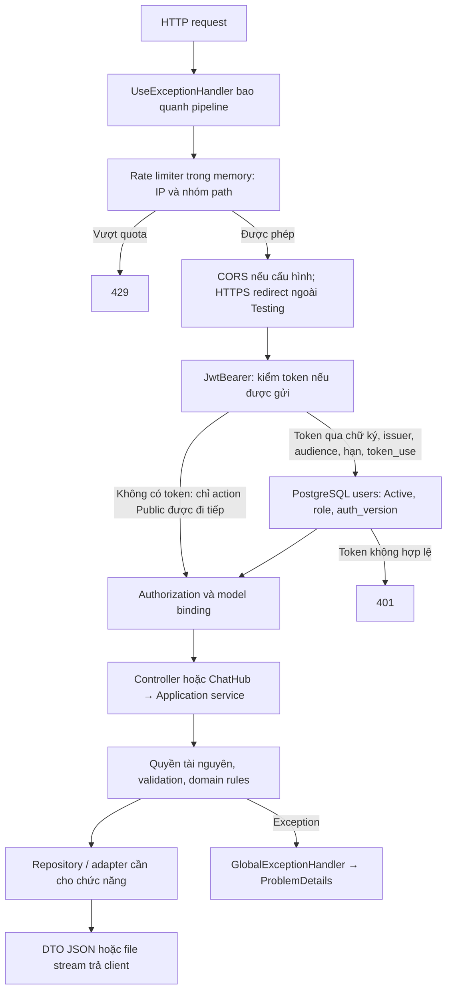

Thứ tự middleware trong `Program.cs`:

```text
HTTP request
 1. UseExceptionHandler        → bắt exception, GlobalExceptionHandler trả ProblemDetails
 2. UseRateLimiter             → fixed window 1 phút theo IP: /api/auth/* = 10, còn lại = 240 → 429
 3. UseCors("Frontend")        → chỉ khi Cors:AllowedOrigins không rỗng
 4. UseHttpsRedirection        → bỏ qua ở môi trường Testing
 5. UseAuthentication          → JwtBearer
      a. OnMessageReceived     : path /hubs/chat mới nhận token ở query access_token
      b. validate chữ ký, issuer, audience, hạn (lệch đồng hồ 30 giây)
      c. OnTokenValidated      : token_use=chat_realtime chỉ cho /hubs/chat;
                                 đọc user từ PostgreSQL, so Status=Active, Role, auth_version
 6. UseAuthorization           → [Authorize], [Authorize(Roles="Admin,System")]
 7. MapControllers / MapHub    → Controller hoặc ChatHub
```

Trong controller:

```text
Model binding ([ApiController] tự trả 400 nếu body/query sai kiểu)
 → Application Service (ICurrentUser lấy userId/role từ claim)
     ├─ validate đầu vào        → BadRequestException (400)
     ├─ kiểm tra quyền/sở hữu   → ForbiddenException (403) hoặc NotFoundException (404)
     ├─ kiểm tra trạng thái     → ConflictException (409)
     ├─ Repository (EF Core)    → PostgreSQL
     ├─ ICache (Redis)          → chỉ nhóm xác thực
     ├─ IFileStorage            → chỉ endpoint file
     ├─ IMailSender (SMTP)      → đăng ký/gửi lại mã, quên mật khẩu, chia sẻ question bank
     └─ IUnitOfWork.SaveChangesAsync (commit)
 → Controller trả DTO (JSON camelCase, enum dạng chuỗi)
```

Lớp `AppDbContext` vừa là `IUnitOfWork` vừa là `ITransactionManager` nên mọi repository dùng chung một DbContext theo scope của request.

## 2. Đăng nhập và làm mới token

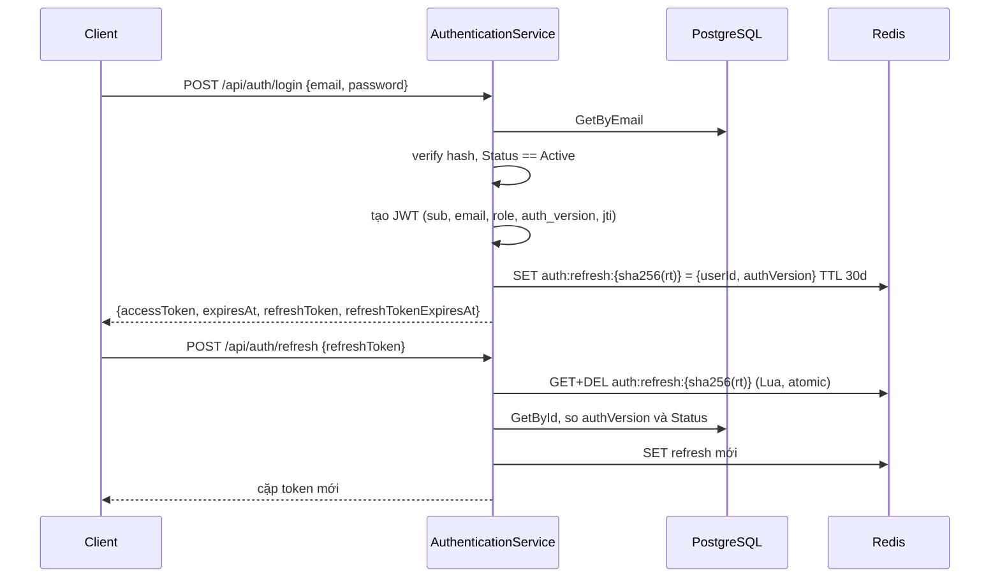

Điểm quan trọng:

- Refresh token chỉ tồn tại một lần; đọc đồng thời hai request thì chỉ một request lấy được (GET+DEL atomic).
- Nếu bước sau khi consume lỗi **hạ tầng** (DB/Redis tạm thời) thì refresh token cũ được `SET NX` lại 1 phút để client retry. Lỗi nghiệp vụ (`400/401/403/404/409`) thì không phục hồi (xem `AuthFailurePolicy.IsCredentialRestorable`).
- Mỗi request có JWT đều tốn một truy vấn PostgreSQL ở `OnTokenValidated` để chặn token của tài khoản bị khóa/đổi role/đổi mật khẩu.

## 3. Đăng ký và xác thực email

Bổ sung bản hiển thị tương thích Mermaid: dấu chấm phẩy trong nhãn của bản cũ bị parser hiểu là dấu kết thúc câu lệnh. Bản gốc được giữ nguyên trong khối mã tham chiếu ngay sau sơ đồ này.

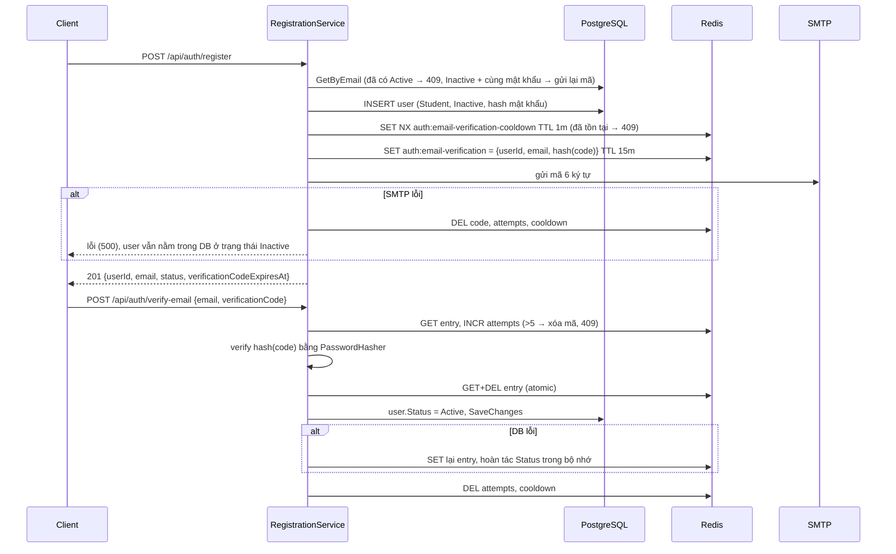

Mã sơ đồ gốc (giữ nguyên để đối chiếu):

````text
```mermaid
sequenceDiagram
    participant C as Client
    participant S as RegistrationService
    participant DB as PostgreSQL
    participant R as Redis
    participant M as SMTP
    C->>S: POST /api/auth/register
    S->>DB: GetByEmail (đã có Active → 409; Inactive + cùng mật khẩu → gửi lại mã)
    S->>DB: INSERT user (Student, Inactive, hash mật khẩu)
    S->>R: SET NX auth:email-verification-cooldown TTL 1m (đã tồn tại → 409)
    S->>R: SET auth:email-verification = {userId, email, hash(code)} TTL 15m
    S->>M: gửi mã 6 ký tự
    alt SMTP lỗi
        S->>R: DEL code, attempts, cooldown
        S-->>C: lỗi (500), user vẫn nằm trong DB ở trạng thái Inactive
    end
    S-->>C: 201 {userId, email, status, verificationCodeExpiresAt}
    C->>S: POST /api/auth/verify-email {email, verificationCode}
    S->>R: GET entry; INCR attempts (>5 → xóa mã, 409)
    S->>S: verify hash(code) bằng PasswordHasher
    S->>R: GET+DEL entry (atomic)
    S->>DB: user.Status = Active, SaveChanges
    alt DB lỗi
        S->>R: SET lại entry, hoàn tác Status trong bộ nhớ
    end
    S->>R: DEL attempts, cooldown
```
````

Mã xác thực **không** lưu dạng thô trong Redis mà lưu hash (cùng `PasswordHasher` với mật khẩu). Bảng chữ cái mã: `ABCDEFGHJKLMNPQRSTUVWXYZ23456789` (bỏ `I`, `O`, `0`, `1`).

## 4. Quên và đặt lại mật khẩu

Luồng xử lý và dữ liệu:

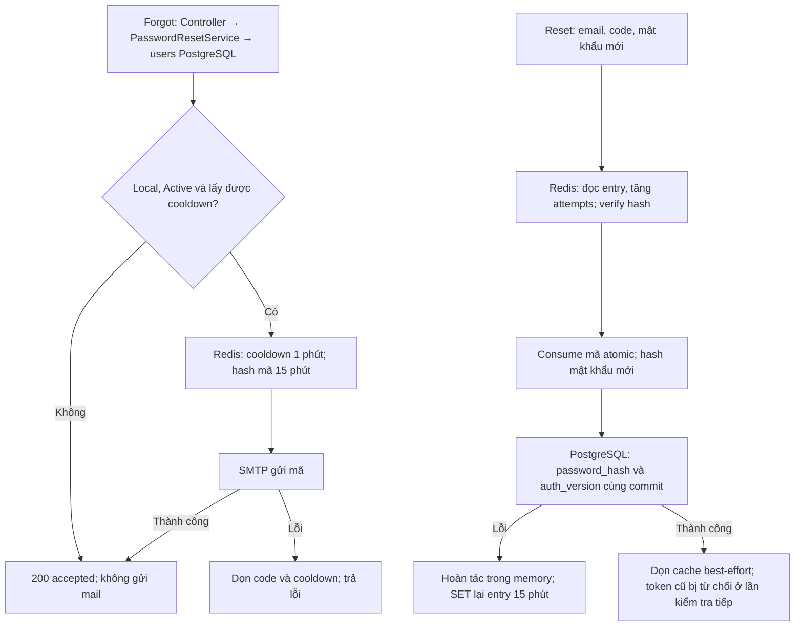

```text
POST /api/auth/forgot-password
  email không tồn tại / tài khoản OAuth (không có mật khẩu) / không Active / đang cooldown
      → vẫn trả 200 {accepted:true, codeExpiresAt}   (không lộ thông tin)
  ngược lại: SET NX cooldown 1m → SET auth:password-reset (hash code) TTL 15m → gửi SMTP
      SMTP lỗi → xóa code + cooldown → lỗi 500

POST /api/auth/reset-password
  validate mật khẩu (8–128, khớp xác nhận) và mã 6 ký tự        → 400
  email không tồn tại / không có mã trong Redis / mã sai        → 400 "invalid or expired"
  tài khoản OAuth (PasswordHash null)                           → 409
  INCR attempts > 5 → xóa mã                                    → 409
  GET+DEL mã (atomic) → đổi hash + RevokeSessions() (AuthVersion++) → SaveChanges
      DB lỗi → khôi phục hash/version cũ trong bộ nhớ, SET lại mã, ném lỗi
  xóa attempts + cooldown (lỗi ở bước này được bỏ qua)
```

## 5. Google OAuth (Authorization Code + PKCE)

Bổ sung bản hiển thị tương thích Mermaid: dấu chấm phẩy trong nhãn của bản cũ bị parser hiểu là dấu kết thúc câu lệnh. Bản gốc được giữ nguyên trong khối mã tham chiếu ngay sau sơ đồ này.

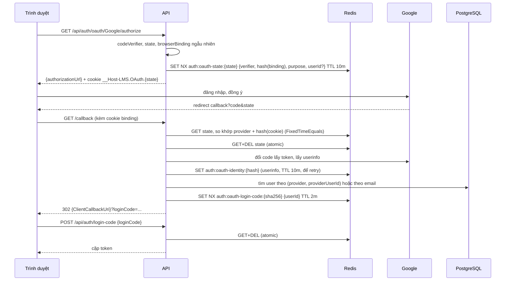

Mã sơ đồ gốc (giữ nguyên để đối chiếu):

````text
```mermaid
sequenceDiagram
    participant B as Trình duyệt
    participant A as API
    participant R as Redis
    participant G as Google
    participant DB as PostgreSQL
    B->>A: GET /api/auth/oauth/Google/authorize
    A->>A: codeVerifier, state, browserBinding ngẫu nhiên
    A->>R: SET NX auth:oauth-state:{state} {verifier, hash(binding), purpose, userId?} TTL 10m
    A-->>B: {authorizationUrl} + cookie __Host-LMS.OAuth.{state}
    B->>G: đăng nhập, đồng ý
    G-->>B: redirect callback?code&state
    B->>A: GET /callback (kèm cookie binding)
    A->>R: GET state; so khớp provider + hash(cookie) (FixedTimeEquals)
    A->>R: GET+DEL state (atomic)
    A->>G: đổi code lấy token, lấy userinfo
    A->>R: SET auth:oauth-identity:{hash} (userinfo, TTL 10m, để retry)
    A->>DB: tìm user theo (provider, providerUserId) hoặc theo email
    A->>R: SET NX auth:oauth-login-code:{sha256} {userId} TTL 2m
    A-->>B: 302 {ClientCallbackUri}?loginCode=...
    B->>A: POST /api/auth/login-code {loginCode}
    A->>R: GET+DEL (atomic)
    A-->>B: cặp token
```
````

Quy tắc xử lý user ở callback đăng nhập (`AuthenticationService.LoginWithOAuthAsync`):

1. Email Google phải `EmailVerified = true`, `ProviderUserId` hợp lệ (≤ 255 ký tự), email hợp lệ; sai → `401`.
2. Đã có liên kết `(provider, providerUserId)` → dùng user đó.
3. Chưa có liên kết nhưng email trùng một user local:
   - user không `Active` → `401`;
   - user đã liên kết một Google khác → `409`;
   - ngược lại **tự động liên kết** Google vào tài khoản local này (không cần mật khẩu).
4. Email chưa tồn tại → tạo user mới role `Student`, status `Active`, **không có mật khẩu**, họ tên lấy từ Google (cắt 100 ký tự) hoặc phần trước `@`.
5. User cuối cùng không `Active` → `401`.

Luồng `Link` (liên kết) dùng state có `purpose=Link` và userId lấy từ JWT lúc gọi `link/authorize`; Google đã thuộc user khác → `409`, user đã có Google → `409`.

Mọi lỗi hạ tầng giữa chừng sẽ `SET NX` lại state 1 phút (và identity đã lấy từ Google còn nằm 10 phút) để người dùng thử lại callback.

## 6. Upload file (material, exercise, submission, chat)

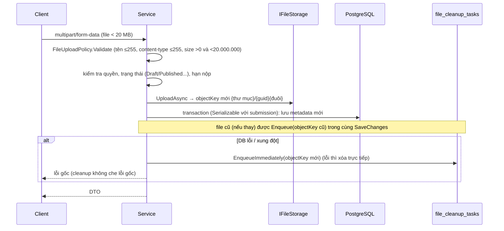

- **Thứ tự**: ghi file trước, DB sau; nếu DB lỗi thì file mới thành "mồ côi" và được dọn.
- **Dọn file**: `FileCleanupQueue.Enqueue` chỉ add entity `FileCleanupTask`; `AppDbContext.SaveChangesAsync` tách các task này ra và ghi bằng `INSERT ... ON CONFLICT (object_key) DO NOTHING` trong cùng transaction với dữ liệu nghiệp vụ (idempotent, không vi phạm unique khi cùng key). `FileCleanupWorker` (10 giây/lần, 100 task) xóa file thật; lỗi thì `task.RecordFailure` với backoff `min(60, 2^attemptCount)` phút (tối đa 2^6).
- **Download**: `GET .../content` kiểm tra quyền → `IFileStorage.OpenReadAsync(objectKey)` → stream về client. DTO material/exercise/submission có `objectKey`; DTO chat attachment không có. Đây là khóa nội bộ, không phải URL công khai. Controller luôn trả filename, kể cả `download=false`.

## 7. Enrollment (đăng ký học)

Trạng thái enrollment trong PostgreSQL; accept/thêm bằng email kiểm sĩ số trong transaction Serializable:

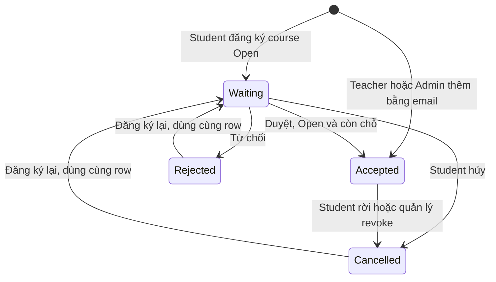

```text
POST /courses/{id}/enrollments (Student)
  course tồn tại (không xóa mềm) và Status == Open, nếu không → 404 / 409
  đã có enrollment:
      Rejected | Cancelled → existing.RequestAgain() → Waiting (tái dùng record)
      còn lại             → 409 "active enrollment already exists"
  chưa có → INSERT (unique student_id + course_id làm chốt cuối)

POST /enrollments/{id}/accept | reject      ── transaction SERIALIZABLE
  load enrollment + course, EnsureCanManage (Teacher sở hữu hoặc Admin)
  phải đang Waiting (409 nếu không)
  accept: course phải Open; COUNT(Accepted) < MaxStudents rồi mới Accept()
          (serializable chống hai teacher/hai request cùng nhận vượt sĩ số)
```

## 8. Vòng đời course và chat room

Luồng xử lý và dữ liệu:

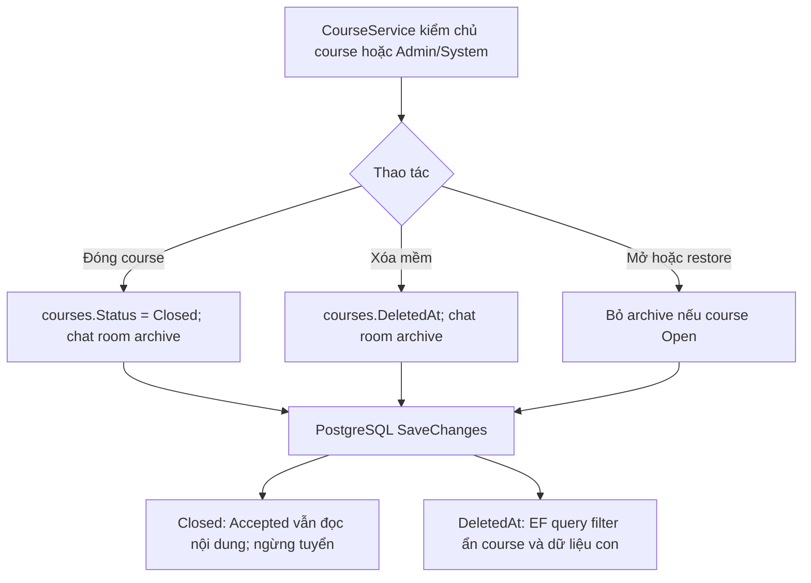

`CourseService.UpdateAsync/DeleteAsync/RestoreAsync` luôn gọi `ChatRoom.SynchronizeWithCourse(course)` trước `SaveChanges`:

| Trạng thái course | Hệ quả với course chat room |
| --- | --- |
| `Open`, chưa xóa | `ArchivedAt = null` (mở lại nếu đang archive) |
| `Closed` | Archive (`ArchivedAt` được đặt) |
| Xóa mềm | Archive; không ai truy cập được (404) |

Chat service cũng tự đồng bộ khi có người truy cập room (`EnsureCurrentCourseAccessAsync`), nên không phụ thuộc hoàn toàn vào việc course service đã chạy.

## 9. Làm bài thi – từ publish tới chấm điểm

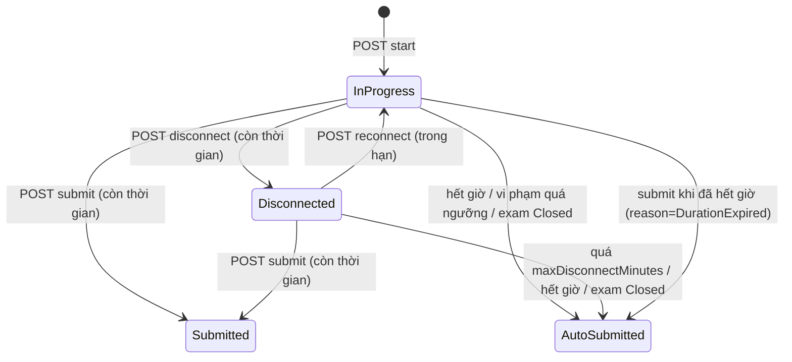

Chi tiết từng bước (mỗi thao tác ghi dùng transaction **Serializable**):

**Start**
1. Chỉ `Student`. Load kỳ thi (kèm câu hỏi snapshot) → course không xóa → enrollment `Accepted` (403 nếu không).
2. Kỳ thi phải `Published` và `startAt <= now < dueAt` (409 nếu không); phải có ≥ 1 câu hỏi.
3. Nếu đã có **bất kỳ** attempt nào của student cho kỳ thi này → `409 "A student can attempt an examination only once."`. DB còn ràng buộc unique `(examination_id, student_id)` làm chốt cuối.
4. Tạo attempt `InProgress`, `TotalQuestions = số câu`.

**Thời hạn của attempt**

```text
examDeadline = min(startedAt + durationMinutes, examination.dueAt)
remainingSeconds = max(0, ceil(examDeadline - now))
```

**Lưu đáp án** (`PUT .../multiple-choice`, `.../fill-in-blank`)
- Attempt phải `InProgress` (409 `The examination attempt must be InProgress.` kể cả khi `Disconnected`), enrollment còn `Accepted`, `remainingSeconds > 0` (nếu hết giờ → 409 `The examination attempt has expired.`; chưa tự nộp ở request này, worker sẽ nộp).
- Trắc nghiệm: option phải thuộc câu hỏi; ghi đè đáp án cũ. Điền khuyết: `blankOrder` phải tồn tại trong câu hỏi, không trùng, mỗi đáp án ≤ 1000 ký tự; thay thế toàn bộ tập đáp án của câu.
- Mỗi lần lưu cập nhật `lastActivityAt`.

**Disconnect / Reconnect**
- `disconnect`: attempt `InProgress`; nếu `remainingSeconds == 0` → chấm và `AutoSubmitted (DurationExpired)`, ngược lại `Disconnected`, lưu `disconnectedAt` và `remainingSeconds`.
- `reconnect`: attempt `Disconnected`; nếu `now >= examDeadline` hoặc `now >= disconnectedAt + maxDisconnectMinutes` → `AutoSubmitted` với reason tính bởi `AttemptDeadline.GetExpiredReason` (`DurationExpired` hoặc `DisconnectTimeout`), ngược lại về `InProgress`.

**Violation**
- Phải attempt active; loại vi phạm phải được bật tương ứng (`ExitFullscreen`←`requireFullscreen`, `TabChanged`/`WindowBlurred`←`detectTabChange`, `CopyAttempt`/`PasteAttempt`←`blockCopyPaste`, `RightClickAttempt`←`blockRightClick`, `DevToolsSuspected`←`detectDevTools`) nếu không `400`.
- `ExitFullscreen` cần `durationSeconds >= 0`; `<= fullscreenGraceSeconds` chỉ cập nhật hoạt động, **không** tính vi phạm.
- Ghi `ExaminationViolation`, tăng `violationCount`; nếu `maxViolations > 0` và `violationCount >= maxViolations` → chấm và `AutoSubmitted (MaxViolationsExceeded)`.

**Submit**
- Attempt active. Nếu đã hết giờ: `AutoSubmitted` + `DurationExpired`; ngược lại `Submitted` + `StudentSubmitted`.

**Chấm điểm** (`AttemptGrader.CompleteAndGrade`)
- Câu trắc nghiệm đúng khi `selectedOptionId == correctOptionId`.
- Câu điền khuyết đúng khi **mọi** ô trống đều có đáp án của student khớp (so sánh bỏ khoảng trắng đầu/cuối, **không phân biệt hoa thường**) với một trong các đáp án chấp nhận của ô đó. Thiếu một ô là sai cả câu.
- Câu không trả lời là sai. `score = correct / total * 10` (thang 10).
- Gọi lại trên attempt đã nộp → `409 "The examination attempt has already been submitted."`

**Hiển thị điểm** (`ShouldRevealScore`): luôn ẩn khi `InProgress`/`Disconnected`; nếu `showScoreImmediately` thì hiện ngay sau khi hoàn thành; ngược lại chỉ hiện khi examination `Closed` hoặc `now >= dueAt`. Danh sách kết quả của giáo viên (`/attempts`) che `correctAnswers` và `score` khi attempt còn active.

**Auto-submit tự động** – `ExaminationAutoSubmitWorker` mỗi 30 giây, mỗi lần tối đa 100 attempt, ưu tiên `lastActivityAt` cũ nhất. Điều kiện chọn (trong `ListExpiredAsync`):

```text
InProgress    AND (startedAt + duration <= now  OR  dueAt <= now)
Disconnected  AND disconnectedAt != null
              AND (disconnectedAt + maxDisconnect <= now OR startedAt + duration <= now OR dueAt <= now)
```

Worker chấm với `reason` từ `AttemptDeadline.GetExpiredReason`, rồi `SaveChanges` một lần cho cả batch. Lỗi được log (`LogError`), vòng lặp tiếp tục ở chu kỳ sau. Worker không dùng transaction Serializable; xung đột với request của student được phát hiện bằng `Version` (xmin) row-version của `examination_attempts` và request thua trả `409`.

**Close examination** (`POST /examinations/{id}/close`): transaction Serializable, khóa dòng kỳ thi (`GetByIdForUpdateAsync`), chấm và auto-submit mọi attempt active với `ExaminationClosed`, rồi đặt `Closed`.

**Auto-submit thủ công của Admin** kiểm tra reason có áp dụng không (`EnsureAutoSubmitReasonApplies`):

| Reason | Điều kiện |
| --- | --- |
| `DurationExpired` | `now >= examDeadline` |
| `DisconnectTimeout` | attempt `Disconnected`, `disconnectedAt + maxDisconnect < examDeadline` và `now >= disconnectedAt + maxDisconnect` |
| `MaxViolationsExceeded` | `maxViolations > 0` và `violationCount >= maxViolations` |
| `ExaminationClosed` | examination đang `Closed` |
| `StudentSubmitted` hoặc giá trị ngoài enum | `400` |

## 10. Tạo kỳ thi và snapshot câu hỏi

Luồng xử lý và dữ liệu:

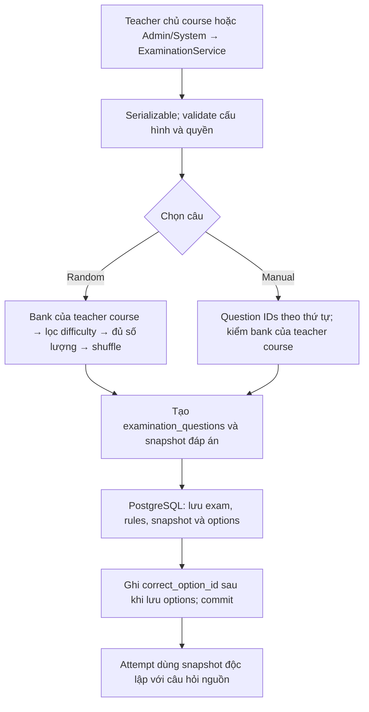

`ExaminationService.CreateAsync` (transaction Serializable):

```text
validate: title 1–200, description ≤ 4000, start/due là UTC, due > start,
          duration phải nằm gọn trong [start, due], security không âm
validate selection: mode Random ⇒ rules, không có questionIds; Manual ⇒ questionIds, không có rules; tối đa 500 câu
EnsureCanManage(course)
Random:  load các question bank theo rule → phải đủ bank (404) và thuộc teacher của course (403)
         với mỗi rule (bank, difficulty, count): lọc câu theo độ khó,
         ít hơn count → 409 "does not contain enough <difficulty> questions",
         Shuffle ngẫu nhiên rồi lấy count câu đầu
Manual:  load các questionId theo đúng thứ tự gửi → đủ câu (404), bank thuộc teacher của course (403)
Mỗi câu → CreateSnapshot (ExaminationQuestion + option/answer key), order tăng dần từ 0
         trắc nghiệm không có option đúng, hoặc điền khuyết không có answer key → 409
INSERT examination + rules + questions → SaveChanges
UPDATE correctOptionId của các câu trắc nghiệm (cần Id option đã sinh) → SaveChanges lần hai
```

Câu hỏi nguồn bị sửa/xóa sau đó **không** ảnh hưởng kỳ thi (snapshot độc lập). Với `Random`, bộ câu hỏi được chọn **một lần** lúc tạo/đổi question set; thứ tự xáo trộn khi thi chỉ phụ thuộc `attemptId` (seed = SHA-256 của `attemptId:salt`) nên reload vẫn ra cùng thứ tự.

## 11. Nộp bài tập và chấm điểm

Vòng đời bài nộp; service lưu PostgreSQL trong transaction Serializable và kiểm row-version:

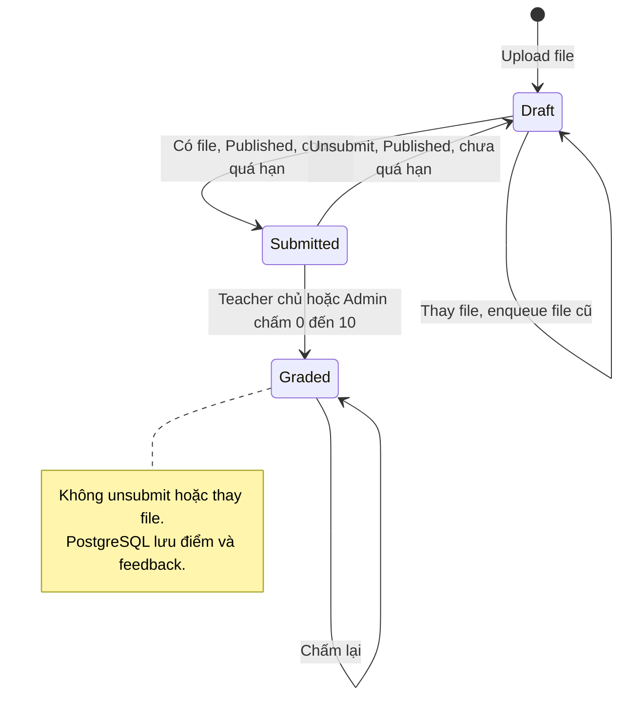

```text
POST /exercises/{id}/submissions (Student, multipart)
  validate file → student có enrollment Accepted → exercise phải Published (409)
  deadline: dueAt != null && dueAt <= now → 409
  upload file lên storage
  transaction SERIALIZABLE:
      lấy submission (exercise, student) hoặc tạo mới
      Draft + chưa có file  → thêm attachment
      Draft + đã có file    → thay metadata, Enqueue(objectKey cũ)
      Submitted/Graded      → entity ném InvalidOperationException → ConflictException
  lỗi bất kỳ → dọn file mới (EnqueueImmediately → xóa trực tiếp)

POST /submissions/{id}/submit    : Draft + có file + exercise Published + chưa quá hạn
POST /submissions/{id}/unsubmit  : Submitted + exercise Published + chưa quá hạn
PUT  /submissions/{id}/grade     : Teacher sở hữu/Admin; Submitted hoặc Graded; grade 0–10, feedback ≤ 4000
```

`Submission` có cột `Version` (row-version Postgres); hai request đồng thời sửa cùng bài → request thua nhận `DbUpdateConcurrencyException` → `409 "The data was changed by another request. Please retry."`.

## 12. Chat

Bổ sung bản hiển thị tương thích Mermaid: dấu chấm phẩy trong nhãn của bản cũ bị parser hiểu là dấu kết thúc câu lệnh. Bản gốc được giữ nguyên trong khối mã tham chiếu ngay sau sơ đồ này.

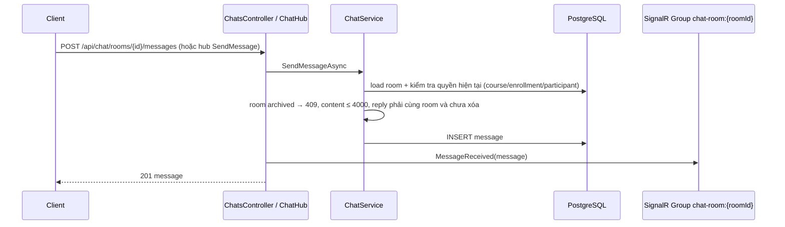

Mã sơ đồ gốc (giữ nguyên để đối chiếu):

````text
```mermaid
sequenceDiagram
    participant C as Client
    participant API as ChatsController / ChatHub
    participant S as ChatService
    participant DB as PostgreSQL
    participant H as SignalR Group chat-room:{roomId}
    C->>API: POST /api/chat/rooms/{id}/messages (hoặc hub SendMessage)
    API->>S: SendMessageAsync
    S->>DB: load room + kiểm tra quyền hiện tại (course/enrollment/participant)
    S->>S: room archived → 409; content ≤ 4000; reply phải cùng room và chưa xóa
    S->>DB: INSERT message
    API->>H: MessageReceived(message)
    API-->>C: 201 message
```
````

- Course room: quyền được tính lại mỗi lần từ course + enrollment (`EnsureCourseAuthorizationAsync`): Teacher của course, Admin, hoặc student `Accepted`. Người có quyền được tự thêm vào `ChatParticipant` khi truy cập (`EnsureCourseParticipantAsync`).
- Direct room: phải là participant. Tạo room dùng `DirectMessageKey` duy nhất (unique index) nên hai user chỉ có một room.
- `DELETE message` là **xóa mềm** (`DeletedAt`), file đính kèm trong storage không bị xóa; receipt đang trỏ vào message bị xóa được xóa. Người xóa: sender, Admin, hoặc Teacher trong **course** room.
- Broadcast SignalR được REST controller gọi sau khi lưu thành công; nếu broadcast lỗi thì dữ liệu vẫn đã lưu (client đồng bộ lại bằng REST).
- Đánh dấu đã đọc: transaction Serializable, chỉ tiến theo `(createdAt, id)`.

`DELETE /api/chat/rooms/{id}` chỉ dành direct room: cập nhật hai mốc cleared/hidden cho participant hiện tại và xóa receipt. Truy vấn lịch sử, preview/unread và kiểm tra file/reply dùng mốc cleared của chính user. Tin nhắn mới hoặc mở lại room bỏ hidden nhưng không bỏ cleared. Không phát event riêng cho xóa conversation.

## 13. Chia sẻ ngân hàng câu hỏi và quyền quản trị

Luồng xử lý và dữ liệu:

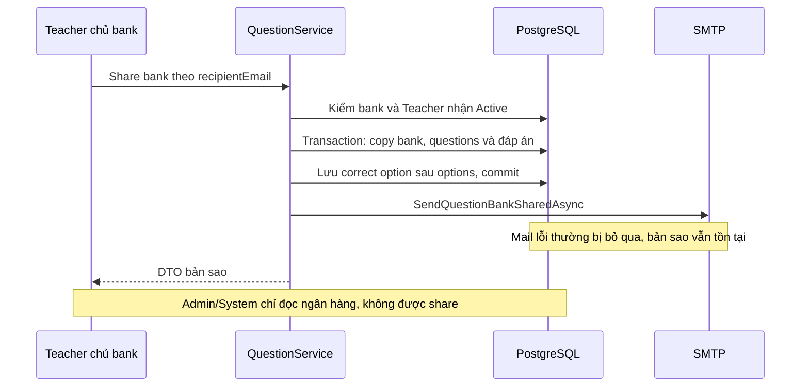

`POST /api/question-banks/{id}/share`: Teacher chủ bank → tìm Teacher Active theo email → transaction sao chép bank, câu hỏi, options/answer keys → lưu correct option sau khi lưu options → commit → SMTP `SendQuestionBankSharedAsync`. Mail lỗi thông thường được bỏ qua sau commit; không có queue gửi lại. Hủy request có thể vẫn làm response lỗi sau khi bản sao đã tồn tại, nên kiểm tra trước khi gửi lại.

Admin/System chỉ đọc bank/câu hỏi, dù được quản lý kỳ thi và dùng bank của teacher sở hữu course. `GET question-banks` không có teacherId trả toàn bộ bank cho Admin/System; `ownerSearch` lọc tên/email chủ trong bộ nhớ.

`SystemAccountSeeder` chạy sau migration, bỏ qua khi thiếu email/password hoặc độ dài password không hợp lệ. Tạo mới System Active nếu chưa có email; nếu đã có user không phải System thì nâng role và tăng AuthVersion, giữ nguyên password/status. Nếu đã là System thì không cập nhật gì. Unique filtered index chặn System thứ hai.

## Bổ sung đối chiếu transaction của thao tác lưu đáp án

`SaveMultipleChoiceAnswerAsync` và `SaveFillInBlankAnswerAsync` gọi `SaveChangesAsync` trực tiếp, không bọc `ExecuteSerializableAsync`. Chúng yêu cầu attempt `InProgress`, kiểm enrollment và deadline; hết hạn trả `409`. Cập nhật activity làm row-version `xmin` của attempt tham gia phát hiện xung đột. Các thao tác start/disconnect/reconnect/violation/submit/auto-submit/reset mới dùng transaction Serializable tường minh. Nguồn: [ExaminationAttemptService](../../LMS.Api/application/features/examinationattempts/ExaminationAttemptService.cs).

Luồng xử lý và dữ liệu:

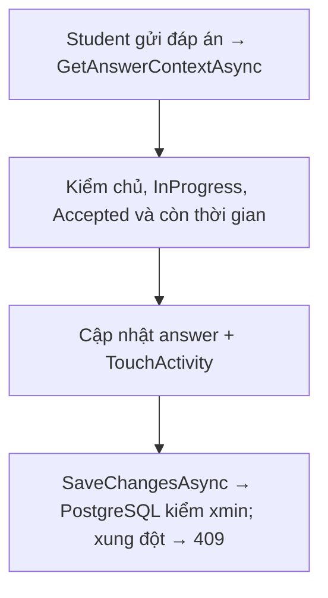
