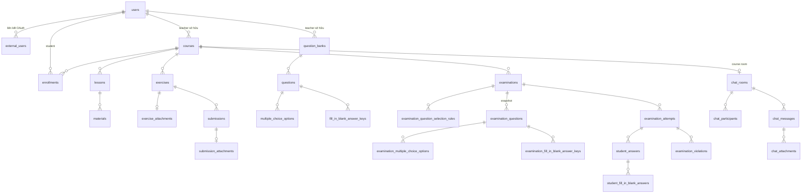

# Backend – Mô hình dữ liệu (PostgreSQL)

Nguồn: `LMS.Api/domain/entities` và `LMS.Api/infrastructure/persistence/configurations`. Tên bảng/cột là `snake_case`. Khóa chính là `uuid`.

## 1. Sơ đồ quan hệ

## 2. Bảng, ràng buộc và index

Index `UNIQUE` là chốt chặn cuối cùng cho các quy tắc nghiệp vụ; service thường kiểm tra trước để trả lỗi `409` rõ ràng.

| Bảng | Vai trò | Ràng buộc / index đáng chú ý |
| --- | --- | --- |
| `users` | Tài khoản | `UNIQUE(email)`; `auth_version` là concurrency token, tăng khi đổi mật khẩu/role/status; `password_hash` null với tài khoản chỉ dùng Google |
| `external_users` | Liên kết OAuth | `UNIQUE(provider, external_user_id)`, `UNIQUE(user_id, provider)` |
| `courses` | Khóa học | Soft delete bằng `deleted_at` (global query filter `deleted_at IS NULL`); index `teacher_id`, `status`, `deleted_at` |
| `enrollments` | Đăng ký học | `UNIQUE(student_id, course_id)`; index `(course_id, status)`; query filter theo course chưa xóa |
| `lessons` | Bài giảng | `UNIQUE(course_id, lesson_order)`; query filter theo course chưa xóa |
| `materials` | Tài liệu bài giảng | `UNIQUE(object_key)` |
| `exercises` | Bài tập | Index `course_id`, `(course_id, status)`; query filter theo course chưa xóa |
| `exercise_attachments` | File đề | `UNIQUE(exercise_id)` (một file/bài), `UNIQUE(object_key)` |
| `submissions` | Bài nộp | `UNIQUE(exercise_id, student_id)`; cột `Version` row-version (optimistic concurrency) |
| `submission_attachments` | File bài nộp | `UNIQUE(submission_id)`, `UNIQUE(object_key)` |
| `question_banks` | Ngân hàng câu hỏi | index `teacher_id` |
| `questions` | Câu hỏi nguồn | index `(question_bank_id, type, difficulty)` |
| `multiple_choice_options` | Đáp án trắc nghiệm | `UNIQUE(question_id, order)` |
| `fill_in_blank_answer_keys` | Đáp án điền khuyết | `UNIQUE(question_id, blank_order, expected_answer)` |
| `examinations` | Kỳ thi | index `(course_id, status)`, `(start_at, due_at)`; query filter theo course chưa xóa |
| `examination_question_selection_rules` | Rule chọn câu (Random) | `UNIQUE(examination_id, question_bank_id, difficulty)` |
| `examination_questions` | **Snapshot** câu hỏi của kỳ thi | `UNIQUE(examination_id, order)`; index `source_question_id` (chỉ để truy vết, không ràng buộc khóa ngoại sống còn) |
| `examination_multiple_choice_options` | Snapshot option | `UNIQUE(examination_question_id, order)` |
| `examination_fill_in_blank_answer_keys` | Snapshot đáp án điền khuyết | `UNIQUE(examination_question_id, blank_order, expected_answer)` |
| `examination_attempts` | Lượt làm bài | `UNIQUE(examination_id, student_id)` → mỗi student **một** lượt/kỳ thi; cột `Version` row-version; index `(status, last_activity_at)` phục vụ worker |
| `student_answers` | Đáp án đã chọn | `UNIQUE(examination_attempt_id, examination_question_id)` |
| `student_fill_in_blank_answers` | Đáp án điền khuyết của student | `UNIQUE(student_answer_id, blank_order)` |
| `examination_violations` | Nhật ký vi phạm | index `(examination_attempt_id, occurred_at)` |
| `chat_rooms` | Phòng chat | `UNIQUE(course_id)` (một room/course), `UNIQUE(direct_message_key)` (một room/cặp user), index `archived_at` |
| `chat_participants` | Thành viên room | `UNIQUE(chat_room_id, user_id)`; lưu `last_read_message_id` |
| `chat_messages` | Tin nhắn | Index `(chat_room_id, created_at, id)` cho phân trang; xóa mềm bằng `deleted_at` |
| `chat_attachments` | File chat | `UNIQUE(object_key)` |
| `file_cleanup_tasks` | Hàng đợi xóa file | `UNIQUE(object_key)`; index `next_attempt_at`; cột `attempt_count`, `last_error` |

## 3. Xóa mềm và query filter

`Course` bị xóa mềm (`deleted_at`). Query filter toàn cục ẩn course đã xóa **và** các bảng con phụ thuộc course (`enrollments`, `lessons`, `exercises`, `examinations`): khi course bị xóa, mọi truy vấn qua EF tự động không thấy dữ liệu con đó. `restore` đưa course (và dữ liệu con) hiện trở lại. Repository có tham số `includeDeleted` để Admin/restore bỏ qua filter.

`ChatMessage` cũng xóa mềm nhưng không có query filter; repository/service loại message đã xóa khỏi danh sách và từ chối tải attachment của message đã xóa (`404`).

## 4. Đồng thời (concurrency)

| Cơ chế | Dùng cho |
| --- | --- |
| Transaction `Serializable` + retry 3 lần | accept enrollment, update course, chỉnh/publish/close examination, mọi thao tác attempt, upload/submit/grade bài nộp, mark chat read |
| Row-version (`Version`, xmin của Postgres) | `submissions`, `examination_attempts` |
| Concurrency token | `users` (qua `auth_version`) |
| Unique index | Chốt cuối cho trùng lặp (email, enrollment, lesson order, room, attachment key...) |
| `GetByIdForUpdateAsync` | Khóa dòng `examinations` khi sửa/publish/close |

Xem cách lỗi được dịch ra HTTP ở [error-handling.md](error-handling.md).

## 5. Snapshot câu hỏi

Câu hỏi trong kỳ thi **không tham chiếu** trực tiếp `questions`; chúng được sao chép vào `examination_questions` (+ option/answer key) khi tạo hoặc thay question set. Hệ quả:

- Sửa hoặc xóa câu hỏi nguồn không đổi đề thi đã tạo hay điểm đã chấm.
- `source_question_id` chỉ giữ để truy vết.
- Question bank chỉ bị chặn xóa khi còn được selection rule của một examination tham chiếu.
- Với trắc nghiệm, `examination_questions.correct_option_id` được ghi ở lần `SaveChanges` thứ hai sau khi các option có Id.

## 6. Migration

Thư mục `infrastructure/persistence/migrations`, mới nhất: `PersistUserAuthVersion`, `EnforceSingleExaminationAttempt` (thêm unique `(examination_id, student_id)`), `AddSubmissionConcurrencyToken`, `AddPersistentFileCleanupQueue`, `AddExerciseLifecycle`, `AddSubmissionGrading`. API tự `Migrate()` khi khởi động nên không cần chạy tay trong dev.
