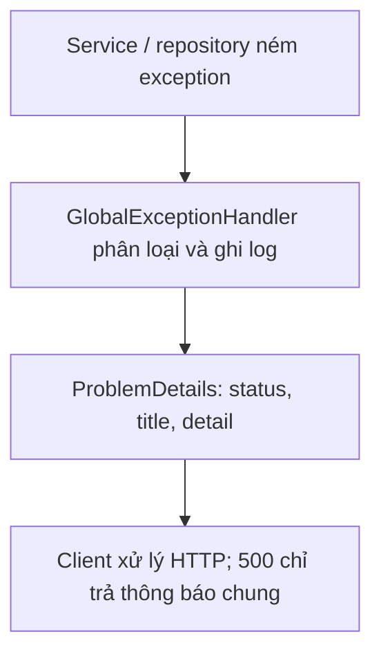
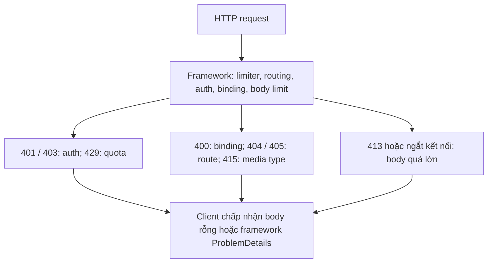
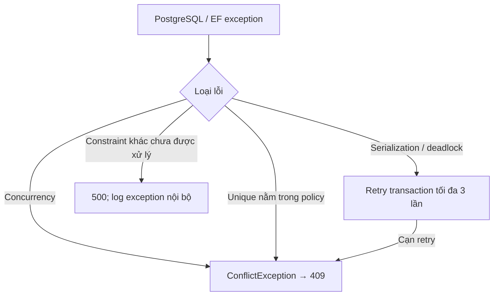
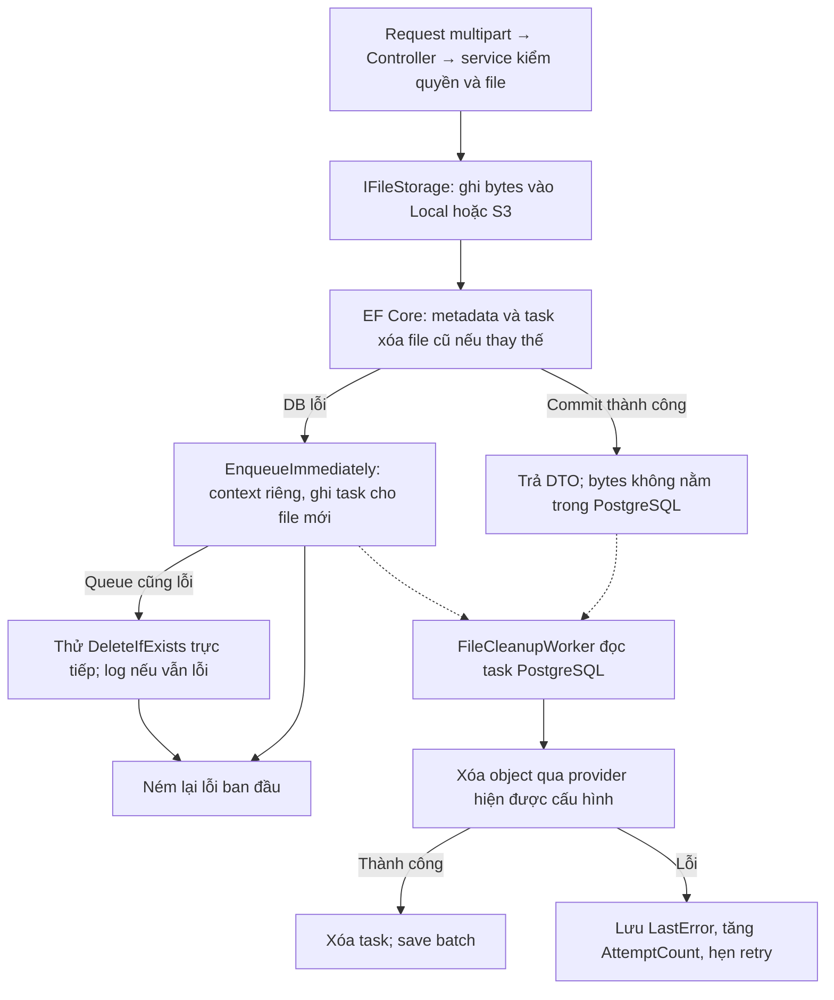
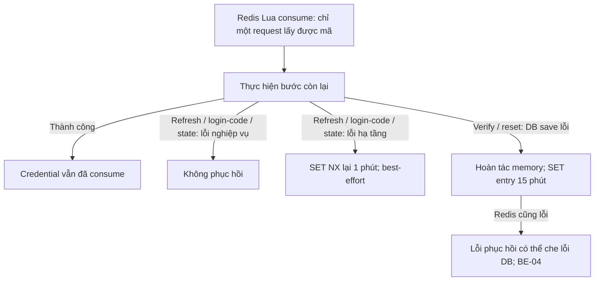
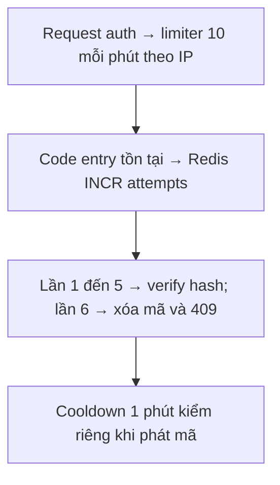
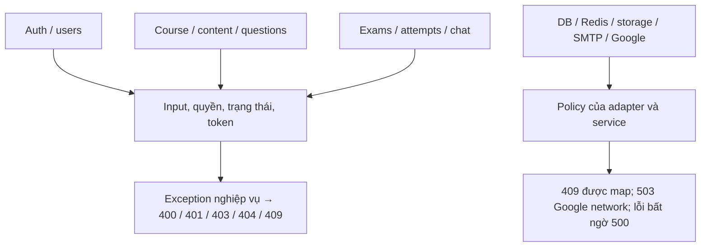
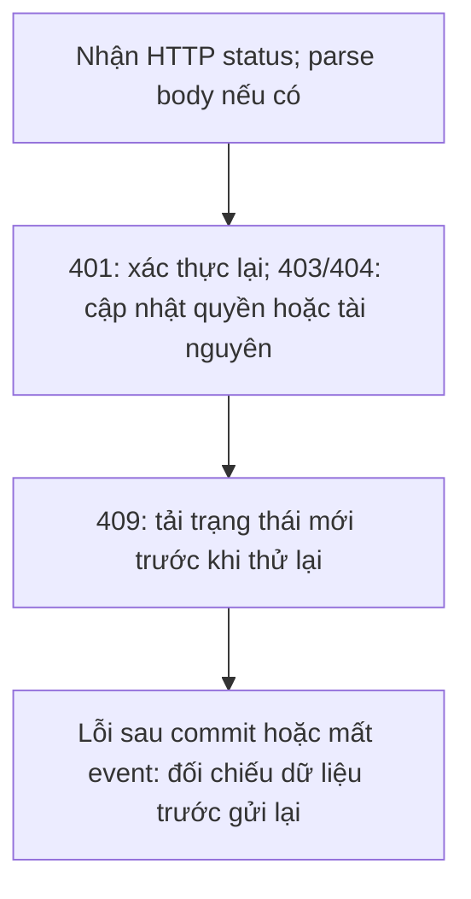

# Backend – Xử lý ngoại lệ và lỗi

Đối chiếu mã nguồn ngày **2026-10-13**. Mô tả implementation trong repository, không phải xác nhận môi trường production.

## 1. Mô hình

Luồng xử lý và dữ liệu:



Nghiệp vụ ném exception tùy chỉnh (thư mục `domain/exceptions`); `GlobalExceptionHandler` (đăng ký qua `AddExceptionHandler` + `UseExceptionHandler`) biến chúng thành `ProblemDetails`.

| Exception | HTTP | `title` | `detail` |
| --- | --- | --- | --- |
| `BadRequestException` | 400 | `Bad Request` | message của exception |
| `UnauthorizeException` | 401 | `Unauthorize` | message |
| `ForbiddenException` | 403 | `Forbidden` | message |
| `NotFoundException` | 404 | `Not found` | message |
| `ConflictException` | 409 | `Conflict` | message |
| `ExternalServiceUnavailableException` | 503 | `Service Unavailable` | message (`Unable to reach Google...` / `Google did not respond in time...`) |
| `DbUpdateException` vi phạm unique nghiệp vụ | 409 | `Conflict` | `The requested change conflicts with existing data.` |
| Mọi exception khác | 500 | `Internal Server Error` | `An unexpected error occurred.` (không lộ chi tiết) |

Ghi log: lỗi status `>= 500` dùng `LogError` kèm exception, **trừ** `ExternalServiceUnavailableException` (503) dùng `LogWarning`. Warning chỉ gồm status và tên kiểu exception. Xem [supporting-components.md](supporting-components.md) cho toàn bộ logger và nơi đọc log.

Response mẫu:

```json
{
  "title": "Conflict",
  "status": 409,
  "detail": "Only waiting enrollments can change status."
}
```

> `type` có thể không xuất hiện vì handler tự dựng `ProblemDetails` chỉ với `status`, `title`, `detail`. Client chỉ nên dựa vào `status` và `detail`.

## 2. Các lỗi không đi qua `GlobalExceptionHandler`

Luồng xử lý và dữ liệu:



Những lỗi này do framework sinh ra nên có hình dạng khác (hành vi mặc định của ASP.NET Core, chưa bật `UseStatusCodePages`). Client cần chịu được body rỗng.

| Tình huống | HTTP | Body |
| --- | --- | --- |
| Thiếu/sai/hết hạn JWT, chữ ký sai, `OnTokenValidated` thất bại (user bị khóa, đổi role, `auth_version` lệch) | 401 | Thường rỗng, kèm header `WWW-Authenticate: Bearer` |
| Realtime token dùng ngoài `/hubs/chat` | 401 | như trên |
| `[Authorize(Roles = "Admin,System")]` không đạt (chỉ `auto-submit`) | 403 | Rỗng |
| Body JSON sai cú pháp/sai kiểu, enum chuỗi không parse được, GUID sai định dạng khi model binding query/body | 400 | `ValidationProblemDetails` của `[ApiController]`: `{ "title": "One or more validation errors occurred.", "status": 400, "errors": { "field": ["..."] } }` |
| GUID không khớp route constraint `{id:guid}` | 404 | Không match route; không phải lỗi validation của service |
| Sai `Content-Type` (không phải JSON/multipart) | 415 | Rỗng hoặc ProblemDetails mặc định |
| Request body vượt `RequestSizeLimit(20_000_000)` ở endpoint upload | 413 / ngắt kết nối | Tùy server |
| Vượt rate limit | 429 | Rỗng |
| Route/phương thức không tồn tại | 404 / 405 | Rỗng |

Ví dụ `400` do binding:

```json
{
  "type": "https://tools.ietf.org/html/rfc9110#section-15.5.1",
  "title": "One or more validation errors occurred.",
  "status": 400,
  "errors": {
    "request": ["The request field is required."],
    "$.role": ["The JSON value could not be converted to LMS.Api.domain.Enums.Users.Role."]
  }
}
```

## 3. Chuyển đổi lỗi tầng thấp thành `409`

Luồng xử lý và dữ liệu:



`AppDbContext.SaveChangesAsync` bắt:

| Lỗi gốc | Kết quả |
| --- | --- |
| `DbUpdateConcurrencyException` (row-version `Submission`/`ExaminationAttempt`, concurrency token `User`) | `ConflictException("The data was changed by another request. Please retry.")` |
| `DbUpdateException` unique violation trên các index nghiệp vụ | `ConflictException("The record already exists.")` |

Các index được coi là "nghiệp vụ" (danh sách `DatabaseConstraintPolicy`): `IX_users_email`, `IX_users_single_system_role`, `IX_enrollments_student_id_course_id`, `IX_lessons_course_id_lesson_order`, `IX_submissions_exercise_id_student_id`, `IX_chat_rooms_course_id`, `IX_chat_rooms_direct_message_key`, `IX_materials_object_key`, `IX_exercise_attachments_object_key`, `IX_submission_attachments_object_key`, `IX_chat_attachments_object_key`.

Các unique index **không** nằm trong danh sách (ví dụ `(examination_id, student_id)` của `examination_attempts`, `(user_id, provider)` của `external_users`, các index trên bảng snapshot câu hỏi) nếu bị vi phạm mà service chưa chặn trước sẽ rơi vào `GlobalExceptionHandler` nhánh `DbUpdateException` không phải nghiệp vụ → `500`. Hầu hết đã được service kiểm tra trước nên trả `409` đúng nghĩa; nếu thêm unique index mới, nhớ thêm vào `DatabaseConstraintPolicy`.

`AppDbContext.ExecuteSerializableAsync`/`ExecuteAsync` (transaction thủ công):

- Chạy `action` trong transaction với mức `Serializable` (hoặc `ReadCommitted`).
- Gặp `PostgresException` có `SqlState` = `40001` (serialization failure) hoặc `40P01` (deadlock) → `ChangeTracker.Clear()`, chờ `25ms × lần thử`, thử lại tối đa **3 lần**.
- Hết số lần → `ConflictException("The transaction conflicted with another request. Please retry.")` (`409`).

## 4. Chiến lược chịu lỗi theo thành phần

Luồng xử lý và dữ liệu:



| Thành phần | Khi lỗi | Cách xử lý |
| --- | --- | --- |
| Redis (nhóm auth) | Mất kết nối / timeout | Exception không thuộc nhóm nghiệp vụ → `500`. Không có fallback |
| SMTP | Gửi mail lỗi | Dọn mã + cooldown trong Redis rồi ném lỗi (`500`) để client gọi lại ngay; riêng `forgot-password` vẫn không lộ việc email tồn tại khi chưa chạm tới bước gửi |
| SMTP sau share question bank | Bản sao đã commit | Nuốt lỗi nếu request chưa bị hủy, trả thành công; không queue/retry mail |
| PostgreSQL sau khi consume mã/refresh token | Lỗi tạm thời | **Hoàn tác trạng thái tạm** (xem mục 5) |
| Storage khi upload | Lỗi ghi | Exception → `500`, chưa có dữ liệu DB nên không cần dọn |
| DB lỗi sau khi đã upload file | Lỗi DB/xung đột | File mới được đưa vào cleanup queue ngay (`EnqueueImmediately`); nếu queue lỗi → xóa trực tiếp; nếu vẫn lỗi → chỉ log, **lỗi gốc luôn được ném lại** |
| Worker | Lỗi trong vòng lặp | Log lỗi, vòng sau chạy lại; không làm sập host |
| SignalR broadcast | Lỗi gửi | Dữ liệu đã lưu; client đồng bộ lại bằng REST |
| Google OAuth | Không kết nối được / quá 10 giây (`HttpClient.Timeout`) | `GoogleOAuthProvider` ném `ExternalServiceUnavailableException` → `503`, log `Warning`; state được phục hồi để thử callback lại |
| Google OAuth | Đổi code lỗi / userinfo trả HTTP lỗi | Lỗi lan ra → `500` (hoặc `401` nếu Google trả dữ liệu không hợp lệ như email chưa verify); state được phục hồi 1 phút để thử callback lại |

## 5. Mẫu "consume rồi phục hồi" cho mã dùng một lần

Luồng xử lý và dữ liệu:



Áp dụng cho refresh token, login code OAuth, OAuth state, mã xác thực email, mã đặt lại mật khẩu:

```text
1. GET + DEL atomic (Lua)             → chỉ một request đồng thời lấy được giá trị
2. Thực hiện bước ghi/đổi trạng thái
3a. Thành công                        → xong, giá trị đã bị xóa
3b. Lỗi hạ tầng (không phải 400/401/403/404/409)
        → SET NX giá trị cũ, TTL 1 phút (OAuth identity: 10 phút) rồi ném lại lỗi gốc
3c. Lỗi nghiệp vụ                     → không phục hồi (mã đã "cháy")
```

Riêng email verification / password reset phục hồi bằng `SET` lại entry với TTL đầy đủ 15 phút và hoàn tác `Status`/`PasswordHash`/`AuthVersion` trong bộ nhớ nếu `SaveChanges` lỗi. Hai nhánh này dùng `CancellationToken.None` nhưng không có catch bảo vệ lần `SET` phục hồi; nếu Redis cũng lỗi, lỗi phụ có thể che lỗi DB gốc. Refresh/login-code/OAuth-state mới dùng helper nuốt lỗi phục hồi.

## 6. Giới hạn thử mã (brute-force)

Luồng xử lý và dữ liệu:



| Mã | Giới hạn | Khi vượt |
| --- | --- | --- |
| Xác thực email | 5 lần kiểm tra entry, kể cả mã đúng; TTL 15 phút từ lần INCR đầu tiên; gửi mã mới xóa counter | Lần 6 xóa mã, `409 Too many verification attempts. Request a new code.` |
| Đặt lại mật khẩu | 5 lần kiểm tra entry; gửi mã mới không xóa counter hiện có | Lần 6 xóa mã, `409 Too many reset attempts. Try again later.` |
| Toàn bộ `/api/auth/*` | 10 request/phút/IP | `429` |
| Gửi lại mã | 1 phút/tài khoản | `409 Please wait before requesting another verification code.` |

`forgot-password` trong cooldown trả `200 accepted=true`, không trả `409` như resend verification. Ghi chú bảo mật: `verify-email` và `resend-verification` trả `404 Account was not found.` khi email không tồn tại; `forgot-password` cố ý trả cùng response cho trường hợp không gửi mail.

## 7. Danh mục lỗi nghiệp vụ theo module

Luồng xử lý và dữ liệu:



Các thông báo tiêu biểu bên dưới bằng tiếng Anh; danh sách không thay thế mọi nhánh trong service. Cột HTTP là status mapping. Admin/System thao tác ghi question bank nhận `403 Administrator accounts can only view question banks.`; xóa course conversation nhận `400 Only direct conversations can be deleted.` (xem service cho message chính xác).

### Chung

| HTTP | Thông báo | Khi nào |
| --- | --- | --- |
| 401 | `Authentication is required.` | Không đọc được userId/role từ claim |
| 400 | `{field} is required.` | GUID rỗng (`Guid.Empty`) |
| 400 | `Page must be positive and page size must be between 1 and 100.` | Phân trang sai (một số nơi: `Invalid pagination.`) |
| 400 | `File name must contain between 1 and 255 characters.` / `File content type must contain between 1 and 255 characters.` / `File size must be greater than zero.` / `File size must be smaller than {n} bytes.` / `File content is not readable.` | `FileUploadPolicy` |

### Auth, Registration, Password reset

| HTTP | Thông báo |
| --- | --- |
| 400 | `Email and password are required.` · `Email address is invalid.` · `Password must contain between 8 and 128 characters.` · `Password confirmation does not match.` · `Verification code must contain exactly 6 supported letters or numbers.` · `Verification code is invalid or expired.` · `Reset code must contain exactly 6 supported characters.` · `Reset code is invalid or expired.` · `Password is invalid or confirmation does not match.` · `Refresh token is required.` · `OAuth login code is required.` · `OAuth state is invalid or expired.` · `OAuth state does not match the provider.` · `OAuth state is not valid for this browser.` · `OAuth state has an invalid flow purpose.` · `OAuth provider '{p}' is not supported.` · `OAuth provider, code, redirect URI and code verifier are required.` |
| 401 | `Invalid email or password.` · `Account is not active.` · `Refresh token is invalid or expired.` · `OAuth login code is invalid or expired.` · `The external account email is not verified.` · `The external account returned an invalid email address.` · `The external account returned an invalid provider identity.` |
| 404 | `Account was not found.` (verify/resend/link) |
| 409 | `An account with this email already exists.` · `The registration request does not match the existing inactive account.` · `Only inactive accounts can be verified.` · `Only inactive accounts can request a verification code.` · `OAuth accounts do not require email verification.` · `OAuth accounts do not use password reset.` · `Please wait before requesting another verification code.` · `Too many verification attempts. Request a new code.` · `Too many reset attempts. Try again later.` · `Verification code has already been used. Request a new code.` · `Reset code has already been used. Request a new code.` · `Your account already has a different linked {p} account.` · `Your account already has a linked {p} account.` · `This external account is already linked to your account.` · `This external account is already linked to another account.` |

### Users

| HTTP | Thông báo |
| --- | --- |
| 400 | `User id is required.` · `Full name is invalid.` · `Phone cannot exceed 20 characters.` · `Current password is incorrect.` · `New password must be different from the current password.` · `Role is invalid.` · `User id or status is invalid.` · `User id, full name or role is invalid.` · `You cannot start a direct conversation with yourself.` |
| 403 | `You can only view your own profile.` · `Administrator accounts cannot be modified.` · `Only administrators can manage users.` |
| 404 | `User was not found.` · `An active user with this email was not found.` |
| 409 | `An account with this email already exists.` · `The last active administrator cannot be disabled.` · `The last active administrator cannot be demoted.` · `Transfer the teacher's courses and question banks before changing their role or active status.` |

### Courses và Enrollments

| HTTP | Thông báo |
| --- | --- |
| 400 | `Course name must contain between 1 and 200 characters.` · `Course description cannot exceed 2000 characters.` · `Maximum students must be greater than zero.` · `Course status is invalid.` · `Course teacher must be an active teacher account.` |
| 403 | `Only the course teacher or an administrator can manage this course.` · `Teachers can only create courses assigned to themselves.` · `Only administrators can view deleted courses.` · `Only students can list their enrolled courses.` · `Only students can request enrollment.` · `Only students can list their enrollments.` · `Students can only cancel their own enrollment requests.` |
| 404 | `Course was not found.` · `Teacher was not found.` · `Enrollment was not found.` |
| 409 | `Maximum students cannot be lower than the number of accepted enrollments.` · `Enrollment is only available for open courses.` · `An active enrollment for this student and course already exists.` · `Enrollments can only be accepted for open courses.` · `Course has reached its maximum number of students.` · `Only waiting enrollments can change status.` · `Only accepted enrollments can be revoked.` · `This course is already deleted` · `Only deleted courses can be restored` · `Only waiting enrollment can be accepted.` · `Only waiting enrollments can be rejected.` · `Only waiting or accepted enrollment can be cancelled.` · `Only rejected or cancelled enrollment can be requested again.` |

### Question banks

| HTTP | Thông báo |
| --- | --- |
| 400 | `Question bank name must contain between 1 and 200 characters.` · `Question bank description cannot exceed 2000 characters.` · `Question bank owner must be an active teacher account.` · `Question content is required.` · `Question difficulty is invalid.` · `A multiple-choice question requires at least two options.` · `A multiple-choice question requires exactly one correct option.` · `Multiple-choice option content is required.` · `A fill-in-blank question requires at least one answer.` · `Fill-in-blank answers must have a valid order and contain at most 1000 characters.` · `Options can only be updated on a multiple-choice question.` · `Answers can only be updated on a fill-in-blank question.` |
| 403 | `Only the question bank owner or an administrator can manage it.` · `Teachers can only create question banks assigned to themselves.` · `Teachers can only view their own question banks.` |
| 404 | `Question bank was not found.` · `Question was not found.` · `Teacher was not found.` |
| 409 | `Question bank is referenced by an examination and cannot be deleted.` · `Duplicate expected answers for the same blank are not allowed.` |

### Lessons, Materials

| HTTP | Thông báo |
| --- | --- |
| 400 | `Lesson name must contain between 1 and 200 characters.` · `Lesson order cannot be negative.` · `Lesson status is invalid.` · `Lesson ids are required.` · `Lesson ids must be unique and valid.` · `The complete lesson list for this course is required.` |
| 404 | `Lesson was not found.` · `Material was not found.` · `Course was not found.` |
| 409 | `Lesson order already exists in this course.` · `Lesson order values are too large to reorder safely.` |

### Exercises, Submissions

| HTTP | Thông báo |
| --- | --- |
| 400 | `Exercise title must contain between 1 and 200 characters.` · `Exercise description cannot exceed 4000 characters.` · `Exercise deadline must use UTC.` · `Grade must be between 0 and 10 and feedback cannot exceed 4000 characters.` |
| 403 | `Only students can manage submissions.` · `Students can only manage their own submissions.` · `Students can only download their own submissions.` · `An accepted course enrollment is required.` |
| 404 | `Exercise was not found.` · `Exercise attachment was not found.` · `Submission was not found.` · `Submission attachment was not found.` |
| 409 | `Only draft exercises can be updated.` · `Only draft exercises can have their attachment changed.` · `Only draft exercises can be deleted.` · `Only draft exercises can be published.` · `An exercise cannot be published after its deadline.` · `Only published exercises can be closed.` · `Submissions are only accepted for published exercises.` · `The exercise deadline has passed.` · `Submissions can only change while the exercise is published.` · `A file must be uploaded before submitting work.` · `Only draft submissions can be submitted.` · `Only submitted work can be unsubmitted.` |

### Examinations

| HTTP | Thông báo |
| --- | --- |
| 400 | `Examination title must contain between 1 and 200 characters.` · `Examination description cannot exceed 4000 characters.` · `Examination start and due times must use UTC.` · `Examination due time must be after its start time.` · `Examination duration must fit within its availability window.` · `Examination security limits cannot be negative.` · `Question selection mode is invalid.` · `Random selection requires rules and cannot include explicit question ids.` · `Question selection rules are invalid.` · `Manual selection requires question ids and cannot include random selection rules.` · `Manual question selection is invalid or exceeds 500 questions.` · `An examination cannot contain more than 500 questions.` |
| 403 | `Examinations can only use question banks owned by the course teacher.` |
| 404 | `Examination was not found.` · `A selected question bank was not found.` · `A selected question was not found.` · `A question bank for a selected question was not found.` · `Course was not found.` |
| 409 | `Only draft examinations can be updated.` · `Only draft examinations can be published.` · `An examination requires at least one snapshotted question before publishing.` · `An examination cannot be published after its due time.` · `Only published examinations can be closed.` · `Question bank '{name}' does not contain enough {difficulty} questions.` · `Duplicate question selection rules are not allowed.` · `Duplicate manually selected questions are not allowed.` · `A selected multiple-choice question has no valid correct option.` · `A selected fill-in-blank question has no answer key.` |

### Examination attempts

| HTTP | Thông báo |
| --- | --- |
| 400 | `The selected question is not multiple choice.` · `The selected option does not belong to this question.` · `The selected question is not fill in blank.` · `An answer references a blank that does not exist in this question.` · `Fill-in-blank answers must have a valid order and contain at most 1000 characters.` · `Examination violation type is invalid.` · `This violation type is not enabled for the examination.` · `Fullscreen exit duration is required and cannot be negative.` · `Auto-submit reason is invalid.` · `Invalid pagination.` |
| 403 | `Only students can access examination attempts.` · `Students can only access their own examination attempts.` · `An accepted course enrollment is required to start this examination.` · `Only administrators can trigger auto-submit.` |
| 404 | `Examination was not found.` · `Examination attempt was not found.` · `Examination question was not found.` · `Course was not found.` |
| 409 | `Only published examinations can be started.` · `The examination is not currently available.` · `The examination has no questions.` · `A student can attempt an examination only once.` · `The examination attempt is no longer active.` · `The examination attempt must be {status}.` · `The examination attempt has expired.` · `The examination attempt has already been submitted.` · `Only one student answer is allowed for each blank.` · `The requested auto-submit reason does not apply to this attempt.` · `Only in-progress attempts can be disconnected.` · `Only disconnected attempts can reconnect.` · `Only active attempts can be submitted.` |

### Chat

| HTTP | Thông báo |
| --- | --- |
| 400 | `A direct chat requires another user.` · `The reply message is invalid for this room.` · `Message content cannot exceed 4000 characters.` · `The read receipt target is invalid for this room.` · `A chat message must contain text or at least one attachment.` |
| 401 | `User authentication is no longer valid.` · `Account is not active.` |
| 403 | `Direct chat is available only for active users.` · `You are not a participant in this chat room.` · `Only the course teacher or an accepted student can access course chat.` · `Only the message sender can edit this message.` · `You cannot delete this message.` |
| 404 | `The chat room was not found.` · `The other user was not found.` · `The chat message was not found.` · `The chat attachment was not found.` · `The course was not found.` · `The course chat room is invalid.` |
| 409 | `Archived chat rooms cannot be joined.` · `Archived chat rooms do not accept new messages.` · `Archived chat rooms cannot be modified.` · `You are not a participant in this chat room.` |

### Lỗi do tầng dữ liệu

| HTTP | Thông báo |
| --- | --- |
| 409 | `The data was changed by another request. Please retry.` · `The record already exists.` · `The transaction conflicted with another request. Please retry.` |
| 500 | `An unexpected error occurred.` |

## 8. Khuyến nghị cho client

Luồng xử lý và dữ liệu:



- Luôn đọc `status` và `detail`; dùng `status` để phân nhánh, không so khớp chuỗi `detail` (tiếng Anh, có thể đổi).
- `401` ngoài `login`: thử `refresh` một lần rồi gửi lại; nếu vẫn `401` → đăng xuất. `401` từ `login` nghĩa là sai thông tin hoặc tài khoản không `Active`.
- `409` kiểu `Please retry` / `transaction conflicted`: có thể retry ngay (idempotent ở phía server do đã rollback).
- `429`: chờ tối đa 1 phút (cửa sổ cố định).
- Body lỗi có thể rỗng (mục 2) – đừng giả định luôn parse được JSON.
