# Bản đồ file backend

Đối chiếu ngày 2026-10-13. Danh mục các file mã nguồn/cấu hình văn bản; không bao gồm dependency, build output, nội dung secret `.env`, assets nhị phân hoặc tài liệu lặp lại. Backend Designer/Snapshot đi kèm migration được gom trong [data-model](../../docs/architecture/data-model.md). Đây là chỉ mục truy vết, không khẳng định đã kiểm thử runtime từng file.

## .github/workflows

Vị trí nhóm file trong hệ thống:

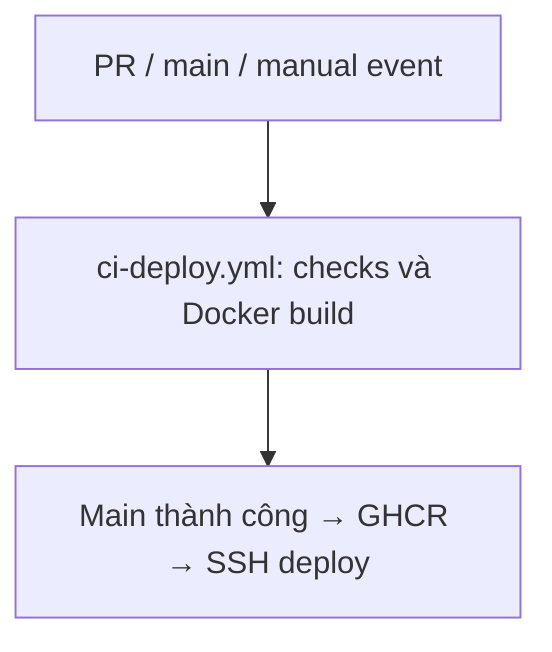

| File | Làm gì / khi dùng | Điểm truy vết |
| --- | --- | --- |
| [ci-deploy.yml](<../../.github/workflows/ci-deploy.yml>) | Workflow CI kiểm tra và deploy trên main | — |

## LMS.Api/Properties

Vị trí nhóm file trong hệ thống:

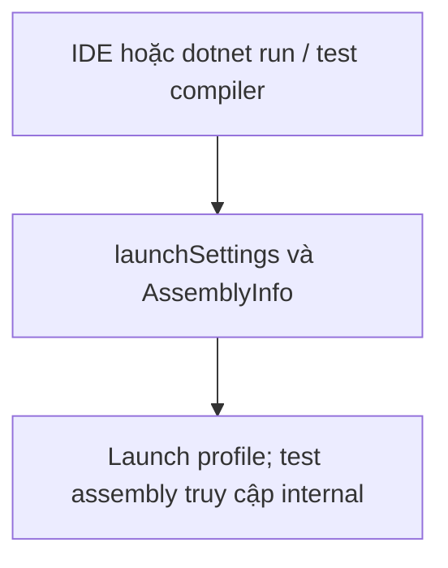

| File | Làm gì / khi dùng | Điểm truy vết |
| --- | --- | --- |
| [AssemblyInfo.cs](<../../LMS.Api/Properties/AssemblyInfo.cs>) | Thành phần hỗ trợ/cấu hình; tra supporting-components hoặc supporting-features | — |
| [launchSettings.json](<../../LMS.Api/Properties/launchSettings.json>) | Thành phần hỗ trợ/cấu hình; tra supporting-components hoặc supporting-features | — |

## LMS.Api/application

Vị trí nhóm file trong hệ thống:

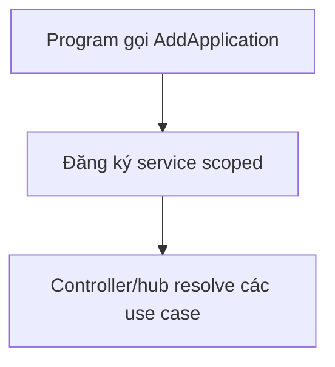

| File | Làm gì / khi dùng | Điểm truy vết |
| --- | --- | --- |
| [DependencyInjection.cs](<../../LMS.Api/application/DependencyInjection.cs>) | Thành phần hỗ trợ/cấu hình; tra supporting-components hoặc supporting-features | `DependencyInjection` |

## LMS.Api/application/abstractions/auth

Vị trí nhóm file trong hệ thống:

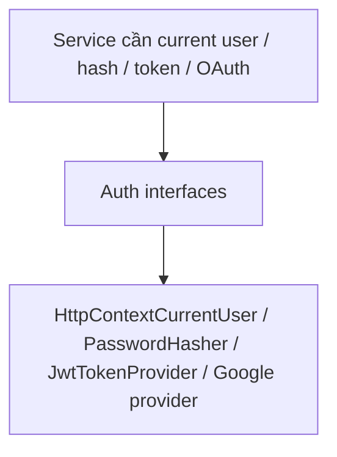

| File | Làm gì / khi dùng | Điểm truy vết |
| --- | --- | --- |
| [CurrentUserExtensions.cs](<../../LMS.Api/application/abstractions/auth/CurrentUserExtensions.cs>) | Interface/helper dùng chung giữa service và hạ tầng | `CurrentUserExtensions` |
| [ICurrentUser.cs](<../../LMS.Api/application/abstractions/auth/ICurrentUser.cs>) | Interface/helper dùng chung giữa service và hạ tầng | `ICurrentUser` |
| [IOAuthProvider.cs](<../../LMS.Api/application/abstractions/auth/IOAuthProvider.cs>) | Interface/helper dùng chung giữa service và hạ tầng | `OAuthAuthorizationRequest`, `OAuthTokenResult`, `OAuthUserInfo`, `IOAuthProvider` |
| [IPasswordHasher.cs](<../../LMS.Api/application/abstractions/auth/IPasswordHasher.cs>) | Interface/helper dùng chung giữa service và hạ tầng | `IPasswordHasher` |
| [ITokenProvider.cs](<../../LMS.Api/application/abstractions/auth/ITokenProvider.cs>) | Interface/helper dùng chung giữa service và hạ tầng | `ITokenProvider`, `AccessToken`, `AuthenticationTokenClaims` |

## LMS.Api/application/abstractions/caching

Vị trí nhóm file trong hệ thống:

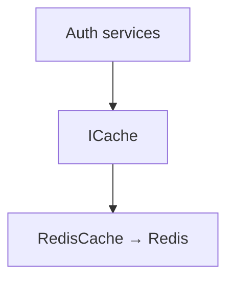

| File | Làm gì / khi dùng | Điểm truy vết |
| --- | --- | --- |
| [ICache.cs](<../../LMS.Api/application/abstractions/caching/ICache.cs>) | Interface/helper dùng chung giữa service và hạ tầng | `ICache` |

## LMS.Api/application/abstractions/mail

Vị trí nhóm file trong hệ thống:

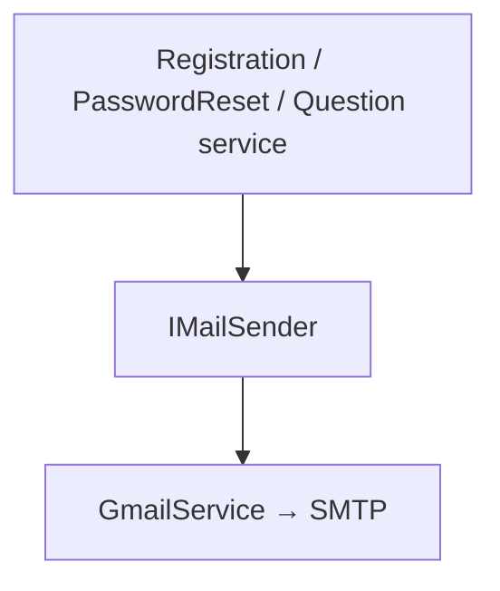

| File | Làm gì / khi dùng | Điểm truy vết |
| --- | --- | --- |
| [IMailSender.cs](<../../LMS.Api/application/abstractions/mail/IMailSender.cs>) | Interface/helper dùng chung giữa service và hạ tầng | `IMailSender` |

## LMS.Api/application/abstractions/persistence

Vị trí nhóm file trong hệ thống:

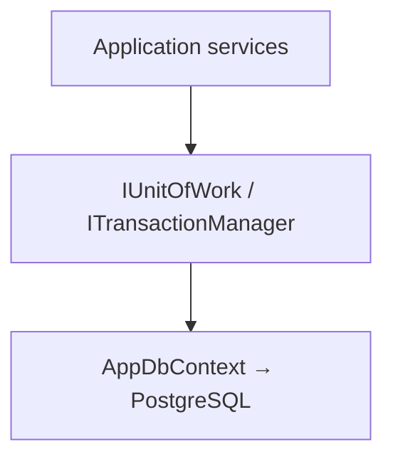

| File | Làm gì / khi dùng | Điểm truy vết |
| --- | --- | --- |
| [ITransactionManager.cs](<../../LMS.Api/application/abstractions/persistence/ITransactionManager.cs>) | Interface/helper dùng chung giữa service và hạ tầng | `ITransactionManager` |
| [IUnitOfWork.cs](<../../LMS.Api/application/abstractions/persistence/IUnitOfWork.cs>) | Interface/helper dùng chung giữa service và hạ tầng | `IUnitOfWork` |

## LMS.Api/application/abstractions/time

Vị trí nhóm file trong hệ thống:

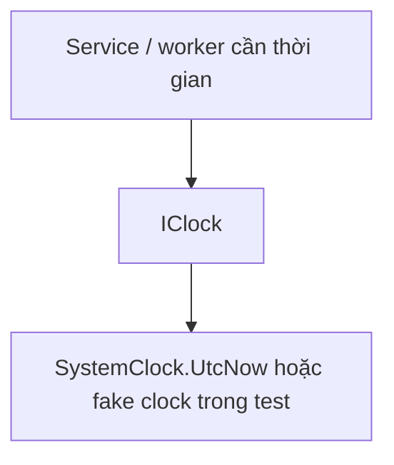

| File | Làm gì / khi dùng | Điểm truy vết |
| --- | --- | --- |
| [IClock.cs](<../../LMS.Api/application/abstractions/time/IClock.cs>) | Interface/helper dùng chung giữa service và hạ tầng | `IClock` |

## LMS.Api/application/common

Vị trí nhóm file trong hệ thống:

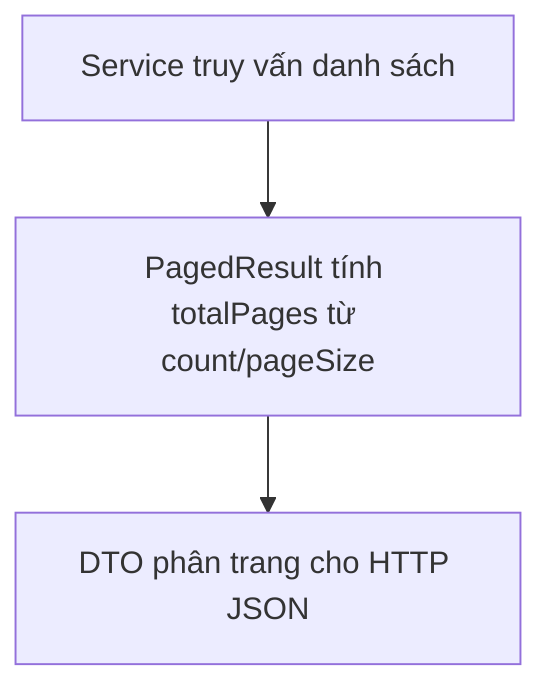

| File | Làm gì / khi dùng | Điểm truy vết |
| --- | --- | --- |
| [PagedResult.cs](<../../LMS.Api/application/common/PagedResult.cs>) | Thành phần hỗ trợ/cấu hình; tra supporting-components hoặc supporting-features | `PagedResult` |

## LMS.Api/application/features/auth

Vị trí nhóm file trong hệ thống:

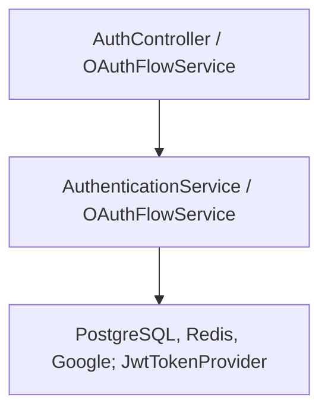

| File | Làm gì / khi dùng | Điểm truy vết |
| --- | --- | --- |
| [AuthenticationContracts.cs](<../../LMS.Api/application/features/auth/AuthenticationContracts.cs>) | Request/DTO/interface service; xem API contracts | `LoginRequest`, `LoginResponse`, `RefreshTokenRequest`, `OAuthLoginRequest`, `OAuthLoginCodeRequest`, `OAuthLoginCodeResponse`, `OAuthLinkRequest`, `OAuthLinkResponse`, `IAuthenticationService` |
| [AuthenticationService.cs](<../../LMS.Api/application/features/auth/AuthenticationService.cs>) | Điều phối quyền, validation, trạng thái và lưu dữ liệu của module | `AuthenticationService` |
| [OAuthFlowContracts.cs](<../../LMS.Api/application/features/auth/OAuthFlowContracts.cs>) | Request/DTO/interface service; xem API contracts | `OAuthFlowPurpose`, `OAuthAuthorizationResult`, `OAuthCallbackRequest`, `OAuthCallbackResult`, `IOAuthFlowService` |
| [OAuthFlowService.cs](<../../LMS.Api/application/features/auth/OAuthFlowService.cs>) | Điều phối quyền, validation, trạng thái và lưu dữ liệu của module | `OAuthFlowService` |

## LMS.Api/application/features/auth/utils

Vị trí nhóm file trong hệ thống:

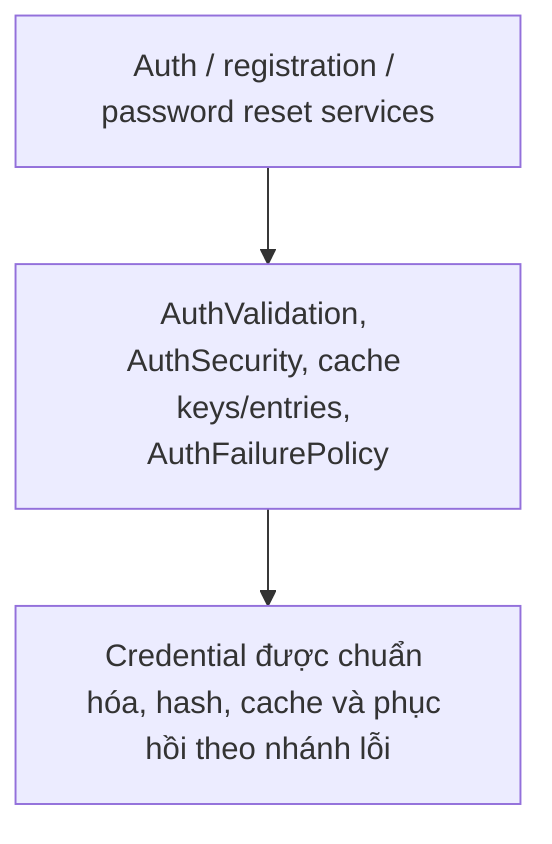

| File | Làm gì / khi dùng | Điểm truy vết |
| --- | --- | --- |
| [AuthCacheEntries.cs](<../../LMS.Api/application/features/auth/utils/AuthCacheEntries.cs>) | Thành phần hỗ trợ/cấu hình; tra supporting-components hoặc supporting-features | — |
| [AuthCacheKeys.cs](<../../LMS.Api/application/features/auth/utils/AuthCacheKeys.cs>) | Thành phần hỗ trợ/cấu hình; tra supporting-components hoặc supporting-features | — |
| [AuthFailurePolicy.cs](<../../LMS.Api/application/features/auth/utils/AuthFailurePolicy.cs>) | Thành phần hỗ trợ/cấu hình; tra supporting-components hoặc supporting-features | — |
| [AuthSecurity.cs](<../../LMS.Api/application/features/auth/utils/AuthSecurity.cs>) | Thành phần hỗ trợ/cấu hình; tra supporting-components hoặc supporting-features | — |
| [AuthValidation.cs](<../../LMS.Api/application/features/auth/utils/AuthValidation.cs>) | Thành phần hỗ trợ/cấu hình; tra supporting-components hoặc supporting-features | — |

## LMS.Api/application/features/chats

Vị trí nhóm file trong hệ thống:

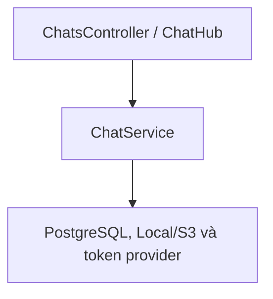

| File | Làm gì / khi dùng | Điểm truy vết |
| --- | --- | --- |
| [ChatContracts.cs](<../../LMS.Api/application/features/chats/ChatContracts.cs>) | Request/DTO/interface service; xem API contracts | `ChatRoomDto`, `ChatRoomLatestMessageDto`, `ChatAttachmentDto`, `ChatMessageDto`, `SendChatMessageRequest`, `EditChatMessageRequest`, `ChatPageQuery`, `ChatRealtimeTokenDto`, `IChatService` |
| [ChatService.cs](<../../LMS.Api/application/features/chats/ChatService.cs>) | Điều phối quyền, validation, trạng thái và lưu dữ liệu của module | `ChatService` |

## LMS.Api/application/features/coursecontents

Vị trí nhóm file trong hệ thống:

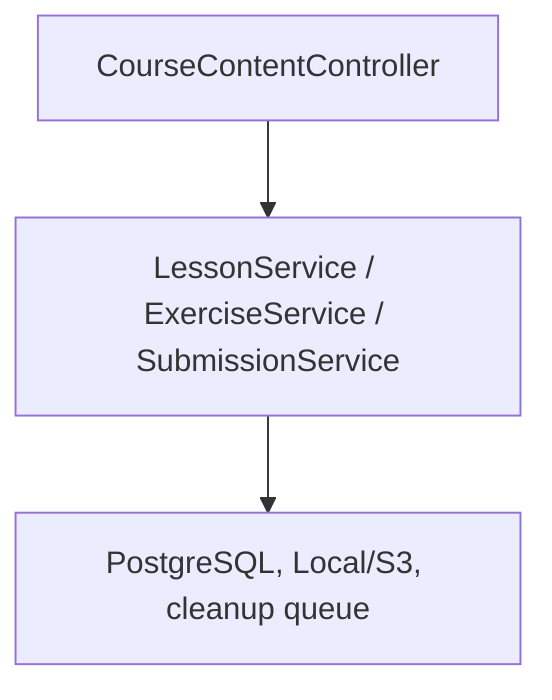

| File | Làm gì / khi dùng | Điểm truy vết |
| --- | --- | --- |
| [ExerciseContracts.cs](<../../LMS.Api/application/features/coursecontents/ExerciseContracts.cs>) | Request/DTO/interface service; xem API contracts | `CreateExerciseRequest`, `UpdateExerciseRequest`, `FileAttachmentDto`, `SubmissionStudentDto`, `ExerciseDto`, `SubmissionDto`, `SubmissionQuery`, `GradeSubmissionRequest`, `IExerciseService`, `ISubmissionService` |
| [ExerciseService.cs](<../../LMS.Api/application/features/coursecontents/ExerciseService.cs>) | Điều phối quyền, validation, trạng thái và lưu dữ liệu của module | `ExerciseService` |
| [LessonContracts.cs](<../../LMS.Api/application/features/coursecontents/LessonContracts.cs>) | Request/DTO/interface service; xem API contracts | `CreateLessonRequest`, `UpdateLessonRequest`, `ReorderLessonsRequest`, `LessonDto`, `MaterialDto`, `ILessonService` |
| [LessonService.cs](<../../LMS.Api/application/features/coursecontents/LessonService.cs>) | Điều phối quyền, validation, trạng thái và lưu dữ liệu của module | `LessonService` |
| [SubmissionService.cs](<../../LMS.Api/application/features/coursecontents/SubmissionService.cs>) | Điều phối quyền, validation, trạng thái và lưu dữ liệu của module | `SubmissionService` |

## LMS.Api/application/features/courses

Vị trí nhóm file trong hệ thống:

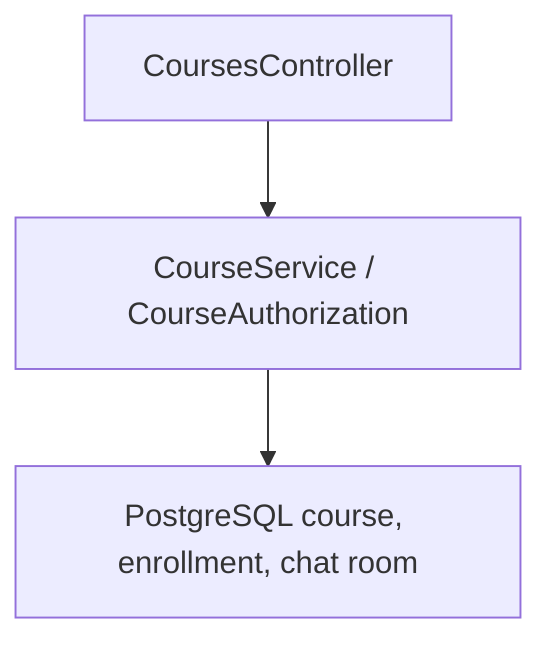

| File | Làm gì / khi dùng | Điểm truy vết |
| --- | --- | --- |
| [CourseAuthorization.cs](<../../LMS.Api/application/features/courses/CourseAuthorization.cs>) | Thành phần hỗ trợ/cấu hình; tra supporting-components hoặc supporting-features | `CourseAuthorization` |
| [CourseContracts.cs](<../../LMS.Api/application/features/courses/CourseContracts.cs>) | Request/DTO/interface service; xem API contracts | `CreateCourseRequest`, `UpdateCourseRequest`, `CourseQuery`, `CourseDto`, `ICourseService` |
| [CourseService.cs](<../../LMS.Api/application/features/courses/CourseService.cs>) | Điều phối quyền, validation, trạng thái và lưu dữ liệu của module | `CourseService` |

## LMS.Api/application/features/enrollments

Vị trí nhóm file trong hệ thống:

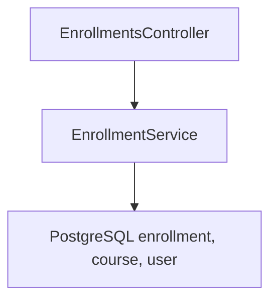

| File | Làm gì / khi dùng | Điểm truy vết |
| --- | --- | --- |
| [EnrollmentContracts.cs](<../../LMS.Api/application/features/enrollments/EnrollmentContracts.cs>) | Request/DTO/interface service; xem API contracts | `EnrollmentQuery`, `EnrollmentStudentDto`, `EnrollmentCourseDto`, `EnrollmentDto`, `AddStudentsByEmailRequest`, `AddStudentResultStatus`, `AddStudentResultDto`, `IEnrollmentService` |
| [EnrollmentService.cs](<../../LMS.Api/application/features/enrollments/EnrollmentService.cs>) | Điều phối quyền, validation, trạng thái và lưu dữ liệu của module | `EnrollmentService` |

## LMS.Api/application/features/examinationattempts

Vị trí nhóm file trong hệ thống:

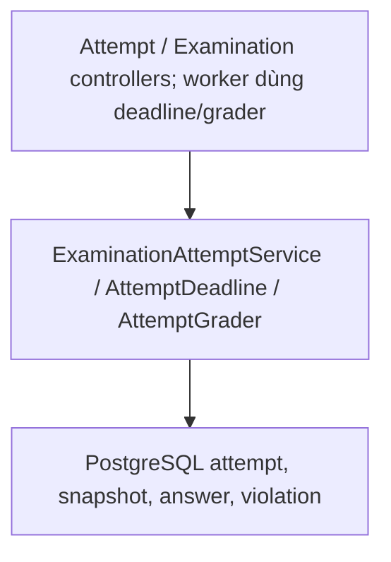

| File | Làm gì / khi dùng | Điểm truy vết |
| --- | --- | --- |
| [AttemptDeadline.cs](<../../LMS.Api/application/features/examinationattempts/AttemptDeadline.cs>) | Thành phần hỗ trợ/cấu hình; tra supporting-components hoặc supporting-features | — |
| [AttemptGrader.cs](<../../LMS.Api/application/features/examinationattempts/AttemptGrader.cs>) | Thành phần hỗ trợ/cấu hình; tra supporting-components hoặc supporting-features | — |
| [ExaminationAttemptContracts.cs](<../../LMS.Api/application/features/examinationattempts/ExaminationAttemptContracts.cs>) | Request/DTO/interface service; xem API contracts | `StudentFillInBlankAnswerInput`, `StudentAnswerDto`, `ExaminationAttemptDto`, `ExaminationAttemptQuery`, `ExaminationAttemptResultDto`, `StudentExamOptionDto`, `StudentExamQuestionDto`, `IExaminationAttemptService` |
| [ExaminationAttemptService.cs](<../../LMS.Api/application/features/examinationattempts/ExaminationAttemptService.cs>) | Điều phối quyền, validation, trạng thái và lưu dữ liệu của module | `ExaminationAttemptService` |

## LMS.Api/application/features/examinations

Vị trí nhóm file trong hệ thống:

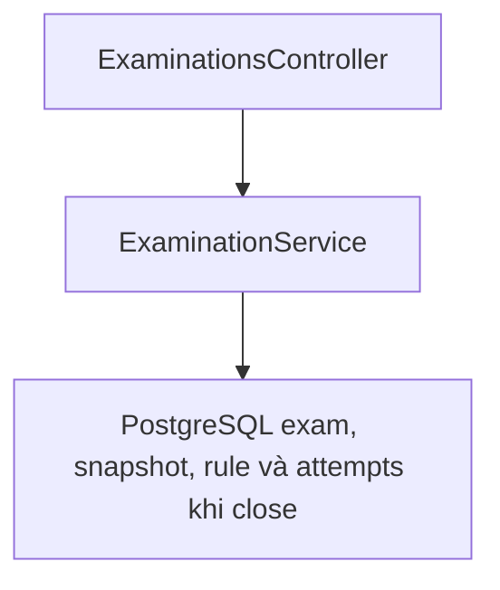

| File | Làm gì / khi dùng | Điểm truy vết |
| --- | --- | --- |
| [ExaminationContracts.cs](<../../LMS.Api/application/features/examinations/ExaminationContracts.cs>) | Request/DTO/interface service; xem API contracts | `ExaminationSecuritySettings`, `QuestionSelectionRuleInput`, `CreateExaminationRequest`, `UpdateExaminationRequest`, `UpdateExaminationQuestionSetRequest`, `QuestionSelectionRuleDto`, `ExaminationDto`, `StudentExaminationDto`, `IExaminationService` |
| [ExaminationService.cs](<../../LMS.Api/application/features/examinations/ExaminationService.cs>) | Điều phối quyền, validation, trạng thái và lưu dữ liệu của module | `ExaminationService` |

## LMS.Api/application/features/passwordreset

Vị trí nhóm file trong hệ thống:

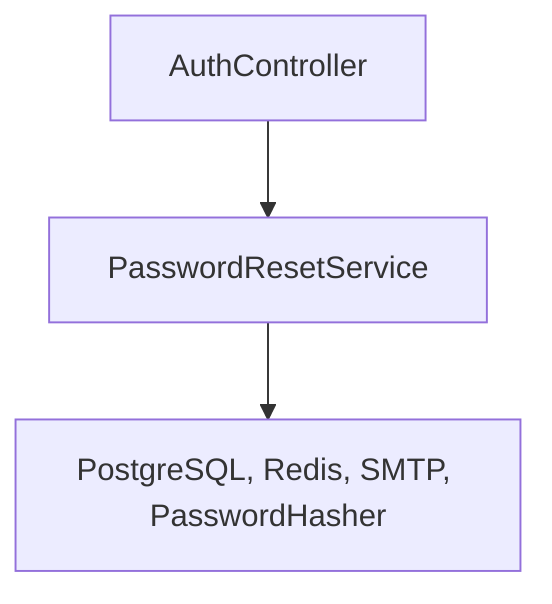

| File | Làm gì / khi dùng | Điểm truy vết |
| --- | --- | --- |
| [PasswordResetContracts.cs](<../../LMS.Api/application/features/passwordreset/PasswordResetContracts.cs>) | Request/DTO/interface service; xem API contracts | `ForgotPasswordRequest`, `ResetPasswordRequest`, `PasswordResetRequestedDto`, `PasswordResetResultDto`, `IPasswordResetService` |
| [PasswordResetService.cs](<../../LMS.Api/application/features/passwordreset/PasswordResetService.cs>) | Điều phối quyền, validation, trạng thái và lưu dữ liệu của module | `PasswordResetService` |

## LMS.Api/application/features/questions

Vị trí nhóm file trong hệ thống:

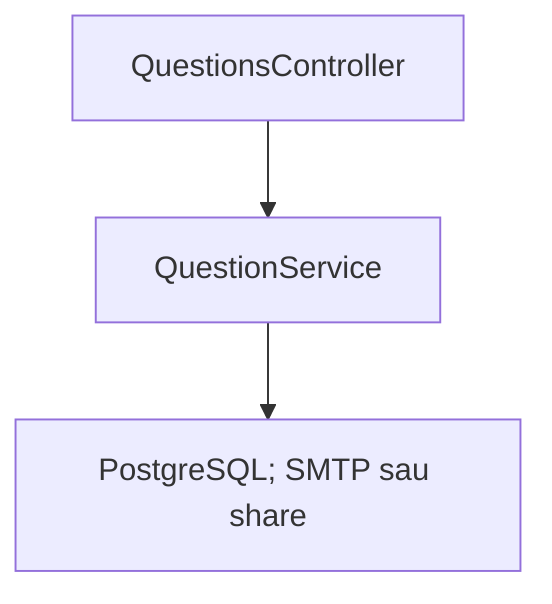

| File | Làm gì / khi dùng | Điểm truy vết |
| --- | --- | --- |
| [QuestionContracts.cs](<../../LMS.Api/application/features/questions/QuestionContracts.cs>) | Request/DTO/interface service; xem API contracts | `CreateQuestionBankRequest`, `UpdateQuestionBankRequest`, `ShareQuestionBankRequest`, `QuestionBankDto`, `MultipleChoiceOptionInput`, `FillInBlankAnswerInput`, `CreateMultipleChoiceQuestionRequest`, `CreateFillInBlankQuestionRequest`, `UpdateQuestionRequest`, `MultipleChoiceOptionDto` |
| [QuestionService.cs](<../../LMS.Api/application/features/questions/QuestionService.cs>) | Điều phối quyền, validation, trạng thái và lưu dữ liệu của module | `QuestionService` |

## LMS.Api/application/features/registration

Vị trí nhóm file trong hệ thống:

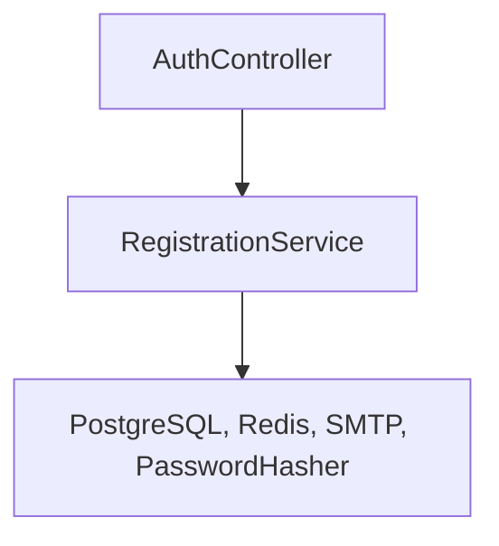

| File | Làm gì / khi dùng | Điểm truy vết |
| --- | --- | --- |
| [RegistrationContracts.cs](<../../LMS.Api/application/features/registration/RegistrationContracts.cs>) | Request/DTO/interface service; xem API contracts | `RegisterAccountRequest`, `VerifyEmailRequest`, `ResendVerificationRequest`, `RegistrationDto`, `EmailVerificationResultDto`, `IRegistrationService` |
| [RegistrationService.cs](<../../LMS.Api/application/features/registration/RegistrationService.cs>) | Điều phối quyền, validation, trạng thái và lưu dữ liệu của module | `RegistrationService` |

## LMS.Api/application/features/users

Vị trí nhóm file trong hệ thống:

```mermaid
flowchart TD
    N0["UsersController"]
    N1["UserService"]
    N2["PostgreSQL và PasswordHasher"]
    N0 --> N1
    N1 --> N2
```

| File | Làm gì / khi dùng | Điểm truy vết |
| --- | --- | --- |
| [UserContracts.cs](<../../LMS.Api/application/features/users/UserContracts.cs>) | Request/DTO/interface service; xem API contracts | `UserProfileDto`, `UserQuery`, `AdminCreateUserRequest`, `UpdateUserStatusRequest`, `AdminUpdateUserRequest`, `UpdateMyProfileRequest`, `ChangeMyPasswordRequest`, `ChatUserSearchDto`, `IUserService` |
| [UserService.cs](<../../LMS.Api/application/features/users/UserService.cs>) | Điều phối quyền, validation, trạng thái và lưu dữ liệu của module | `UserService` |

## LMS.Api

Vị trí nhóm file trong hệ thống:

```mermaid
flowchart TD
    N0["csproj và appsettings"]
    N1["Build dependency / runtime configuration"]
    N2["Program và DI sử dụng cấu hình"]
    N0 --> N1
    N1 --> N2
```

| File | Làm gì / khi dùng | Điểm truy vết |
| --- | --- | --- |
| [appsettings.Development.json](<../../LMS.Api/appsettings.Development.json>) | Thành phần hỗ trợ/cấu hình; tra supporting-components hoặc supporting-features | — |
| [appsettings.json](<../../LMS.Api/appsettings.json>) | Thành phần hỗ trợ/cấu hình; tra supporting-components hoặc supporting-features | — |

## LMS.Api/domain/entities/chats

Vị trí nhóm file trong hệ thống:

```mermaid
flowchart TD
    N0["chats: Application service gọi hành vi entity"]
    N1["Domain entities: invariant, quan hệ và trạng thái trong memory"]
    N2["EF configuration + repository → bảng PostgreSQL tương ứng"]
    N0 --> N1
    N1 --> N2
```

| File | Làm gì / khi dùng | Điểm truy vết |
| --- | --- | --- |
| [ChatAttachment.cs](<../../LMS.Api/domain/entities/chats/ChatAttachment.cs>) | Entity và invariant nghiệp vụ; được service/repository sử dụng | `ChatAttachment` |
| [ChatMessage.cs](<../../LMS.Api/domain/entities/chats/ChatMessage.cs>) | Entity và invariant nghiệp vụ; được service/repository sử dụng | `ChatMessage` |
| [ChatParticipant.cs](<../../LMS.Api/domain/entities/chats/ChatParticipant.cs>) | Entity và invariant nghiệp vụ; được service/repository sử dụng | `ChatParticipant` |
| [ChatRoom.cs](<../../LMS.Api/domain/entities/chats/ChatRoom.cs>) | Entity và invariant nghiệp vụ; được service/repository sử dụng | `ChatRoom` |

## LMS.Api/domain/entities/courses

Vị trí nhóm file trong hệ thống:

```mermaid
flowchart TD
    N0["courses: Application service gọi hành vi entity"]
    N1["Domain entities: invariant, quan hệ và trạng thái trong memory"]
    N2["EF configuration + repository → bảng PostgreSQL tương ứng"]
    N0 --> N1
    N1 --> N2
```

| File | Làm gì / khi dùng | Điểm truy vết |
| --- | --- | --- |
| [Course.cs](<../../LMS.Api/domain/entities/courses/Course.cs>) | Entity và invariant nghiệp vụ; được service/repository sử dụng | `Course` |
| [Enrollment.cs](<../../LMS.Api/domain/entities/courses/Enrollment.cs>) | Entity và invariant nghiệp vụ; được service/repository sử dụng | `Enrollment` |
| [Exercise.cs](<../../LMS.Api/domain/entities/courses/Exercise.cs>) | Entity và invariant nghiệp vụ; được service/repository sử dụng | `Exercise` |
| [ExerciseAttachment.cs](<../../LMS.Api/domain/entities/courses/ExerciseAttachment.cs>) | Entity và invariant nghiệp vụ; được service/repository sử dụng | `ExerciseAttachment` |
| [Lesson.cs](<../../LMS.Api/domain/entities/courses/Lesson.cs>) | Entity và invariant nghiệp vụ; được service/repository sử dụng | `Lesson` |
| [Material.cs](<../../LMS.Api/domain/entities/courses/Material.cs>) | Entity và invariant nghiệp vụ; được service/repository sử dụng | `Material` |
| [Submission.cs](<../../LMS.Api/domain/entities/courses/Submission.cs>) | Entity và invariant nghiệp vụ; được service/repository sử dụng | `Submission` |
| [SubmissionAttachment.cs](<../../LMS.Api/domain/entities/courses/SubmissionAttachment.cs>) | Entity và invariant nghiệp vụ; được service/repository sử dụng | `SubmissionAttachment` |

## LMS.Api/domain/entities/examinations

Vị trí nhóm file trong hệ thống:

```mermaid
flowchart TD
    N0["examinations: Application service gọi hành vi entity"]
    N1["Domain entities: invariant, quan hệ và trạng thái trong memory"]
    N2["EF configuration + repository → bảng PostgreSQL tương ứng"]
    N0 --> N1
    N1 --> N2
```

| File | Làm gì / khi dùng | Điểm truy vết |
| --- | --- | --- |
| [Examination.cs](<../../LMS.Api/domain/entities/examinations/Examination.cs>) | Entity và invariant nghiệp vụ; được service/repository sử dụng | `Examination` |
| [ExaminationAttempt.cs](<../../LMS.Api/domain/entities/examinations/ExaminationAttempt.cs>) | Entity và invariant nghiệp vụ; được service/repository sử dụng | `ExaminationAttempt` |
| [ExaminationFillInBlankAnswerKey.cs](<../../LMS.Api/domain/entities/examinations/ExaminationFillInBlankAnswerKey.cs>) | Entity và invariant nghiệp vụ; được service/repository sử dụng | `ExaminationFillInBlankAnswerKey` |
| [ExaminationMultipleChoiceOption.cs](<../../LMS.Api/domain/entities/examinations/ExaminationMultipleChoiceOption.cs>) | Entity và invariant nghiệp vụ; được service/repository sử dụng | `ExaminationMultipleChoiceOption` |
| [ExaminationQuestion.cs](<../../LMS.Api/domain/entities/examinations/ExaminationQuestion.cs>) | Entity và invariant nghiệp vụ; được service/repository sử dụng | `ExaminationQuestion` |
| [ExaminationQuestionSelectionRule.cs](<../../LMS.Api/domain/entities/examinations/ExaminationQuestionSelectionRule.cs>) | Entity và invariant nghiệp vụ; được service/repository sử dụng | `ExaminationQuestionSelectionRule` |
| [ExaminationViolation.cs](<../../LMS.Api/domain/entities/examinations/ExaminationViolation.cs>) | Entity và invariant nghiệp vụ; được service/repository sử dụng | `ExaminationViolation` |
| [StudentAnswer.cs](<../../LMS.Api/domain/entities/examinations/StudentAnswer.cs>) | Entity và invariant nghiệp vụ; được service/repository sử dụng | `StudentAnswer` |
| [StudentFillInBlankAnswer.cs](<../../LMS.Api/domain/entities/examinations/StudentFillInBlankAnswer.cs>) | Entity và invariant nghiệp vụ; được service/repository sử dụng | `StudentFillInBlankAnswer` |

## LMS.Api/domain/entities/questions

Vị trí nhóm file trong hệ thống:

```mermaid
flowchart TD
    N0["questions: Application service gọi hành vi entity"]
    N1["Domain entities: invariant, quan hệ và trạng thái trong memory"]
    N2["EF configuration + repository → bảng PostgreSQL tương ứng"]
    N0 --> N1
    N1 --> N2
```

| File | Làm gì / khi dùng | Điểm truy vết |
| --- | --- | --- |
| [FillInBlankAnswerKey.cs](<../../LMS.Api/domain/entities/questions/FillInBlankAnswerKey.cs>) | Entity và invariant nghiệp vụ; được service/repository sử dụng | `FillInBlankAnswerKey` |
| [MultipleChoiceOption.cs](<../../LMS.Api/domain/entities/questions/MultipleChoiceOption.cs>) | Entity và invariant nghiệp vụ; được service/repository sử dụng | `MultipleChoiceOption` |
| [Question.cs](<../../LMS.Api/domain/entities/questions/Question.cs>) | Entity và invariant nghiệp vụ; được service/repository sử dụng | `Question` |
| [QuestionBank.cs](<../../LMS.Api/domain/entities/questions/QuestionBank.cs>) | Entity và invariant nghiệp vụ; được service/repository sử dụng | `QuestionBank` |

## LMS.Api/domain/entities/users

Vị trí nhóm file trong hệ thống:

```mermaid
flowchart TD
    N0["users: Application service gọi hành vi entity"]
    N1["Domain entities: invariant, quan hệ và trạng thái trong memory"]
    N2["EF configuration + repository → bảng PostgreSQL tương ứng"]
    N0 --> N1
    N1 --> N2
```

| File | Làm gì / khi dùng | Điểm truy vết |
| --- | --- | --- |
| [ExternalUser.cs](<../../LMS.Api/domain/entities/users/ExternalUser.cs>) | Entity và invariant nghiệp vụ; được service/repository sử dụng | `ExternalUser` |
| [User.cs](<../../LMS.Api/domain/entities/users/User.cs>) | Entity và invariant nghiệp vụ; được service/repository sử dụng | `User` |

## LMS.Api/domain/enums/chats

Vị trí nhóm file trong hệ thống:

```mermaid
flowchart TD
    N0["chats: request/DTO và entity"]
    N1["Enum định nghĩa tập giá trị; service kiểm giá trị và transition"]
    N2["JSON dùng tên; EF mapping lưu theo configuration"]
    N0 --> N1
    N1 --> N2
```

| File | Làm gì / khi dùng | Điểm truy vết |
| --- | --- | --- |
| [ChatRoomType.cs](<../../LMS.Api/domain/enums/chats/ChatRoomType.cs>) | Trạng thái/vai trò dùng trong domain và contract | `ChatRoomType` |

## LMS.Api/domain/enums/courses

Vị trí nhóm file trong hệ thống:

```mermaid
flowchart TD
    N0["courses: request/DTO và entity"]
    N1["Enum định nghĩa tập giá trị; service kiểm giá trị và transition"]
    N2["JSON dùng tên; EF mapping lưu theo configuration"]
    N0 --> N1
    N1 --> N2
```

| File | Làm gì / khi dùng | Điểm truy vết |
| --- | --- | --- |
| [CourseStatus.cs](<../../LMS.Api/domain/enums/courses/CourseStatus.cs>) | Trạng thái/vai trò dùng trong domain và contract | `CourseStatus` |
| [EnrollmentStatus.cs](<../../LMS.Api/domain/enums/courses/EnrollmentStatus.cs>) | Trạng thái/vai trò dùng trong domain và contract | `EnrollmentStatus` |
| [ExerciseStatus.cs](<../../LMS.Api/domain/enums/courses/ExerciseStatus.cs>) | Trạng thái/vai trò dùng trong domain và contract | `ExerciseStatus` |
| [LessonStatus.cs](<../../LMS.Api/domain/enums/courses/LessonStatus.cs>) | Trạng thái/vai trò dùng trong domain và contract | `LessonStatus` |
| [SubmissionStatus.cs](<../../LMS.Api/domain/enums/courses/SubmissionStatus.cs>) | Trạng thái/vai trò dùng trong domain và contract | `SubmissionStatus` |

## LMS.Api/domain/enums/examinations

Vị trí nhóm file trong hệ thống:

```mermaid
flowchart TD
    N0["examinations: request/DTO và entity"]
    N1["Enum định nghĩa tập giá trị; service kiểm giá trị và transition"]
    N2["JSON dùng tên; EF mapping lưu theo configuration"]
    N0 --> N1
    N1 --> N2
```

| File | Làm gì / khi dùng | Điểm truy vết |
| --- | --- | --- |
| [ExaminationAttemptStatus.cs](<../../LMS.Api/domain/enums/examinations/ExaminationAttemptStatus.cs>) | Trạng thái/vai trò dùng trong domain và contract | `ExaminationAttemptStatus` |
| [ExaminationQuestionSelectionMode.cs](<../../LMS.Api/domain/enums/examinations/ExaminationQuestionSelectionMode.cs>) | Trạng thái/vai trò dùng trong domain và contract | `ExaminationQuestionSelectionMode` |
| [ExaminationStatus.cs](<../../LMS.Api/domain/enums/examinations/ExaminationStatus.cs>) | Trạng thái/vai trò dùng trong domain và contract | `ExaminationStatus` |
| [ExaminationSubmitReason.cs](<../../LMS.Api/domain/enums/examinations/ExaminationSubmitReason.cs>) | Trạng thái/vai trò dùng trong domain và contract | `ExaminationSubmitReason` |
| [ExaminationViolationType.cs](<../../LMS.Api/domain/enums/examinations/ExaminationViolationType.cs>) | Trạng thái/vai trò dùng trong domain và contract | `ExaminationViolationType` |

## LMS.Api/domain/enums/questions

Vị trí nhóm file trong hệ thống:

```mermaid
flowchart TD
    N0["questions: request/DTO và entity"]
    N1["Enum định nghĩa tập giá trị; service kiểm giá trị và transition"]
    N2["JSON dùng tên; EF mapping lưu theo configuration"]
    N0 --> N1
    N1 --> N2
```

| File | Làm gì / khi dùng | Điểm truy vết |
| --- | --- | --- |
| [QuestionDifficulty.cs](<../../LMS.Api/domain/enums/questions/QuestionDifficulty.cs>) | Trạng thái/vai trò dùng trong domain và contract | `QuestionDifficulty` |
| [QuestionType.cs](<../../LMS.Api/domain/enums/questions/QuestionType.cs>) | Trạng thái/vai trò dùng trong domain và contract | `QuestionType` |

## LMS.Api/domain/enums/users

Vị trí nhóm file trong hệ thống:

```mermaid
flowchart TD
    N0["users: request/DTO và entity"]
    N1["Enum định nghĩa tập giá trị; service kiểm giá trị và transition"]
    N2["JSON dùng tên; EF mapping lưu theo configuration"]
    N0 --> N1
    N1 --> N2
```

| File | Làm gì / khi dùng | Điểm truy vết |
| --- | --- | --- |
| [AccountStatus.cs](<../../LMS.Api/domain/enums/users/AccountStatus.cs>) | Trạng thái/vai trò dùng trong domain và contract | `AccountStatus` |
| [ExternalProvider.cs](<../../LMS.Api/domain/enums/users/ExternalProvider.cs>) | Trạng thái/vai trò dùng trong domain và contract | `ExternalProvider` |
| [Role.cs](<../../LMS.Api/domain/enums/users/Role.cs>) | Trạng thái/vai trò dùng trong domain và contract | `Role` |
| [RoleExtensions.cs](<../../LMS.Api/domain/enums/users/RoleExtensions.cs>) | Trạng thái/vai trò dùng trong domain và contract | `RoleExtensions` |

## LMS.Api/domain/exceptions

Vị trí nhóm file trong hệ thống:

```mermaid
flowchart TD
    N0["Service hoặc adapter"]
    N1["Exception nghiệp vụ"]
    N2["GlobalExceptionHandler → HTTP status và ProblemDetails"]
    N0 --> N1
    N1 --> N2
```

| File | Làm gì / khi dùng | Điểm truy vết |
| --- | --- | --- |
| [BadRequestException.cs](<../../LMS.Api/domain/exceptions/BadRequestException.cs>) | Exception nghiệp vụ; GlobalExceptionHandler ánh xạ HTTP | `BadRequestException` |
| [ConflictException.cs](<../../LMS.Api/domain/exceptions/ConflictException.cs>) | Exception nghiệp vụ; GlobalExceptionHandler ánh xạ HTTP | `ConflictException` |
| [ExternalServiceUnavailableException.cs](<../../LMS.Api/domain/exceptions/ExternalServiceUnavailableException.cs>) | Exception nghiệp vụ; GlobalExceptionHandler ánh xạ HTTP | `ExternalServiceUnavailableException` |
| [ForbiddenException.cs](<../../LMS.Api/domain/exceptions/ForbiddenException.cs>) | Exception nghiệp vụ; GlobalExceptionHandler ánh xạ HTTP | `ForbiddenException` |
| [NotFoundException.cs](<../../LMS.Api/domain/exceptions/NotFoundException.cs>) | Exception nghiệp vụ; GlobalExceptionHandler ánh xạ HTTP | `NotFoundException` |
| [UnauthorizeException.cs](<../../LMS.Api/domain/exceptions/UnauthorizeException.cs>) | Exception nghiệp vụ; GlobalExceptionHandler ánh xạ HTTP | `UnauthorizeException` |

## LMS.Api/domain/repositories

Vị trí nhóm file trong hệ thống:

```mermaid
flowchart TD
    N0["Application sử dụng repository interface"]
    N1["Infrastructure repository implement interface"]
    N2["EF Core → PostgreSQL"]
    N0 --> N1
    N1 --> N2
```

| File | Làm gì / khi dùng | Điểm truy vết |
| --- | --- | --- |
| [IChatMessageRepository.cs](<../../LMS.Api/domain/repositories/IChatMessageRepository.cs>) | Interface truy vấn persistence; infrastructure triển khai | `IChatMessageRepository`, `ChatRoomLatestMessage` |
| [IChatRoomRepository.cs](<../../LMS.Api/domain/repositories/IChatRoomRepository.cs>) | Interface truy vấn persistence; infrastructure triển khai | `IChatRoomRepository` |
| [ICourseRepository.cs](<../../LMS.Api/domain/repositories/ICourseRepository.cs>) | Interface truy vấn persistence; infrastructure triển khai | `ICourseRepository` |
| [IEnrollmentRepository.cs](<../../LMS.Api/domain/repositories/IEnrollmentRepository.cs>) | Interface truy vấn persistence; infrastructure triển khai | `IEnrollmentRepository` |
| [IExaminationAttemptRepository.cs](<../../LMS.Api/domain/repositories/IExaminationAttemptRepository.cs>) | Interface truy vấn persistence; infrastructure triển khai | `ExaminationAttemptOverview`, `IExaminationAttemptRepository` |
| [IExaminationRepository.cs](<../../LMS.Api/domain/repositories/IExaminationRepository.cs>) | Interface truy vấn persistence; infrastructure triển khai | `IExaminationRepository` |
| [IExerciseRepository.cs](<../../LMS.Api/domain/repositories/IExerciseRepository.cs>) | Interface truy vấn persistence; infrastructure triển khai | `IExerciseRepository` |
| [ILessonRepository.cs](<../../LMS.Api/domain/repositories/ILessonRepository.cs>) | Interface truy vấn persistence; infrastructure triển khai | `ILessonRepository` |
| [IMaterialRepository.cs](<../../LMS.Api/domain/repositories/IMaterialRepository.cs>) | Interface truy vấn persistence; infrastructure triển khai | `IMaterialRepository` |
| [IQuestionBankRepository.cs](<../../LMS.Api/domain/repositories/IQuestionBankRepository.cs>) | Interface truy vấn persistence; infrastructure triển khai | `IQuestionBankRepository` |
| [IQuestionRepository.cs](<../../LMS.Api/domain/repositories/IQuestionRepository.cs>) | Interface truy vấn persistence; infrastructure triển khai | `IQuestionRepository` |
| [ISubmissionRepository.cs](<../../LMS.Api/domain/repositories/ISubmissionRepository.cs>) | Interface truy vấn persistence; infrastructure triển khai | `ISubmissionRepository` |
| [IUserManagementRepository.cs](<../../LMS.Api/domain/repositories/IUserManagementRepository.cs>) | Interface truy vấn persistence; infrastructure triển khai | `IUserManagementRepository` |
| [IUserRepository.cs](<../../LMS.Api/domain/repositories/IUserRepository.cs>) | Interface truy vấn persistence; infrastructure triển khai | `IUserRepository` |

## LMS.Api/infrastructure

Vị trí nhóm file trong hệ thống:

```mermaid
flowchart TD
    N0["Program gọi AddInfrastructure"]
    N1["DI nối abstraction với provider và hosted workers"]
    N2["Scoped DB/repo; singleton adapter; typed HttpClient"]
    N0 --> N1
    N1 --> N2
```

| File | Làm gì / khi dùng | Điểm truy vết |
| --- | --- | --- |
| [DependencyInjection.cs](<../../LMS.Api/infrastructure/DependencyInjection.cs>) | Thành phần hỗ trợ/cấu hình; tra supporting-components hoặc supporting-features | `DependencyInjection` |

## LMS.Api/infrastructure/authentication/JWT

Vị trí nhóm file trong hệ thống:

```mermaid
flowchart TD
    N0["Auth / ChatService"]
    N1["JwtTokenProvider và JwtOptions"]
    N2["JWT có AuthVersion → JwtBearer validate"]
    N0 --> N1
    N1 --> N2
```

| File | Làm gì / khi dùng | Điểm truy vết |
| --- | --- | --- |
| [JwtOptions.cs](<../../LMS.Api/infrastructure/authentication/JWT/JwtOptions.cs>) | Thành phần hỗ trợ/cấu hình; tra supporting-components hoặc supporting-features | `JwtOptions` |
| [JwtTokenProvider.cs](<../../LMS.Api/infrastructure/authentication/JWT/JwtTokenProvider.cs>) | Thành phần hỗ trợ/cấu hình; tra supporting-components hoặc supporting-features | `JwtTokenProvider` |

## LMS.Api/infrastructure/authentication/OAuth

Vị trí nhóm file trong hệ thống:

```mermaid
flowchart TD
    N0["OAuthFlowService / AuthenticationService"]
    N1["OAuthResolver → GoogleOAuthProvider"]
    N2["HttpClient token/userinfo; timeout 10 giây"]
    N0 --> N1
    N1 --> N2
```

| File | Làm gì / khi dùng | Điểm truy vết |
| --- | --- | --- |
| [GoogleOAuthOptions.cs](<../../LMS.Api/infrastructure/authentication/OAuth/GoogleOAuthOptions.cs>) | Thành phần hỗ trợ/cấu hình; tra supporting-components hoặc supporting-features | `GoogleOAuthOptions` |
| [GoogleOAuthProvider.cs](<../../LMS.Api/infrastructure/authentication/OAuth/GoogleOAuthProvider.cs>) | Thành phần hỗ trợ/cấu hình; tra supporting-components hoặc supporting-features | `GoogleOAuthProvider` |
| [OAuthResolver.cs](<../../LMS.Api/infrastructure/authentication/OAuth/OAuthResolver.cs>) | Thành phần hỗ trợ/cấu hình; tra supporting-components hoặc supporting-features | `OAuthResolver` |

## LMS.Api/infrastructure/authentication/PasswordHashing

Vị trí nhóm file trong hệ thống:

```mermaid
flowchart TD
    N0["Auth / user / registration / reset / seed"]
    N1["AspNetCorePasswordHasher"]
    N2["Hash hoặc verify password/code trong memory"]
    N0 --> N1
    N1 --> N2
```

| File | Làm gì / khi dùng | Điểm truy vết |
| --- | --- | --- |
| [AspNetCorePasswordHasher.cs](<../../LMS.Api/infrastructure/authentication/PasswordHashing/AspNetCorePasswordHasher.cs>) | Thành phần hỗ trợ/cấu hình; tra supporting-components hoặc supporting-features | `AspNetCorePasswordHasher` |

## LMS.Api/infrastructure/caching/Redis

Vị trí nhóm file trong hệ thống:

```mermaid
flowchart TD
    N0["ICache từ auth services"]
    N1["RedisCache: JSON, TTL và Lua"]
    N2["Redis auth state; kết nối lazy"]
    N0 --> N1
    N1 --> N2
```

| File | Làm gì / khi dùng | Điểm truy vết |
| --- | --- | --- |
| [RedisCache.cs](<../../LMS.Api/infrastructure/caching/Redis/RedisCache.cs>) | Thành phần hỗ trợ/cấu hình; tra supporting-components hoặc supporting-features | `RedisCache` |

## LMS.Api/infrastructure/mail/Gmail

Vị trí nhóm file trong hệ thống:

```mermaid
flowchart TD
    N0["IMailSender từ service"]
    N1["GmailService + MailOptions"]
    N2["SMTP trong request"]
    N0 --> N1
    N1 --> N2
```

| File | Làm gì / khi dùng | Điểm truy vết |
| --- | --- | --- |
| [GmailService.cs](<../../LMS.Api/infrastructure/mail/Gmail/GmailService.cs>) | Thành phần hỗ trợ/cấu hình; tra supporting-components hoặc supporting-features | `GmailService` |
| [MailOptions.cs](<../../LMS.Api/infrastructure/mail/Gmail/MailOptions.cs>) | Thành phần hỗ trợ/cấu hình; tra supporting-components hoặc supporting-features | `MailOptions` |

## LMS.Api/infrastructure/persistence

Vị trí nhóm file trong hệ thống:

```mermaid
flowchart TD
    N0["Repository / UnitOfWork / TransactionManager"]
    N1["AppDbContext + constraint policy"]
    N2["PostgreSQL; factory cho design time, seeder cho startup"]
    N0 --> N1
    N1 --> N2
```

| File | Làm gì / khi dùng | Điểm truy vết |
| --- | --- | --- |
| [AppDbContext.cs](<../../LMS.Api/infrastructure/persistence/AppDbContext.cs>) | Thành phần hỗ trợ/cấu hình; tra supporting-components hoặc supporting-features | `AppDbContext` |
| [AppDbContextFactory.cs](<../../LMS.Api/infrastructure/persistence/AppDbContextFactory.cs>) | Thành phần hỗ trợ/cấu hình; tra supporting-components hoặc supporting-features | `AppDbContextFactory` |
| [DatabaseConstraintPolicy.cs](<../../LMS.Api/infrastructure/persistence/DatabaseConstraintPolicy.cs>) | Thành phần hỗ trợ/cấu hình; tra supporting-components hoặc supporting-features | — |
| [SystemAccountSeeder.cs](<../../LMS.Api/infrastructure/persistence/SystemAccountSeeder.cs>) | Thành phần hỗ trợ/cấu hình; tra supporting-components hoặc supporting-features | `SystemAccountSeeder` |

## LMS.Api/infrastructure/persistence/configurations/chats

Vị trí nhóm file trong hệ thống:

```mermaid
flowchart TD
    N0["chats: entity và navigation"]
    N1["IEntityTypeConfiguration → AppDbContext model"]
    N2["PostgreSQL table/column/FK/index/filter; migrations áp schema"]
    N0 --> N1
    N1 --> N2
```

| File | Làm gì / khi dùng | Điểm truy vết |
| --- | --- | --- |
| [ChatAttachmentConfiguration.cs](<../../LMS.Api/infrastructure/persistence/configurations/chats/ChatAttachmentConfiguration.cs>) | Mapping entity → PostgreSQL: bảng/cột/index/FK/query filter | `ChatAttachmentConfiguration` |
| [ChatMessageConfiguration.cs](<../../LMS.Api/infrastructure/persistence/configurations/chats/ChatMessageConfiguration.cs>) | Mapping entity → PostgreSQL: bảng/cột/index/FK/query filter | `ChatMessageConfiguration` |
| [ChatParticipantConfiguration.cs](<../../LMS.Api/infrastructure/persistence/configurations/chats/ChatParticipantConfiguration.cs>) | Mapping entity → PostgreSQL: bảng/cột/index/FK/query filter | `ChatParticipantConfiguration` |
| [ChatRoomConfiguration.cs](<../../LMS.Api/infrastructure/persistence/configurations/chats/ChatRoomConfiguration.cs>) | Mapping entity → PostgreSQL: bảng/cột/index/FK/query filter | `ChatRoomConfiguration` |

## LMS.Api/infrastructure/persistence/configurations/courses

Vị trí nhóm file trong hệ thống:

```mermaid
flowchart TD
    N0["courses: entity và navigation"]
    N1["IEntityTypeConfiguration → AppDbContext model"]
    N2["PostgreSQL table/column/FK/index/filter; migrations áp schema"]
    N0 --> N1
    N1 --> N2
```

| File | Làm gì / khi dùng | Điểm truy vết |
| --- | --- | --- |
| [CourseConfiguration.cs](<../../LMS.Api/infrastructure/persistence/configurations/courses/CourseConfiguration.cs>) | Mapping entity → PostgreSQL: bảng/cột/index/FK/query filter | `CourseConfiguration` |
| [EnrollmentConfiguration.cs](<../../LMS.Api/infrastructure/persistence/configurations/courses/EnrollmentConfiguration.cs>) | Mapping entity → PostgreSQL: bảng/cột/index/FK/query filter | `EnrollmentConfiguration` |
| [ExerciseAttachmentConfiguration.cs](<../../LMS.Api/infrastructure/persistence/configurations/courses/ExerciseAttachmentConfiguration.cs>) | Mapping entity → PostgreSQL: bảng/cột/index/FK/query filter | `ExerciseAttachmentConfiguration` |
| [ExerciseConfiguration.cs](<../../LMS.Api/infrastructure/persistence/configurations/courses/ExerciseConfiguration.cs>) | Mapping entity → PostgreSQL: bảng/cột/index/FK/query filter | `ExerciseConfiguration` |
| [LessonConfiguration.cs](<../../LMS.Api/infrastructure/persistence/configurations/courses/LessonConfiguration.cs>) | Mapping entity → PostgreSQL: bảng/cột/index/FK/query filter | `LessonConfiguration` |
| [MaterialConfiguration.cs](<../../LMS.Api/infrastructure/persistence/configurations/courses/MaterialConfiguration.cs>) | Mapping entity → PostgreSQL: bảng/cột/index/FK/query filter | `MaterialConfiguration` |
| [SubmissionAttachmentConfiguration.cs](<../../LMS.Api/infrastructure/persistence/configurations/courses/SubmissionAttachmentConfiguration.cs>) | Mapping entity → PostgreSQL: bảng/cột/index/FK/query filter | `SubmissionAttachmentConfiguration` |
| [SubmissionConfiguration.cs](<../../LMS.Api/infrastructure/persistence/configurations/courses/SubmissionConfiguration.cs>) | Mapping entity → PostgreSQL: bảng/cột/index/FK/query filter | `SubmissionConfiguration` |

## LMS.Api/infrastructure/persistence/configurations/examinations

Vị trí nhóm file trong hệ thống:

```mermaid
flowchart TD
    N0["examinations: entity và navigation"]
    N1["IEntityTypeConfiguration → AppDbContext model"]
    N2["PostgreSQL table/column/FK/index/filter; migrations áp schema"]
    N0 --> N1
    N1 --> N2
```

| File | Làm gì / khi dùng | Điểm truy vết |
| --- | --- | --- |
| [ExaminationAttemptConfiguration.cs](<../../LMS.Api/infrastructure/persistence/configurations/examinations/ExaminationAttemptConfiguration.cs>) | Mapping entity → PostgreSQL: bảng/cột/index/FK/query filter | `ExaminationAttemptConfiguration` |
| [ExaminationConfiguration.cs](<../../LMS.Api/infrastructure/persistence/configurations/examinations/ExaminationConfiguration.cs>) | Mapping entity → PostgreSQL: bảng/cột/index/FK/query filter | `ExaminationConfiguration` |
| [ExaminationFillInBlankAnswerKeyConfiguration.cs](<../../LMS.Api/infrastructure/persistence/configurations/examinations/ExaminationFillInBlankAnswerKeyConfiguration.cs>) | Mapping entity → PostgreSQL: bảng/cột/index/FK/query filter | `ExaminationFillInBlankAnswerKeyConfiguration` |
| [ExaminationMultipleChoiceOptionConfiguration.cs](<../../LMS.Api/infrastructure/persistence/configurations/examinations/ExaminationMultipleChoiceOptionConfiguration.cs>) | Mapping entity → PostgreSQL: bảng/cột/index/FK/query filter | `ExaminationMultipleChoiceOptionConfiguration` |
| [ExaminationQuestionConfiguration.cs](<../../LMS.Api/infrastructure/persistence/configurations/examinations/ExaminationQuestionConfiguration.cs>) | Mapping entity → PostgreSQL: bảng/cột/index/FK/query filter | `ExaminationQuestionConfiguration` |
| [ExaminationQuestionSelectionRuleConfiguration.cs](<../../LMS.Api/infrastructure/persistence/configurations/examinations/ExaminationQuestionSelectionRuleConfiguration.cs>) | Mapping entity → PostgreSQL: bảng/cột/index/FK/query filter | `ExaminationQuestionSelectionRuleConfiguration` |
| [ExaminationViolationConfiguration.cs](<../../LMS.Api/infrastructure/persistence/configurations/examinations/ExaminationViolationConfiguration.cs>) | Mapping entity → PostgreSQL: bảng/cột/index/FK/query filter | `ExaminationViolationConfiguration` |
| [StudentAnswerConfiguration.cs](<../../LMS.Api/infrastructure/persistence/configurations/examinations/StudentAnswerConfiguration.cs>) | Mapping entity → PostgreSQL: bảng/cột/index/FK/query filter | `StudentAnswerConfiguration` |
| [StudentFillInBlankAnswerConfiguration.cs](<../../LMS.Api/infrastructure/persistence/configurations/examinations/StudentFillInBlankAnswerConfiguration.cs>) | Mapping entity → PostgreSQL: bảng/cột/index/FK/query filter | `StudentFillInBlankAnswerConfiguration` |

## LMS.Api/infrastructure/persistence/configurations/questions

Vị trí nhóm file trong hệ thống:

```mermaid
flowchart TD
    N0["questions: entity và navigation"]
    N1["IEntityTypeConfiguration → AppDbContext model"]
    N2["PostgreSQL table/column/FK/index/filter; migrations áp schema"]
    N0 --> N1
    N1 --> N2
```

| File | Làm gì / khi dùng | Điểm truy vết |
| --- | --- | --- |
| [FillInBlankAnswerKeyConfiguration.cs](<../../LMS.Api/infrastructure/persistence/configurations/questions/FillInBlankAnswerKeyConfiguration.cs>) | Mapping entity → PostgreSQL: bảng/cột/index/FK/query filter | `FillInBlankAnswerKeyConfiguration` |
| [MultipleChoiceOptionConfiguration.cs](<../../LMS.Api/infrastructure/persistence/configurations/questions/MultipleChoiceOptionConfiguration.cs>) | Mapping entity → PostgreSQL: bảng/cột/index/FK/query filter | `MultipleChoiceOptionConfiguration` |
| [QuestionBankConfiguration.cs](<../../LMS.Api/infrastructure/persistence/configurations/questions/QuestionBankConfiguration.cs>) | Mapping entity → PostgreSQL: bảng/cột/index/FK/query filter | `QuestionBankConfiguration` |
| [QuestionConfiguration.cs](<../../LMS.Api/infrastructure/persistence/configurations/questions/QuestionConfiguration.cs>) | Mapping entity → PostgreSQL: bảng/cột/index/FK/query filter | `QuestionConfiguration` |

## LMS.Api/infrastructure/persistence/configurations/users

Vị trí nhóm file trong hệ thống:

```mermaid
flowchart TD
    N0["users: entity và navigation"]
    N1["IEntityTypeConfiguration → AppDbContext model"]
    N2["PostgreSQL table/column/FK/index/filter; migrations áp schema"]
    N0 --> N1
    N1 --> N2
```

| File | Làm gì / khi dùng | Điểm truy vết |
| --- | --- | --- |
| [ExternalUserConfiguration.cs](<../../LMS.Api/infrastructure/persistence/configurations/users/ExternalUserConfiguration.cs>) | Mapping entity → PostgreSQL: bảng/cột/index/FK/query filter | `ExternalUserConfiguration` |
| [UserConfiguration.cs](<../../LMS.Api/infrastructure/persistence/configurations/users/UserConfiguration.cs>) | Mapping entity → PostgreSQL: bảng/cột/index/FK/query filter | `UserConfiguration` |

## LMS.Api/infrastructure/persistence/migrations

Vị trí nhóm file trong hệ thống:

```mermaid
flowchart TD
    N0["EF model thay đổi"]
    N1["Migration Up/Down và model snapshot"]
    N2["Database.Migrate hoặc dotnet ef → schema và history"]
    N0 --> N1
    N1 --> N2
```

| File | Làm gì / khi dùng | Điểm truy vết |
| --- | --- | --- |
| [20260904073847_InitialCreate.cs](<../../LMS.Api/infrastructure/persistence/migrations/20260904073847_InitialCreate.cs>) | Lịch sử schema EF; chạy lúc migrate, Designer/Snapshot là metadata sinh tự động | `InitialCreate` |
| [20260904103655_FixSoftDeleteRelationshipMappings.cs](<../../LMS.Api/infrastructure/persistence/migrations/20260904103655_FixSoftDeleteRelationshipMappings.cs>) | Lịch sử schema EF; chạy lúc migrate, Designer/Snapshot là metadata sinh tự động | `FixSoftDeleteRelationshipMappings` |
| [20260904123000_UseDecimalMegabyteFileLimit.cs](<../../LMS.Api/infrastructure/persistence/migrations/20260904123000_UseDecimalMegabyteFileLimit.cs>) | Lịch sử schema EF; chạy lúc migrate, Designer/Snapshot là metadata sinh tự động | `UseDecimalMegabyteFileLimit` |
| [20261006111627_AddSubmissionGrading.cs](<../../LMS.Api/infrastructure/persistence/migrations/20261006111627_AddSubmissionGrading.cs>) | Lịch sử schema EF; chạy lúc migrate, Designer/Snapshot là metadata sinh tự động | `AddSubmissionGrading` |
| [20261006113153_AddExerciseLifecycle.cs](<../../LMS.Api/infrastructure/persistence/migrations/20261006113153_AddExerciseLifecycle.cs>) | Lịch sử schema EF; chạy lúc migrate, Designer/Snapshot là metadata sinh tự động | `AddExerciseLifecycle` |
| [20261006124414_AddPersistentFileCleanupQueue.cs](<../../LMS.Api/infrastructure/persistence/migrations/20261006124414_AddPersistentFileCleanupQueue.cs>) | Lịch sử schema EF; chạy lúc migrate, Designer/Snapshot là metadata sinh tự động | `AddPersistentFileCleanupQueue` |
| [20261008020625_AddSubmissionConcurrencyToken.cs](<../../LMS.Api/infrastructure/persistence/migrations/20261008020625_AddSubmissionConcurrencyToken.cs>) | Lịch sử schema EF; chạy lúc migrate, Designer/Snapshot là metadata sinh tự động | `AddSubmissionConcurrencyToken` |
| [20261008022024_PersistUserAuthVersion.cs](<../../LMS.Api/infrastructure/persistence/migrations/20261008022024_PersistUserAuthVersion.cs>) | Lịch sử schema EF; chạy lúc migrate, Designer/Snapshot là metadata sinh tự động | `PersistUserAuthVersion` |
| [20261008034151_EnforceSingleExaminationAttempt.cs](<../../LMS.Api/infrastructure/persistence/migrations/20261008034151_EnforceSingleExaminationAttempt.cs>) | Lịch sử schema EF; chạy lúc migrate, Designer/Snapshot là metadata sinh tự động | `EnforceSingleExaminationAttempt` |
| [20261010090000_AddSystemRoleSingletonConstraint.cs](<../../LMS.Api/infrastructure/persistence/migrations/20261010090000_AddSystemRoleSingletonConstraint.cs>) | Lịch sử schema EF; chạy lúc migrate, Designer/Snapshot là metadata sinh tự động | `AddSystemRoleSingletonConstraint` |
| [20261012040018_AddDirectConversationVisibility.cs](<../../LMS.Api/infrastructure/persistence/migrations/20261012040018_AddDirectConversationVisibility.cs>) | Lịch sử schema EF; chạy lúc migrate, Designer/Snapshot là metadata sinh tự động | `AddDirectConversationVisibility` |

## LMS.Api/infrastructure/persistence/repositories

Vị trí nhóm file trong hệ thống:

```mermaid
flowchart TD
    N0["Application repository interface"]
    N1["EF query / Include / filter / page / lock theo method"]
    N2["AppDbContext chung scope → PostgreSQL"]
    N0 --> N1
    N1 --> N2
```

| File | Làm gì / khi dùng | Điểm truy vết |
| --- | --- | --- |
| [ChatMessageRepository.cs](<../../LMS.Api/infrastructure/persistence/repositories/ChatMessageRepository.cs>) | Truy vấn EF Core, tải quan hệ/lọc/sắp xếp theo module | `ChatMessageRepository` |
| [ChatRoomRepository.cs](<../../LMS.Api/infrastructure/persistence/repositories/ChatRoomRepository.cs>) | Truy vấn EF Core, tải quan hệ/lọc/sắp xếp theo module | `ChatRoomRepository` |
| [CourseRepository.cs](<../../LMS.Api/infrastructure/persistence/repositories/CourseRepository.cs>) | Truy vấn EF Core, tải quan hệ/lọc/sắp xếp theo module | `CourseRepository` |
| [EnrollmentRepository.cs](<../../LMS.Api/infrastructure/persistence/repositories/EnrollmentRepository.cs>) | Truy vấn EF Core, tải quan hệ/lọc/sắp xếp theo module | `EnrollmentRepository` |
| [ExaminationAttemptRepository.cs](<../../LMS.Api/infrastructure/persistence/repositories/ExaminationAttemptRepository.cs>) | Truy vấn EF Core, tải quan hệ/lọc/sắp xếp theo module | `ExaminationAttemptRepository` |
| [ExaminationRepository.cs](<../../LMS.Api/infrastructure/persistence/repositories/ExaminationRepository.cs>) | Truy vấn EF Core, tải quan hệ/lọc/sắp xếp theo module | `ExaminationRepository` |
| [ExerciseRepository.cs](<../../LMS.Api/infrastructure/persistence/repositories/ExerciseRepository.cs>) | Truy vấn EF Core, tải quan hệ/lọc/sắp xếp theo module | `ExerciseRepository` |
| [LessonRepository.cs](<../../LMS.Api/infrastructure/persistence/repositories/LessonRepository.cs>) | Truy vấn EF Core, tải quan hệ/lọc/sắp xếp theo module | `LessonRepository` |
| [MaterialRepository.cs](<../../LMS.Api/infrastructure/persistence/repositories/MaterialRepository.cs>) | Truy vấn EF Core, tải quan hệ/lọc/sắp xếp theo module | `MaterialRepository` |
| [QuestionBankRepository.cs](<../../LMS.Api/infrastructure/persistence/repositories/QuestionBankRepository.cs>) | Truy vấn EF Core, tải quan hệ/lọc/sắp xếp theo module | `QuestionBankRepository` |
| [QuestionRepository.cs](<../../LMS.Api/infrastructure/persistence/repositories/QuestionRepository.cs>) | Truy vấn EF Core, tải quan hệ/lọc/sắp xếp theo module | `QuestionRepository` |
| [SubmissionRepository.cs](<../../LMS.Api/infrastructure/persistence/repositories/SubmissionRepository.cs>) | Truy vấn EF Core, tải quan hệ/lọc/sắp xếp theo module | `SubmissionRepository` |
| [UserRepository.cs](<../../LMS.Api/infrastructure/persistence/repositories/UserRepository.cs>) | Truy vấn EF Core, tải quan hệ/lọc/sắp xếp theo module | `UserRepository` |

## LMS.Api/infrastructure/time

Vị trí nhóm file trong hệ thống:

```mermaid
flowchart TD
    N0["IClock từ service hoặc worker"]
    N1["SystemClock"]
    N2["UTC now cho deadline / expiry"]
    N0 --> N1
    N1 --> N2
```

| File | Làm gì / khi dùng | Điểm truy vết |
| --- | --- | --- |
| [SystemClock.cs](<../../LMS.Api/infrastructure/time/SystemClock.cs>) | Thành phần hỗ trợ/cấu hình; tra supporting-components hoặc supporting-features | `SystemClock` |

## LMS.Api/infrastructure/workers

Vị trí nhóm file trong hệ thống:

```mermaid
flowchart TD
    N0["API hosted service tick 30 giây"]
    N1["ExaminationAutoSubmitWorker → deadline/grader"]
    N2["PostgreSQL expired attempts → chấm → SaveChanges"]
    N0 --> N1
    N1 --> N2
```

| File | Làm gì / khi dùng | Điểm truy vết |
| --- | --- | --- |
| [ExaminationAutoSubmitWorker.cs](<../../LMS.Api/infrastructure/workers/ExaminationAutoSubmitWorker.cs>) | Thành phần hỗ trợ/cấu hình; tra supporting-components hoặc supporting-features | `ExaminationAutoSubmitWorker` |

## LMS.Api/presentation

Vị trí nhóm file trong hệ thống:

```mermaid
flowchart TD
    N0["Program startup / DI"]
    N1["Middleware + JSON/CORS + route mapping"]
    N2["Controllers hoặc ChatHub"]
    N0 --> N1
    N1 --> N2
```

| File | Làm gì / khi dùng | Điểm truy vết |
| --- | --- | --- |
| [DependencyInjection.cs](<../../LMS.Api/presentation/DependencyInjection.cs>) | Thành phần hỗ trợ/cấu hình; tra supporting-components hoặc supporting-features | `DependencyInjection` |
| [OAuthHttpResponseExtensions.cs](<../../LMS.Api/presentation/OAuthHttpResponseExtensions.cs>) | Thành phần hỗ trợ/cấu hình; tra supporting-components hoặc supporting-features | — |
| [Program.cs](<../../LMS.Api/presentation/Program.cs>) | Thành phần hỗ trợ/cấu hình; tra supporting-components hoặc supporting-features | `Program` |

## LMS.Api/presentation/controllers

Vị trí nhóm file trong hệ thống:

```mermaid
flowchart TD
    N0["HTTP và model binding"]
    N1["Controllers chuyển request sang service"]
    N2["DTO/status/stream; chat còn broadcast sau save"]
    N0 --> N1
    N1 --> N2
```

| File | Làm gì / khi dùng | Điểm truy vết |
| --- | --- | --- |
| [AuthController.cs](<../../LMS.Api/presentation/controllers/AuthController.cs>) | REST routing, binding, status response; ủy quyền nghiệp vụ cho service | `AuthController` |
| [ChatsController.cs](<../../LMS.Api/presentation/controllers/ChatsController.cs>) | REST routing, binding, status response; ủy quyền nghiệp vụ cho service | `ChatsController` |
| [CourseContentController.cs](<../../LMS.Api/presentation/controllers/CourseContentController.cs>) | REST routing, binding, status response; ủy quyền nghiệp vụ cho service | `CourseContentController` |
| [CoursesController.cs](<../../LMS.Api/presentation/controllers/CoursesController.cs>) | REST routing, binding, status response; ủy quyền nghiệp vụ cho service | `CoursesController` |
| [EnrollmentsController.cs](<../../LMS.Api/presentation/controllers/EnrollmentsController.cs>) | REST routing, binding, status response; ủy quyền nghiệp vụ cho service | `EnrollmentsController` |
| [ExaminationAttemptsController.cs](<../../LMS.Api/presentation/controllers/ExaminationAttemptsController.cs>) | REST routing, binding, status response; ủy quyền nghiệp vụ cho service | `ExaminationAttemptsController` |
| [ExaminationsController.cs](<../../LMS.Api/presentation/controllers/ExaminationsController.cs>) | REST routing, binding, status response; ủy quyền nghiệp vụ cho service | `ExaminationsController` |
| [QuestionsController.cs](<../../LMS.Api/presentation/controllers/QuestionsController.cs>) | REST routing, binding, status response; ủy quyền nghiệp vụ cho service | `QuestionsController` |
| [UsersController.cs](<../../LMS.Api/presentation/controllers/UsersController.cs>) | REST routing, binding, status response; ủy quyền nghiệp vụ cho service | `UsersController` |

## LMS.Api/presentation/hubs

Vị trí nhóm file trong hệ thống:

```mermaid
flowchart TD
    N0["SignalR connection authenticated"]
    N1["ChatHub kiểm quyền qua ChatService"]
    N2["Join/Leave group hoặc Save message → broadcast"]
    N0 --> N1
    N1 --> N2
```

| File | Làm gì / khi dùng | Điểm truy vết |
| --- | --- | --- |
| [ChatHub.cs](<../../LMS.Api/presentation/hubs/ChatHub.cs>) | Thành phần hỗ trợ/cấu hình; tra supporting-components hoặc supporting-features | `ChatHub` |

## LMS.Api/presentation/middleware

Vị trí nhóm file trong hệ thống:

```mermaid
flowchart TD
    N0["Exception HTTP trong pipeline"]
    N1["GlobalExceptionHandler → ILogger"]
    N2["ProblemDetails về client"]
    N0 --> N1
    N1 --> N2
```

| File | Làm gì / khi dùng | Điểm truy vết |
| --- | --- | --- |
| [GlobalExceptionHandler.cs](<../../LMS.Api/presentation/middleware/GlobalExceptionHandler.cs>) | Thành phần hỗ trợ/cấu hình; tra supporting-components hoặc supporting-features | `GlobalExceptionHandler` |

## LMS.Api/presentation/security

Vị trí nhóm file trong hệ thống:

```mermaid
flowchart TD
    N0["HttpContext.User đã authenticate"]
    N1["HttpContextCurrentUser"]
    N2["Application đọc userId/Role qua ICurrentUser"]
    N0 --> N1
    N1 --> N2
```

| File | Làm gì / khi dùng | Điểm truy vết |
| --- | --- | --- |
| [HttpContextCurrentUser.cs](<../../LMS.Api/presentation/security/HttpContextCurrentUser.cs>) | Thành phần hỗ trợ/cấu hình; tra supporting-components hoặc supporting-features | `HttpContextCurrentUser` |

## LMS.Domain.Tests/Application

Vị trí nhóm file trong hệ thống:

```mermaid
flowchart TD
    N0["Application: fixture / dữ liệu kiểm thử"]
    N1["Các test trong bảng gọi lớp đang kiểm tra"]
    N2["Assertions; xem testing.md để phân biệt fake và provider thật"]
    N0 --> N1
    N1 --> N2
```

| File | Làm gì / khi dùng | Điểm truy vết |
| --- | --- | --- |
| [AuthenticationApplicationTests.cs](<../../LMS.Domain.Tests/Application/AuthenticationApplicationTests.cs>) | Kiểm thử; không chạy trong request production | `AuthenticationApplicationTests`; 18 khai báo Fact/Theory (không tính số case InlineData) |
| [ChatApplicationTests.cs](<../../LMS.Domain.Tests/Application/ChatApplicationTests.cs>) | Kiểm thử; không chạy trong request production | `ChatApplicationTests`; 25 khai báo Fact/Theory (không tính số case InlineData) |
| [CourseApplicationTests.cs](<../../LMS.Domain.Tests/Application/CourseApplicationTests.cs>) | Kiểm thử; không chạy trong request production | `CourseApplicationTests`; 22 khai báo Fact/Theory (không tính số case InlineData) |
| [CourseContentApplicationTests.cs](<../../LMS.Domain.Tests/Application/CourseContentApplicationTests.cs>) | Kiểm thử; không chạy trong request production | `CourseContentApplicationTests`; 16 khai báo Fact/Theory (không tính số case InlineData) |
| [ExaminationAttemptApplicationTests.cs](<../../LMS.Domain.Tests/Application/ExaminationAttemptApplicationTests.cs>) | Kiểm thử; không chạy trong request production | `ExaminationAttemptApplicationTests`; 21 khai báo Fact/Theory (không tính số case InlineData) |
| [ExaminationAuthoringTests.cs](<../../LMS.Domain.Tests/Application/ExaminationAuthoringTests.cs>) | Kiểm thử; không chạy trong request production | `ExaminationAuthoringTests`; 9 khai báo Fact/Theory (không tính số case InlineData) |
| [PasswordResetApplicationTests.cs](<../../LMS.Domain.Tests/Application/PasswordResetApplicationTests.cs>) | Kiểm thử; không chạy trong request production | `PasswordResetApplicationTests`; 5 khai báo Fact/Theory (không tính số case InlineData) |
| [QuestionApplicationTests.cs](<../../LMS.Domain.Tests/Application/QuestionApplicationTests.cs>) | Kiểm thử; không chạy trong request production | `QuestionApplicationTests`; 14 khai báo Fact/Theory (không tính số case InlineData) |
| [RegistrationApplicationTests.cs](<../../LMS.Domain.Tests/Application/RegistrationApplicationTests.cs>) | Kiểm thử; không chạy trong request production | `RegistrationApplicationTests`; 14 khai báo Fact/Theory (không tính số case InlineData) |
| [SubmissionApplicationTests.cs](<../../LMS.Domain.Tests/Application/SubmissionApplicationTests.cs>) | Kiểm thử; không chạy trong request production | `SubmissionApplicationTests`; 7 khai báo Fact/Theory (không tính số case InlineData) |
| [UserApplicationTests.cs](<../../LMS.Domain.Tests/Application/UserApplicationTests.cs>) | Kiểm thử; không chạy trong request production | `UserApplicationTests`; 24 khai báo Fact/Theory (không tính số case InlineData) |

## LMS.Domain.Tests/Chats

Vị trí nhóm file trong hệ thống:

```mermaid
flowchart TD
    N0["Chats: fixture / dữ liệu kiểm thử"]
    N1["Các test trong bảng gọi lớp đang kiểm tra"]
    N2["Assertions; xem testing.md để phân biệt fake và provider thật"]
    N0 --> N1
    N1 --> N2
```

| File | Làm gì / khi dùng | Điểm truy vết |
| --- | --- | --- |
| [ChatMessageTests.cs](<../../LMS.Domain.Tests/Chats/ChatMessageTests.cs>) | Kiểm thử; không chạy trong request production | `ChatMessageTests`; 6 khai báo Fact/Theory (không tính số case InlineData) |
| [ChatRoomTests.cs](<../../LMS.Domain.Tests/Chats/ChatRoomTests.cs>) | Kiểm thử; không chạy trong request production | `ChatRoomTests`; 6 khai báo Fact/Theory (không tính số case InlineData) |

## LMS.Domain.Tests/Courses

Vị trí nhóm file trong hệ thống:

```mermaid
flowchart TD
    N0["Courses: fixture / dữ liệu kiểm thử"]
    N1["Các test trong bảng gọi lớp đang kiểm tra"]
    N2["Assertions; xem testing.md để phân biệt fake và provider thật"]
    N0 --> N1
    N1 --> N2
```

| File | Làm gì / khi dùng | Điểm truy vết |
| --- | --- | --- |
| [CourseTests.cs](<../../LMS.Domain.Tests/Courses/CourseTests.cs>) | Kiểm thử; không chạy trong request production | `CourseTests`; 2 khai báo Fact/Theory (không tính số case InlineData) |
| [EnrollmentTests.cs](<../../LMS.Domain.Tests/Courses/EnrollmentTests.cs>) | Kiểm thử; không chạy trong request production | `EnrollmentTests`; 2 khai báo Fact/Theory (không tính số case InlineData) |
| [SubmissionTests.cs](<../../LMS.Domain.Tests/Courses/SubmissionTests.cs>) | Kiểm thử; không chạy trong request production | `SubmissionTests`; 1 khai báo Fact/Theory (không tính số case InlineData) |

## LMS.Domain.Tests/Examinations

Vị trí nhóm file trong hệ thống:

```mermaid
flowchart TD
    N0["Examinations: fixture / dữ liệu kiểm thử"]
    N1["Các test trong bảng gọi lớp đang kiểm tra"]
    N2["Assertions; xem testing.md để phân biệt fake và provider thật"]
    N0 --> N1
    N1 --> N2
```

| File | Làm gì / khi dùng | Điểm truy vết |
| --- | --- | --- |
| [ExaminationAttemptTests.cs](<../../LMS.Domain.Tests/Examinations/ExaminationAttemptTests.cs>) | Kiểm thử; không chạy trong request production | `ExaminationAttemptTests`; 2 khai báo Fact/Theory (không tính số case InlineData) |

## LMS.Domain.Tests/Integration

Vị trí nhóm file trong hệ thống:

```mermaid
flowchart TD
    N0["Integration: fixture / dữ liệu kiểm thử"]
    N1["Các test trong bảng gọi lớp đang kiểm tra"]
    N2["Assertions; xem testing.md để phân biệt fake và provider thật"]
    N0 --> N1
    N1 --> N2
```

| File | Làm gì / khi dùng | Điểm truy vết |
| --- | --- | --- |
| [ApiWebApplicationFactory.cs](<../../LMS.Domain.Tests/Integration/ApiWebApplicationFactory.cs>) | Kiểm thử; không chạy trong request production | `ApiWebApplicationFactory` |
| [AuthenticationApiTests.cs](<../../LMS.Domain.Tests/Integration/AuthenticationApiTests.cs>) | Kiểm thử; không chạy trong request production | `AuthenticationApiTests`; 17 khai báo Fact/Theory (không tính số case InlineData) |
| [FileCleanupQueueIntegrationTests.cs](<../../LMS.Domain.Tests/Integration/FileCleanupQueueIntegrationTests.cs>) | Kiểm thử; không chạy trong request production | `FileCleanupQueueIntegrationTests`; 1 khai báo Fact/Theory (không tính số case InlineData) |
| [JsonContractTests.cs](<../../LMS.Domain.Tests/Integration/JsonContractTests.cs>) | Kiểm thử; không chạy trong request production | `JsonContractTests`; 1 khai báo Fact/Theory (không tính số case InlineData) |
| [SignalRAuthenticationTests.cs](<../../LMS.Domain.Tests/Integration/SignalRAuthenticationTests.cs>) | Kiểm thử; không chạy trong request production | `SignalRAuthenticationTests`; 8 khai báo Fact/Theory (không tính số case InlineData) |

## LMS.Domain.Tests/Persistence

Vị trí nhóm file trong hệ thống:

```mermaid
flowchart TD
    N0["Persistence: fixture / dữ liệu kiểm thử"]
    N1["Các test trong bảng gọi lớp đang kiểm tra"]
    N2["Assertions; xem testing.md để phân biệt fake và provider thật"]
    N0 --> N1
    N1 --> N2
```

| File | Làm gì / khi dùng | Điểm truy vết |
| --- | --- | --- |
| [AppDbContextModelTests.cs](<../../LMS.Domain.Tests/Persistence/AppDbContextModelTests.cs>) | Kiểm thử; không chạy trong request production | `AppDbContextModelTests`; 7 khai báo Fact/Theory (không tính số case InlineData) |

## LMS.Domain.Tests/Presentation

Vị trí nhóm file trong hệ thống:

```mermaid
flowchart TD
    N0["Presentation: fixture / dữ liệu kiểm thử"]
    N1["Các test trong bảng gọi lớp đang kiểm tra"]
    N2["Assertions; xem testing.md để phân biệt fake và provider thật"]
    N0 --> N1
    N1 --> N2
```

| File | Làm gì / khi dùng | Điểm truy vết |
| --- | --- | --- |
| [ChatsControllerTests.cs](<../../LMS.Domain.Tests/Presentation/ChatsControllerTests.cs>) | Kiểm thử; không chạy trong request production | `ChatsControllerTests`; 4 khai báo Fact/Theory (không tính số case InlineData) |

## LMS.Domain.Tests/Storage

Vị trí nhóm file trong hệ thống:

```mermaid
flowchart TD
    N0["Storage: fixture / dữ liệu kiểm thử"]
    N1["Các test trong bảng gọi lớp đang kiểm tra"]
    N2["Assertions; xem testing.md để phân biệt fake và provider thật"]
    N0 --> N1
    N1 --> N2
```

| File | Làm gì / khi dùng | Điểm truy vết |
| --- | --- | --- |
| [FileCleanupTaskTests.cs](<../../LMS.Domain.Tests/Storage/FileCleanupTaskTests.cs>) | Kiểm thử; không chạy trong request production | `FileCleanupTaskTests`; 1 khai báo Fact/Theory (không tính số case InlineData) |
| [LocalFileStorageTests.cs](<../../LMS.Domain.Tests/Storage/LocalFileStorageTests.cs>) | Kiểm thử; không chạy trong request production | `LocalFileStorageTests`; 7 khai báo Fact/Theory (không tính số case InlineData) |
| [S3FileStorageTests.cs](<../../LMS.Domain.Tests/Storage/S3FileStorageTests.cs>) | Kiểm thử; không chạy trong request production | `S3FileStorageTests`; 6 khai báo Fact/Theory (không tính số case InlineData) |

## .

Vị trí nhóm file trong hệ thống:

```mermaid
flowchart TD
    N0["Solution / env mẫu / Docker / Compose / nginx / deploy.sh"]
    N1["Build và cấu hình triển khai"]
    N2["Runtime API, DB, Redis, frontend, proxy, volumes"]
    N0 --> N1
    N1 --> N2
```

| File | Làm gì / khi dùng | Điểm truy vết |
| --- | --- | --- |
| [deploy.sh](<../../deploy.sh>) | Thành phần hỗ trợ/cấu hình; tra supporting-components hoặc supporting-features | — |
| [docker-compose.prod.yml](<../../docker-compose.prod.yml>) | Thành phần hỗ trợ/cấu hình; tra supporting-components hoặc supporting-features | — |
| [docker-compose.yml](<../../docker-compose.yml>) | Thành phần hỗ trợ/cấu hình; tra supporting-components hoặc supporting-features | — |
| [nginx.conf.template](<../../nginx.conf.template>) | Thành phần hỗ trợ/cấu hình; tra supporting-components hoặc supporting-features | — |

## LMS.Api/application/abstractions/storage

Vị trí nhóm file trong hệ thống:

```mermaid
flowchart TD
    N0["Service upload/download/xóa file"]
    N1["IFileStorage / FileUploadPolicy / IFileCleanupQueue"]
    N2["Local/S3 cho bytes; PostgreSQL cho cleanup task"]
    N0 --> N1
    N1 --> N2
```

| File | Làm gì / khi dùng |
| --- | --- |
| [IFileStorage.cs](../../LMS.Api/application/abstractions/storage/IFileStorage.cs) | Contract upload, metadata và file stream nội bộ. |
| [FileUploadPolicy.cs](../../LMS.Api/application/abstractions/storage/FileUploadPolicy.cs) | Validate file và giới hạn kích thước dùng chung. |
| [IFileCleanupQueue.cs](../../LMS.Api/application/abstractions/storage/IFileCleanupQueue.cs) | Hợp đồng enqueue cùng transaction hoặc context độc lập. |

## LMS.Api/domain/entities/storage

Vị trí nhóm file trong hệ thống:

```mermaid
flowchart TD
    N0["Lỗi xóa object hoặc file cần dọn"]
    N1["FileCleanupTask: key, attempts, next attempt, last error"]
    N2["PostgreSQL lưu task qua restart"]
    N0 --> N1
    N1 --> N2
```

| File | Làm gì / khi dùng |
| --- | --- |
| [FileCleanupTask.cs](../../LMS.Api/domain/entities/storage/FileCleanupTask.cs) | Trạng thái task và ghi nhận lỗi để retry. |

## LMS.Api/infrastructure/persistence/configurations/storage

Vị trí nhóm file trong hệ thống:

```mermaid
flowchart TD
    N0["FileCleanupTask domain entity"]
    N1["FileCleanupTaskConfiguration → EF model"]
    N2["file_cleanup_tasks: unique object_key và index next_attempt_at"]
    N0 --> N1
    N1 --> N2
```

| File | Làm gì / khi dùng |
| --- | --- |
| [FileCleanupTaskConfiguration.cs](../../LMS.Api/infrastructure/persistence/configurations/storage/FileCleanupTaskConfiguration.cs) | Mapping bảng, unique key, index và giới hạn trường. |

## LMS.Api/infrastructure/storage

Vị trí nhóm file trong hệ thống:

```mermaid
flowchart TD
    N0["Service enqueue task PostgreSQL"]
    N1["FileCleanupWorker: ngay startup rồi mỗi 10 giây, batch 100"]
    N2["IFileStorage xóa bytes; save kết quả hoặc lịch retry"]
    N0 --> N1
    N1 --> N2
```

| File | Làm gì / khi dùng |
| --- | --- |
| [FileCleanupQueue.cs](../../LMS.Api/infrastructure/storage/FileCleanupQueue.cs) | Enqueue trong UnitOfWork hoặc context độc lập qua factory. |
| [FileCleanupWorker.cs](../../LMS.Api/infrastructure/storage/FileCleanupWorker.cs) | Xóa file theo task và backoff bền vững. |

## LMS.Api/infrastructure/storage/Local

Vị trí nhóm file trong hệ thống:

```mermaid
flowchart TD
    N0["IFileStorage được DI chọn khi S3 tắt"]
    N1["LocalFileStorage kiểm đường dẫn/stream/size"]
    N2["Bytes trong root cấu hình; production dùng uploads volume"]
    N0 --> N1
    N1 --> N2
```

| File | Làm gì / khi dùng |
| --- | --- |
| [FileStorageOptions.cs](../../LMS.Api/infrastructure/storage/Local/FileStorageOptions.cs) | RootPath cho local storage. |
| [LocalFileStorage.cs](../../LMS.Api/infrastructure/storage/Local/LocalFileStorage.cs) | Upload, đọc và xóa object trên filesystem. |

## LMS.Api/infrastructure/storage/S3

Vị trí nhóm file trong hệ thống:

```mermaid
flowchart TD
    N0["IFileStorage được DI chọn khi S3 bật"]
    N1["S3FileStorage → AWS SDK Put/Get/DeleteObject"]
    N2["Bucket được chuẩn bị sẵn; metadata vẫn PostgreSQL"]
    N0 --> N1
    N1 --> N2
```

| File | Làm gì / khi dùng |
| --- | --- |
| [S3StorageOptions.cs](../../LMS.Api/infrastructure/storage/S3/S3StorageOptions.cs) | Enabled, bucket, endpoint, region và credential options. |
| [S3FileStorage.cs](../../LMS.Api/infrastructure/storage/S3/S3FileStorage.cs) | Adapter IAmazonS3; không cấp presigned URL. |
