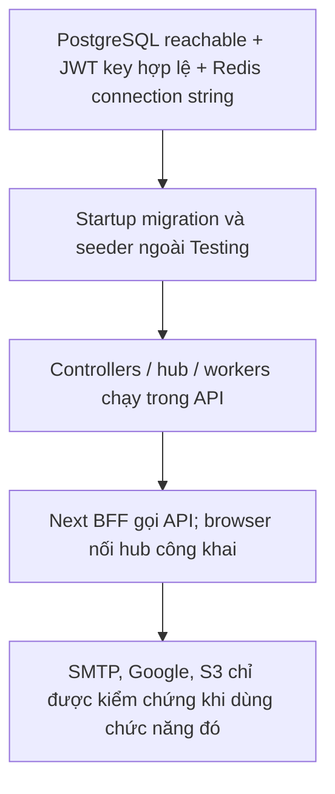
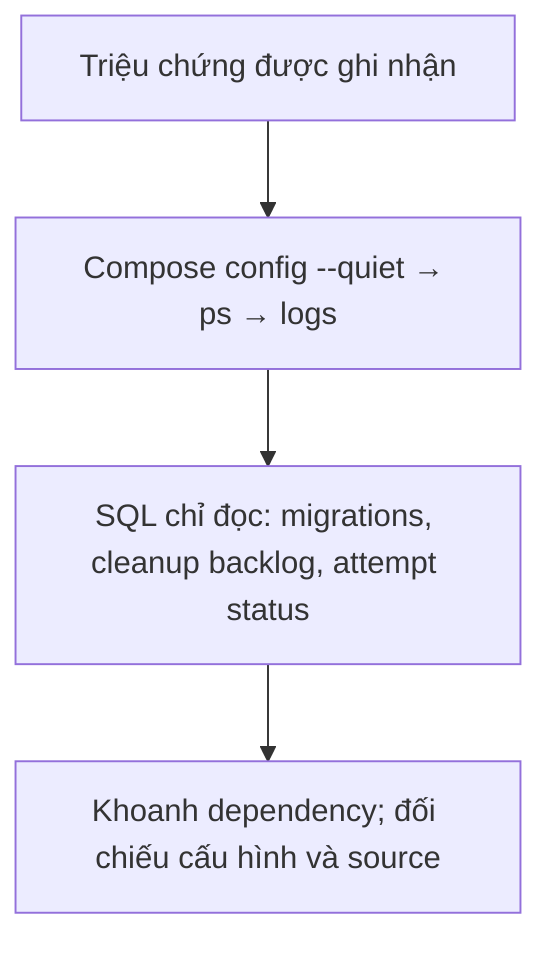
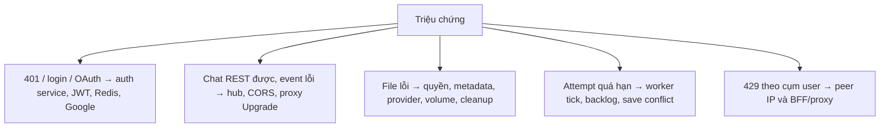
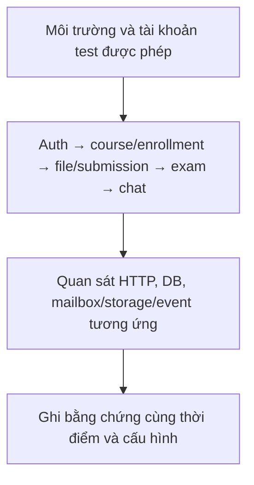
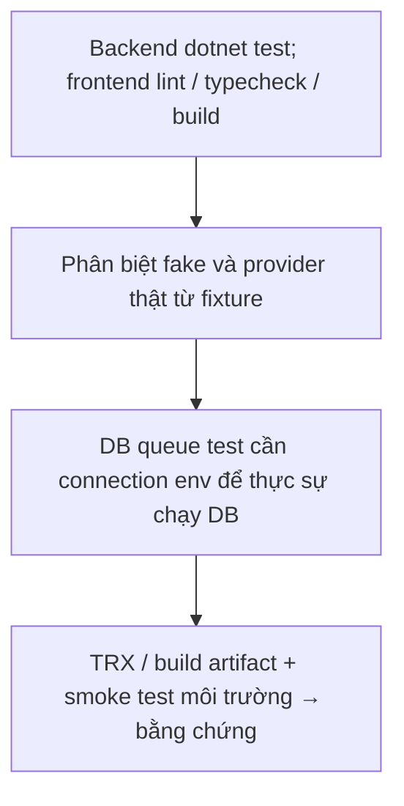
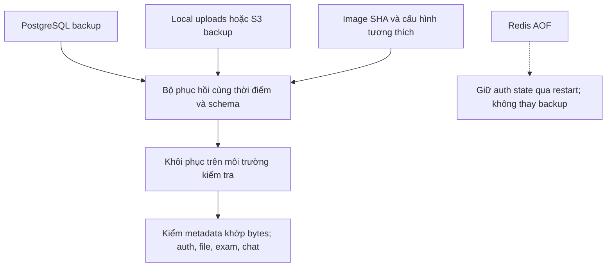

# Vận hành, kiểm tra và xử lý sự cố

Đối chiếu ngày **2026-10-13**. Các bước dưới là hướng dẫn, không khẳng định đã chạy trên VPS. Không dùng secret thật trong tài liệu/log chia sẻ. Cấu hình local: [setup](setup.md), production: [deploy-vps](deploy-vps.md), công cụ: [tools](tools-and-integrations.md), logger/worker: [supporting-components](architecture/supporting-components.md).

## 1. Phụ thuộc và thứ tự khởi động

Luồng xử lý và dữ liệu:



1. PostgreSQL phải truy cập được để migrate/seed khi API startup ngoài Testing. JWT signing key phải hợp lệ; Redis connection string phải tồn tại, kết nối Redis được mở lazy khi dùng.
2. API khởi động middleware/controllers/hub và hai hosted workers. Worker cleanup có thể truy cập storage ngay lúc bắt đầu.
3. Next dùng BACKEND_API_URL phía server; browser dùng BACKEND_HUB_URL công khai. Production không để browser nhận hostname nội bộ `api`.
4. SMTP/Google/S3 chỉ dùng cho chức năng tương ứng. API chạy được không chứng minh credential tích hợp đúng.

| Dependency lỗi | Triệu chứng / phần bị ảnh hưởng | Dữ liệu vẫn còn |
| --- | --- | --- |
| PostgreSQL | Startup migration lỗi; gần như mọi API có JWT còn cần tra user DB | Volume/backup DB; không tự restore bằng code |
| Redis | Login/refresh/OAuth/code verification/reset lỗi | Dữ liệu nghiệp vụ ở DB; JWT còn hạn có thể vẫn gọi API không dùng cache |
| SMTP | Register/resend/forgot thất bại; share bank có thể vẫn 200 | User Inactive hoặc bản sao bank đã commit |
| Google | Callback lỗi 503 network/timeout hoặc 500 HTTP provider | Local login vẫn dùng được nếu user có password; state/identity có cơ chế recovery |
| Local disk/S3 | Upload/download lỗi, cleanup backlog | Metadata DB chưa bảo đảm file vật lý tồn tại |
| SignalR | REST vẫn tải/ghi được nhưng UI không nhận event | Message đã commit trong PostgreSQL |
| API process/worker | Không quét cleanup/expired attempts khi process dừng | Task/attempt vẫn DB, xử lý lại khi chạy |

## 2. Chẩn đoán chỉ đọc

Luồng xử lý và dữ liệu:



Chạy tại backend repository cho dev:

```bash
docker compose ps
docker compose logs --tail=100 postgres redis
dotnet --info
git status --short
```

Production (tại thư mục deployment có Compose/.env):

```bash
docker compose --env-file .env -f docker-compose.prod.yml config --quiet
docker compose --env-file .env -f docker-compose.prod.yml ps
docker compose --env-file .env -f docker-compose.prod.yml logs --tail=100 api frontend nginx
```

`config --quiet` kiểm tra cấu hình mà không in giá trị resolve. Không gửi `.env`, connection string, JWT, cookie, SMTP password, Google secret hay URL chứa access_token trong ticket. Backend chưa có `/health`/readiness API; Swagger chỉ Development, nên `/swagger` 404 production không phải bằng chứng API hỏng.

SQL chỉ đọc cho người vận hành có quyền DB:

```sql
SELECT "MigrationId" FROM "__EFMigrationsHistory" ORDER BY "MigrationId";
SELECT count(*) AS pending_cleanup, min(next_attempt_at) AS oldest_due
FROM file_cleanup_tasks;
SELECT attempt_count, next_attempt_at, created_at
FROM file_cleanup_tasks ORDER BY next_attempt_at LIMIT 20;
SELECT status, count(*) FROM examination_attempts GROUP BY status;
```

LastError/object_key có thể chứa thông tin nội bộ; đọc có kiểm soát khi cần. Không sửa trực tiếp status/AuthVersion/queue để “sửa nhanh” một lỗi chưa chẩn đoán.

## 3. Tra triệu chứng → file cần kiểm tra

Luồng xử lý và dữ liệu:



| Triệu chứng | Kiểm tra | Nguồn |
| --- | --- | --- |
| Login 500 | Redis reachable; DB user lookup; log exception; không phải SMTP nếu login local | AuthenticationService, RedisCache |
| Verify/reset báo hết mã | TTL, counter, cooldown; đúng email và mã normalize; register gửi lại khác forgot reset counter | RegistrationService, PasswordResetService |
| Không nhận mail nhưng share thành công | Bản sao bank có tồn tại; SMTP credentials/delivery; lỗi mail share bị nuốt | QuestionService, GmailService |
| JWT 401 dù chưa hết hạn | Role/status/AuthVersion DB, issuer/audience/signing key; realtime token dùng nhầm REST | infrastructure/DependencyInjection, JwtTokenProvider |
| Reload bị về login sau khoảng 60 phút | Access cookie đã mất; refresh còn nhưng getCurrentUser không tự bắt đầu refresh; cookie write trong server render | frontend lib/auth/session, lib/api/server-client |
| OAuth state không đúng browser | Cookie host-only/HTTPS, authorize/callback có cùng host, callback qua BFF; thời hạn 10 phút | OAuthHttpResponseExtensions, OAuthFlowService, BFF route |
| Chat REST được nhưng không realtime | Public hub URL, CORS chính xác, proxy Upgrade, JWT 2 phút, JoinRoom sau reconnect | ChatHub, chat-realtime.ts, nginx template |
| 429 nhiều người cùng lúc | Limiter theo peer IP; sau BFF/nginx có thể gom nhiều user một IP; không phải Redis counter | presentation/DependencyInjection |
| Upload gần 20 MB bị 413 | Tổng multipart vượt 20 triệu byte dù file nhỏ hơn mức đó | RequestSizeLimit controllers |
| File 404 dù metadata còn | Đã chuyển provider/root, mất volume, object bị xóa hoặc không còn quyền | storage, service authorization |
| Xóa file mãi còn | Cleanup worker/log, NextAttemptAt, quyền delete, đang đổi provider | FileCleanupWorker/FileCleanupTask |
| Attempt quá giờ chưa nộp | API còn chạy, backlog batch100, lỗi save concurrency; kiểm tra ít nhất sau tick30s | ExaminationAutoSubmitWorker/AttemptDeadline |
| System seed không chạy | Thiếu một biến, password sai độ dài, user đã System; unique System thứ hai | SystemAccountSeeder/UserConfiguration |
| Admin không sửa bank | Hành vi hiện tại: Admin/System chỉ đọc, không phải lỗi token | QuestionService |

## 4. Kiểm tra chức năng khi bàn giao môi trường

Luồng xử lý và dữ liệu:



Chỉ chạy các luồng tạo/sửa dữ liệu dưới đây trên môi trường test và tài khoản test được cho phép; đây không phải kết quả đã chạy trong lần cập nhật docs.

| Luồng | Kỳ vọng / tín hiệu |
| --- | --- |
| Register → nhận mã → verify → login | User Inactive rồi Active; mã consume; cookie BFF HttpOnly; không lộ token pair ra JS |
| Refresh → thử dùng lại refresh cũ | Token mới hoạt động, token cũ đã consume bị từ chối |
| Đổi mật khẩu/role/status | Request mới bằng token cũ nhận 401; login theo trạng thái mới |
| Forgot unknown email / email hợp lệ | Cùng accepted response; chỉ email local Active hợp lệ nhận thư |
| Google login trên đúng domain | Cookie binding, callback loginCode, redeem và redirect dashboard |
| Upload/thay file/xóa material | Download qua endpoint kiểm quyền; file cũ vào task, worker dọn |
| Course/enrollment | Student Waiting chưa xem nội dung; Accepted xem; revoke mất quyền request tiếp theo |
| Exam deadline/disconnect | Attempt auto-submit, điểm theo chính sách công bố; reset không gia hạn |
| Chat 2 browser | REST persist + event, reconnect tải bù, xóa direct conversation chỉ ảnh hưởng bên xóa |
| Share bank | Bản sao độc lập và mail; sửa nguồn không đổi bản sao/snapshot kỳ thi |

## 5. Kiểm thử tự động và phạm vi bằng chứng

Luồng xử lý và dữ liệu:



Backend: `dotnet test LMS.sln`; CI còn restore/build Release và Docker build. xUnit/Moq/fake repos/cache/OAuth/SMTP giúp kiểm tra nghiệp vụ và contract. Tests dùng WebApplicationFactory không đồng nghĩa kiểm tra toàn bộ deployment với dịch vụ thật. `FileCleanupQueueIntegrationTests` chỉ dùng PostgreSQL thật khi có `CONNECTIONSTRINGS__DEFAULTCONNECTION`; thiếu biến này test return sớm, không chứng minh queue chạy với DB. Khi bật, test ghi và dọn dữ liệu nên chỉ dùng DB test riêng. Xem [testing.md](testing.md) để phân biệt fixture/fake, coverage khai báo và kết quả chạy thực tế.

Frontend: `npm run lint`, `npx tsc --noEmit`, `npm run build`; hiện không có npm test/E2E script. Kiểm tra browser riêng cho 320/375/768/1024/1440px, vi/en, sáng/tối, upload và fullscreen/WebSocket. Build xanh không chứng minh API permissions, SMTP hay browser guard hoạt động.

## 6. Backup, rollout và giới hạn

Luồng xử lý và dữ liệu:



Backup cả PostgreSQL và file storage; Redis AOF giúp giữ refresh/mã qua restart nhưng không thay backup. Khôi phục DB phải khớp snapshot file và phiên bản schema; rollback image không tự rollback migration. Startup tự migrate nên nên chạy một API instance theo cấu hình hiện có.

Production stack yêu cầu network ngoài `tino_tino-network`, cert directories và `certbot-www` do người vận hành chuẩn bị; không có certbot service/renew job trong Compose. Nginx còn route default HTTP tới `tino-web-prod`. `deploy.sh` chỉ cập nhật tag/pull/up/ps, không health gate/rollback. Các đề xuất cần duyệt riêng ở [review-findings.md](review-findings.md).
