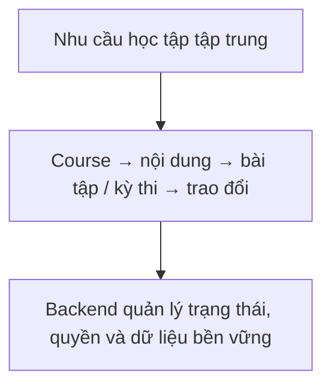
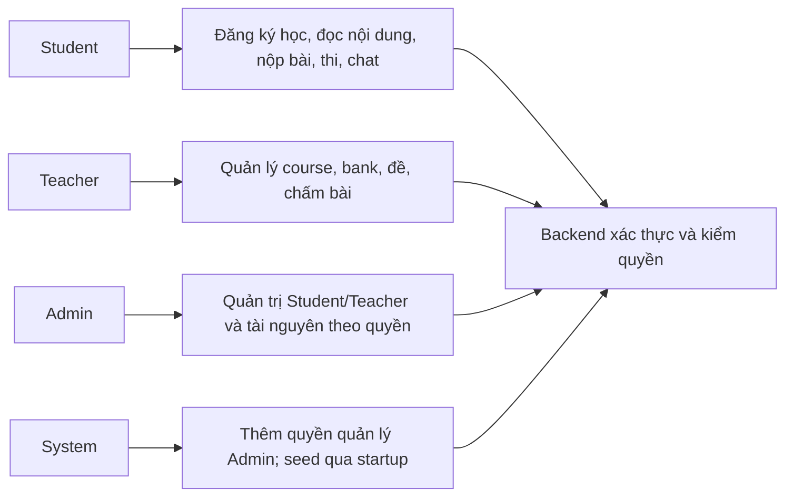
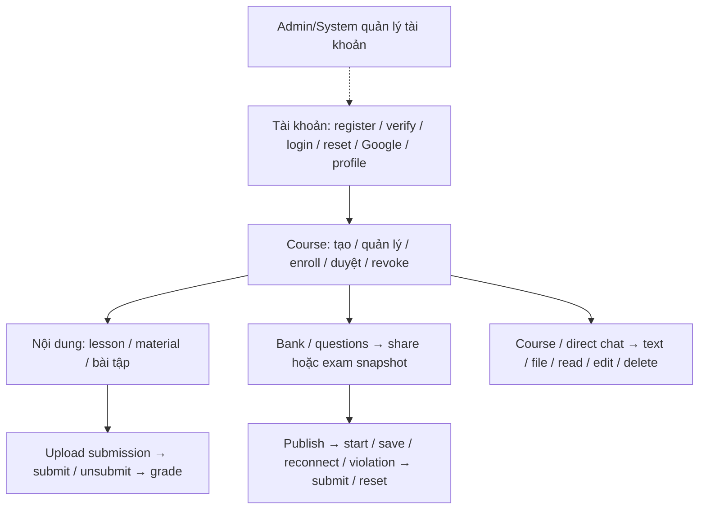
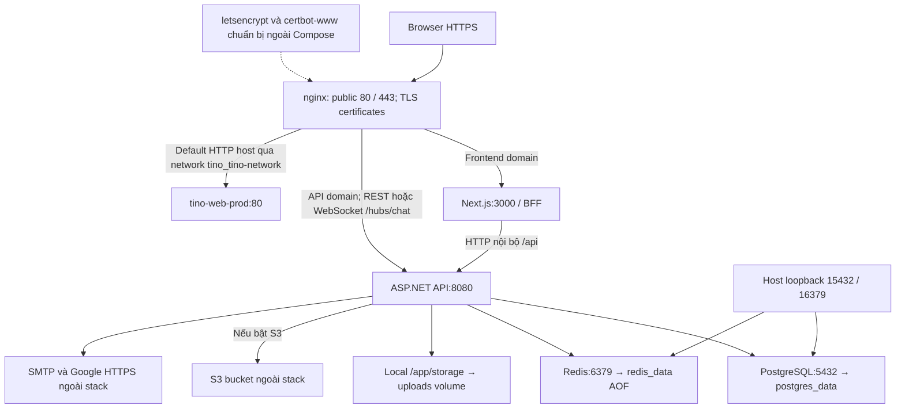
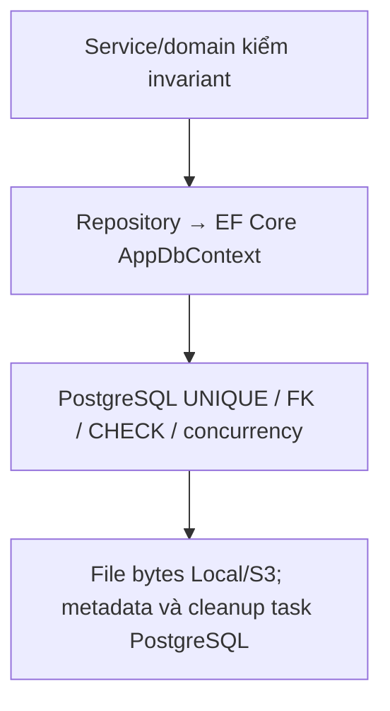
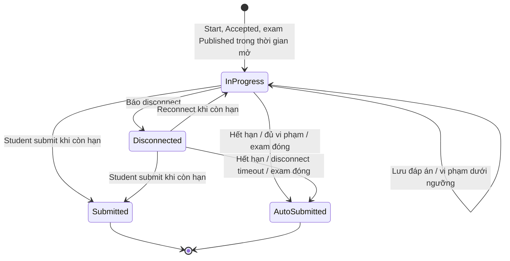
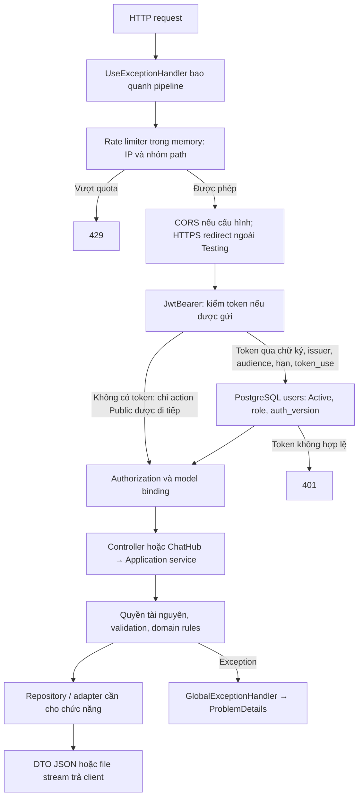
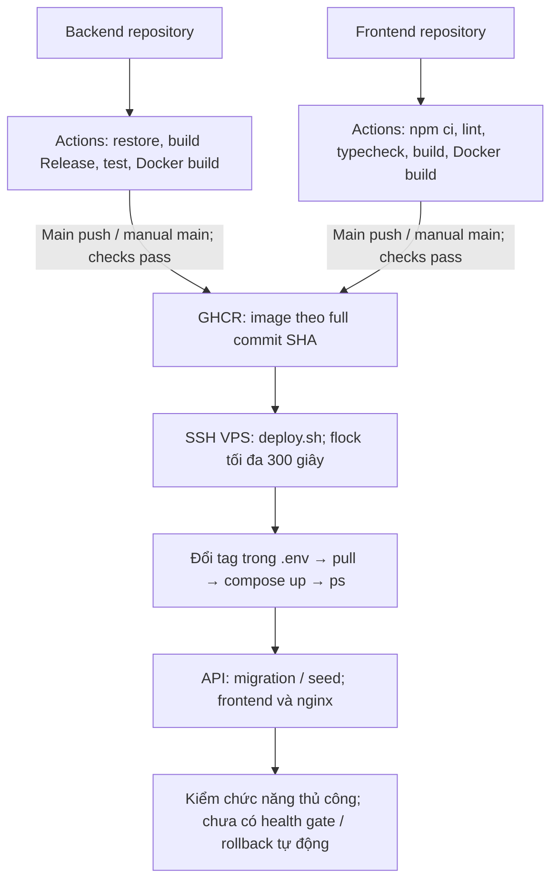
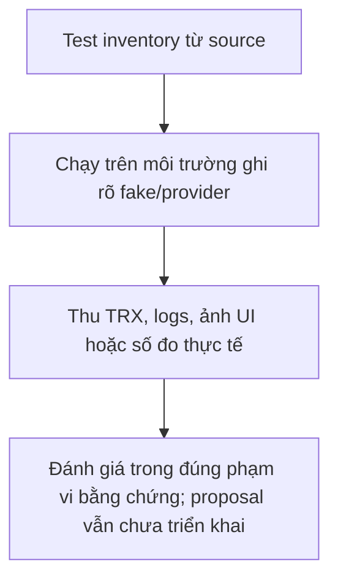
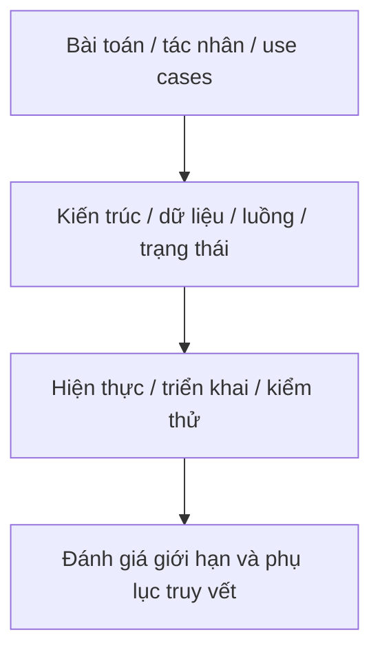

# Hồ sơ kỹ thuật phục vụ báo cáo dự án SFIT Study

Đối chiếu ngày **2026-10-13**, backend base commit `eef952f`, frontend base commit `0e772fb`. Nội dung phản ánh source hiện có và cấu hình được commit, không chứng minh phiên bản đang chạy trên VPS. Lần cập nhật này chỉ thay tài liệu; không nâng dependency, đổi API hoặc sửa nghiệp vụ.

## 1. Bài toán, mục tiêu và phạm vi

Luồng xử lý và dữ liệu:

SFIT Study là hệ thống quản lý học tập dành cho môi trường CLB Tin học SFIT–UTC theo metadata ứng dụng. Hệ thống gom quản lý khóa học, đăng ký lớp, bài giảng/tài liệu, bài tập/nộp bài/chấm điểm, ngân hàng câu hỏi, thi trực tuyến và trao đổi qua chat trong một ứng dụng web. Backend bảo vệ dữ liệu theo tài khoản, vai trò, quyền sở hữu và trạng thái nghiệp vụ; frontend cung cấp giao diện tiếng Việt/Anh, sáng/tối và truy cập trên nhiều kích thước màn hình.

Phạm vi hiện có không bao gồm thanh toán, chứng chỉ, video streaming chuyên dụng, SCORM, chấm bài lập trình bằng sandbox, AI grading, push notification tổng quát hoặc chống gian lận cấp hệ điều hành. Không mô tả các mục này là tính năng đã hoàn thành chỉ vì thuộc một LMS thông thường.

## 2. Tác nhân và ranh giới trách nhiệm

Luồng xử lý và dữ liệu:

| Tác nhân | Mục tiêu và quyền thực tế |
| --- | --- |
| Khách chưa đăng nhập | Register/verify/resend, login/refresh, forgot/reset, OAuth login |
| Student | Tìm course Open, yêu cầu/hủy enrollment; khi Accepted đọc nội dung, nộp/rút bài, thi, xem điểm theo chính sách; chat |
| Teacher | Sở hữu course, quản lý enrollment/nội dung/bài tập/kỳ thi/kết quả; sở hữu bank, chỉnh đáp án và chia sẻ bản sao; chat |
| Admin | Quản trị course/content/exams và Student/Teacher; đọc mọi question bank; không ghi bank hoặc tạo/cấp Admin |
| System | Khả năng quản trị tương ứng Admin, thêm quyền quản lý Admin; vẫn chỉ đọc bank; tối đa một System, seed ngoài API |
| API hosted worker | Tự nộp/chấm attempt quá hạn và dọn file; không phải tài khoản role System, không đăng nhập qua HTTP |
| Google/SMTP/object storage | Dịch vụ ngoài phục vụ xác minh danh tính, giao thư và nội dung file; không quyết định quyền khóa học |

Teacher không được quản lý mọi khóa học chỉ vì có role Teacher. Student Active chưa chắc có quyền nội dung: phải có enrollment Accepted. Admin/System có quyền rộng nhưng không phải “bỏ qua mọi rule”; ví dụ ngân hàng câu hỏi chỉ đọc và thao tác auto-submit vẫn kiểm tra điều kiện reason.

## 3. Danh mục chức năng và use case

Luồng xử lý và dữ liệu:

| ID | Use case / tác nhân | Điều kiện, luồng chính, kết quả | API / tài liệu |
| --- | --- | --- | --- |
| UC-01 | Đăng ký và kích hoạt / Khách | Tạo Student Inactive, hash password, mã Redis + SMTP; mã đúng chuyển Active | `/api/auth/register`, `/verify-email`, `/resend-verification`; [auth](api/auth.md) |
| UC-02 | Đăng nhập / User Active | Password hoặc Google loginCode → access JWT + refresh Redis; BFF đặt cookie | `/api/auth/login`, `/login-code`, `/refresh` |
| UC-03 | Khôi phục mật khẩu / User local | Forgot trả accepted cả khi không gửi; reset consume mã và tăng AuthVersion | `/api/auth/forgot-password`, `/reset-password` |
| UC-04 | Liên kết Google / User Active | State purpose Link gắn userId và browser cookie; callback ghi external identity | `/api/auth/oauth/Google/link/authorize`, `/callback` |
| UC-05 | Hồ sơ và password / Chính chủ | Sửa tên/phone; đổi/tạo password, thu hồi token cũ | `/api/users/me`, `/me/password`; [users](api/users.md) |
| UC-06 | Quản trị tài khoản / Admin/System | Search/filter/page, create/update/status theo quyền; không sửa System qua API | `/api/users` và `/{id}`/`/{id}/status` |
| UC-07 | Import users / Admin/System | Parse XLSX browser, preview, mỗi dòng một POST; thành công một phần | POST `/api/users`; [Excel frontend](../../frontend/docs/supporting-features.md) |
| UC-08 | Quản lý course / Teacher chủ hoặc quản trị | Create/update, soft-delete/restore; status đồng bộ archive chat | `/api/courses`; [courses](api/courses.md) |
| UC-09 | Đăng ký lớp / Student | Course Open; Waiting → được duyệt hoặc hủy; có thể rời Accepted | `/courses/{id}/enrollments`, `/enrollments/{id}/cancel` |
| UC-10 | Duyệt/thêm/loại học viên / Người quản lý course | Waiting → Accepted/Rejected; thêm bằng email vào Accepted; giới hạn sĩ số | accept/reject/revoke, `/enrollments/by-email` |
| UC-11 | Soạn bài giảng / Người quản lý course | Draft/Published, order duy nhất, reorder gửi đủ lesson IDs | `/lessons`, `/lessons/reorder`; [content](api/course-content.md) |
| UC-12 | Tài liệu / Người quản lý upload, người có quyền đọc | File storage trước metadata; download kiểm quyền; delete enqueue cleanup | `/lessons/{id}/materials`, `/materials/{id}/content` |
| UC-13 | Bài tập / Người quản lý course | Draft sửa/thay file/xóa; Publish rồi Close; deadline kiểm backend | `/exercises/{id}`/attachment/publish/close; [exercises](api/exercises.md) |
| UC-14 | Bài nộp / Student Accepted | Upload tạo draft, submit, unsubmit trước hạn; một bài/student/exercise | `/exercises/{id}/submissions`, `/submissions/{id}/submit`/unsubmit |
| UC-15 | Chấm bài / Người quản lý course | Submitted → Graded, điểm 0–10 và feedback; có thể chấm lại | PUT `/submissions/{id}/grade` |
| UC-16 | Bank/câu hỏi / Teacher chủ | MCQ đúng một đáp án, FIB nhiều đáp án chấp nhận; chỉnh tập đáp án theo loại | `/question-banks`, `/questions/{id}`; [questions](api/question-banks.md) |
| UC-17 | Đọc bank / Admin/System | Xem mọi bank, lọc teacherId/ownerSearch, không sửa | GET `/question-banks`, `/{id}/questions` |
| UC-18 | Chia sẻ bank / Teacher chủ | Sao chép độc lập cho Teacher Active khác rồi SMTP thông báo | POST `/question-banks/{id}/share` |
| UC-19 | Import câu hỏi / Teacher chủ | XLSX → mỗi dòng POST MCQ/FIB, preview lỗi | API question-bank tương ứng; không có upload workbook backend |
| UC-20 | Soạn đề thi / Người quản lý course | Random theo rules hoặc Manual; bank thuộc teacher course; snapshot ≤500 câu | `/courses/{id}/examinations`, `/examinations/{id}/question-set`; [exams](api/examinations.md) |
| UC-21 | Làm thi / Student Accepted | Published và trong giờ; một attempt hiện hữu; lưu câu trả lời qua REST | `/examination-attempts/{examId}/start`, `/{attemptId}/questions/...`; [attempts](api/examination-attempts.md) |
| UC-22 | Giám sát và tự nộp / Browser + backend | Browser báo violation/disconnect; server áp deadline/ngưỡng; worker nộp khi quá hạn | violations/disconnect/reconnect/submit; worker 30s |
| UC-23 | Kết quả/reset/export / Student hoặc người quản lý | Student xem điểm theo chính sách; quản lý xem lịch sử, xóa attempt; export XLSX browser | `/examinations/{id}/my-attempt`, `/attempts`, DELETE attempt |
| UC-24 | Chat course/direct / User có quyền | REST persist history, SignalR event; reply/edit/delete/read, attachment | `/api/chat/...`, `/hubs/chat`; [chat](api/chat.md) |
| UC-25 | Xóa conversation / Participant direct | Chỉ ẩn/xóa lịch sử đến mốc của chính user; người kia giữ lịch sử | DELETE `/api/chat/rooms/{roomId}` |
| UC-26 | Tùy chọn giao diện / Người dùng | vi/en, theme sáng/tối; lưu browser preference | Không có API preference; [frontend overview](../../frontend/docs/overview.md) |

Đây là bản tổng hợp; URL rút gọn trong cột cuối dùng base path của module. Toàn bộ method/path/controller ở [105 REST actions](api/endpoint-index.md), DTO/request và contract hỗ trợ ở [90 record contracts](api/contracts.md), trong đó 3 record storage dùng nội bộ. Không nhầm `{examId}` lúc start với `{attemptId}` ở các thao tác sau.

## 4. Kiến trúc và lựa chọn thiết kế

Luồng xử lý và dữ liệu:

Backend là **một ứng dụng/assembly phân lớp**, không phải microservices: presentation, application, domain, infrastructure nằm trong LMS.Api. Interface repository/storage/cache/mail/token giúp thay implementation và mock test. Phân lớp chưa hoàn toàn độc lập compile-time; ví dụ AuthenticationService dùng OAuthResolver thuộc infrastructure. Vì vậy nên gọi là “layered monolith”, không khẳng định Clean Architecture thuần túy hoặc mọi dependency đều hướng vào domain.

Frontend dùng Next App Router với Server Components cho tải trang và Client Components cho tương tác. BFF giúp access/refresh token nằm trong HttpOnly cookie, Next thêm Bearer khi gọi REST. Hub là ngoại lệ kết nối trực tiếp từ browser bằng token giới hạn chat. DTO TypeScript hiện viết tay; chưa có pipeline codegen client từ OpenAPI.

Các đánh đổi có thể phân tích trong báo cáo (nhận xét dựa trên implementation, không phải lịch sử quyết định của tác giả):

| Thiết kế | Lợi ích quan sát được | Đánh đổi / giới hạn |
| --- | --- | --- |
| JWT + tra user/AuthVersion DB | Thu hồi token ở lần xác thực tiếp theo sau đổi quyền/password | Mỗi request JWT phụ thuộc DB; connection realtime cần xử lý riêng |
| Refresh/mã một lần Redis | TTL và thao tác atomic, tránh redeem đồng thời | Redis lỗi/mất dữ liệu ảnh hưởng login/refresh/mã đang chờ |
| Snapshot câu hỏi | Đề và điểm không đổi khi bank nguồn chỉnh sửa/xóa | Dữ liệu lặp lại, cần phân biệt question ID nguồn với snapshot |
| Serializable + row-version | Bảo vệ sĩ số/trạng thái bài nộp/attempt | Có conflict/retry, phải đo dưới tải thật |
| File ngoài DB + cleanup DB queue | DB giữ metadata, retry dọn file qua restart | Ghi file/DB không phải một atomic transaction; cần bù lỗi |
| SMTP trực tiếp request | Triển khai đơn giản, biết lỗi gửi ở luồng xác thực | Độ trễ SMTP ảnh hưởng HTTP; share mail lỗi không có retry |
| REST persistence + SignalR event | History bền vững, realtime nhanh | Không exactly-once/replay/backplane mặc định |
| ExcelJS ở browser | Không cần import/export file service | Nhiều request, bộ nhớ browser, kết quả có thể thành công một phần |

## 5. Dữ liệu và tính toàn vẹn

Luồng xử lý và dữ liệu:

Model snapshot có **28 bảng nghiệp vụ**, **229 property mapping** (bao gồm shadow row-version), cộng bảng EF migration history ngoài số đếm. [ERD](architecture/data-model.md) giải thích quan hệ; [từ điển dữ liệu](architecture/data-dictionary.md) cung cấp tên cột, kiểu PostgreSQL, nullable, index/FK/CHECK. DB triển khai phải kiểm tra riêng `__EFMigrationsHistory`.

Ba loại dữ liệu cần phân biệt: dữ liệu nghiệp vụ bền vững ở PostgreSQL; trạng thái xác thực tạm ở Redis; bytes file ở local/S3. Cookie/localStorage/sessionStorage frontend chứa phiên/preference/control state, không phải nơi lưu kết quả học tập. FileCleanupTask là queue PostgreSQL, không phải Redis job.

Soft delete course ẩn dữ liệu con qua query filters và có restore. Soft delete message không xóa file vật lý. Clear direct conversation là mốc visibility per-user. Reset attempt là xóa thực lượt và answers/violations theo cascade. Không gom bốn hành vi này thành cùng một khái niệm “xóa dữ liệu”.

## 6. Luồng và trạng thái nên đưa vào báo cáo

Luồng xử lý và dữ liệu:

Các sequence/state diagrams sẵn có ở [data-flow](architecture/data-flow.md). Nên dùng ít nhất các luồng register/verify, refresh, Google OAuth, upload+cleanup, start/save/submit exam và chat persistence+broadcast.

| Aggregate | Trạng thái chính | Quy tắc cần giải thích |
| --- | --- | --- |
| Account | Inactive/Active/Disabled/Banned | Register tự do tạo Inactive; management không gán Inactive; seed không tự active tài khoản có sẵn |
| Course | Open/Closed + DeletedAt | Closed ngừng tuyển, Accepted vẫn đọc; delete khác close |
| Enrollment | Waiting/Accepted/Rejected/Cancelled | Re-request tái sử dụng row; by-email có thể vào Accepted trực tiếp |
| Lesson | Draft/Published | Student chỉ thấy Published |
| Exercise | Draft → Published → Closed | Chỉ Draft sửa đề/attachment/xóa |
| Submission | Draft → Submitted → Graded | Unsubmit về Draft trước hạn khi chưa graded; optimistic concurrency |
| Examination | Draft → Published → Closed | Draft mới sửa cấu hình/bộ đề; Close nộp mọi attempt active |
| Attempt | InProgress ⇄ Disconnected → Submitted/AutoSubmitted | Deadline server, chính sách công bố điểm, một lượt hiện hữu |
| Chat | Active/Archived room; soft-deleted message; per-user hidden history | Quyền room theo course/enrollment, group realtime có giới hạn thu hồi |

## 7. Bảo mật và xử lý lỗi

Luồng xử lý và dữ liệu:

| Cơ chế đã có | Rủi ro hướng tới | Giới hạn phải ghi đúng |
| --- | --- | --- |
| PasswordHasher + RNG code | Không lưu plaintext password/mã | Mail nhận mã thô theo mục đích; không gọi hash là mã hóa hai chiều |
| JWT validate + AuthVersion | Token giả/hết hạn/đã thu hồi | Backend DB xác nhận; frontend decode không phải verify |
| Role/ownership/enrollment | Truy cập tài nguyên trái quyền | UI ẩn nút không thay service authorization |
| OAuth state/browser-binding/PKCE | Callback không đúng flow/browser, đánh cắp code | Host cookie và HTTPS phải cấu hình đúng |
| Cooldown/counter/rate limiter | Spam mail/brute-force/thừa request | Rate limit memory/peer IP, có giới hạn reverse proxy/BFF |
| Path normalization + GUID object key | Traversal và trùng tên file | Chưa antivirus/whitelist; không khẳng định upload an toàn tuyệt đối |
| ProblemDetails + 500 chung | Tránh trả exception nội bộ ra HTTP | Logger vẫn có stack/metadata; một số framework error body rỗng |
| Transaction + unique/CHECK/FK | Dữ liệu trùng/sai quan hệ/concurrent update | Mapping unique →409 chưa bao phủ mọi constraint |

[Error handling](architecture/error-handling.md) có status và ví dụ; [backend findings](review-findings.md), [frontend findings](../../frontend/docs/review-findings.md) tách hạn chế chưa sửa. Chưa có bằng chứng audit/pentest, đo chống gian lận, compliance hoặc bảo đảm zero data loss; không đưa những tuyên bố này vào kết luận.

## 8. Chức năng nền, hỗ trợ và vận hành

Luồng xử lý và dữ liệu:

Worker thi quét 30 giây/batch100; cleanup chạy ngay rồi 10 giây/batch100, backoff tối đa 60 phút. ILogger xuất qua host/container, chưa sink file/log tập trung. Seeder sau migration tạo/promote System, không phải worker định kỳ. Helper validation/auth/clock/upload/pagination, EF configurations/factory/migrations, fixtures/tests, CI/Docker/nginx có giải thích từng file ở [supporting-components](architecture/supporting-components.md). Frontend có [bảng thành phần hỗ trợ](../../frontend/docs/supporting-features.md) cho guard, theme/i18n, Excel, metadata và file cũ không mount.

Deployment gồm hai repository CI độc lập, build images GHCR rồi dùng SSH/deploy.sh cùng Compose stack; flock tuần tự hóa deployment. PostgreSQL/Redis/uploads dùng volumes; TLS/nginx và external TiNo network cần chuẩn bị riêng. Cấu hình hiện tại một API instance, không tự đảm bảo HA/scale ngang. Đọc [setup](setup.md), [deploy](deploy-vps.md), [operations](operations.md).

## 9. Kiểm thử và đánh giá kết quả

Luồng xử lý và dữ liệu:

Có **246 phương thức Fact/Theory trong 26 file test**, được đếm từ source (Theory có thể nhiều case, không phải số test pass). Danh sách từng tình huống: [testing.md](testing.md). Một PostgreSQL integration test return sớm nếu thiếu connection env; cần nêu rõ khi báo cáo kết quả. Frontend CI có lint/typecheck/build, chưa bộ E2E được khai báo.

Đợt cập nhật docs kiểm tra cấu trúc tài liệu, link, endpoint/contract/model/test inventory và phạm vi diff. Không chạy lại bộ ứng dụng, gửi SMTP, login Google, thay DB hoặc deploy. Để phần “đánh giá” có số liệu, cần bổ sung bằng chứng thực nghiệm:

| Mục đánh giá | Cách thu thập | Trạng thái ở hồ sơ này |
| --- | --- | --- |
| Functional tests | dotnet test với SDK/commit và TRX ghi rõ provider thật/fake | Có danh mục source; chưa báo số pass |
| Frontend | lint/tsc/build và browser smoke từng role | Có lệnh/luồng; chưa xác nhận UI runtime lần này |
| Hiệu năng | Định nghĩa dataset/concurrency, đo p50/p95/errors/DB queries | Chưa đo; không ghi số users đồng thời suy đoán |
| Độ bền dữ liệu | Test restore DB+files, restart worker, fault injection | Có cơ chế trong code; chưa diễn tập môi trường thật |
| Responsive/i18n | 320/375/768/1024/1440px, vi/en, light/dark | Có định hướng và implementation; cần ảnh/checklist thực tế |
| Bảo mật | Test quyền chéo role/resource, revoke, OAuth cookie, file access | Có tests/guards và findings; chưa pentest đầy đủ |

## 10. Gợi ý bố cục báo cáo hoàn chỉnh

Luồng xử lý và dữ liệu:

1. Giới thiệu bài toán, mục tiêu và phạm vi (mục 1–2).
2. Khảo sát/yêu cầu chức năng, tác nhân, use cases (mục 3 và business-rules).
3. Phân tích thiết kế: kiến trúc, ERD, schema, state/sequence diagrams (mục 4–6).
4. Hiện thực: module/API, công cụ, helpers/workers/logger/frontend integration (mục 7–8).
5. Triển khai và kiểm thử: môi trường, CI/CD, case catalog, bằng chứng chạy thật (mục 8–9).
6. Đánh giá: những gì đã làm, hạn chế xác nhận từ code, hướng phát triển có ưu tiên; không đưa proposal chưa duyệt vào phần đã hoàn thành.
7. Phụ lục: endpoint index, contracts, data dictionary, source maps, biến môi trường không có secret.

Ảnh màn hình, yêu cầu ban đầu của môn học, sơ đồ tổ chức nhóm, đóng góp từng thành viên, thời gian thực hiện, dữ liệu khảo sát người dùng và kết quả benchmark không có trong source: người viết báo cáo phải cung cấp bổ sung, không suy diễn từ commit hoặc metadata.
