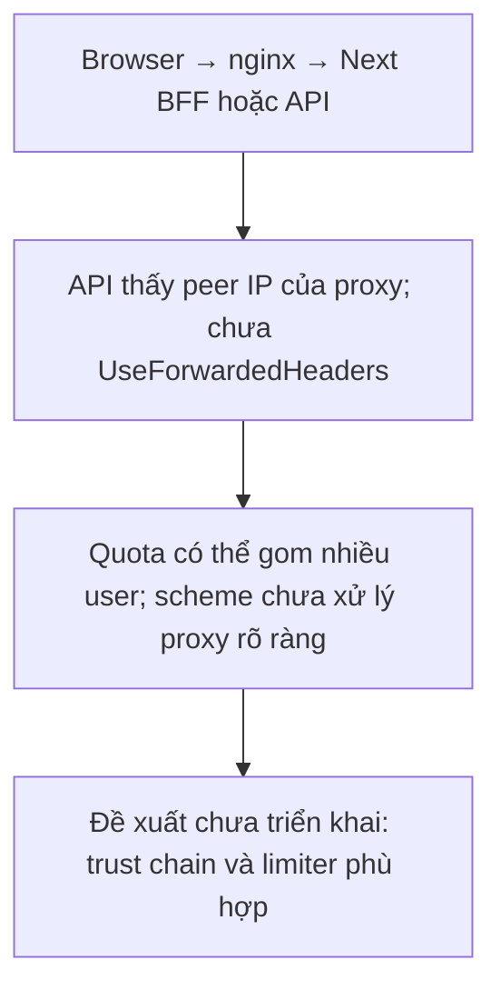
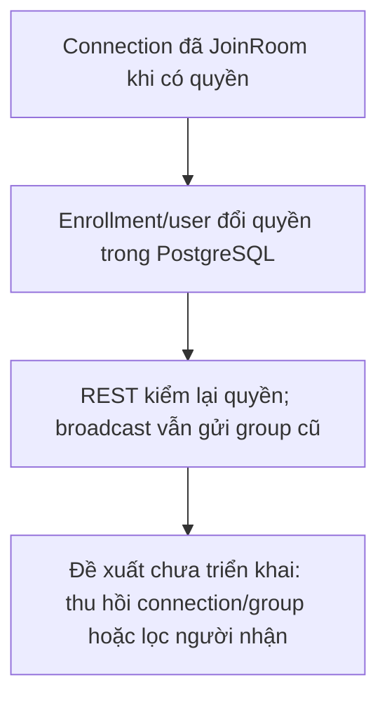
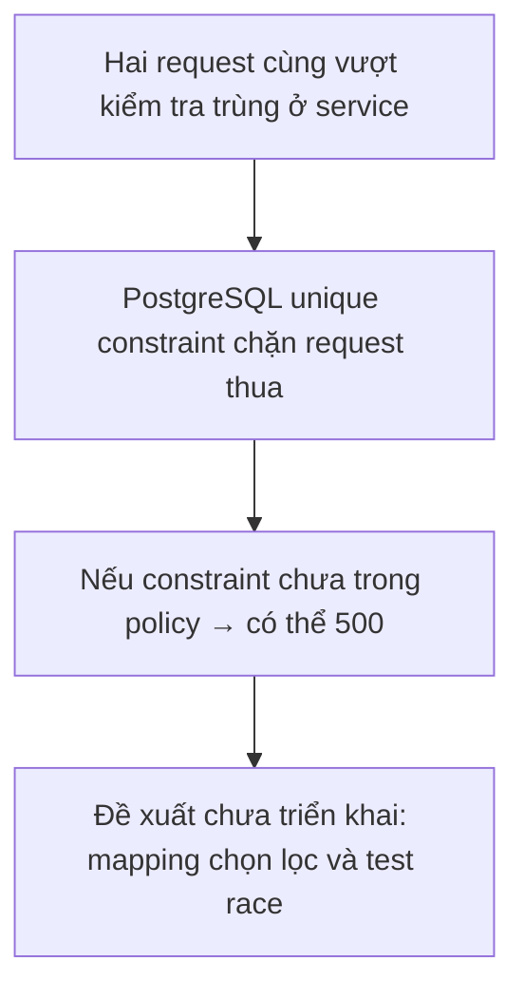
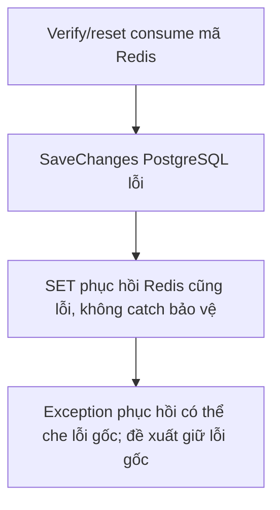
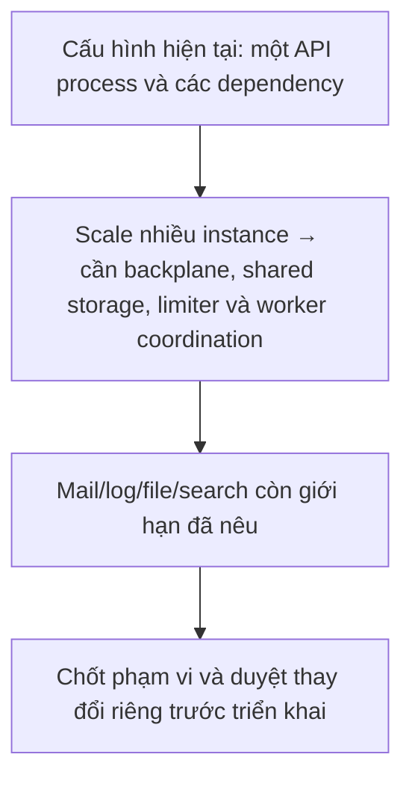

# Phát hiện và đề xuất cần duyệt riêng

Rà soát tĩnh ngày **2026-10-13**, chưa phải pentest hoặc tái hiện production. Không thay backend trong đợt cập nhật tài liệu. Các đề xuất dưới đây chưa được phê duyệt/triển khai; có thể duyệt từng mục độc lập. Các giới hạn vận hành khác được ghi ở [operations](operations.md).

## Backend Change Proposal

Luồng hiện tại và điểm cần xem xét; bước đề xuất chưa được triển khai:

### Module
BE-01 — Reverse proxy, HTTPS và rate limiter.

### Current behavior
`presentation/Program.cs` chưa gọi UseForwardedHeaders; limiter trong `presentation/DependencyInjection.cs` dùng Connection.RemoteIpAddress. Nginx gửi X-Forwarded-For/Proto, còn REST frontend đi thêm qua Next BFF.

### Problem
Peer IP của API có thể là nginx hoặc Next, gom nhiều người vào quota chung 10/240 request mỗi phút. HTTPS redirect cũng không có xử lý proxy scheme rõ ràng trong pipeline. Chỉ bật forwarded headers tại API chưa giải quyết đường browser → Next → API vì BFF hiện không chuyển chuỗi client IP tin cậy.

### Severity
HIGH

### Proposed change
Thiết kế trust chain nginx/Next/API: chuẩn hóa forwarded headers tại ingress, chỉ tin proxy/network được xác định, xử lý scheme/IP trước limiter/HTTPS; định nghĩa giới hạn theo người dùng/IP phù hợp với BFF. Thêm test không tin header giả từ client.

### Why
Phân biệt được client thật và tránh quota dùng chung hoặc tin IP giả.

### Backend files likely affected
`LMS.Api/presentation/Program.cs`, `presentation/DependencyInjection.cs`, cấu hình proxy/network và test integration tương ứng.

### Frontend impact
Cần phối hợp BFF forwarding trong `app/api/backend/[...path]/route.ts` và `lib/api/server-client.ts`; không chỉ sửa config API.

### Compatibility impact
Thay partition rate limit và cách API hiểu origin scheme/IP; response DTO không cần đổi.

### Risk
Tin forwarded headers quá rộng cho phép giả IP; cấu hình sai có thể gây redirect loop hoặc chặn client.

### Recommendation
REQUIRED trước khi dựa vào rate limit theo IP ở production nhiều người dùng.

## Backend Change Proposal

Luồng hiện tại và điểm cần xem xét; bước đề xuất chưa được triển khai:

### Module
BE-02 — Thu hồi quyền nhận chat realtime.

### Current behavior
ChatHub JoinRoom/SendMessage kiểm tra quyền room; broadcast gửi thẳng `Clients.Group(...)`. JWT/AuthVersion kiểm tra lúc HTTP authentication; chưa có bước remove các connection hiện hữu khỏi group khi enrollment bị revoke/cancel hoặc user đổi quyền.

### Problem
Suy luận từ mã: connection đã join có thể tiếp tục nhận broadcast sau khi quyền đọc REST đã mất, cho đến khi connection đóng hoặc được xử lý lại. JWT realtime 2 phút giảm thời gian tồn tại nhưng không phải thu hồi tức thời; backend cũng nhận access JWT bình thường tại hub.

### Severity
HIGH

### Proposed change
Bổ sung quản lý connection/group theo user và cơ chế loại/đóng connection khi quyền bị thu hồi, hoặc lọc người nhận dựa trên quyền hiện hành. Kiểm tra cả role/status/AuthVersion và enrollment; thiết kế cho nhiều instance nếu dự kiến scale.

### Why
Đồng nhất quyền nhận event với quyền đọc REST.

### Backend files likely affected
`presentation/hubs/ChatHub.cs`, `presentation/controllers/ChatsController.cs`, `application/features/chats/ChatService.cs`, enrollment/user/course services và tests SignalR.

### Frontend impact
Xử lý connection/room bị thu hồi, dọn UI và tải lại room; không tự giả quyền trong client.

### Compatibility impact
Có thể bổ sung event hoặc hub-close behavior; REST DTO có thể giữ nguyên.

### Risk
Race khi revoke/rejoin; phải tránh gửi nhầm hoặc loại nhầm connection khi nhiều instance.

### Recommendation
REQUIRED nếu yêu cầu thu hồi quyền chat có hiệu lực tức thời.

## Backend Change Proposal

Luồng hiện tại và điểm cần xem xét; bước đề xuất chưa được triển khai:

### Module
BE-03 — Phân loại lỗi unique constraint.

### Current behavior
DatabaseConstraintPolicy chỉ map danh sách constraint cho phép thành 409. Unique examination/student ở attempt và external identity/user-provider chưa nằm trong danh sách; service có một số kiểm tra trước.

### Problem
Race concurrent có thể vượt kiểm tra trước và thành DbUpdateException 500 ở constraint chưa map. Đây là khả năng theo code, chưa tái hiện race thực tế trong đợt docs.

### Severity
MEDIUM

### Proposed change
Rà đúng các business unique constraints còn thiếu, bổ sung mapping chọn lọc và integration test gửi đồng thời; giữ 500 cho lỗi schema/data không nên coi là conflict nghiệp vụ.

### Why
Client phân biệt dữ liệu trùng với lỗi hạ tầng và xử lý đúng.

### Backend files likely affected
`infrastructure/persistence/DatabaseConstraintPolicy.cs`, tests auth/attempt/persistence; có thể cần service xử lý conflict cụ thể.

### Frontend impact
Nhận 409 thay vì 500 trong race tương ứng, dùng thông báo conflict hiện có.

### Compatibility impact
Thay status lỗi ở một số tình huống đồng thời, không thay success DTO.

### Risk
Mapping quá rộng có thể che lỗi lập trình; cần kiểm tra tên constraint thực tế trong migration.

### Recommendation
RECOMMENDED

## Backend Change Proposal

Luồng hiện tại và điểm cần xem xét; bước đề xuất chưa được triển khai:

### Module
BE-04 — Phục hồi mã xác thực/reset khi DB và Redis cùng lỗi.

### Current behavior
RegistrationService.VerifyEmailAsync và PasswordResetService.ResetAsync consume mã, rồi nếu SaveChanges lỗi sẽ SET lại mã với CancellationToken.None. Khác helper recovery refresh/OAuth, SET này không có catch bảo vệ.

### Problem
Redis cũng lỗi lúc phục hồi sẽ che exception DB gốc, làm việc chẩn đoán mất nguyên nhân ban đầu. Có thể không khôi phục được mã dù user nhận thông báo thử lại.

### Severity
MEDIUM

### Proposed change
Bảo toàn exception gốc, ghi log lỗi phục hồi riêng và test double-failure; thống nhất chính sách thông báo/thử lại mà không khẳng định mã đã phục hồi khi chưa thành công.

### Why
Chẩn đoán chính xác và mô tả recovery đúng mức đảm bảo.

### Backend files likely affected
`application/features/registration/RegistrationService.cs`, `features/passwordreset/PasswordResetService.cs` và tests tương ứng.

### Frontend impact
Không đổi success contract; retry/re-request code theo lỗi trả về.

### Compatibility impact
HTTP có thể vẫn 500; khác exception được log/quan sát.

### Risk
Không được ghi mã, hash, token hoặc secret vào log recovery.

### Recommendation
RECOMMENDED

## Giới hạn đã ghi nhận, chưa đề xuất thay đổi nghiệp vụ

Luồng xử lý và dữ liệu:

Chạy nhiều API instance cần giải quyết SignalR backplane, rate limiter phân tán, startup migrations, shared storage và claim task worker. Mail share chưa có outbox/retry/log thất bại; logger chưa có sink tập trung/audit log. API file hiện bỏ qua download flag, không whitelist file type. Question-bank listing chưa phân trang, ownerSearch lọc trong memory. Các điều này là hành vi/giới hạn hiện tại; muốn mở rộng cần chốt phạm vi và đề xuất riêng, không tự triển khai trong tác vụ docs.
