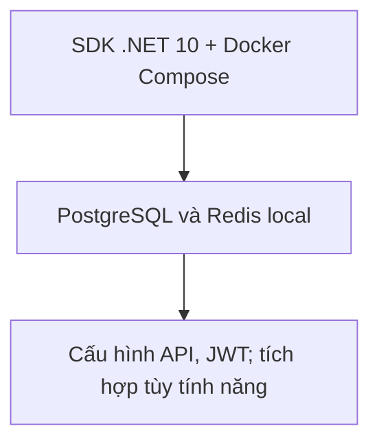
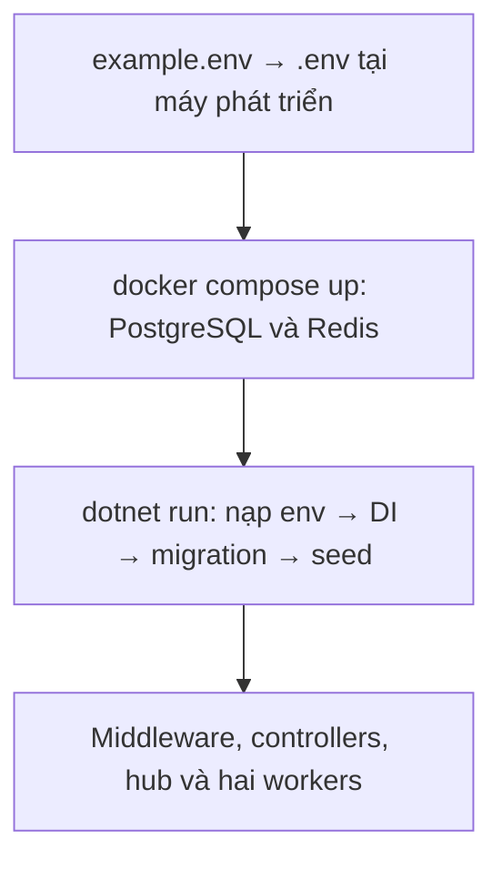
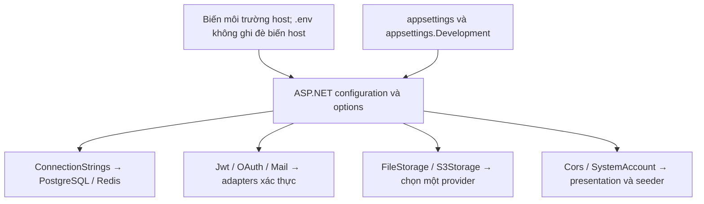
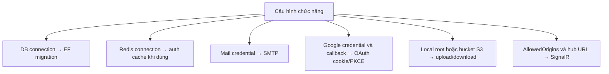
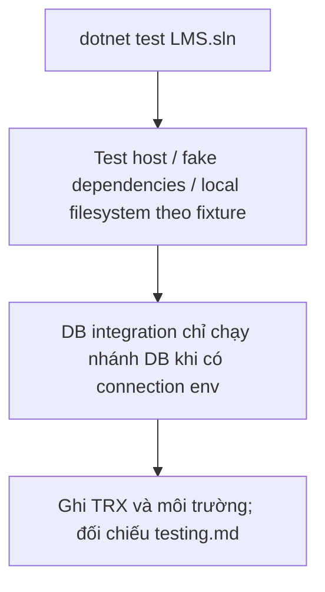
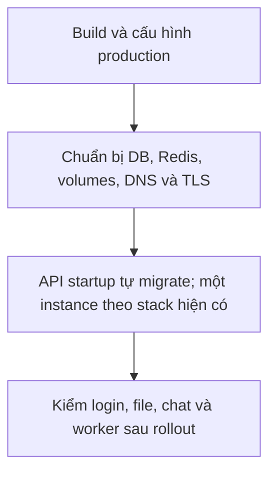

# Backend – Cài đặt và vận hành

Đối chiếu mã nguồn ngày **2026-10-13**. Mô tả implementation trong repository, không phải xác nhận môi trường production.

## 1. Yêu cầu

Luồng xử lý và dữ liệu:



- .NET SDK 10
- Docker (để chạy PostgreSQL và Redis)
- Tài khoản SMTP (khuyến nghị Gmail + App Password) để gửi mail xác thực/đặt lại mật khẩu
- (Tùy chọn) Google OAuth client, bucket S3

## 2. Chạy local

Luồng xử lý và dữ liệu:



```bash
cd backend

# 1. Tạo file cấu hình từ mẫu và điền giá trị
cp example.env .env

# 2. Khởi động PostgreSQL (container lms-database) và Redis (container lms-caching)
docker compose up -d

# 3. Chạy API (tự động áp dụng migration khi khởi động)
dotnet run --project LMS.Api --launch-profile http
```

| Thành phần | Địa chỉ mặc định |
| --- | --- |
| API HTTP | `http://localhost:5258` |
| API HTTPS (profile `https`) | `https://localhost:7086` |
| Swagger (chỉ `Development`) | `{API_ORIGIN}/swagger` |
| SignalR hub | `{API_ORIGIN}/hubs/chat` |

`Program.cs` nạp `.env` bằng `DotNetEnv` (tìm ngược các thư mục cha, không ghi đè biến đã có trong môi trường). Cấu hình đọc theo thứ tự: `appsettings.json` → `appsettings.{Environment}.json` → `.env`/biến môi trường. Quy ước biến môi trường: `Section__Key` (ví dụ `JWT__SIGNINGKEY`).

### Log EF Core

Log câu lệnh SQL (`Microsoft.EntityFrameworkCore.Database.Command`) ở mức `Warning` trong cả hai appsettings. Muốn debug, đặt chính xác khóa cấu hình `Logging:LogLevel:Microsoft.EntityFrameworkCore.Database.Command=Information`; không thay dấu chấm trong tên category bằng `__` (sẽ thành khóa khác). Có thể truyền đối số `--Logging:LogLevel:Microsoft.EntityFrameworkCore.Database.Command=Information` cho ứng dụng. Không bật sensitive-data logging với dữ liệu thật.

> Cổng PostgreSQL trong `ConnectionStrings:DefaultConnection` phải trùng `POSTGRES_PORT` (mẫu dùng `5433`).

## 3. Biến môi trường

Luồng xử lý và dữ liệu:



| Biến | Ý nghĩa | Bắt buộc |
| --- | --- | --- |
| `POSTGRES_DB`, `POSTGRES_USER`, `POSTGRES_PASSWORD`, `POSTGRES_PORT` | Dùng bởi `docker-compose.yml` để tạo container PostgreSQL | Có (khi dùng Docker) |
| `REDIS_PORT` | Cổng Redis expose ra host | Có (khi dùng Docker) |
| `CONNECTIONSTRINGS__DEFAULTCONNECTION` | Connection string Npgsql (cần đặt trong dấu nháy kép) | Có |
| `CONNECTIONSTRINGS__REDIS` | Ví dụ `localhost:6379,abortConnect=false` | Có (thiếu sẽ lỗi khi khởi động) |
| `JWT__ISSUER`, `JWT__AUDIENCE` | Issuer/audience của JWT (mặc định `LMS.Api` / `LMS.Client`) | Không nếu dùng mặc định |
| `JWT__SIGNINGKEY` | Khóa ký, **tối thiểu 32 byte**, thiếu/ngắn thì API không khởi động | Có |
| `JWT__EXPIRATIONMINUTES` | Thời sống access token (phút), mặc định 60 | Không |
| `MAIL__HOST`, `MAIL__PORT`, `MAIL__ENABLESSL`, `MAIL__USERNAME`, `MAIL__PASSWORD`, `MAIL__FROMEMAIL`, `MAIL__FROMNAME` | SMTP gửi mail (Gmail: `smtp.gmail.com`, 587, SSL, App Password) | Có nếu dùng đăng ký/quên mật khẩu |
| `SYSTEMACCOUNT__EMAIL`, `SYSTEMACCOUNT__PASSWORD` | Email/mật khẩu (8–128 ký tự) của tài khoản System được seed khi khởi động. Chưa có thì tạo mới (`Active`); đã có thì nâng role lên `System` và thu hồi phiên (mật khẩu cũ giữ nguyên). Thiếu một trong hai thì bỏ qua | Không |
| `CORS__ALLOWEDORIGINS__0` (`__1`, …) | Origin frontend được phép gọi trực tiếp (cần cho SignalR trực tiếp). Không dùng wildcard | Không |
| `FILESTORAGE__ROOTPATH` | Thư mục lưu file local, mặc định `storage` | Không |
| `S3STORAGE__ENABLED` | `true` để chuyển sang S3 | Không |
| `S3STORAGE__BUCKETNAME`, `__REGION`, `__SERVICEURL`, `__ACCESSKEY`, `__SECRETKEY`, `__FORCEPATHSTYLE` | Thông số S3/S3-compatible (MinIO: đặt `SERVICEURL` và `FORCEPATHSTYLE=true`) | Khi bật S3 |
| `OAUTH__GOOGLE__CLIENTID`, `__CLIENTSECRET` | Credential Google OAuth | Khi dùng Google |
| `OAUTH__GOOGLE__REDIRECTURI` | Với frontend BFF: `http://localhost:3000/api/backend/auth/oauth/Google/callback`; phải đăng ký chính xác trong Google Cloud | Khi dùng Google |
| `OAUTH__GOOGLE__CLIENTCALLBACKURI` | Trang frontend nhận `loginCode`, ví dụ `http://localhost:3000/oauth/callback`. Nếu bỏ trống, callback trả JSON thay vì redirect | Không |

`.env` chứa bí mật, đã nằm trong `.gitignore`; chỉ commit `example.env`.

## 4. Thiết lập từng chức năng

Luồng xử lý và dữ liệu:



### PostgreSQL + Redis

`docker compose up -d` tạo `lms-database` (postgres:17, volume `postgres_data`) và `lms-caching` (redis:8-alpine, `--appendonly yes`, volume `redis_data`), đều có healthcheck. Nếu container đã tồn tại: `docker start lms-database lms-caching`.

### Migration

```bash
cd backend
dotnet tool install --global dotnet-ef     # một lần
dotnet ef migrations add <Name> --project LMS.Api --output-dir infrastructure/persistence/migrations
dotnet ef database update --project LMS.Api
```

API cũng tự `Migrate()` khi chạy (bỏ qua ở môi trường `Testing`). `AppDbContextFactory` phục vụ công cụ design-time.

### Gửi email (xác thực, quên mật khẩu, chia sẻ bank)

1. Bật xác minh hai bước cho tài khoản Gmail và tạo **App Password**.
2. Điền `MAIL__USERNAME`, `MAIL__PASSWORD` (App Password), `MAIL__FROMEMAIL`.
3. Mã có hiệu lực 15 phút, gửi lại cách nhau tối thiểu 1 phút.

Chia sẻ bank gửi mail thông báo sau commit, không dùng mã/cooldown Redis. Mail hiện là HTML tiếng Anh. Xem [tools-and-integrations.md](tools-and-integrations.md) để phân biệt lỗi mail làm thất bại request và lỗi được bỏ qua.

### Google OAuth

1. Google Cloud Console → Credentials → OAuth client loại *Web application*.
2. Thêm `OAUTH__GOOGLE__REDIRECTURI` vào *Authorized redirect URIs*.
3. Điền `CLIENTID`, `CLIENTSECRET`, và `CLIENTCALLBACKURI` trỏ tới `/oauth/callback` của frontend.
4. Bảo đảm trình duyệt gọi `authorize` bằng cùng origin với callback (cookie `__Host-LMS.OAuth.*` cần `Secure`/HTTPS ngoài môi trường localhost).

`example.env` hiện minh họa callback gọi backend trực tiếp ở port 5258. Khi chạy giao diện BFF, thay giá trị trong `.env` của môi trường thành callback qua frontend như bảng trên. Nếu frontend/backend khác hostname, cookie host-only đặt qua frontend không được gửi tới hostname backend. Không thay mã nguồn để khắc phục cấu hình host sai.

### Lưu file

- Local: không cần cấu hình thêm; thư mục `LMS.Api/storage` được tạo tự động.
- S3: đặt `S3STORAGE__ENABLED=true` và các thông số bucket. File đã lưu ở local không tự động di chuyển sang S3.

### CORS và SignalR

Frontend lấy realtime token qua Next.js server nhưng trình duyệt kết nối thẳng `/hubs/chat` của backend, nên origin frontend phải nằm trong `Cors:AllowedOrigins`:

```bash
CORS__ALLOWEDORIGINS__0=http://localhost:3000
```

## 5. Chạy test

Luồng xử lý và dữ liệu:



```bash
cd backend
dotnet test LMS.sln
```

Test tích hợp dùng `ApiWebApplicationFactory` với môi trường `Testing` (không tự động migrate/seed, không redirect HTTPS). Factory thay cache/auth bằng fake, test SignalR có chế độ JWT thật nhưng repository/service giả. Test xanh không xác nhận SMTP, Google, Redis, S3 hay PostgreSQL production hoạt động. Xem [operations.md](operations.md).

## 6. Triển khai – lưu ý

Luồng xử lý và dữ liệu:



- Đặt `ASPNETCORE_ENVIRONMENT=Production` (tắt Swagger), dùng HTTPS (`UseHttpsRedirection` bật ngoài `Testing`).
- `JWT__SIGNINGKEY`, mật khẩu DB, SMTP, S3 phải truyền qua secret của môi trường, không đưa vào `appsettings.json`.
- Cấu hình triển khai hiện tại dành cho một API instance. Chưa có SignalR backplane, distributed rate limiter, distributed worker lock hoặc điều phối migration. Dùng chung PostgreSQL/Redis chưa đủ để khẳng định chạy nhiều replica an toàn; local storage cũng cần dùng chung hoặc chuyển S3. Xem [review-findings.md](review-findings.md).
- Biến local dùng tên `JWT__SIGNINGKEY`, còn Compose production nhận `JWT_SIGNING_KEY` rồi ánh xạ vào container. Không dùng lẫn hai mẫu. Xem [deploy-vps.md](deploy-vps.md).
