# Danh mục kiểm thử và bằng chứng cần thu thập

Đối chiếu ngày 2026-10-13. Danh mục dưới là các phương thức có `[Fact]`/`[Theory]` trong source, **không phải kết quả chạy**, không phải tỷ lệ coverage. Một Theory có thể sinh nhiều case. Không đổi source/test trong đợt tài liệu.

## Cách diễn giải trong báo cáo

Phạm vi kiểm chứng của nhóm test; sơ đồ không biểu thị test đã được chạy:

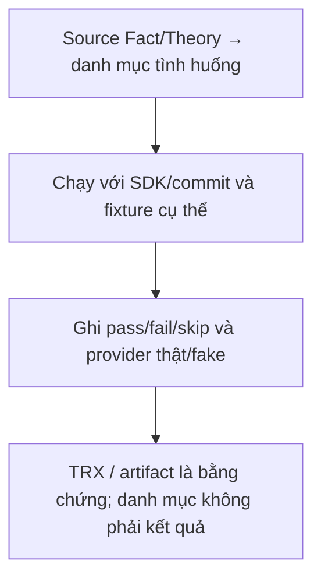

- Domain: kiểm tra invariant/state transitions trong bộ nhớ.
- Application: đa số dependency được mock/fake; chứng minh các nhánh service, không chứng minh provider thật.
- Integration WebApplicationFactory: HTTP/binding/auth/hub trong test host; cache/auth/repository có thể bị thay thế.
- Storage: đọc fixture từng file để phân biệt local filesystem và S3 mock.
- `FileCleanupQueueIntegrationTests.ConcurrentDuplicateEnqueueCreatesOneTaskWithoutFailingEitherSave` dùng PostgreSQL thật khi có `CONNECTIONSTRINGS__DEFAULTCONNECTION`; nếu thiếu env thì **return ngay** (có thể hiện pass mà không thực hiện kiểm tra DB). Nếu đặt env, test ghi rồi dọn task trong DB đó: chỉ dùng DB test được phép.
- CI hiện không khai báo PostgreSQL/Redis service container; không suy từ CI xanh ra tích hợp dịch vụ thật đã được chạy.
- Frontend hiện chỉ có lint/typecheck/build trong scripts/CI, chưa có npm test hoặc E2E browser suite.

Khi viết kết quả kiểm thử, ghi commit, SDK/runtime, lệnh, môi trường/fake/provider thật, số pass/fail/skip và artifact TRX/coverage thực tế. Chưa đo hiệu năng/load/accessibility hoặc tỷ lệ coverage thì ghi “chưa đo”, không tự điền con số.

## AuthenticationApplicationTests

Phạm vi kiểm chứng của nhóm test; sơ đồ không biểu thị test đã được chạy:

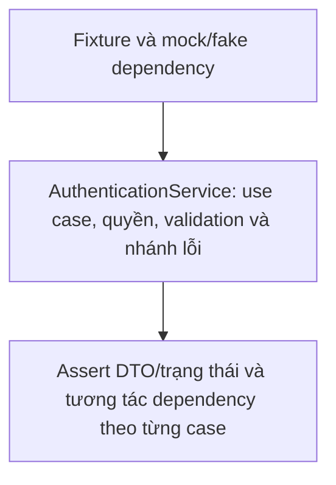

Nguồn: [AuthenticationApplicationTests.cs](<../LMS.Domain.Tests/Application/AuthenticationApplicationTests.cs>).

| Loại | Tình huống (tên test trong mã nguồn) |
| --- | --- |
| Fact | `LoginReturnsOnlyTokenMetadataAndUsesHashedPassword` |
| Fact | `RefreshTokenCanOnlyBeUsedOnce` |
| Fact | `RefreshTokenIsRejectedAfterPersistentAuthVersionChanges` |
| Fact | `RefreshTokenCanBeRetriedAfterTransientUserLookupFailure` |
| Fact | `InactiveAccountCannotLogin` |
| Fact | `OAuthLoginLinksAnExistingLocalAccountByEmail` |
| Fact | `OAuthLoginCreatesAnAccountWhenTheEmailDoesNotExist` |
| Fact | `OAuthLoginRetryReusesVerifiedIdentityAfterDatabaseFailure` |
| Fact | `OAuthLoginBoundsProviderFullNameToDatabaseColumn` |
| Fact | `OAuthLoginCodeCanOnlyBeRedeemedOnce` |
| Fact | `OAuthLoginCodeCanBeRetriedAfterTransientUserLookupFailure` |
| Fact | `ExpiredOAuthLoginCodeIsRejected` |
| Fact | `ConcurrentOAuthLoginCodeRedemptionHasExactlyOneWinner` |
| Fact | `LinkedProviderSubjectCannotBeRedirectedByEmailCollision` |
| Fact | `AuthenticatedAccountCanExplicitlyLinkAnExternalIdentity` |
| Fact | `OAuthLinkRetryReusesVerifiedIdentityAfterDatabaseFailure` |
| Fact | `ExternalIdentityCannotBeLinkedToTwoAccounts` |
| Fact | `AccessTokenContainsOnlySelectedAccountClaims` |

## ChatApplicationTests

Phạm vi kiểm chứng của nhóm test; sơ đồ không biểu thị test đã được chạy:


Nguồn: [ChatApplicationTests.cs](<../LMS.Domain.Tests/Application/ChatApplicationTests.cs>).

| Loại | Tình huống (tên test trong mã nguồn) |
| --- | --- |
| Fact | `ParticipantCanDeleteDirectConversationForThemselves` |
| Fact | `CourseConversationCannotBeDeleted` |
| Fact | `AuthenticatedUserCanCreateShortLivedRealtimeToken` |
| Fact | `HistoricalCourseParticipantMustStillHaveCurrentCourseAccess` |
| Fact | `EnrollmentFromAnotherCourseCannotAuthorizeRoomAccess` |
| Fact | `ExistingConnectionCannotSendAfterCoursePermissionIsRevoked` |
| Fact | `RoomListOmitsCourseRoomWhenCurrentCourseAccessWasRevoked` |
| Fact | `RoomListMarksRoomsThatContainUnreadMessages` |
| Fact | `RoomListIncludesLatestMessageAndSortsByRecentActivity` |
| Fact | `RoomListOmitsDeletedCourseRoomAndContinuesWithOtherRooms` |
| Fact | `RoomListOmitsRoomWhoseCourseNoLongerExistsAndContinuesWithOtherRooms` |
| Fact | `RoomAccessArchivesClosedCourseAndRestoresReopenedCourse` |
| Fact | `ArchivedCourseRoomCanBeReadButCannotBeJoinedOrWritten` |
| Fact | `DeletedCourseArchivesRoomBeforeAccessIsRejected` |
| Fact | `MissingCourseRejectsExplicitCourseRoomAccess` |
| Fact | `RoomListLoadsCoursesAndEnrollmentsInBatchedQueries` |
| Fact | `RoomListOmitsCourseRoomForTeacherWhoDoesNotOwnCourse` |
| Fact | `AuthorizedParticipantCanDownloadMessageAttachment` |
| Fact | `MessageListOmitsDeletedMessagesAndTheirAttachments` |
| Fact | `CourseMessageListIncludesSenderIdentity` |
| Fact | `AttachmentCleanupFailuresPreserveOriginalMessageSaveFailure` |
| Fact | `ReadReceiptNeverMovesBackward` |
| Fact | `DeletedMessageCannotBecomeReadReceiptTarget` |
| Fact | `GetOrCreateCourseRoomAddsBothCreatorAndTeacher` |
| Fact | `CourseParticipantIsAutomaticallyAddedWhenAccessingCourseRoom` |

## CourseApplicationTests

Phạm vi kiểm chứng của nhóm test; sơ đồ không biểu thị test đã được chạy:

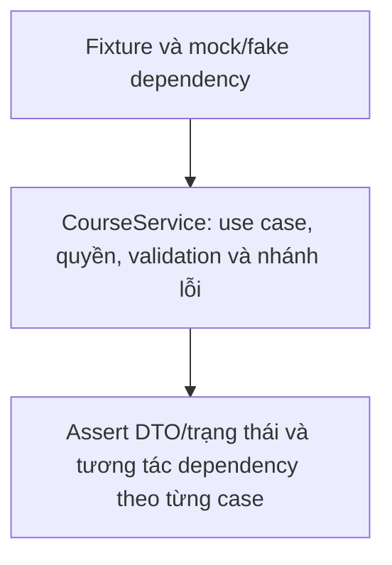

Nguồn: [CourseApplicationTests.cs](<../LMS.Domain.Tests/Application/CourseApplicationTests.cs>).

| Loại | Tình huống (tên test trong mã nguồn) |
| --- | --- |
| Fact | `TeacherCanCreateCourseAssignedToSelf` |
| Fact | `TeacherCannotCreateCourseForAnotherTeacher` |
| Fact | `InactiveTeacherCannotBeAssignedToCourse` |
| Fact | `StudentCanOnlyListOpenCourses` |
| Fact | `StudentCannotFetchClosedCourseById` |
| Fact | `StudentCanViewClosedCourseWhenEnrollmentAccepted` |
| Fact | `StudentMyCoursesIncludesAcceptedClosedCourse` |
| Fact | `CourseListsIncludeAcceptedEnrollmentCountOnly` |
| Fact | `StudentMyCoursesExcludesSoftDeletedCourse` |
| Fact | `CourseChangesSynchronizeTheCourseRoomLifecycle` |
| Fact | `StudentCanRequestEnrollmentForOpenCourse` |
| Fact | `TeacherCanAddStudentsByEmailAndReportPerEmailResults` |
| Fact | `StudentCannotAddStudentsByEmail` |
| Fact | `StudentEnrollmentListIncludesCourseSummary` |
| Fact | `DuplicateEnrollmentRequestIsRejected` |
| Fact | `CancelledEnrollmentCanBeRequestedAgainWithoutCreatingDuplicate` |
| Fact | `CourseCapacityIsCheckedBeforeAcceptingEnrollment` |
| Fact | `EnrollmentCannotBeAcceptedAfterCourseIsClosed` |
| Fact | `CourseCapacityCannotBeLoweredBelowAcceptedEnrollmentCount` |
| Fact | `AcceptEnrollmentRunsInsideSerializableTransaction` |
| Fact | `CourseTeacherReceivesStudentIdentityInEnrollmentList` |
| Fact | `StudentCannotCancelAnotherStudentsEnrollment` |

## CourseContentApplicationTests

Phạm vi kiểm chứng của nhóm test; sơ đồ không biểu thị test đã được chạy:

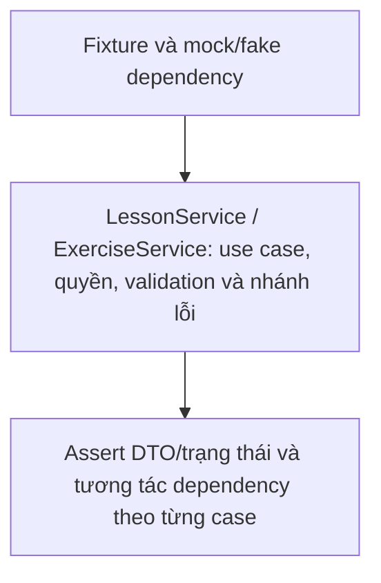

Nguồn: [CourseContentApplicationTests.cs](<../LMS.Domain.Tests/Application/CourseContentApplicationTests.cs>).

| Loại | Tình huống (tên test trong mã nguồn) |
| --- | --- |
| Fact | `UploadMaterialStoresFileBeforePersistingMetadata` |
| Fact | `UploadMaterialDeletesStoredFileWhenDatabaseSaveFails` |
| Fact | `CleanupFailuresDoNotReplaceOriginalDatabaseFailure` |
| Fact | `MaterialLargerThanCourseLimitIsRejectedBeforeStorageUpload` |
| Fact | `StudentListsOnlyPublishedLessonsWhenEnrolled` |
| Fact | `StudentCannotGetDraftLesson` |
| Fact | `StudentListsPublishedAndClosedExercisesWhenEnrolled` |
| Fact | `StudentCanGetClosedExerciseWhenEnrolled` |
| Fact | `StudentCanReadMaterialFromPublishedLessonWhenEnrolled` |
| Fact | `StudentCannotReadMaterialFromDraftLesson` |
| Fact | `DeleteLessonRemovesLessonAndStoredMaterials` |
| Fact | `PublishedExerciseCannotBeDeleted` |
| Theory | `ReleasedExerciseAttachmentCannotBeChanged` |
| Fact | `ExerciseDescriptionLongerThanDatabaseColumnIsRejected` |
| Fact | `CourseManagerCanReorderEveryLessonInCourse` |
| Fact | `ReorderingRequiresCompleteLessonList` |

## ExaminationAttemptApplicationTests

Phạm vi kiểm chứng của nhóm test; sơ đồ không biểu thị test đã được chạy:

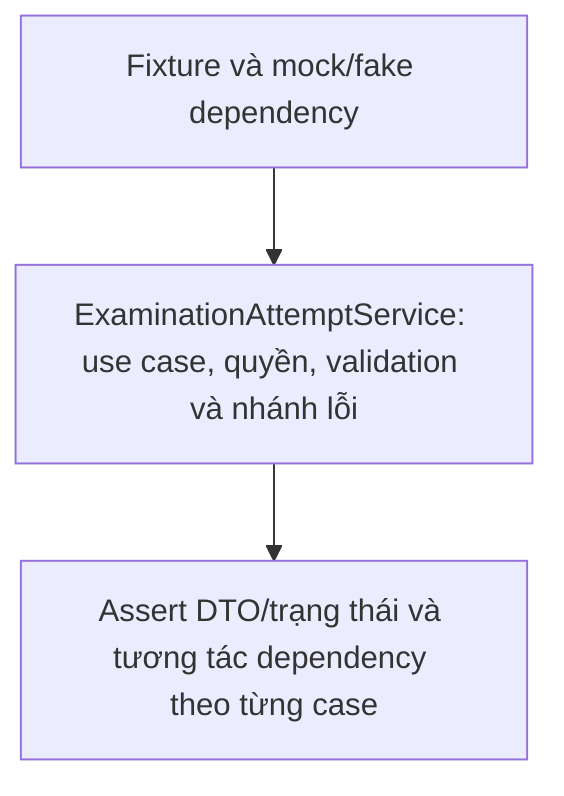

Nguồn: [ExaminationAttemptApplicationTests.cs](<../LMS.Domain.Tests/Application/ExaminationAttemptApplicationTests.cs>).

| Loại | Tình huống (tên test trong mã nguồn) |
| --- | --- |
| Fact | `AcceptedStudentCanStartAnswerAndReceiveScoreFromSnapshot` |
| Fact | `ReachingViolationLimitAutoSubmitsAttempt` |
| Fact | `DisabledViolationTypeIsRejectedWithoutChangingAttempt` |
| Fact | `FullscreenGraceDoesNotCountShortExitButCountsLongExit` |
| Fact | `DisconnectAfterDurationExpiresAutoSubmitsAttempt` |
| Fact | `ReconnectUsesTheDeadlineThatExpiredFirst` |
| Fact | `StudentMustKeepAcceptedEnrollmentDuringAttempt` |
| Fact | `ActiveAndSubmittedAttemptHideScoreWhenImmediateReleaseIsDisabled` |
| Fact | `ActiveAttemptHidesResultEvenWhenImmediateReleaseIsEnabled` |
| Fact | `HiddenScoreIsReleasedAfterExaminationDueTime` |
| Fact | `StudentCannotStartAnExaminationTwice` |
| Fact | `CourseTeacherCanDeleteAttemptAndAllowStudentToStartAgain` |
| Fact | `TeacherCannotDeleteAttemptForAnotherTeachersCourse` |
| Fact | `ResetCannotDeleteAttemptFromAnotherExamination` |
| Fact | `ResetDoesNotDeleteAttemptWhenExaminationIsNoLongerAvailable` |
| Fact | `RecoverAttemptReturnsNotFoundWhenStudentHasNotStartedExamination` |
| Theory | `AdminCannotAutoSubmitBeforeRequestedReasonApplies` |
| Fact | `AdminCanAutoSubmitAfterDurationDeadline` |
| Fact | `GetQuestionsKeepsSnapshotOrderWhenShuffleIsDisabled` |
| Fact | `GetQuestionsAppliesStablePerAttemptShuffle` |
| Fact | `AdministratorCanListClassAttemptResults` |

## ExaminationAuthoringTests

Phạm vi kiểm chứng của nhóm test; sơ đồ không biểu thị test đã được chạy:

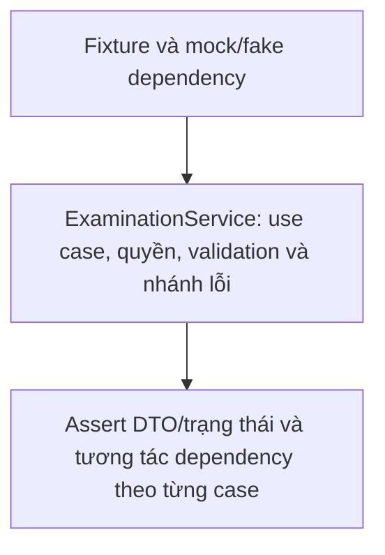

Nguồn: [ExaminationAuthoringTests.cs](<../LMS.Domain.Tests/Application/ExaminationAuthoringTests.cs>).

| Loại | Tình huống (tên test trong mã nguồn) |
| --- | --- |
| Fact | `CreateSnapshotsMultipleChoiceAndFillInBlankDefinitions` |
| Fact | `CreateRejectsRuleWhenQuestionBankHasTooFewQuestions` |
| Fact | `CreateCanSnapshotExplicitlySelectedQuestionsInRequestedOrder` |
| Fact | `UpdateQuestionSetReplacesDraftSnapshotAndSelectionRules` |
| Fact | `UpdateQuestionSetRejectsPublishedExamination` |
| Fact | `CreateRejectsMixingRandomRulesWithExplicitQuestionIds` |
| Theory | `CreateRejectsNonUtcSchedule` |
| Fact | `ExaminationFollowsDraftPublishedClosedLifecycle` |
| Fact | `ClosingExaminationAutoSubmitsEveryActiveAttempt` |

## PasswordResetApplicationTests

Phạm vi kiểm chứng của nhóm test; sơ đồ không biểu thị test đã được chạy:

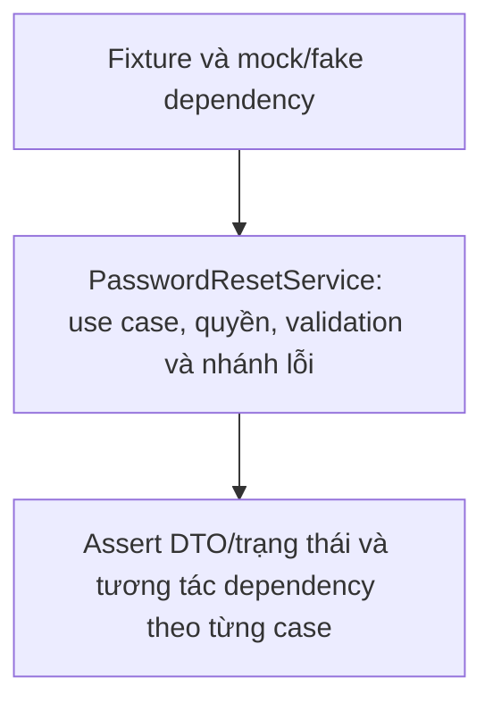

Nguồn: [PasswordResetApplicationTests.cs](<../LMS.Domain.Tests/Application/PasswordResetApplicationTests.cs>).

| Loại | Tình huống (tên test trong mã nguồn) |
| --- | --- |
| Fact | `RepeatedRequestDuringCooldownDoesNotReplaceCodeOrSendAnotherEmail` |
| Fact | `RequestingNewCodeDoesNotResetFailedAttemptLimit` |
| Fact | `ResetCodeAndPasswordAreRestoredWhenDatabaseSaveFails` |
| Fact | `CacheCleanupFailureAfterCommitDoesNotChangeSuccessfulResetResult` |
| Fact | `ForgotPasswordCanBeRetriedImmediatelyAfterMailFailure` |

## QuestionApplicationTests

Phạm vi kiểm chứng của nhóm test; sơ đồ không biểu thị test đã được chạy:

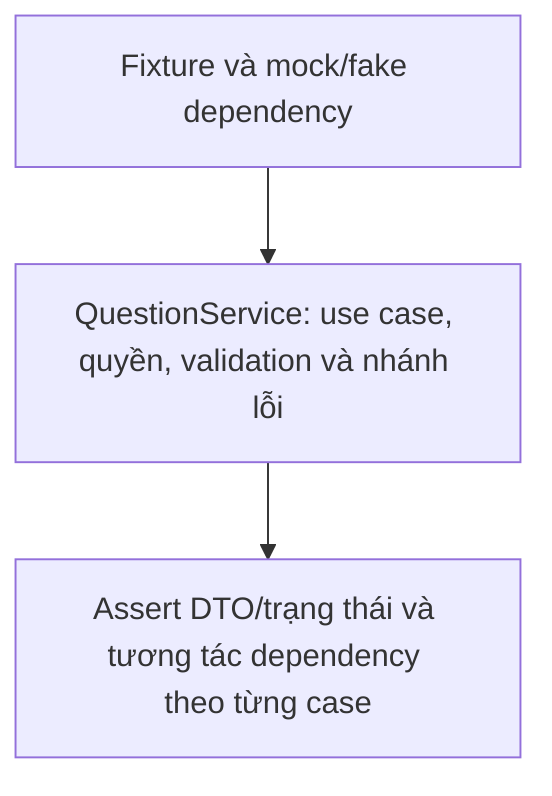

Nguồn: [QuestionApplicationTests.cs](<../LMS.Domain.Tests/Application/QuestionApplicationTests.cs>).

| Loại | Tình huống (tên test trong mã nguồn) |
| --- | --- |
| Fact | `MultipleChoiceRequiresExactlyOneCorrectOption` |
| Fact | `MultipleChoicePersistsOptionsThenCorrectOptionInsideTransaction` |
| Fact | `MultipleChoiceBuildsFreshAggregateWhenTransactionIsRetried` |
| Fact | `FillInBlankUsesAnswerKeysAndDisablesOptionShuffle` |
| Fact | `UpdateQuestionChangesOnlyEditableSourceFields` |
| Fact | `UpdateMultipleChoiceReplacesOptionsAndCorrectOption` |
| Fact | `UpdateMultipleChoiceRejectsInvalidCorrectOptionCount` |
| Fact | `UpdateFillInBlankReplacesAnswersAndRejectsOptions` |
| Fact | `DeleteQuestionRemovesSourceQuestion` |
| Fact | `DeleteMultipleChoiceQuestionClearsCorrectOptionBeforeRemovingQuestion` |
| Fact | `ReferencedQuestionBankCannotBeDeleted` |
| Theory | `AdministratorsCanListAllQuestionBanksAndFilterByOwner` |
| Theory | `AdministratorsCanReadQuestionsOwnedByAnotherUser` |
| Theory | `AdministratorsCannotMutateQuestionBanksOrQuestions` |

## RegistrationApplicationTests

Phạm vi kiểm chứng của nhóm test; sơ đồ không biểu thị test đã được chạy:

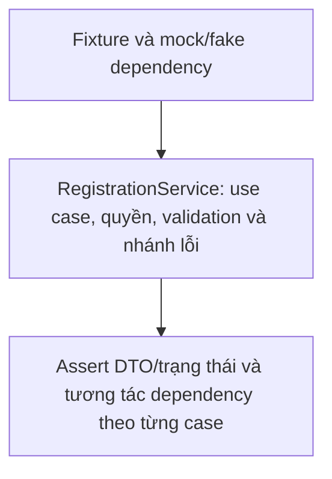

Nguồn: [RegistrationApplicationTests.cs](<../LMS.Domain.Tests/Application/RegistrationApplicationTests.cs>).

| Loại | Tình huống (tên test trong mã nguồn) |
| --- | --- |
| Fact | `RegisterCreatesInactiveAccountAndSendsExpiringCode` |
| Fact | `RegisterRejectsFullNameLongerThanDatabaseColumn` |
| Theory | `RegisterRejectsBlankFullName` |
| Fact | `RegisterRejectsPhoneLongerThanDatabaseColumn` |
| Fact | `RegisterAfterMailFailureRequiresTheExistingAccountResendFlow` |
| Fact | `RepeatedRegisterDuringCooldownDoesNotReplaceVerificationCode` |
| Fact | `RegisterRetryWithDifferentPasswordIsRejectedWithoutReplacingCode` |
| Fact | `CorrectCodeActivatesAccountAndRemovesVerificationState` |
| Fact | `ResendIsThrottledAndInvalidCodeIsCounted` |
| Theory | `NonInactiveAccountCannotVerifyOrRequestNewCode` |
| Fact | `ExpiredVerificationCodeIsRejected` |
| Fact | `UsedVerificationCodeCannotBeReused` |
| Fact | `VerificationCodeIsRestoredWhenDatabaseSaveFails` |
| Fact | `ConcurrentVerificationCodeRedemptionHasExactlyOneWinner` |

## SubmissionApplicationTests

Phạm vi kiểm chứng của nhóm test; sơ đồ không biểu thị test đã được chạy:

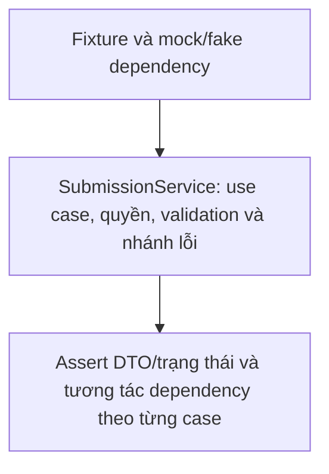

Nguồn: [SubmissionApplicationTests.cs](<../LMS.Domain.Tests/Application/SubmissionApplicationTests.cs>).

| Loại | Tình huống (tên test trong mã nguồn) |
| --- | --- |
| Fact | `StudentCanRecoverOwnSubmissionAfterReload` |
| Fact | `CourseTeacherCanListAndGradeSubmittedWork` |
| Fact | `StudentCannotUnsubmitGradedWork` |
| Fact | `CourseTeacherCanDownloadSubmissionAttachment` |
| Fact | `UploadRejectsAndCleansNewFileWhenSubmissionIsSubmittedConcurrently` |
| Fact | `FirstUploadReturnsPersistedAttachment` |
| Fact | `GradeRechecksStatusInsideSerializableTransaction` |

## UserApplicationTests

Phạm vi kiểm chứng của nhóm test; sơ đồ không biểu thị test đã được chạy:

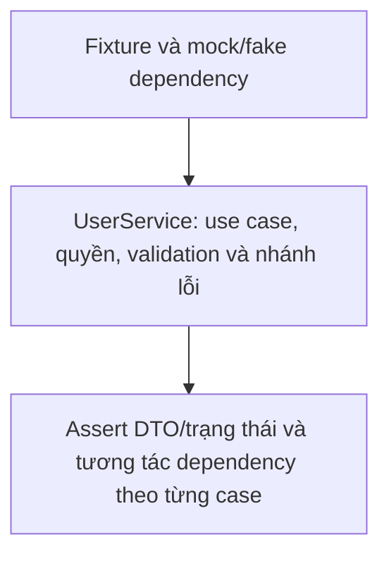

Nguồn: [UserApplicationTests.cs](<../LMS.Domain.Tests/Application/UserApplicationTests.cs>).

| Loại | Tình huống (tên test trong mã nguồn) |
| --- | --- |
| Fact | `ListUsersAppliesRoleAndStatusFiltersToPageAndCount` |
| Fact | `AdminCannotDemoteAnotherAdministrator` |
| Fact | `AdminCannotEditOwnAdministratorAccount` |
| Fact | `AdminCannotChangeAnotherAdministratorStatus` |
| Fact | `SystemCanDemoteAdministratorWhenAnotherAdministratorRemains` |
| Fact | `SystemCannotDisableLastActiveAdministrator` |
| Fact | `AdminCannotCreateAnotherAdministrator` |
| Fact | `SystemCanCreateAnAdministrator` |
| Fact | `SystemRoleCannotBeAssignedThroughUserCreation` |
| Fact | `SystemCannotModifySystemAccount` |
| Fact | `AdminCannotChangeTeacherIntoAdministrator` |
| Fact | `TeacherWithOwnedCourseCannotBeDisabled` |
| Fact | `AdminCreateRejectsUndefinedRole` |
| Fact | `AdminCreateRejectsPhoneLongerThanDatabaseColumn` |
| Fact | `AdminCreateRejectsEmailLongerThanDatabaseColumn` |
| Fact | `AuthenticatedUserCanUpdateOwnProfile` |
| Theory | `ProfileReportsWhetherGoogleAccountIsLinked` |
| Fact | `LocalUserCanChangePasswordAndRevokeAllSessions` |
| Fact | `ChangePasswordRejectsIncorrectCurrentPassword` |
| Fact | `OAuthOnlyUserCanCreateLocalPassword` |
| Fact | `ChatSearchReturnsMinimalProfileForAnotherActiveUser` |
| Fact | `ChatSearchRejectsSearchingForSelf` |
| Fact | `ChatNameSearchReturnsLimitedMinimalProfiles` |
| Theory | `ChatNameSearchRejectsShortQueries` |

## ChatMessageTests

Phạm vi kiểm chứng của nhóm test; sơ đồ không biểu thị test đã được chạy:

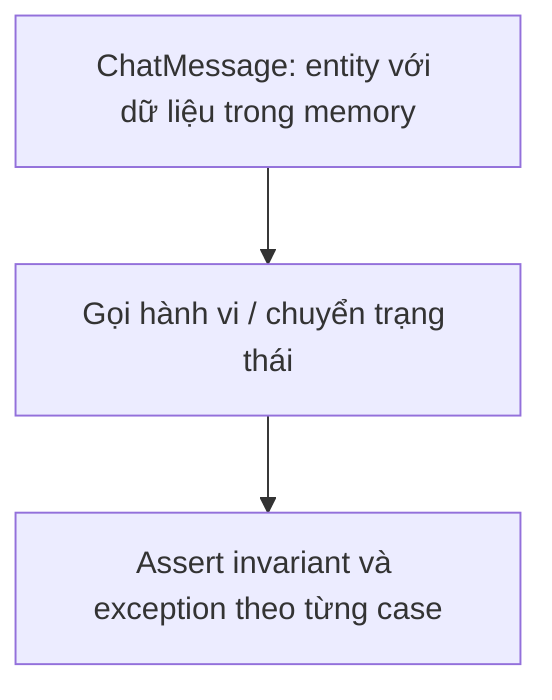

Nguồn: [ChatMessageTests.cs](<../LMS.Domain.Tests/Chats/ChatMessageTests.cs>).

| Loại | Tình huống (tên test trong mã nguồn) |
| --- | --- |
| Fact | `TextMessageAcceptsEmojiContent` |
| Fact | `EmptyTextMessageIsRejected` |
| Fact | `AttachmentMessageAcceptsFileSmallerThanTwentyMegabytes` |
| Theory | `InvalidAttachmentSizeIsRejected` |
| Fact | `DeletedMessageCannotBeEdited` |
| Fact | `ContentLongerThanDatabaseColumnIsRejectedForCreateAndEdit` |

## ChatRoomTests

Phạm vi kiểm chứng của nhóm test; sơ đồ không biểu thị test đã được chạy:

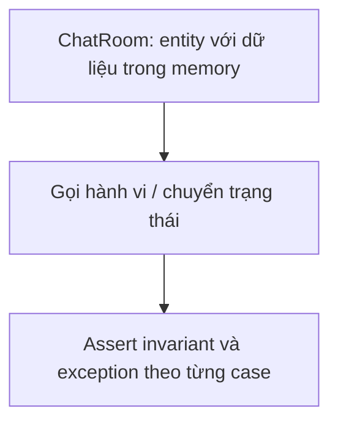

Nguồn: [ChatRoomTests.cs](<../LMS.Domain.Tests/Chats/ChatRoomTests.cs>).

| Loại | Tình huống (tên test trong mã nguồn) |
| --- | --- |
| Fact | `DirectMessageKeyIsIndependentOfUserOrder` |
| Fact | `DirectMessageRoomContainsExactlyTwoParticipants` |
| Fact | `DirectMessageRoomRejectsSameUser` |
| Fact | `DirectConversationCanBeClearedAndRevealedForOneParticipant` |
| Fact | `CourseParticipantIsAddedIdempotently` |
| Fact | `CourseRoomFollowsCourseStatusAndDeletionLifecycle` |

## CourseTests

Phạm vi kiểm chứng của nhóm test; sơ đồ không biểu thị test đã được chạy:

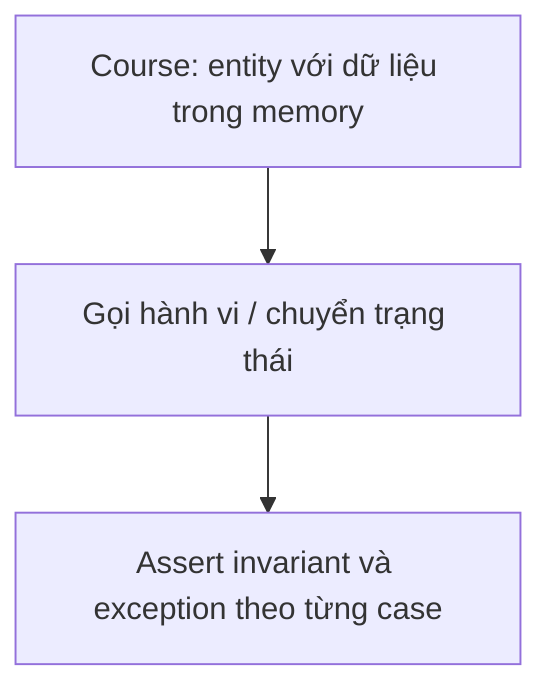

Nguồn: [CourseTests.cs](<../LMS.Domain.Tests/Courses/CourseTests.cs>).

| Loại | Tình huống (tên test trong mã nguồn) |
| --- | --- |
| Fact | `DeleteAndRestorePreserveCourseStatus` |
| Fact | `DeleteAlreadyDeletedCourseThrows` |

## EnrollmentTests

Phạm vi kiểm chứng của nhóm test; sơ đồ không biểu thị test đã được chạy:

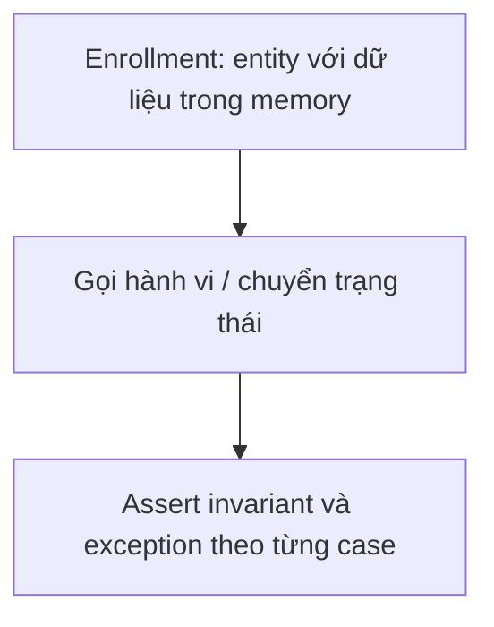

Nguồn: [EnrollmentTests.cs](<../LMS.Domain.Tests/Courses/EnrollmentTests.cs>).

| Loại | Tình huống (tên test trong mã nguồn) |
| --- | --- |
| Theory | `WaitingEnrollmentCanReachTerminalStatus` |
| Fact | `AcceptedEnrollmentCanBeCancelledAndRequestedAgain` |

## SubmissionTests

Phạm vi kiểm chứng của nhóm test; sơ đồ không biểu thị test đã được chạy:

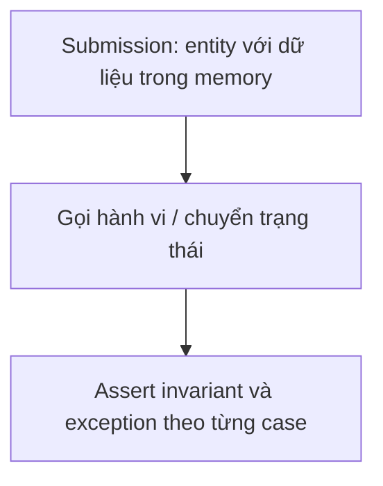

Nguồn: [SubmissionTests.cs](<../LMS.Domain.Tests/Courses/SubmissionTests.cs>).

| Loại | Tình huống (tên test trong mã nguồn) |
| --- | --- |
| Fact | `UnsubmitReturnsSubmissionToCleanDraftState` |

## ExaminationAttemptTests

Phạm vi kiểm chứng của nhóm test; sơ đồ không biểu thị test đã được chạy:

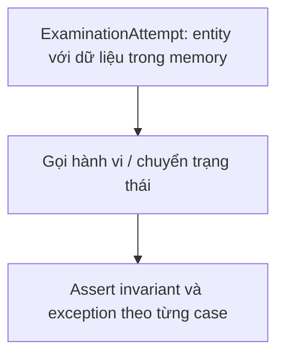

Nguồn: [ExaminationAttemptTests.cs](<../LMS.Domain.Tests/Examinations/ExaminationAttemptTests.cs>).

| Loại | Tình huống (tên test trong mã nguồn) |
| --- | --- |
| Fact | `DisconnectAndReconnectPreserveActiveAttempt` |
| Fact | `SubmittedAttemptCannotBeSubmittedAgain` |

## AuthenticationApiTests

Phạm vi kiểm chứng của nhóm test; sơ đồ không biểu thị test đã được chạy:

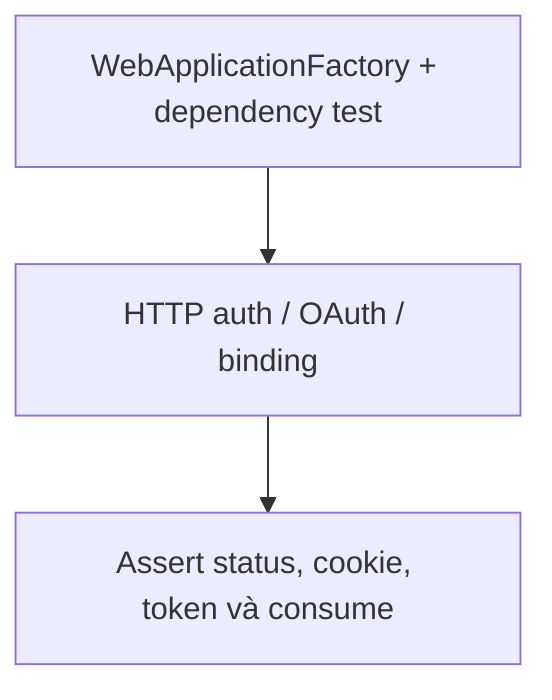

Nguồn: [AuthenticationApiTests.cs](<../LMS.Domain.Tests/Integration/AuthenticationApiTests.cs>).

| Loại | Tình huống (tên test trong mã nguồn) |
| --- | --- |
| Fact | `ProtectedEndpointRequiresBearerToken` |
| Fact | `LoginResponseContainsTokensButDoesNotExposeAccountProfile` |
| Fact | `RefreshEndpointReturnsRotatedTokenPair` |
| Fact | `AdminOnlyEndpointRejectsStudentRole` |
| Fact | `MissingMultipartFileReturnsBadRequest` |
| Fact | `OAuthCallbackRequiresTheBrowserThatStartedTheFlow` |
| Fact | `OAuthAuthorizeUsesRandomStateAndSecureHttpOnlyBrowserCookie` |
| Fact | `OAuthCallbackRejectsBindingCookieFromAnotherFlow` |
| Fact | `OAuthCallbackRejectsMissingWrongAndExpiredState` |
| Fact | `OAuthStateCanOnlyBeRedeemedOnce` |
| Fact | `ConcurrentOAuthStateRedemptionHasOneWinner` |
| Fact | `OAuthLoginCallbackReturnsOnlyApplicationLoginCodeInBody` |
| Fact | `OAuthLoginCodeCanBeExchangedOnceForTokenPair` |
| Fact | `ExpiredOAuthLoginCodeIsRejected` |
| Fact | `ConcurrentOAuthLoginCodeRedemptionHasOneWinner` |
| Fact | `OAuthLinkMustBeStartedByAnAuthenticatedAccount` |
| Fact | `OAuthLinkCallbackUsesTheAccountCapturedAtAuthenticatedStart` |

## FileCleanupQueueIntegrationTests

Phạm vi kiểm chứng của nhóm test; sơ đồ không biểu thị test đã được chạy:

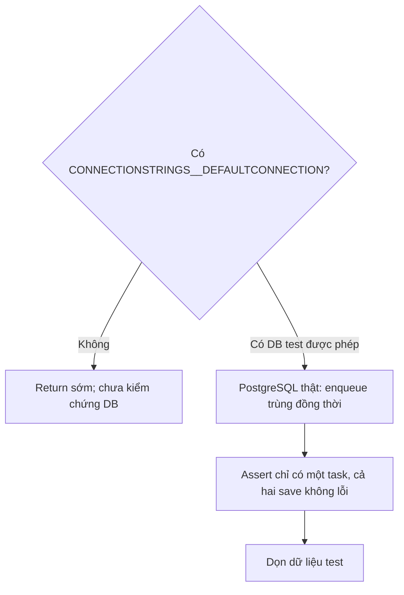

Nguồn: [FileCleanupQueueIntegrationTests.cs](<../LMS.Domain.Tests/Integration/FileCleanupQueueIntegrationTests.cs>).

| Loại | Tình huống (tên test trong mã nguồn) |
| --- | --- |
| Fact | `ConcurrentDuplicateEnqueueCreatesOneTaskWithoutFailingEitherSave` |

## JsonContractTests

Phạm vi kiểm chứng của nhóm test; sơ đồ không biểu thị test đã được chạy:

```mermaid
flowchart TD
    N0["JSON serializer options"]
    N1["Serialize/deserialize enum"]
    N2["Assert tên enum trong request/response"]
    N0 --> N1
    N1 --> N2
```

Nguồn: [JsonContractTests.cs](<../LMS.Domain.Tests/Integration/JsonContractTests.cs>).

| Loại | Tình huống (tên test trong mã nguồn) |
| --- | --- |
| Fact | `EnumsUseNamesInRequestsAndResponses` |

## SignalRAuthenticationTests

Phạm vi kiểm chứng của nhóm test; sơ đồ không biểu thị test đã được chạy:

```mermaid
flowchart TD
    N0["Test host + JWT + SignalR client"]
    N1["Negotiate/connect/reconnect/protected hub method"]
    N2["Assert token scope, expiry và AuthVersion"]
    N0 --> N1
    N1 --> N2
```

Nguồn: [SignalRAuthenticationTests.cs](<../LMS.Domain.Tests/Integration/SignalRAuthenticationTests.cs>).

| Loại | Tình huống (tên test trong mã nguồn) |
| --- | --- |
| Theory | `QueryAccessTokenIsAcceptedOnlyForChatHub` |
| Fact | `ChatHubClosesConnectionsWhenAuthenticationExpires` |
| Fact | `ChatHubNegotiationRejectsMissingInvalidAndExpiredBearerTokens` |
| Fact | `NativeBearerHeaderCanAuthenticateHubNegotiation` |
| Fact | `ShortLivedChatTokenAuthenticatesHubButNotRestApi` |
| Fact | `PersistentAuthVersionRevokesExistingAccessToken` |
| Fact | `AuthenticatedClientCanConnectReconnectAndInvokeProtectedHubMethod` |
| Fact | `EstablishedHubConnectionClosesWhenJwtExpires` |

## AppDbContextModelTests

Phạm vi kiểm chứng của nhóm test; sơ đồ không biểu thị test đã được chạy:

```mermaid
flowchart TD
    N0["AppDbContext relational model"]
    N1["Index, entity, create script, concurrency và policy"]
    N2["Assert metadata; không suy ra DB production đã migrate"]
    N0 --> N1
    N1 --> N2
```

Nguồn: [AppDbContextModelTests.cs](<../LMS.Domain.Tests/Persistence/AppDbContextModelTests.cs>).

| Loại | Tình huống (tên test trong mã nguồn) |
| --- | --- |
| Fact | `ModelContainsEveryDomainEntity` |
| Fact | `CriticalBusinessIndexesAreUnique` |
| Fact | `RelationalModelGeneratesCreateScript` |
| Fact | `SubmissionUsesPostgresRowVersionForOptimisticConcurrency` |
| Fact | `UserAuthVersionIsPersistentAndConcurrencyProtected` |
| Theory | `TransactionRetryOnlyHandlesConcurrencySqlStates` |
| Theory | `OnlyAllowlistedUniqueConstraintsAreBusinessConflicts` |

## ChatsControllerTests

Phạm vi kiểm chứng của nhóm test; sơ đồ không biểu thị test đã được chạy:

```mermaid
flowchart TD
    N0["Mock ChatService và hub context"]
    N1["Controller lưu qua service rồi broadcast"]
    N2["Assert response và event/payload"]
    N0 --> N1
    N1 --> N2
```

Nguồn: [ChatsControllerTests.cs](<../LMS.Domain.Tests/Presentation/ChatsControllerTests.cs>).

| Loại | Tình huống (tên test trong mã nguồn) |
| --- | --- |
| Fact | `DeleteDirectConversationReturnsNoContent` |
| Fact | `RestTextMessageBroadcastsToRoomAfterSave` |
| Fact | `EditMessageBroadcastsUpdatedPayload` |
| Fact | `DeleteMessageBroadcastsMessageId` |

## FileCleanupTaskTests

Phạm vi kiểm chứng của nhóm test; sơ đồ không biểu thị test đã được chạy:

```mermaid
flowchart TD
    N0["FileCleanupTask trong memory"]
    N1["RecordFailure và next attempt"]
    N2["Assert lỗi và lịch retry được giữ"]
    N0 --> N1
    N1 --> N2
```

Nguồn: [FileCleanupTaskTests.cs](<../LMS.Domain.Tests/Storage/FileCleanupTaskTests.cs>).

| Loại | Tình huống (tên test trong mã nguồn) |
| --- | --- |
| Fact | `FailureIsRetainedForADeferredRetry` |

## LocalFileStorageTests

Phạm vi kiểm chứng của nhóm test; sơ đồ không biểu thị test đã được chạy:

```mermaid
flowchart TD
    N0["Temporary filesystem + upload streams"]
    N1["LocalFileStorage validate / write / read / delete"]
    N2["Assert bytes, size và path traversal"]
    N0 --> N1
    N1 --> N2
```

Nguồn: [LocalFileStorageTests.cs](<../LMS.Domain.Tests/Storage/LocalFileStorageTests.cs>).

| Loại | Tình huống (tên test trong mã nguồn) |
| --- | --- |
| Fact | `CourseUploadHasNoApplicationSizeLimitButChatUploadDoes` |
| Fact | `CourseUploadRejectsConfiguredMaximumSize` |
| Fact | `DeleteRejectsPathTraversal` |
| Fact | `UploadAndDeleteUseConfiguredStorageRoot` |
| Fact | `OpenReadReturnsStoredContent` |
| Fact | `OpenReadRejectsPathTraversal` |
| Fact | `UploadRejectsContentThatExceedsDeclaredLength` |

## S3FileStorageTests

Phạm vi kiểm chứng của nhóm test; sơ đồ không biểu thị test đã được chạy:

```mermaid
flowchart TD
    N0["Mock IAmazonS3 + storage options"]
    N1["S3FileStorage tạo request upload/read/delete"]
    N2["Assert SDK request; không gọi bucket thật"]
    N0 --> N1
    N1 --> N2
```

Nguồn: [S3FileStorageTests.cs](<../LMS.Domain.Tests/Storage/S3FileStorageTests.cs>).

| Loại | Tình huống (tên test trong mã nguồn) |
| --- | --- |
| Fact | `UploadSendsValidatedObjectRequest` |
| Fact | `DeleteNormalizesSeparatorsAndSendsRequest` |
| Fact | `OpenReadNormalizesSeparatorsAndReturnsResponseStream` |
| Fact | `DeleteRejectsPathTraversalBeforeCallingS3` |
| Fact | `DisabledS3RegistersLocalStorage` |
| Fact | `EnabledS3RegistersS3Storage` |

Tổng **246 phương thức Fact/Theory** trong **26 file test**; không tính helper/fixture và không nhân Theory theo InlineData.
