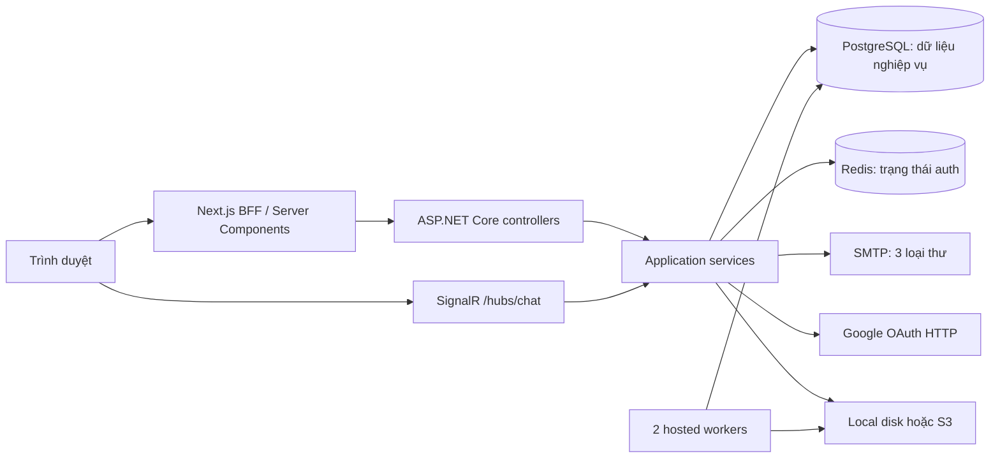
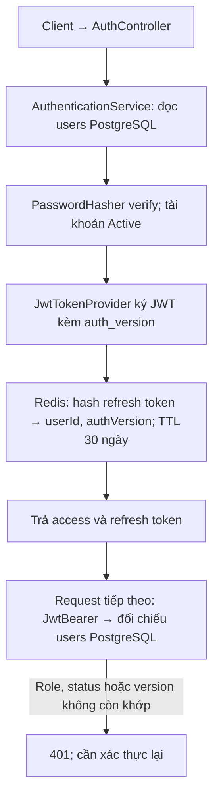
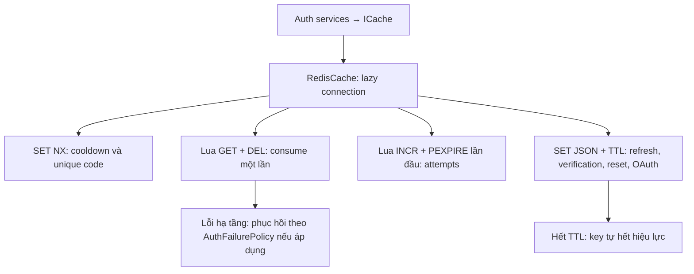
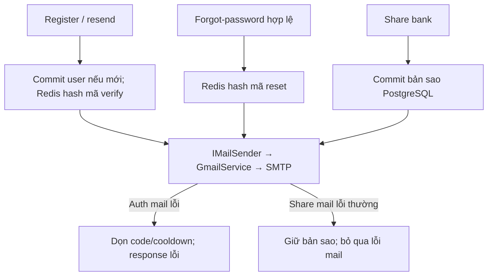
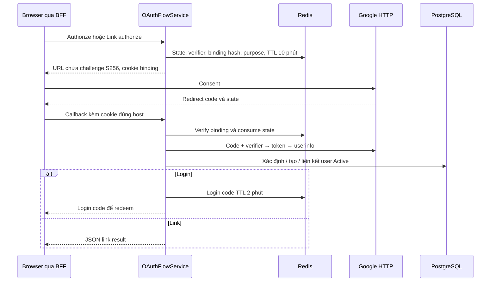
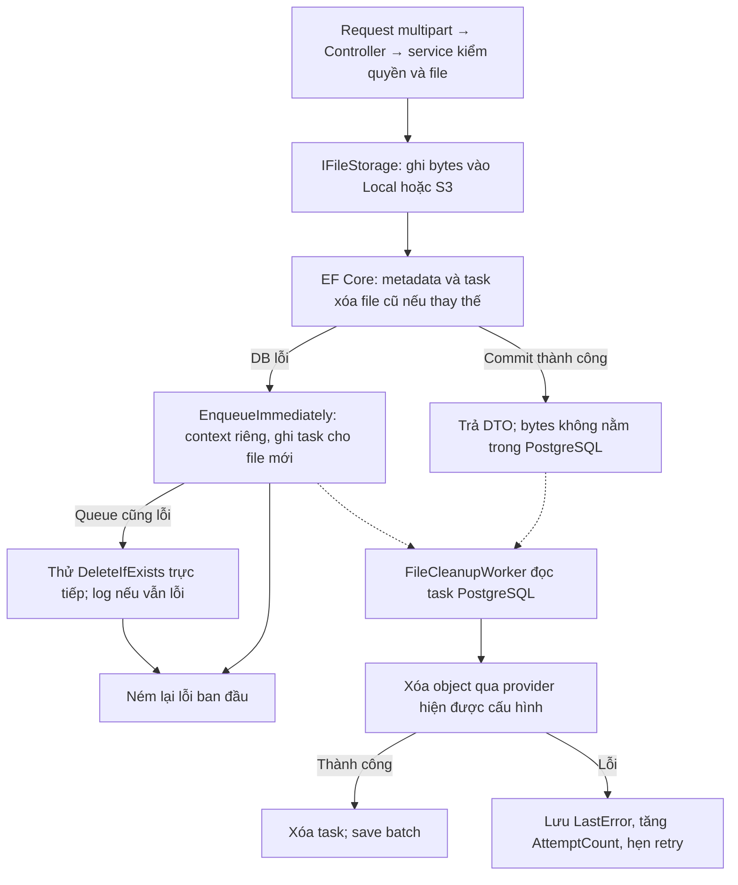
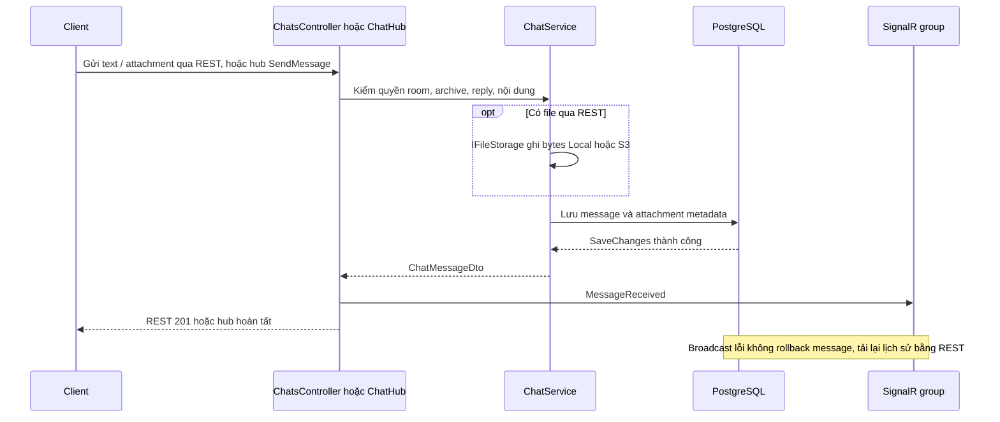
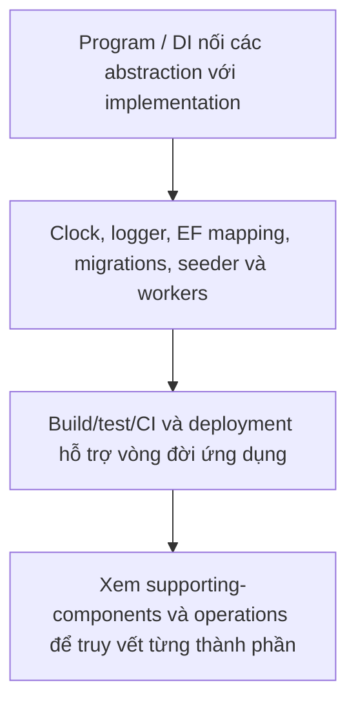

# Công cụ, tích hợp và nơi sử dụng

Đối chiếu mã nguồn ngày **2026-10-13**. “Phiên bản hiện tại” là phiên bản trong repository, không phải bản mới nhất trên registry. Không cần nâng dependency để sử dụng tài liệu này. Tra mọi action ở [API index](api/endpoint-index.md), trường dữ liệu ở [contracts](api/contracts.md), thành phần phụ ở [supporting-components](architecture/supporting-components.md).

## 1. Bản đồ tổng thể

JWT được kiểm tra trước controller/hub, quyền nghiệp vụ được kiểm tra trong service. Không có message broker; Redis không đóng vai trò hàng đợi mail, kho bài thi hay SignalR backplane.

| Công cụ | Phiên bản khai báo / cấu hình | Nơi và thời điểm dùng |
| --- | --- | --- |
| .NET / ASP.NET Core | Target `net10.0`; runtime image `10.0` | Chạy API, DI, controller, middleware, background service, SignalR |
| EF Core / Npgsql | `10.0.11` / `10.0.1` | Mọi dữ liệu nghiệp vụ; migrate lúc startup; transaction, unique index, concurrency |
| PostgreSQL | Dev `postgres:17`; prod `postgres:17-alpine` | Nguồn dữ liệu bền vững, kể cả auth version và cleanup queue |
| StackExchange.Redis / Redis | `3.1.31` / `redis:8-alpine` | Auth state, mã một lần, cooldown/counter; kết nối lazy |
| JwtBearer | `10.0.11` | Bảo vệ REST và hub; HS256, đối chiếu user DB |
| ASP.NET Core PasswordHasher | API của shared framework | Hash mật khẩu và mã xác thực/reset; không mã hóa có thể giải ngược |
| SMTP | `System.Net.Mail`, mặc định Gmail 587 + TLS | Register/resend, forgot-password, share bank |
| Google OAuth | `HttpClient`, timeout 10 giây | Authorize/callback/login/link, Authorization Code + PKCE |
| AWSSDK.S3 | `4.0.102.4` | Upload/read/delete file khi `S3Storage:Enabled=true` |
| DotNetEnv | `3.2.0` | Nạp `.env` lúc API startup và design-time factory |
| OpenAPI / Swashbuckle | `10.0.11` / `10.2.3` | `/openapi/v1.json`, `/swagger`, chỉ Development |
| Next / React | `16.4.0` / `19.3.0` | Giao diện, BFF, server render |
| SignalR JS | Khai báo `^10.0.11` | Browser chat realtime; phiên bản resolve xem package-lock |
| jose | Khai báo `^6.2.12` | Decode user ID từ cookie JWT trên Next server; backend mới verify chữ ký |
| ExcelJS | Khai báo `^4.4.0` | Import users/questions, xuất mẫu và kết quả thi ngay trên browser |
| Tailwind, Radix, RHF/Zod, next-themes | Xem package.json/package-lock | Style, dialog/dropdown, validate form, theme; không thay quyền backend |
| Docker Compose / nginx / GHCR / Actions | Image nginx `1.27-alpine`, Node `22-alpine` | Đóng gói, reverse proxy TLS/WebSocket, build/test/publish/deploy |

Nguồn phiên bản: [csproj](../LMS.Api/LMS.Api.csproj), [test csproj](../LMS.Domain.Tests/LMS.Domain.Tests.csproj), [frontend package.json](../../frontend/package.json), [lockfile](../../frontend/package-lock.json), [Compose production](../docker-compose.prod.yml). Các tag Docker major/minor không pin digest.

## 2. JWT, refresh token và cookie

Luồng xử lý và dữ liệu:

Nguồn: [JwtTokenProvider](../LMS.Api/infrastructure/authentication/JWT/JwtTokenProvider.cs), [đăng ký JwtBearer](../LMS.Api/infrastructure/DependencyInjection.cs), [AuthenticationService](../LMS.Api/application/features/auth/AuthenticationService.cs).

| Trường hợp | API / điểm kích hoạt | Hành vi |
| --- | --- | --- |
| Login local | `POST /api/auth/login` | Verify password + Active → JWT và refresh session Redis |
| Login Google hoàn tất | `POST /api/auth/login-code` | Consume code Redis → đọc user Active → JWT và refresh mới |
| Refresh | `POST /api/auth/refresh` | Consume refresh cũ, so AuthVersion DB → cặp mới; TTL refresh mới lại 30 ngày |
| REST được bảo vệ | Tất cả controller ngoài auth public | Validate signature/issuer/audience/expiry; đọc user và so Active, role, auth_version |
| Chat realtime | `POST /api/chat/realtime-token` | JWT 2 phút với `token_use=chat_realtime`; không tạo refresh session riêng |
| SignalR handshake | `/hubs/chat` và negotiate | Bearer hoặc query access_token; realtime token bị từ chối ở REST |
| Đổi password/role/status | `/api/users/me/password`, `/api/users/{id}`, `/api/users/{id}/status`, `/api/auth/reset-password` | Tăng AuthVersion cùng commit thay đổi bảo mật; token cũ không qua lần kiểm tra tiếp theo |
| Logout giao diện | Next `POST /api/auth/logout` | Chỉ xóa cookie; không xóa refresh Redis hoặc tăng AuthVersion backend |

Access JWT sống mặc định 60 phút, clock skew validate 30 giây. Claims được tạo bằng `ClaimTypes.NameIdentifier`, Email, Role, `auth_version`, `jti`; serialization JWT có thể map tên claim chuẩn. Refresh là 64 byte ngẫu nhiên base64, không phải JWT; Redis key dùng SHA-256 token, value `{userId, authVersion}`.

JWT signing key tối thiểu 32 byte; `SET_VIA_ENVIRONMENT` hoặc key ngắn làm startup lỗi. Frontend giữ access/refresh trong cookie HttpOnly (`SameSite=Lax`, `/`, Secure ở production); chỉ realtime JWT được trả cho JS và giữ trong closure. `decodeJwt` không verify chữ ký; `/users/{id}/profile` của backend xác thực lại. Chi tiết hạn chế refresh: [frontend integration](../../frontend/docs/api-integration.md).

## 3. Redis: đủ các key, API, TTL và cơ chế

Luồng xử lý và dữ liệu:

Nguồn: [AuthCacheKeys](../LMS.Api/application/features/auth/utils/AuthCacheKeys.cs), [entries](../LMS.Api/application/features/auth/utils/AuthCacheEntries.cs), [RedisCache](../LMS.Api/infrastructure/caching/Redis/RedisCache.cs). `{id:N}` là GUID 32 ký tự không gạch.

| Key | Giá trị | TTL lúc tạo | Ghi / đọc / xóa trong tình huống nào |
| --- | --- | --- | --- |
| `auth:refresh:{sha256(token)}` | userId, authVersion | 30 ngày | Login/login-code/refresh tạo; refresh consume |
| `auth:email-verification:{id:N}` | userId, email, codeHash | 15 phút | Register/resend tạo; verify đọc, verify đúng consume; quá attempts hoặc SMTP lỗi xóa |
| `auth:email-verification-attempts:{id:N}` | Counter | 15 phút từ INCR đầu | Verify tăng; lần 6 chặn; tạo mã mới hoặc verify thành công xóa |
| `auth:email-verification-cooldown:{id:N}` | true | 1 phút | Register/resend SET NX; đã có → 409; SMTP lỗi/verify thành công xóa |
| `auth:password-reset:{id:N}` | userId, email, codeHash | 15 phút | Forgot tạo; reset đọc/consume; SMTP lỗi/quá attempts xóa |
| `auth:password-reset-attempts:{id:N}` | Counter | 15 phút từ INCR đầu | Reset tăng; lần 6 chặn; reset thành công xóa; forgot không reset counter |
| `auth:password-reset-cooldown:{id:N}` | true | 1 phút | Forgot SET NX; đã có → accepted=true không gửi; SMTP lỗi/reset thành công xóa |
| `auth:oauth-state:{state}` | provider, redirectUri, codeVerifier, browserBindingHash, purpose, userId? | 10 phút | Authorize/link-authorize tạo; callback so cookie/provider rồi consume |
| `auth:oauth-identity:{sha256(binding)}` | externalInfo đã verify | 10 phút | Callback lưu sau Google userinfo để thử lại khi DB lỗi; thành công dọn best-effort |
| `auth:oauth-login-code:{sha256(code)}` | userId | 2 phút | Callback login tạo SET NX; login-code consume |

`binding` của identity gồm provider, code, redirect URI và code verifier với định dạng có độ dài. Đây không phải chính browser-binding cookie.

`Get` đọc JSON camelCase, `Set` ghi kèm TTL, `SetIfNotExists` dùng SET NX giữ cooldown và mã duy nhất. `Consume` dùng Lua GET+DEL atomic; `Increment` dùng Lua INCR và chỉ đặt PEXPIRE khi giá trị bằng 1. Counter đếm các lần kiểm tra sau khi entry tồn tại, không chỉ các lần sai.

Refresh/login-code/state được phục hồi bằng SET NX TTL 1 phút nếu lỗi sau consume không thuộc BadRequest/Unauthorized/Forbidden/NotFound/Conflict. Verification/reset có nhánh phục hồi TTL 15 phút khi DB save lỗi. Redis lỗi trả 500, không fallback memory. DB users, bài nộp, câu hỏi và tin nhắn không bị mất khi Redis mất dữ liệu; người dùng mất refresh/mã/OAuth đang chờ. Access JWT hiện hữu vẫn có thể qua backend nếu còn hạn và user DB hợp lệ.

Dev/prod bật AOF trong Compose; prod có requirepass và volume. Không coi AOF là backup đầy đủ, không flush Redis để sửa một phiên. Rate limiter của API nằm trong memory process, không dùng Redis.

## 4. Mail: ba loại thư, không có mail worker

Luồng xử lý và dữ liệu:

Nguồn: [IMailSender](../LMS.Api/application/abstractions/mail/IMailSender.cs), [GmailService](../LMS.Api/infrastructure/mail/Gmail/GmailService.cs), [MailOptions](../LMS.Api/infrastructure/mail/Gmail/MailOptions.cs).

| Mail | Khi nào và API | Người nhận / thứ tự | Nếu gửi lỗi |
| --- | --- | --- | --- |
| Verify your LMS account | `POST /api/auth/register`, `/resend-verification` | User local Inactive; commit user → cache mã → SMTP | Dọn code/attempts/cooldown rồi ném lỗi; user đã tạo vẫn Inactive |
| Reset your LMS password | `POST /api/auth/forgot-password` | Chỉ local Active có password, không cooldown; cache mã → SMTP | Dọn code/cooldown rồi ném lỗi; không có mail khi email không tồn tại/OAuth-only/inactive/cooldown |
| A question bank was shared with you | `POST /api/question-banks/{id}/share` | Teacher Active nhận bản sao; transaction DB commit trước SMTP | Lỗi thường bị bỏ qua; request cancellation có thể lan ra dù bản sao đã commit |

Mã 6 ký tự dùng RNG bảo mật, bảng chữ cái bỏ I/O/0/1, hash bằng PasswordHasher trước khi cache, hiệu lực 15 phút. HTML mail hiện bằng tiếng Anh, encode tên và nội dung chèn vào template. Gửi đồng bộ theo vòng đời request bằng `SendMailAsync`; không outbox, không retry tự động, không API gửi lại mail chia sẻ. Gọi share lần nữa tạo bản sao khác, không chỉ gửi lại mail.

`Mail:Host`, `Port`, `EnableSsl`, `Username`, `Password`, `FromEmail`, `FromName`; mặc định smtp.gmail.com/587/true. Thiếu username/password/from email làm thao tác gửi ném lỗi. Có thể dùng SMTP khác qua cấu hình. Không gửi email khi duyệt enrollment, thêm học viên bằng email, giao bài, chấm điểm, publish exam, chat hoặc tạo user bởi Admin/System.

## 5. Google OAuth và PKCE

Luồng xử lý và dữ liệu:

Nguồn: [GoogleOAuthProvider](../LMS.Api/infrastructure/authentication/OAuth/GoogleOAuthProvider.cs), [OAuthFlowService](../LMS.Api/application/features/auth/OAuthFlowService.cs), [OAuth cookie helper](../LMS.Api/presentation/OAuthHttpResponseExtensions.cs).

Authorize tạo verifier/challenge S256, state, browser-binding; lưu state Redis và đặt cookie `__Host-LMS.OAuth.{state}` HttpOnly/Secure/SameSite=Lax/Path=/ trong 10 phút. Callback so hash cookie với state rồi consume. Provider gọi Google token endpoint và userinfo bằng HTTP timeout 10 giây, yêu cầu email verified. User mới thành Student Active; email trùng user Active có thể tự liên kết. Callback Login phát loginCode (không JWT); callback Link trả JSON link result. Microsoft chưa được hỗ trợ.

Với frontend BFF, cả authorize và callback phải qua host frontend để cookie host-only quay lại đúng nơi. Backend `RedirectUri` đặt thành URL proxy công khai, không phải URL nội bộ Docker. `ClientCallbackUri` là `/oauth/callback` của frontend nhận loginCode. Kết nối/timeout Google được map 503; lỗi HTTP provider có thể ra 500. Không lưu Google access token như phiên LMS lâu dài.

## 6. File local / S3 / cleanup

Luồng xử lý và dữ liệu:

Nguồn: [LocalFileStorage](../LMS.Api/infrastructure/storage/Local/LocalFileStorage.cs), [S3FileStorage](../LMS.Api/infrastructure/storage/S3/S3FileStorage.cs), [upload policy](../LMS.Api/application/abstractions/storage/FileUploadPolicy.cs).

| Loại | Upload | Download | Xóa / thay thế |
| --- | --- | --- | --- |
| Material | `POST /api/lessons/{lessonId}/materials` | `GET /api/materials/{materialId}/content` | DELETE material hoặc lesson đưa file vào cleanup |
| Đề bài tập | `POST /api/exercises/{exerciseId}/attachment` | `GET /api/exercises/{exerciseId}/attachment` | Thay file/xóa exercise Draft đưa file cũ vào cleanup |
| Bài nộp | `POST /api/exercises/{exerciseId}/submissions` | `GET /api/submissions/{submissionId}/content` | Thay draft đưa file cũ vào cleanup; không thay khi Submitted/Graded |
| Chat | `POST /api/chat/rooms/{roomId}/messages/attachment` | `GET /api/chat/messages/{messageId}/attachments/{attachmentId}/content` | Upload thất bại sau ghi file được dọn; xóa mềm message/xóa conversation không xóa file vật lý |

Mọi upload field `file`, `0 < size < 20_000_000` byte; request limit 20_000_000 bao gồm multipart overhead nên file sát giới hạn có thể bị 413. Tên/content type ≤255; không whitelist extension, không antivirus trong code. Local kiểm tra stream length thực tế, đường dẫn nằm trong root, tạo object key GUID + extension an toàn. S3 dùng Put/Get/DeleteObject, không presigned URL; root local tương đối với API ContentRootPath. S3 access key trống dùng credential chain của SDK; bucket phải có sẵn và được cấp quyền phù hợp.

Metadata nằm PostgreSQL, nội dung nằm storage. Ghi file trước DB; DB lỗi thì enqueue cleanup bằng context riêng, nếu enqueue lỗi thử delete trực tiếp, lỗi cuối ghi log. Thay/xóa bình thường enqueue cùng transaction dữ liệu. Worker retry bền vững; không có phân biệt provider trong task nên chuyển Local/S3 cần kế hoạch di chuyển cả object và task tồn đọng. Xem [workers](architecture/supporting-components.md).

## 7. SignalR: sự kiện và giới hạn

Luồng xử lý và dữ liệu:

REST tải room/history và gửi file; UI hiện gửi text bằng REST, hub cũng cung cấp `SendMessage`. Controller/hub lưu DB trước broadcast `MessageReceived`, sửa phát `MessageUpdated`, xóa message phát `MessageDeleted`. Group chính xác `chat-room:{roomId:N}`. Join/Leave là theo connection, POST REST join chỉ kiểm tra room, không thêm WebSocket vào group.

Frontend reconnect vô hạn theo backoff 1/2/4/8/16/30 giây, lấy token mới khi còn ≤15 giây, join lại và tải history. Backend đóng kết nối khi hết hạn auth; không có replay event/outbox hoặc đảm bảo exactly-once. Broadcast lỗi không rollback DB, cần tải REST trước khi gửi lại để tránh trùng message.

`AddSignalR()` chưa cấu hình Redis backplane. JWT/AuthVersion kiểm tra lúc HTTP authentication; group membership không tự thu hồi khi enrollment đổi. Xem [findings](review-findings.md) trước khi dựa vào realtime cho thu hồi quyền tức thời hoặc chạy nhiều replica.

## 8. Những công cụ không trực tiếp phục vụ một API

Luồng xử lý và dữ liệu:

`IClock/SystemClock` cho deadline/TTL tính ở service, `ILogger` cho chẩn đoán, DI cho wiring/lifetime, EF configurations/migrations cho schema, hosted workers cho tác vụ sau request. Frontend còn có i18n, theme, Excel, guard thi, metadata/robots/sitemap, error boundary và skeleton. Mô tả từng file, thời điểm gọi và giới hạn tại [supporting-components](architecture/supporting-components.md), [frontend supporting-features](../../frontend/docs/supporting-features.md), [operations](operations.md).
